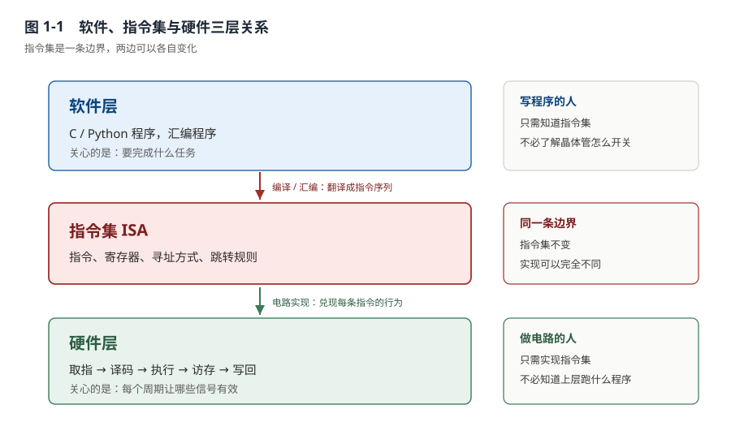
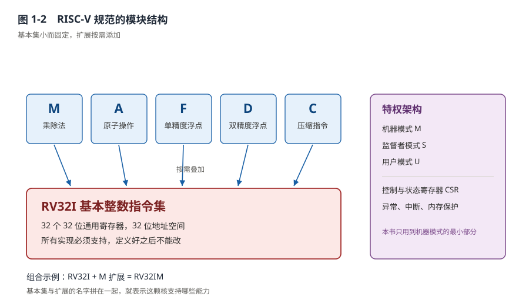
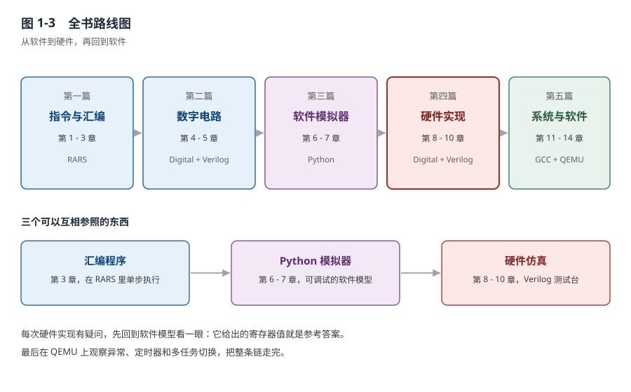

# 第 1 章　从哪里开始

> **本章导读**
> 这本书要带读者从一条汇编指令走到一台能跑程序的处理器。出发之前，先回答三个问题：计算机到底在执行什么，指令集处在系统的哪一层，RISC-V 又是什么。
>
> 这一章没有电路，也没有代码可写。但后面十多章都要用到的几个概念，会在这里先立住：存储程序、指令集是软硬件之间的契约、RV32I 是整套规范里最小的一块地基。
>
> 学完本章，你应该能够：
> 1. 说清软件、指令集、硬件三层各自负责什么；
> 2. 解释为什么同一个指令集可以有不同的硬件实现；
> 3. 说出 RV32I 与 M、A、F、D、C 这些扩展的关系；
> 4. 知道本书按什么顺序走，每章会用到哪组工具。

---

## 1.1　一台会算数的机器

先从一个很小的问题开始：一台机器要能"算东西"，最少需要什么？

想一下人是怎么算的。拿纸笔算一道加法，需要三样东西：写数字的地方、加减乘除的规则、以及"先算哪一步"的安排。机器也一样，要有保存数据的存储器、能改数据的运算部件、以及决定下一步做什么的控制部件。

早期计算机把"安排"做在了机器外面。要换一个算法，就得重新接线或者拨开关。后来出现了一个关键想法：把步骤也写成数据，和数据一起放进存储器。机器按顺序取出这些步骤，一步步执行。这就是存储程序计算机，也叫冯·诺依曼结构。

用厨房来打比方，程序是菜谱，数据是食材，处理器是厨师。菜谱和食材都放在同一个储物架上。厨师每次看一步菜谱，取相应的食材，做一步，再看下一步。想换一道菜，不必改建厨房，换一份菜谱就行。

这个想法今天看起来理所当然，在当年却是一次跨越。它把"做什么"从硬件里抽了出来，交给了软件。从那以后，同一台机器可以做完全不同的事，取决于是哪一份菜谱。

> 本书要设计的处理器，也遵循这个基本图景。取指令、译码、执行、访存、写回这五个步骤，就是厨师看菜谱、取食材、动手、放盘、记结果的过程。第 8 章会把它们画成真正的电路。

---

## 1.2　软件、指令集、硬件

存储程序的思想带来一个问题：软件写的"步骤"，硬件凭什么看得懂？中间需要一份双方都认的约定。这份约定就是指令集架构，简称 ISA（Instruction Set Architecture）。

它规定了很多事：有哪些指令，每条指令长什么样，有多少个寄存器，内存怎么寻址，跳转后到哪里去。软件按照这些规定生成指令序列，硬件按照这些规定让电路产生对应的动作。只要两边都守约，写软件的人不必知道晶体管怎么开关，做硬件的人也不必知道上层跑的是什么程序。



*图 1-1　指令集是软件与硬件之间的一条边界。往上写程序，往下做电路，两边通过这条边界对话。*

这条边界带来一个很有用的性质：**指令集不变，实现可以换**。同一份 RISC-V 程序，可以跑在手表里那颗很小的核上，也可以跑在服务器里那颗复杂的乱序核上，因为两者都认识同一套指令。区别只在于跑得多快、耗多少电、花多少钱。第 8 章到第 10 章会看到，本书自己搭的简单处理器和真实的高性能核，在指令这一层看到的东西是一样的。

### 走一个例子

看一段很短的 C 代码：

```c
int a = b + c;
```

编译器把它翻译成 RISC-V 汇编，大致是这样：

```asm
lw   t0, 0(sp)       # 把 b 从内存读到 t0
lw   t1, 4(sp)       # 把 c 从内存读到 t1
add  a0, t0, t1      # 两个数相加
sw   a0, 8(sp)       # 把结果写回内存
```

这里 `sp` 是栈指针，用它表示变量在内存里的位置；`t0`、`t1`、`a0` 是通用寄存器的名字。四行代码分别对应"读、读、算、写"四件事，硬件里也就需要四种动作：从内存取数、做加法、往内存存数，再加上按顺序取出下一条指令。

编译器负责把 C 变成这四行，硬件只需要认识 `lw`、`add`、`sw` 这些指令。分工就在这里划清了。本书从第 3 章开始写汇编，从第 4 章开始搭能执行这些指令的电路，中间第 6、7 章还会用 Python 写一个软件模型，把上面的过程完整地模拟一遍。

---

## 1.3　RISC-V 是什么

RISC-V 读作"risk five"，2010 年前后诞生于加州大学伯克利分校。它的名字里有两层意思：RISC 指精简指令集计算机，V 是罗马数字的 5，表示这是伯克利做的第五代 RISC 指令集。

它最突出的特点是开放。指令集规范由 RISC-V 国际基金会维护，公开发布，任何人都可以阅读、学习、实现，不需要交授权费，也不需要事先申请。开放不等于随意。基本指令集定义好之后不能改，各家公司可以自由添加扩展，但扩展之间要能共存。这样既保证了软件在不同实现之间可移植，也给创新留了空间。

与常见的 x86、Arm 相比，RISC-V 的指令数量少，格式规整。举个直观的例子：RV32I 的指令长度统一是 32 位，字段位置固定，译码器不必在几十种长度之间做判断。这对做硬件的人很友好，对刚开始学处理器的人更友好——不用先背下一本厚手册才能动手。

> 开放还有一个实际好处：想确认某条指令到底该怎么执行，直接去读规范原文就行。规范是公开的，疑问有出处，不必依赖二手资料。

---

## 1.4　为什么值得学

课堂上常有人问，学这个有什么用。这里给出四条比较实在的理由。

第一，规范公开。处理器设计里很多"为什么这样"的问题，答案就在规范里。能直接读到第一手材料，学习的确定性高得多。

第二，规模合适。RV32I 的常用指令只有几十条，实现一个能跑通简单程序的核，工作量控制在一个学期能够完成的范围内。它足够小，可以看清全貌；又足够完整，能串起编译、汇编、链接、异常、外设这些真实环节。

第三，工具齐备。汇编有 RARS，电路有 Digital，硬件仿真有 Icarus Verilog，C 程序有 RISC-V GCC 交叉编译器，系统演示有 QEMU。这些软件都能免费拿到，不需要硬件开发板也能做完本书的全部实验。

第四，用得上。RISC-V 已经出现在微控制器、存储控制器、AI 加速器等各种产品里。就算将来不从事相关工作，通过它把处理器这套道理学明白，迁移到别的架构也不难。

---

## 1.5　RV32I 在整套规范里的位置

RISC-V 采用模块化的组织方式。最底下是基本整数指令集，上面可以叠加若干扩展，再往上是特权架构。



*图 1-2　RV32I 是基础，扩展按需添加，特权架构规定机器模式等运行特权级。*

基本整数指令集按寄存器宽度分为 RV32I、RV64I 等。RV32I 有 32 个 32 位通用寄存器，地址也是 32 位，能寻址 4 GB 空间。RV64I 把寄存器和地址扩展到 64 位。所有实现都必须支持某个基本整数指令集，没有例外。

标准扩展用小字母表示，常见的有：

| 扩展 | 内容 |
| --- | --- |
| M | 整数乘法和除法 |
| A | 原子操作，用于多核同步 |
| F、D | 单精度和双精度浮点 |
| C | 压缩指令，把常用指令编成 16 位以节省代码空间 |

基本整数指令集加上若干扩展，通常写成一个名字，比如 RV32IM 表示支持乘除法的 RV32I。

特权架构是另一部分，规定机器模式、监督者模式、用户模式这些运行特权级，以及控制和状态寄存器（CSR）。异常处理、中断、内存保护都靠它。

本书的主体只做 RV32I 的用户态部分。第 11 章会引入机器模式下最小的一组 CSR，用来演示异常和中断；第 14 章在 QEMU 上再往前走一步，看看定时器中断和多任务切换。乘除法、浮点、原子操作这些扩展不实现，需要时会在正文里说明它们挂在哪里。这样做是为了让主线保持清楚：先把一条最简单、最完整的路走通，再谈旁路。

---

## 1.6　本书的路线

全书分五篇，顺序是从软件走向硬件，再回到软件。



*图 1-3　三个参照物贯穿全书：汇编程序、Python 模拟器、硬件仿真。后一步以前一步为对照。*

第一篇讲指令和汇编。先把 RV32I 看明白，再用 RARS 写几个小程序。这一篇结束时，读者手里有一串能单步执行的指令。

第二篇补数字电路基础。从真值表和门电路开始，搭出加法器、ALU、寄存器堆，并用 Verilog 描述同一批电路。这一篇结束时，读者知道"运算"在门电路层面是怎么回事。

第三篇用 Python 写 RV32I 模拟器。先做取指译码，再做执行访存，最后让它跑通第一篇写过的汇编程序。这个模拟器在全书里扮演参照物的角色：后面硬件仿真跑出来的寄存器值，可以和它一条条对。

第四篇做硬件。先做单周期处理器，把五段数据通路连起来；再插入流水级，得到五级流水线；最后处理冒险。这一篇是全书的核心。

第五篇把系统补齐。异常与中断让处理器能应对意外，外设让它能和外部世界打交道，C 语言和工具链让写程序变得实际。最后用一个综合实验把整条链串起来。

实验工具的分配也沿着这条路线走：汇编用 RARS，电路和硬件用 Digital 加 Icarus Verilog，C 程序用 RISC-V GCC，异常、定时器和多任务系统在 QEMU 里观察。安装步骤统一放在附录 C，正文里只在第一次用到时说明。

---

## 1.7　本章实验：先动手看一眼

现在可以做一个很小的实验。打开 RARS，新建汇编文件，输入两行：

```asm
addi t0, zero, 5
addi t1, t0, 3
```

单步执行两次，观察寄存器窗口：`t0` 变成 5，`t1` 变成 8。这就是一条指令改变处理器状态的全部过程。第 3 章会在这个基础上写出完整的程序。

如果暂时不想装软件，也可以先记住这四组工具的用途：

| 工具 | 用来做什么 | 首次出现 |
| --- | --- | --- |
| RARS | 写汇编、单步执行、看寄存器和内存 | 第 3 章 |
| Digital + Icarus Verilog | 搭电路、写 Verilog、跑波形和测试台 | 第 4 章 |
| RISC-V GCC | 把 C 编译成 ELF，反汇编，做程序镜像 | 第 6 章 |
| QEMU | 运行裸机程序，观察异常、中断和定时器 | 第 11 章 |

---

## 1.8　重点与权衡

本章没有复杂推导，有三点值得记住。

**指令集是边界。** 它把软件与硬件分开，让两边可以独立变化。学处理器设计，既要看边界上面软件希望硬件做什么，也要看边界下面电路怎么兑现承诺。

**模块化是 RISC-V 的组织原则。** 基本集小而固定，扩展按需添加。本书选择 RV32I 作为地基，是因为它刚好够支撑一条完整的学习路径。

**软件模型先于硬件实现。** Python 模拟器比 Verilog 更容易调试，先把它做出来，后面的硬件就有了一个可以随时对照的正确答案。这是本书安排顺序的主要理由。

---

## 1.9　本章小结

本章从存储程序讲起，说明程序和数据都放在存储器里，处理器按顺序取指执行。软件、指令集、硬件分成三层，指令集是中间的契约。RISC-V 是一套开放的指令集规范，RV32I 是其中最小的 32 位整数基础，其他能力通过扩展添加。本书先写汇编、再做软件模拟器、最后搭硬件，用 QEMU 补齐系统层面的观察手段。

## 思考题

1. 一台计算机为什么要把程序也放进存储器？如果程序固定在硬件连线里，会带来什么麻烦？
2. 用你熟悉的一门语言写一句赋值语句，然后试着说明它要经过哪些步骤才能变成硬件里的电信号。
3. 指令集不变而实现可以更换，这句话对软件开发者意味着什么？对硬件设计者又意味着什么？
4. RV32I 和 RV32IM 有什么区别？如果一个程序只用了加减法，在两种实现上跑出来的结果一样吗？
5. 特权架构为什么单独成为规范的一部分，而不直接放进基本整数指令集？
6. 本书为什么先写 Python 模拟器，再写 Verilog？如果跳过模拟器直接做硬件，可能会遇到什么困难？

---

*下一章：第 2 章　RV32I 指令集。从寄存器和指令格式开始，逐类讲清算术、访存与跳转指令。*
