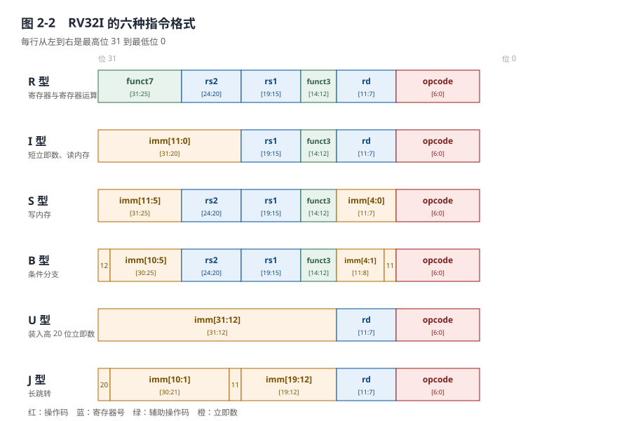

# 第 2 章　RV32I 指令集

> **本章导读**
> 上一章把指令集说成软件与硬件之间的契约。这一章就看这份契约写了什么。
>
> RV32I 是 RISC-V 最小的 32 位整数基础。它只有几十条指令，但它们已经足够支撑一个完整的程序：能算数、能比较、能读写内存、能跳转、能调用子程序。后面搭硬件时，数据通路要做的全部事情，就是兑现这一章讲的行为。
>
> 学完本章，你应该能够：
> 1. 说出 32 个通用寄存器的分工，知道 `x0` 为什么特殊；
> 2. 看懂六种指令格式，能从一条机器码里找出操作码、寄存器号和立即数；
> 3. 分清算术、访存、分支跳转三类指令各自改变什么状态；
> 4. 解释伪指令为什么不是真正的指令，以及它怎么变成真指令。

---

## 2.1　操作数放在哪里

一条指令要干活，先得知道去哪里拿数据。RV32I 提供了三种放数据的地方：寄存器、立即数和内存。

寄存器在处理器内部，数量少但访问最快。RV32I 有 32 个通用寄存器，宽度都是 32 位，名字从 `x0` 到 `x31`。其中 `x0` 是特殊的：它永远等于 0，写进去的值会被丢弃。这个看似奇怪的设计非常有用，比如想丢掉一个结果，就把目的寄存器写成 `x0`；想拿常数 0，直接读 `x0`，不必先装。

另外 31 个寄存器在汇编程序里通常用另一套名字，这套名字叫 ABI 名，体现的是用途而不是编号。写汇编时两种名字都能用，编译器生成的代码多用 ABI 名。


*图 2-1　32 个通用寄存器。`x0` 恒为零，`sp` 指向栈顶，`ra` 保存函数返回地址。*

几个常用的要记住：

| 编号 | ABI 名 | 用途 |
| --- | --- | --- |
| x0 | zero | 恒为 0 |
| x1 | ra | 函数返回地址 |
| x2 | sp | 栈指针 |
| x8 | s0 / fp | 保存寄存器，也常作帧指针 |
| x10、x11 | a0、a1 | 函数参数和返回值 |
| x5 - x7、x28 - x31 | t0 - t2、t3 - t6 | 临时寄存器，用完不用保留 |
| x9、x18 - x27 | s1、s2 - s11 | 保存寄存器，函数里用了要恢复 |

程序计数器 PC 不算通用寄存器，它有独立的存在，指向当前正在执行的指令。PC 也是 32 位。内存按字节寻址，一个地址对应一个字节，RV32I 的地址空间是 2^32 字节。

> 寄存器是手边的案板，内存是远处的仓库。案板地方小，拿取快；仓库容量大，跑一趟慢。指令设计时尽量把数据留在案板上，就是这个道理。

立即数是直接写在指令里的常数。因为指令只有 32 位，还要留出别的信息，立即数的长度有限，I 型是 12 位，U 型是 20 位。写程序时想装一个大的常数，往往要两条指令配合，第 2.3 节会讲。

---

## 2.2　指令的六种格式

RV32I 的指令长度固定为 32 位，并且必须放在 4 字节对齐的地址上。32 位要装下操作种类、源寄存器号、目的寄存器号，有时还要装立即数，怎么安排这些位，就是指令格式要解决的问题。

RV32I 有六种基本格式。



*图 2-2　六种格式的字段安排。注意 `opcode`、`rs1`、`funct3`、`rs2`、`rd` 在多数格式里位置相同。*

每个字段的含义如下。

- `opcode`（7 位）指出指令的大类，比如算术、访存、分支。
- `rd`（5 位）是目的寄存器号，结果写到这里。
- `rs1`、`rs2`（各 5 位）是两个源寄存器号。
- `funct3`、`funct7` 是辅助操作码，在大类里进一步区分具体做什么。
- `imm` 是立即数，在不同格式里位数和位置都不一样。

六种格式分别用在什么地方：

| 格式 | 典型用途 | 例子 |
| --- | --- | --- |
| R 型 | 两个寄存器之间的运算 | `add`、`sub`、`sll` |
| I 型 | 短立即数运算、读内存 | `addi`、`lw`、`jalr` |
| S 型 | 写内存 | `sw` |
| B 型 | 条件分支 | `beq`、`blt` |
| U 型 | 装入高 20 位立即数 | `lui`、`auipc` |
| J 型 | 长跳转 | `jal` |

这张表里有个值得留意的设计：`rs1` 总在 19 到 15 位，`funct3` 总在 14 到 12 位，`opcode` 总在最低 7 位。硬件译码时，不管来的是哪种指令，从同样的位置取同样的字段就行。这省掉了一大堆判断，第 8 章画译码电路时会直接受益。

还有两个边界情况：32 位全为 0 和全为 1 的指令都是非法的。另外，基本整数指令只占了 32 位编码空间里很小一部分，剩下的位置留给标准扩展和自定义指令。这也是 RISC-V 容易扩展的一个原因。

---

## 2.3　算术与逻辑指令

先看最直接的一类：两个寄存器相加。

```asm
add  t0, t1, t2      # t0 = t1 + t2
```

这是一条 R 型指令。`opcode` 表明它属于寄存器-寄存器运算，`funct3` 和 `funct7` 一起指出是加法，三个寄存器号分别给出结果放在哪、两个数从哪来。

减法只有 R 型版本：

```asm
sub  t0, t1, t2      # t0 = t1 - t2
```

没有 `subi` 这条指令。要减一个常数，用 `addi` 加一个负的立即数就行：

```asm
addi t0, t1, -5      # t0 = t1 + (-5)
```

算术运算按 32 位补码进行。加法溢出时不做特殊处理，结果按 32 位截断；需要判断溢出的程序得自己用比较指令检查。这个选择让硬件简单了不少，代价是把麻烦留给了软件。

带立即数的运算属于 I 型：

```asm
addi  t0, t1, 100     # 加
slti  t0, t1, 100     # 有符号小于则置 1
sltiu t0, t1, 100     # 无符号小于则置 1
andi  t0, t1, 0xff    # 按位与
ori   t0, t1, 0xff    # 按位或
xori  t0, t1, -1      # 按位异或，等价于取反
```

12 位立即数按补码解释，取出来后要符号扩展到 32 位再参与运算。比如 `0xfff` 表示 -1，而不是 4095。这一点在写汇编时容易弄错。

逻辑运算的 R 型版本是 `and`、`or`、`xor`。移位指令有两种版本：

```asm
sll  t0, t1, t2      # 逻辑左移，低位补 0
srl  t0, t1, t2      # 逻辑右移，高位补 0
sra  t0, t1, t2      # 算术右移，高位补符号位
slli t0, t1, 3       # 立即数移位
```

移位数只看低 5 位，所以最多移 31 位。`sra` 保留符号位，适合对有符号数做除法式的右移；`srl` 补 0，适合看成一个无符号的位串。

比较指令不产生真正的布尔类型，而是往寄存器里写 0 或 1：

```asm
slt  t0, t1, t2      # t1 < t2（有符号）时 t0 = 1
sltu t0, t1, t2      # t1 < t2（无符号）时 t0 = 1
```

RV32I 没有专门的等于、大于等于指令。要比较相等，可以用 `sub` 加 `sltu` 组合，或者直接用分支指令，第 2.5 节会讲。汇编器也提供了对应的伪指令，写起来更像人话。

### 装入大常数

I 型的立即数只有 12 位，装不下像 `0x12345678` 这样的数。U 型指令就是为这件事准备的：

```asm
lui  t0, 0x12345      # t0 = 0x12345 << 12 = 0x12345000
addi t0, t0, 0x678    # t0 = 0x12345678
```

`lui` 把 20 位立即数放到高 20 位，低 12 位清零；`addi` 再补上低 12 位。注意 `addi` 的立即数会符号扩展，如果低 12 位的最高位是 1，第二条指令要写成加上一个负数并给高位补 1。汇编器处理 `li` 伪指令时会替我们做这件事：

```asm
li   t0, 0x12345678   # 汇编器展开成 lui + addi
```

`auipc` 与 `lui` 很像，区别是它把立即数加到 PC 上，常用来实现位置无关代码。现在只需知道它的存在，第 13 章讲链接脚本时会用到。

---

## 2.4　访存指令

RV32I 采用 load-store 结构：算术指令只在寄存器之间算，读写内存必须走专门的访存指令。这样数据通路比较规整，硬件不必支持"一个操作数直接在内存里"的运算。

读内存用 load，写内存用 store：

```asm
lw   t0, 4(sp)        # 从 sp+4 读一个字（32 位）到 t0
lb   t0, 0(sp)        # 读一个字节，符号扩展到 32 位
lbu  t0, 0(sp)        # 读一个字节，零扩展到 32 位
lh   t0, 2(sp)        # 读一个半字，符号扩展
lhu  t0, 2(sp)        # 读一个半字，零扩展

sw   t0, 4(sp)        # 把 t0 的低 32 位写到 sp+4
sh   t0, 2(sp)        # 写低 16 位
sb   t0, 0(sp)        # 写低 8 位
```

有效地址一律是 `rs1` 的内容加上符号扩展后的 12 位偏移量。所以偏移量的范围是 -2048 到 2047，足够覆盖一个栈帧或者一个结构体的字段。

有符号和无符号的区别只在读取小于 32 位的数据时才出现。比如内存里存着一个字节 `0x80`，`lb` 读出来的结果是 `0xffffff80`，`lbu` 读出来是 `0x00000080`。前者把它当成 -128，后者当成 128。

RV32I 采用小端字节序。一个 32 位数 `0x12345678` 存到地址 0x1000，内存里从低地址到高地址依次是 `78 56 34 12`，最低有效字节放在最低地址。

指令集允许不对齐访问，但硬件实现起来更麻烦，可能要拆成几次内存操作。实际程序里，读字按 4 字节对齐、读半字按 2 字节对齐，是通常的做法。第 12 章给处理器接外设时，寄存器地址都按字对齐。

---

## 2.5　分支与跳转

程序要能改变执行顺序。RV32I 用两条路子：条件分支和有条件/无条件跳转。

### 条件分支

```asm
beq  t0, t1, label    # 相等则跳
bne  t0, t1, label    # 不等则跳
blt  t0, t1, label    # 有符号小于则跳
bge  t0, t1, label    # 有符号大于等于则跳
bltu t0, t1, label    # 无符号小于则跳
bgeu t0, t1, label    # 无符号大于等于则跳
```

这六条都是 B 型指令。目标地址的计算方式是：把编码后的 13 位偏移量（最低位固定为 0，所以总是偶数，实际存在指令里的是 12 位）符号扩展，加到当前 PC 上。因为指令地址必然是 4 的倍数，偏移量用 2 字节为单位就能覆盖足够远的地方。实际范围是相对 PC 的 -4096 到 +4094 字节。

跳转范围有限这件事，写汇编时会以报错的形式遇到：目标标号离得太远，汇编器说分支超出范围。解决的办法是先跳到一个近处的中转点，或者改用 `jal`。

### 无条件跳转

```asm
jal  ra, label        # 跳到 label，同时把 PC+4 写进 ra
jal  x0, label        # 只跳，不保存返回地址
```

`jal` 的全称是跳转并链接，这里的链接指的是它会把下一条指令的地址存进目的寄存器。存进 `ra` 时，函数末尾就能用一条指令返回：

```asm
jalr x0, ra, 0        # 跳到 ra 指向的地方，不写返回地址
```

`jalr` 的目标地址是 `rs1` 加 12 位符号扩展的偏移量，最低位强制清零。它支持任意远的目标，也支持运行时才知道地址的情况，比如函数指针。`jal` 用 J 型格式，偏移范围约 ±1 MB。

汇编器提供了几条常用的伪指令：

| 伪指令 | 展开成 | 含义 |
| --- | --- | --- |
| `j label` | `jal x0, label` | 无条件跳 |
| `call label` | `jal ra, label` | 函数调用 |
| `ret` | `jalr x0, ra, 0` | 函数返回 |

### 立即数为什么被打散

看机器码的时候会有一个奇怪的发现：B 型和 J 型的立即数位不是连着的，而是被拆成几段塞进不同位置。


*图 2-3　立即数在指令里的位置。B 型和 J 型把某些位固定放好，译码时不必搬动太多。*

这样做是为了硬件省事。如果立即数总是连续地放在一个地方，译码器就得为不同格式准备不同的提取和重排电路。RISC-V 的设计者让 `rs1`、`rs2`、`rd`、`funct3` 尽量待在固定位置，立即数的各位也按使用频率安排，结果是指令选择逻辑简单了一大截。代价是看机器码时得多算一步。

对写汇编的人，这件事完全透明；对做硬件的人，它能省下可观的面积。第 8 章设计立即数生成电路时，会照着这张图接线。

---

## 2.6　系统指令与 CSR

剩下几条指令不直接算数，而是和处理器本身的状态打交道。这里只做认识，第 11 章再展开。

`ecall` 用来向执行环境发出请求。在操作系统上跑时，它是系统调用；在 RARS 里跑时，它是 RARS 提供的服务调用。用法是先把服务号放进 `a7`，参数放进 `a0`、`a1`，然后执行 `ecall`：

```asm
li   a7, 1            # RARS 服务号 1：打印整数
li   a0, 42           # 参数
ecall                 # 输出 42
```

`ebreak` 是给调试器用的断点指令。`fence` 和 `fence.i` 是内存和指令流的屏障，在单核、顺序执行的简单系统里几乎用不到，但多核和设备交互时很重要。

CSR 是控制与状态寄存器的统称，有自己的编号空间，不属于那 32 个通用寄存器。读写它们的指令有六条，基本的是三条：

```asm
csrrw  rd, csr, rs1   # 读 CSR 到 rd，同时把 rs1 写进 CSR
csrrs  rd, csr, rs1   # 读 CSR 到 rd，并把 rs1 中为 1 的位对应的 CSR 位置 1
csrrc  rd, csr, rs1   # 读 CSR 到 rd，并把 rs1 中为 1 的位对应的 CSR 位清零
```

汇编器还提供了 `csrr`、`csrw`、`csrs`、`csrc` 这些更好记的伪指令。异常处理要读 `mcause`、写 `mepc`，靠的就是它们。第 11 章会用到。

---

## 2.7　伪指令

前面已经遇到过 `li`、`j`、`ret` 这些写法。它们不是 RV32I 真正的指令，而是汇编器提供的简写，叫做伪指令。汇编器会把每条伪指令翻译成一条或多条基本指令。

常见的伪指令有：

| 伪指令 | 展开 | 含义 |
| --- | --- | --- |
| `nop` | `addi x0, x0, 0` | 什么都不做 |
| `li rd, imm` | `addi` 或 `lui` + `addi` | 装入常数 |
| `mv rd, rs` | `addi rd, rs, 0` | 寄存器间搬数 |
| `not rd, rs` | `xori rd, rs, -1` | 按位取反 |
| `seqz rd, rs` | `sltiu rd, rs, 1` | 等于 0 则置 1 |
| `snez rd, rs` | `sltu rd, x0, rs` | 不等于 0 则置 1 |
| `ble rs1, rs2, label` | `bge rs2, rs1, label` | 小于等于则跳 |
| `bgt rs1, rs2, label` | `blt rs2, rs1, label` | 大于则跳 |

伪指令不改变指令集本身，只是让程序好写。判断一条写法是不是真指令，可以看 RARS 的反汇编结果：伪指令在那里面会变成展开后的基本指令。

> 这条边界值得留意：汇编器能做的事，不等于硬件要做的事。`nop` 看起来像一条"空指令"，其实是一条正规的 `addi`，只不过目的寄存器是 `x0`，写进去的结果被丢掉了。

---

## 2.8　数组求和的完整例子

把这一章的东西合起来看一段程序。它计算一个数组的和，结果放到 `a0`：

```asm
# a0 = 数组首地址，a1 = 元素个数
# 返回时 a0 = 元素之和
loop:
    beq     a1, zero, done    # 个数为 0，结束
    lw      t0, 0(a0)         # 读当前元素
    add     t1, t1, t0        # 累加到 t1
    addi    a0, a0, 4         # 地址后移一个字
    addi    a1, a1, -1        # 计数减一
    j       loop             # 回去继续
done:
    mv      a0, t1            # 结果放进 a0
    ret                      # 返回
```

逐条看它们属于哪种格式：

- `beq` 是 B 型，比较 `a1` 和 `x0`，相等就跳到 `done`。这里用 `x0` 代替常数 0，省了一条装常数的指令。
- `lw` 是 I 型，地址是 `a0 + 0`，读出的 32 位数放进 `t0`。
- `add` 是 R 型，三个寄存器分别是指令里的 `rd`、`rs1`、`rs2`。
- 两条 `addi` 是 I 型，立即数 4 和 -1 都在 12 位范围内。
- `j` 是伪指令，展开成 `jal x0, loop`，向后跳。
- `mv` 和 `ret` 也是伪指令。

把这段程序输进 RARS，单步执行几轮，观察 `a0`、`a1`、`t0`、`t1` 的变化。可以看到循环体每走一遍，地址加 4、计数减 1、累加值增加。这条观察路线在第 3 章还会重复，那时会加入栈和函数调用。

---

## 2.9　重点与权衡

**格式规整换来了简单的译码。** 六种格式里，操作码、三个寄存器号字段和 `funct3` 大多位置固定。硬件取字段时不必先看是哪种格式，这在简单处理器上能省下不少逻辑。

**立即数打散是主动的取舍。** B 型和 J 型的立即数位看起来乱，实际是为了让常用字段待在固定位置，减少译码时的选择电路。写汇编的人看不到这个代价，做硬件的人能拿到好处。

**load-store 结构让数据通路整齐。** 内存访问集中到 load 和 store 两条路上，运算部件只面对寄存器，控制逻辑因此简单。代价是访问内存前必须先把地址算进寄存器，指令数会多一些。

**溢出不处理、只有 `slt` 没有 `sgt`。** 这些选择都指向同一个方向：指令集尽量少做事，把方便留给汇编器和编译器，把简单留给硬件。

---

## 2.10　本章小结

- RV32I 有 32 个 32 位通用寄存器，`x0` 恒为零，其余有约定的 ABI 名。
- 指令固定 32 位，共六种格式；`opcode`、寄存器号、`funct3` 的位置基本一致，便于译码。
- 算术逻辑指令分 R 型和 I 型；大常数用 `lui` 加 `addi` 两步装入。
- 访存指令按字节寻址，采用小端字节序，读取短数据时区分符号扩展和零扩展。
- 分支用 B 型，跳转用 J 型，两者都用 PC 相对寻址，偏移按 2 字节为单位。
- `ecall`、`ebreak` 和 CSR 指令处理执行环境相关的事务，本书第 11 章展开。
- 伪指令由汇编器展开，不增加硬件负担。

## 思考题

1. `x0` 恒为零这个设计带来了哪些方便？如果去掉它，哪些指令会变得难写？
2. 把 `0x80000000` 装进一个寄存器，只用 `addi` 能不能做到？为什么？
3. `lw` 和 `lwu` 的区别是什么？RV32I 为什么没有 `lwu`？
4. 一条 `beq` 指令最多能向前或向后跳多远？如果目标超出范围，汇编器会怎么处理？
5. `jalr x0, ra, 0` 为什么能实现函数返回？把目的寄存器换成 `t0` 会怎样？
6. 在 RARS 里写出第 2.8 节的数组求和程序，用不同的数组内容跑几遍，记录每轮循环后 `a0`、`a1`、`t1` 的值。

---

*下一章：第 3 章　汇编语言编程。用 RARS 写完整的程序，处理栈、函数调用和调用约定。*
