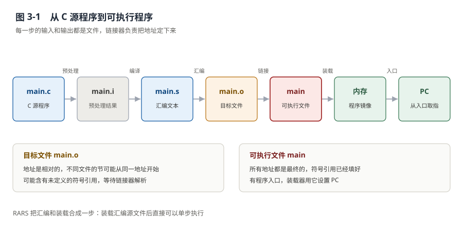
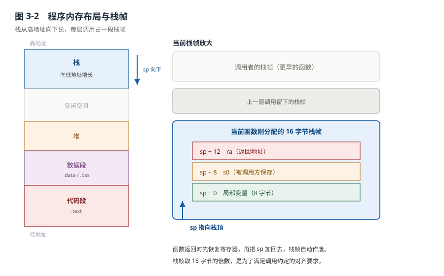
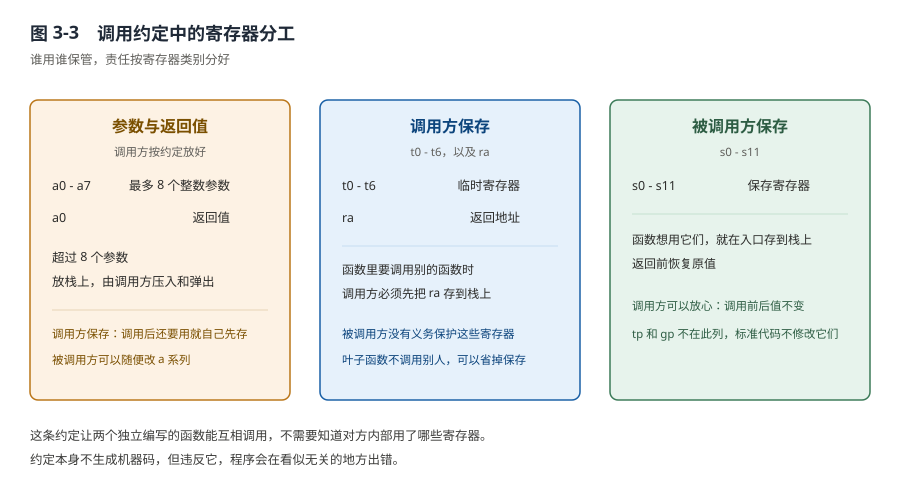

# 第 3 章　汇编语言编程

> **本章导读**
> 上一章认识了一条条指令。这一章把它们放进完整的程序里：数据放在哪，标号怎么引用，函数怎么调用，寄存器谁来保存。
>
> 本章的实验平台是 RARS。它能把汇编源程序装载进一块模拟的 RV32I 内存，单步执行，随时查看寄存器和内存。写完的程序不只在 RARS 里跑，后面第 6、7 章还会让它跑在我们自己写的 Python 模拟器里，第 8 章再让它跑在 Verilog 处理器上。
>
> 学完本章，你应该能够：
> 1. 看懂汇编源文件的四个组成部分，写出能运行的 RARS 程序；
> 2. 说清从 C 源程序到可执行文件的几个步骤，知道链接器做什么；
> 3. 用栈保存寄存器，按调用约定写出可被反复调用的函数；
> 4. 解释为什么调用别的函数前要保存 `ra`，为什么 `s` 系列寄存器要由被调用方保存。

---

## 3.1　一条汇编语句里有什么

汇编源文件是纯文本，一个程序由四种东西组成：注释、标号、汇编指令和汇编命令。先把它们认全，再看完整程序。

**注释**以 `#` 开头，一直到行尾。汇编器读到 `#` 就忽略后面的内容。注释不生成机器码，删掉也不影响程序。

**标号**是一个名字后面跟冒号，比如 `loop:`。它标记了程序里的一个位置，汇编器会把它换算成地址。分支和跳转指令用标号作目标，比手写地址方便得多。

**汇编指令**就是我们上一章学的那些指令，比如 `add`、`lw`、`beq`。它们会被汇编器翻译成真正的 32 位机器码。伪指令也算这一类，由汇编器展开成一条或多条基本指令。

**汇编命令**以点号开头，比如 `.text`、`.word`。它们不生成机器码，而是告诉汇编器怎么组织程序：数据放哪、留多少空间、符号是不是全局的。

立即数有几种写法：十进制直接写，十六进制以 `0x` 开头，二进制以 `0b` 开头，字符用单引号包起来：

```asm
addi t0, zero, 42        # 十进制
addi t0, zero, 0x2a      # 十六进制，同样是 42
addi t0, zero, 0b101010  # 二进制，还是 42
addi t0, zero, 'A'       # 字符，值是 65
```

### 先让程序跑起来

现在从零搭一个最小的程序。要让 RARS 里的程序正常结束，需要请求它的退出服务。服务通过 `ecall` 发出，服务号放在 `a7`：

```asm
.text
.globl main
main:
    li   a7, 10          # 服务号 10：退出程序
    ecall
```

逐行看它的来历。`.text` 告诉汇编器后面的内容属于代码段；`.globl main` 把 `main` 声明为全局符号，让装载器能找到程序入口；`main:` 是标号，标记第一条指令的位置。`li a7, 10` 是伪指令，汇编器会展开成 `addi a7, zero, 10`。最后 `ecall` 发出请求，RARS 根据 `a7` 里的 10 结束运行。

这个程序什么也没做，但它已经具备完整骨架。想让它说句话，先加一段数据：

```asm
.data
msg: .asciz "Hello, RISC-V!\n"

.text
.globl main
main:
    li   a7, 10
    ecall
```

`.data` 把后面的内容放进数据段。`msg:` 是标号，代表字符串所在地址。`.asciz` 汇编命令把字符串逐个字节写进内存，并自动在末尾补一个 0，这样程序才知道字符串到哪里结束。

数据有了，再补上打印：

```asm
.data
msg: .asciz "Hello, RISC-V!\n"

.text
.globl main
main:
    li   a7, 4           # 服务号 4：打印字符串
    la   a0, msg         # a0 放字符串首地址
    ecall

    li   a7, 10          # 服务号 10：退出
    ecall
```

新加的三行里，`la` 是伪指令，把标号 `msg` 代表的地址装进 `a0`；`ecall` 这次看到的是服务号 4，于是把 `a0` 指向的字符串打印出来。RARS 的系统调用都有这个套路：参数放进 `a0` 开始的寄存器，服务号放进 `a7`，然后 `ecall`。

把这个文件保存为 `hello.s`，在 RARS 里装载、汇编、运行，运行日志窗口会输出那行问候。

---

## 3.2　从源文件到可执行程序

刚才 RARS 一步就帮我们做完了汇编和装载。真实的工具链里，这一步其实分成好几段。



*图 3-1　预处理、编译、汇编、链接四步。链接器把各个目标文件拼起来，并确定最终地址。*

以一个简单的 C 程序为例：

```bash
riscv64-unknown-elf-gcc -mabi=ilp32 -march=rv32i -S main.c -o main.s
riscv64-unknown-elf-as -mabi=ilp32 -march=rv32i main.s -o main.o
riscv64-unknown-elf-ld -m elf32lriscv main.o -o main
```

第一步是编译，把 C 变成汇编文本 `-S`。第二步是汇编，把汇编文本变成目标文件 `main.o`。第三步是链接，把一个或多个目标文件合成可执行文件。C 语言还有预处理那一步，处理宏和头文件，通常由编译器自动带上。

目标文件和可执行文件都是 ELF 格式。它们有几个重要区别：

- 目标文件里的地址是相对的，不同文件的节可能从同一个地址开始；可执行文件里的地址是最终的。
- 目标文件里可能留下未定义的符号引用，比如调用了别的文件里的函数；链接器负责找到定义并填上地址。
- 目标文件没有程序入口，可执行文件有。处理器上电后从入口地址开始取指。

程序按节组织。常见的几个节是：`.text` 放指令，`.data` 放已经初始化的全局变量，`.rodata` 放只读数据，`.bss` 放未初始化的全局变量。链接时，同名的节会被合并到一起。

标号在汇编阶段变成符号，符号表记录每个符号对应的地址。汇编器把每条指令翻译成 4 个字节，第一个指令安排在地址 0，第二个在地址 4，依次类推。链接时这些地址可能整体挪动，凡是引用了标号的地方都要跟着改，这个过程叫重定位。链接器靠目标文件里的重定位表知道哪些位置需要修改。

> 编译器有时会用两条指令完成一次函数调用：先用 `auipc` 装入高位，再用 `jalr` 补上低位。如果链接后发现目标其实很近，一条 `jal` 就够了，链接器会把两条改成一条。这种优化叫链接器松弛，既省空间也省时间。第 13 章讲链接脚本时会再次遇到它。

RARS 把这些步骤压缩成一步：它读汇编源文本，自己完成汇编和装载，然后把程序放进一块从 0x10010000 附近开始的内存。地址分配规则和真实工具链略有不同，但指令的含义完全一样。第 13 章会补上完整的 GCC 流程。

---

## 3.3　数据在内存里的样子

写汇编时经常要自己安排数据。汇编器提供了几个常用的汇编命令：

| 汇编命令 | 作用 |
| --- | --- |
| `.byte` | 按字节放入数据 |
| `.half` | 按半字放入数据 |
| `.word` | 按字放入数据 |
| `.ascii` | 放入字符串，不自动补结尾 0 |
| `.asciz` | 放入字符串，自动补结尾 0 |
| `.space n` | 留出 n 个字节，`0` 初始化 |
| `.align n` | 把地址对齐到 2 的 n 次方倍 |

看一个例子：

```asm
.data
array:  .word 3, 5, 7, 9        # 4 个整数，占 16 字节
msg:    .asciz "sum="           # 4 个字符加一个结尾 0
buf:    .space 64               # 留 64 字节缓冲区
```

`array` 这个标号对应第一个字的地址。第二个字在 `array+4`，第三个在 `array+8`。这和第 2 章讲的一致：字是 4 字节，字节寻址，小端存放。字符串里的字符按 ASCII 码逐个字节存放，`sum=` 四个字符加上结尾的 0，一共 5 个字节。

数组和字符串在内存里没有自带长度信息。程序要么把长度写在旁边，要么约定用某个特殊值标记结尾。C 语言字符串用 0 结尾，上一节的 `.asciz` 就是为这个约定准备的。

对齐也值得留意。RV32I 允许从非对齐地址读写，但可能需要多次内存访问。汇编器不会替我们检查地址是不是 4 的倍数，把 8 位数据放在字前面又不加 `.align`，后面的字就可能落在非对齐地址上。写 `.word` 之前加一句 `.align 2`，是个省事习惯。

---

## 3.4　数组求和程序

把上一章那个数组求和例子搬进 RARS，写成能运行的完整程序。这次不一次贴出，按解决的先后顺序一段段加。

先安排数据。数组、元素个数和结果都放在数据段：

```asm
.data
array:  .word 3, 5, 7, 9, 11
n:      .word 5
result: .word 0
```

接下来需要一段循环，把 `n` 减到 0 为止。循环体先空着，只验证计数对不对：

```asm
.text
.globl main
main:
    la   t0, array        # t0 指向当前元素
    lw   t1, n            # t1 是剩余个数
loop:
    beq  t1, zero, done   # 数完了就退出循环
    # 这里马上要填处理当前元素的代码
    addi t1, t1, -1       # 剩余个数减一
    j    loop
done:
```

现在填循环体。每一步要读当前元素、累加、把地址往后移一个字：

```asm
loop:
    beq  t1, zero, done
    lw   t3, 0(t0)        # 读当前元素
    add  t2, t2, t3       # t2 累加
    addi t0, t0, 4        # 地址移到下一个字
    addi t1, t1, -1
    j    loop
```

别忘了在循环开始前把 `t2` 清零，否则累加的起点是随机值：

```asm
    li   t2, 0            # t2 是累加和
loop:
```

循环结束后把结果存回 `result`，再调用 RARS 的打印整数服务，最后退出：

```asm
done:
    la   t4, result
    sw   t2, 0(t4)        # 保存结果

    li   a7, 1            # 服务号 1：打印整数
    mv   a0, t2           # 参数放 a0
    ecall

    li   a7, 10           # 退出
    ecall
```

合起来就是完整程序：

```asm
.data
array:  .word 3, 5, 7, 9, 11
n:      .word 5
result: .word 0

.text
.globl main
main:
    la   t0, array        # t0 指向当前元素
    lw   t1, n            # t1 是剩余个数
    li   t2, 0            # t2 是累加和
loop:
    beq  t1, zero, done   # 数完了就退出循环
    lw   t3, 0(t0)        # 读当前元素
    add  t2, t2, t3       # 累加
    addi t0, t0, 4        # 地址移到下一个字
    addi t1, t1, -1       # 剩余个数减一
    j    loop
done:
    la   t4, result
    sw   t2, 0(t4)        # 保存结果

    li   a7, 1            # 服务号 1：打印整数
    mv   a0, t2
    ecall

    li   a7, 10           # 退出
    ecall
```

这里没有用函数调用，所有变量都放在临时寄存器里。下一节加入栈和函数之后，程序的结构会更接近真实的 C 编译结果。

在 RARS 里单步执行这个程序，重点观察三件事：`t0` 每次加 4，`t1` 每次减 1，`t2` 逐步变成 3、8、15、24、35。循环类程序出错时，这三行观察通常能很快定位问题。

---

## 3.5　栈与函数调用

函数调用要解决几个问题：参数怎么传，返回值放哪，执行完怎么回来，寄存器的旧值谁来保管。这些问题的答案合起来就是调用约定。

### 程序内存布局

先看清栈在整个程序里的位置。



*图 3-2　代码在低地址，栈在高地址并向下增长。每次函数调用在当前栈上分配一段栈帧。*

代码段放在低地址，接着是数据段和堆，栈放在高地址，向低地址增长。栈指针 `sp` 指向当前栈顶。调用一个函数时，栈往下扩一块，放这个函数的返回地址、参数和局部变量；函数返回时，栈收回来。函数嵌套调用，栈帧就一层层摞上去，最后调用的那一层在最上面，也最先被释放。这正是后进先出的顺序。

### 压栈和出栈

先做一个最简单的动作：把 `a0` 存到栈上，再取回来。

```asm
addi sp, sp, -4       # 先往下挪 4 字节，腾出位置
sw   a0, 0(sp)        # 再把 a0 写进去

lw   a0, 0(sp)        # 取回来
addi sp, sp, 4        # 释放这 4 字节
```

注意顺序：入栈时先减 `sp` 再写，出栈时先读再加回 `sp`。一次保存多个寄存器时，可以只调整一次 `sp`，然后用不同的偏移访问：

```asm
addi sp, sp, -16
sw   ra, 12(sp)
sw   s0, 8(sp)
sw   s1, 4(sp)
sw   s2, 0(sp)
# ... 中间随便用这些寄存器 ...
lw   s2, 0(sp)
lw   s1, 4(sp)
lw   s0, 8(sp)
lw   ra, 12(sp)
addi sp, sp, 16
```

RISC-V 的调用约定要求栈指针在函数入口按 16 字节对齐，所以栈帧大小取 16 的倍数比较省事。

### 调用一个函数

调用用 `jal ra, label`。这条指令跳到函数入口，同时把下一条指令的地址写进 `ra`。函数末尾用 `ret`，它跳到 `ra` 指向的地方。

参数放哪里？RISC-V 的 32 位整数调用约定规定：前 8 个整数参数放在 `a0` 到 `a7`，返回值放在 `a0`。参数超过 8 个时，剩下的放栈上，由调用方负责压入和弹出。本书的程序参数都不多，只用寄存器。

寄存器还有保存责任的分工：



*图 3-3　`a` 系列传参数和返回值，`t` 系列由调用方保存，`s` 系列由被调用方保存。*

- `t0` 到 `t6` 以及 `a0` 到 `a7` 是调用方保存的。被调用方可以随便改；调用方如果调用之后还要用旧值，得自己先存起来。
- `s0` 到 `s11` 是被调用方保存的。函数里想用它们，必须先在入口存到栈上，返回前恢复。调用方因此可以放心地认为，调用前后 `s` 系列的值不变。
- `ra` 特殊。每次调用都会覆盖它，所以一个函数只要自己也调用别的函数，就得在一进入时把 `ra` 存到栈上。

这套约定看似繁琐，实际是一条很朴素的原则：谁用谁保管，但保管责任按寄存器类别分好，免得调用双方互相猜。

### 一个递归函数

递归函数是观察调用约定最好的例子。考虑求 1 到 n 的和，`sum(0) = 0`，`sum(n) = n + sum(n-1)`。

先写一个不考虑保存的版本：

```asm
sum:
    beq  a0, zero, base
    addi a0, a0, -1
    jal  ra, sum         # 递归调用
    add  a0, a0, ???     # 问题来了：原来的 n 去哪了？
base:
    li   a0, 0
    ret
```

这段代码故意留着问号，无法汇编，用它来暴露两个问题。第一，`a0` 传进去的 n 在调用前被改成了 n-1，递归返回后已经拿不到原来的 n。第二，`jal` 把返回地址写进 `ra`，第二次调用会覆盖第一次的返回地址，函数就回不到原来的调用点了。

解决办法是用 `s0` 保存 n，并且按被调用方保存的规矩先把它存到栈上，同时把 `ra` 也存起来：

```asm
# sum(n)：计算 1+2+...+n，n 由 a0 传入，结果由 a0 返回
sum:
    addi sp, sp, -16     # 分配 16 字节栈帧
    sw   ra, 12(sp)      # 保存返回地址
    sw   s0, 8(sp)       # 保存 s0 的旧值
    mv   s0, a0          # s0 记住这一层的 n

    bne  s0, zero, recur
    li   a0, 0           # n 为 0，结果是 0
    j    done
recur:
    addi a0, s0, -1      # 参数变成 n-1
    jal  ra, sum         # 递归
    add  a0, a0, s0      # 返回值加上这一层的 n
done:
    lw   ra, 12(sp)      # 恢复返回地址
    lw   s0, 8(sp)       # 恢复 s0
    addi sp, sp, 16      # 释放栈帧
    ret
```

现在每个问题都有对应的代码：`s0` 记住 n，`ra` 在入口保存、出口恢复，`sp` 一次减 16 满足对齐要求。递归调用三层时，栈上就有三份 `s0` 和三份 `ra`，互不干扰，就像三份写着不同数字的便签摞在一起。

调用它很简单：

```asm
    li   a0, 5
    jal  ra, sum         # 返回时 a0 = 15
```

在 RARS 里用 n=5 单步跑一遍，观察每次递归时 `sp` 的变化和栈上 `s0` 的值，调用约定就不再是纸上的条文了。

---

## 3.6　RARS 的操作与系统调用

RARS 的用法可以归纳成四步：装载源文件、汇编、单步或连续运行、观察结果。

常用窗口有三个。`Text` 窗口显示汇编后的指令和对应机器码，`Registers` 窗口显示 32 个通用寄存器和 PC，`Memory` 窗口按地址显示数据。单步执行时，刚执行过的那条指令会被高亮，寄存器里变化的字段也会变色，这对调试循环特别有用。

断点也很实用。在 `Text` 窗口点某条指令的行号设置断点，连续运行到那里会自动停下。想看循环第 10 次的中间状态，设断点比单步点十几次省事。

常用的系统调用如下：

| 服务号 | 功能 | 参数与返回值 |
| --- | --- | --- |
| 1 | 打印整数 | `a0` 是待打印的整数 |
| 4 | 打印字符串 | `a0` 是字符串首地址 |
| 5 | 读入整数 | 结果返回在 `a0` |
| 8 | 读入字符串 | `a0` 是缓冲区地址，`a1` 是最多读几个字节 |
| 10 | 退出程序 | 无 |

调用方式都一样：参数放进 `a0` 开始的寄存器，服务号放进 `a7`，执行 `ecall`。第 11 章讲异常时会看到，`ecall` 在真实系统里触发的是一次环境调用异常，由操作系统或运行环境接管；RARS 只是把这个过程简化成了直接调用服务例程。

---

## 3.7　重点与权衡

**汇编命令和汇编指令是两回事。** 前者给汇编器下命令，不生成机器码；后者才会变成指令。初学时混淆两者，容易写出汇编器看不懂的语句。

**链接决定最终地址。** 汇编器只知道每个文件内部的相对位置，链接器才把各文件拼起来、分配真实地址、解析跨文件的符号。RARS 隐藏了这一步，第 13 章会补上。

**栈帧是函数调用的账本。** `sp` 一次调整到位，偏移访问各项内容，比每次单独压栈弹栈更整齐。16 字节对齐是约定，不是硬件要求，但遵守它能少很多麻烦。

**寄存器保存责任是约定。** `t` 系列由调用方保管，`s` 系列由被调用方保管，`ra` 谁调用谁负责。约定本身不产生机器码，但没有它，两个独立编写的函数没法互相调用。

---

## 3.8　本章小结

- 汇编源文件由注释、标号、汇编指令和汇编命令组成；立即数有十进制、十六进制、二进制和字符几种写法。
- 从 C 到可执行文件依次经过预处理、编译、汇编、链接；目标文件里的地址是相对的，链接后才有最终地址。
- 数据段里可以用 `.word`、`.asciz`、`.space` 安排数组、字符串和缓冲区，注意字节顺序和对齐。
- 栈从高地址向低地址增长，`sp` 指向栈顶；入栈先减 `sp`，出栈后加回。
- RISC-V 调用约定规定参数放 `a0` 到 `a7`、返回值放 `a0`，`t` 系列由调用方保存，`s` 系列由被调用方保存。
- 调用其他函数的函数必须在入口保存 `ra`，返回前恢复。

## 思考题

1. 在 `.data` 里放一个字节、一个字、一个字符串，画出它们在内存里的排列，标出每个标号代表的地址。
2. 链接器为什么要做重定位？如果两个目标文件都把变量放在地址 0，会出现什么问题？
3. 把第 3.4 节数组求和程序的 `array` 长度改成 6，需要改几处？如果忘了改 `n`，程序会怎样？
4. 一个函数想用 `t0` 做临时变量，它需要在入口保存 `t0` 吗？如果换成 `s0` 呢？
5. 第 3.5 节的递归函数为什么栈帧大小取 16 字节？只保存 `ra` 和 `s0` 其实用不了这么多，这样安排有什么好处？
6. 在 RARS 里运行 `sum(5)`，记录每一层递归时 `sp`、`s0`、`ra` 的值，画出调用结束前栈上的内容。

---

*下一章：第 4 章　数字电路基础。从门电路和布尔代数开始，用 Digital 搭出第一批能真正运行的电路。*
