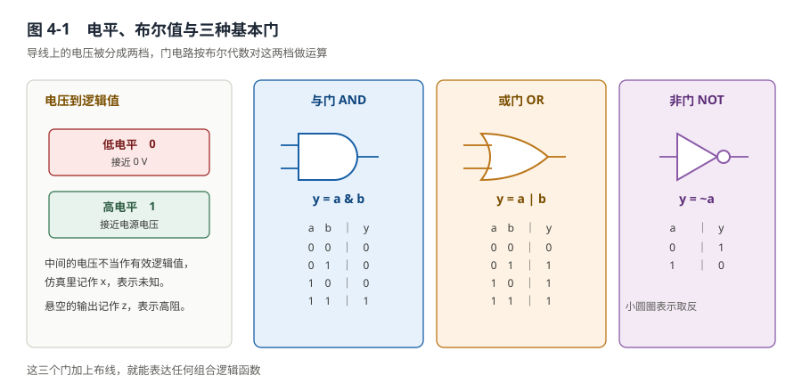
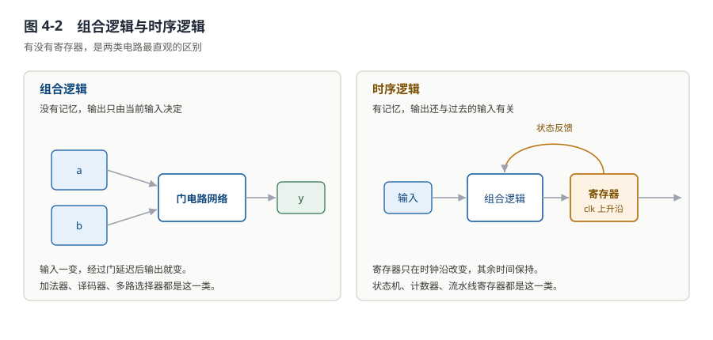
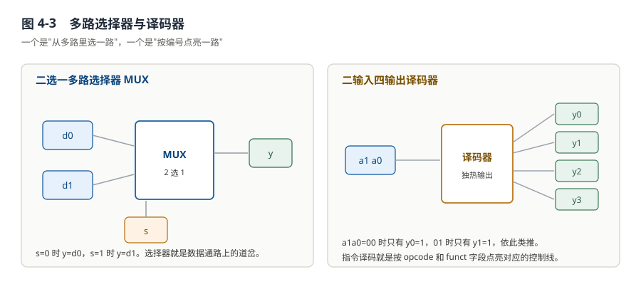
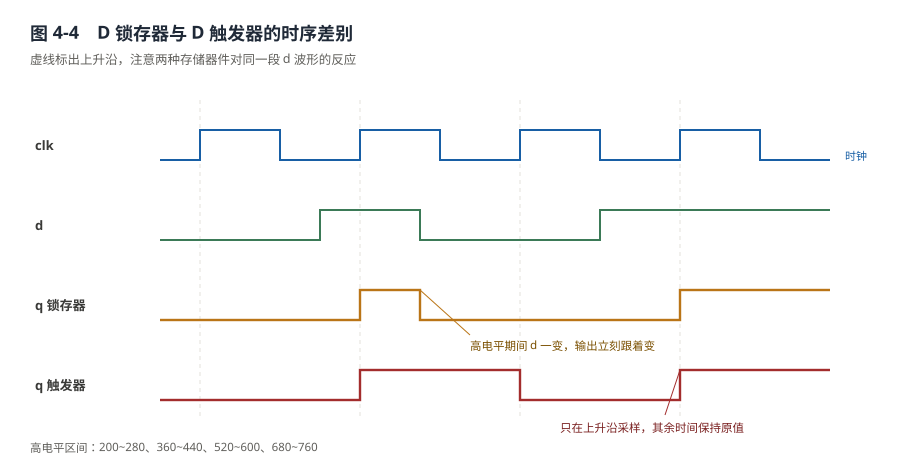
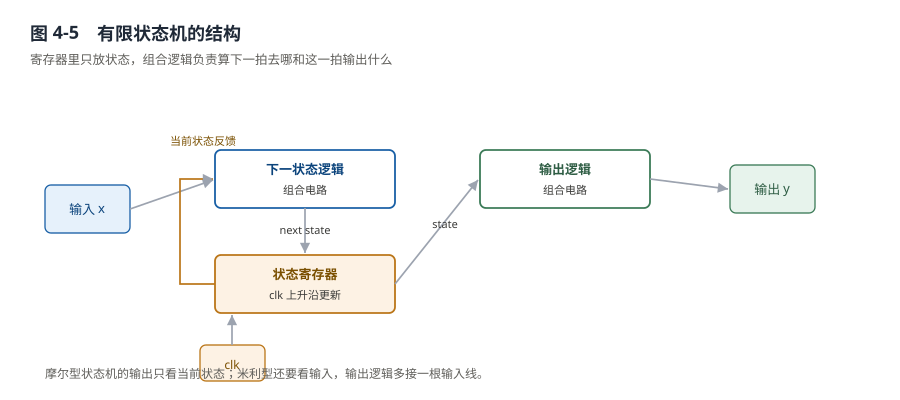
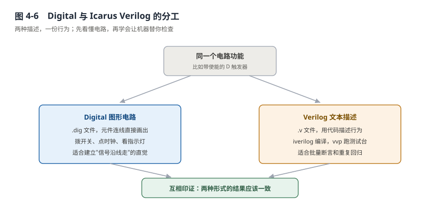

# 第 4 章　数字电路基础

> **本章导读**
> 前三章都在软件一侧。从这一章开始，我们换到硬件一侧，看看一根导线上传的到底是什么，门电路怎么算逻辑，寄存器怎么记住上一拍的值。
>
> 这一章不要求你先学过电路。我们从一个开关说起，一路走到有限状态机。中间只用两种工具：Digital 用来画电路、拨开关、看波形；Icarus Verilog 用来跑测试台，让机器替我们检查几十种输入组合。两者描述的是同一个行为，不是两套东西。
>
> 本章的实验文件在 `code/digital/` 和 `code/verilog/04_digital/`。素材来自课件 3-2《数字逻辑基础》。
>
> 学完本章，你应该能够：
> 1. 说清电平与布尔值的关系，知道与、或、非三种门的真值表；
> 2. 区分组合逻辑与时序逻辑，解释为什么处理器离不开寄存器；
> 3. 看懂多路选择器、译码器、D 触发器和有限状态机的结构；
> 4. 用 Digital 搭一个带使能的触发器，用 Verilog 写出它并跑通测试台。

---

## 4.1　从一个开关说起

先看一个很朴素的事实：开关只有通和断两种状态。把它接到电路里，导线上就出现两种电压，低电压和高电压。我们给它们起个名字，叫 0 和 1。

这一步看似简单，却是整台计算机的地基。电压本来是连续变化的，硬把它分成两档，好处是抗干扰：只要噪声没有大到把低电平抬成高电平，信息就不会丢。风扇转起来、电机启动导致电源波动时，数字电路还能正常工作，靠的就是这个划分。

**布尔代数**是描述这两档值的数学。1854 年，布尔在《思维规律的研究》里用 0 和 1 表示命题的真假，给出了与、或、非三种运算。1937 年，香农在硕士论文里指出，继电器电路恰好可以实现布尔代数：触点闭合相当于 1，断开相当于 0。从那以后，电路设计从手艺变成了可以演算的工程。课件第 3 章讲到这段历史时，把它称作"把数字电路设计从一门艺术变成一门科学"，这个评价并不过分。



*图 4-1　高低电平对应布尔值 0 和 1。与、或、非三种门的输出由真值表完全决定。*

三种基本运算的记号在全书通用：

- 与：`a & b`，两个都为 1 时输出 1；
- 或：`a | b`，只要有一个为 1 就输出 1；
- 非：`~a`，把 0 变 1，把 1 变 0。

在 Verilog 里，`&`、`|`、`~` 就是按位运算符号。写 `assign y = a & b;`，意思是"用一根导线把 a 和 b 接进一个与门，输出接到 y"。这句话既是描述，也是电路本身。

仿真时还会遇到另外两个值。`x` 表示未知，通常是因为信号没初始化，或者两个驱动源打架；`z` 表示高阻，也就是这根线没人驱动，处于悬空状态。处理器复位之前，寄存器里全是 `x`。后面写测试台时，第一条检查往往就是"复位之后输出不再是 x"。

### 晶体管为什么能做门

现在常用的工艺是 CMOS。场效应管可以看成由电压控制的水龙头：栅极加电压，源极和漏极之间就导通。nMOS 擅长把节点拉到低电平，pMOS 擅长把节点拉到高电平。把一个 pMOS 放在上面接电源、一个 nMOS 放在下面接地，栅极接同一个输入，就得到一个反相器：输入为 0 时上面的管子导通，输出被拉到 1；输入为 1 时下面的管子导通，输出被拉到 0。

与门、或门不过是在这个结构上多串几个、多并几个管子。课程课件第 10 到 19 页画了这些晶体管电路，这里不逐个展开。写处理器时我们几乎不会自己去画晶体管，但知道门电路是由开关搭出来的，有助于理解两件事：为什么信号传播需要时间，为什么输入不变时电路不耗多少电。

## 4.2　布尔代数里够用的部分

布尔代数和普通代数有几条相似的定律，也有几条很不一样的。我们只挑搭电路时用得上的。

| 名称 | 与形式 | 或形式 |
| --- | --- | --- |
| 恒等 | `A & 1 = A` | `A | 1 = 1` |
| 零一律 | `A & 0 = 0` | `A | 0 = A` |
| 幂等 | `A & A = A` | `A | A = A` |
| 互补 | `A & ~A = 0` | `A | ~A = 1` |
| 德摩根 | `~(A & B) = ~A | ~B` | `~(A | B) = ~A & ~B` |

德摩根定理最常用。它说"与"取反等于"分别取反再或"，把小圆圈从门的输出端挪到输入端，同时把门换成对偶的形式。Digital 里画电路时，如果手头只有与非门，靠这条定律也能搭出或门。

来看一个小例子。假设某控制电路的输出是

```
y = ~(A & B) + ~(A + B)
```

把两项分别用德摩根展开：

```
~(A & B) = ~A + ~B
~(A + B) = ~A & ~B
```

代回去：

```
y = (~A + ~B) + (~A & ~B)
  = ~A + ~B
```

最后一步用了吸收律：`X + X&Y = X`。原本需要两个与非门、一个或非门、一个或门的表达式，化简后只剩两个非门和一个或门。化简在纸上花几分钟，省下来的是实打实的门数和连线。

真值表是另一种思路。列出所有输入组合和对应输出，再把输出为 1 的每一行写成一个"与"项，全部加起来，就得到积之和（SOP）形式。这种方法不需要灵感，适合交给机器做，也是综合工具的工作方式。第 5 章从真值表搭半加器和全加器时，会完整走一遍这条路。

## 4.3　组合逻辑和时序逻辑

数字电路分两大类，区分标准是"有没有记忆"。

**组合逻辑**没有记忆。任意时刻的输出只由这一时刻的输入决定，输入一变，经过一段延迟，输出就跟着变。加法器、多路选择器、译码器都是组合逻辑。它的电路里没有回路，每个部件要么是输入，要么只接在某个输出上。

**时序逻辑**有记忆。输出不仅看当前输入，还要看过去发生过什么。寄存器保存的这些内容叫状态，状态在时钟沿改变。处理器里的 PC、通用寄存器堆、流水线寄存器都属于这一类。



*图 4-2　组合逻辑没有状态，时序逻辑用寄存器保存状态，并把状态反馈回组合逻辑。*

信号通过门电路不是瞬间完成的。输入变化到输出稳定之间的时间叫传播延时，一条路径上各段延时加起来最长的那条叫关键路径。它决定电路最快能跑多高频率：时钟周期必须比关键路径的延时更长，否则下一个沿到来时，上一个沿发出的信号还没走完。

还有个现象叫毛刺。同一个输入变化经过两条长短不同的路径，到达某个门的时间有先有后，输出可能短暂地跳一下再回到正确值。组合逻辑内部的毛刺在所难免，同步电路的做法是在稳定之后再用时钟沿采样，把毛刺挡在寄存器外面。这也是处理器坚持用统一时钟的原因之一。

组合逻辑如何接线，也有几条朴素规矩：输入放左边，输出放右边，门按从左到右摆放，连线尽量走直线。交叉处是否连通要画清楚。课件第 27 页专门讲了这一点，画图时养成习惯，后面看几十个模块的电路图会省很多力气。

## 4.4　多路选择器和译码器

门电路再往上搭一层，就得到两个常用部件。

**多路选择器**（MUX）像铁路道岔。二选一的 MUX 有两个数据输入 `d0`、`d1`，一个选择信号 `s`，一个输出 `y`。`s=0` 时 `y=d0`，`s=1` 时 `y=d1`。写成表达式是

```
y = ~s & d0 | s & d1
```

四选一可以用三个二选一搭成两层，也可以直接按表达式画。处理器里到处都是 MUX：ALU 的结果和访存的数据要选一个写回寄存器，分支目标和顺序 PC 要选一个送进取指，异常入口和正常 PC 也要选一个。第 8 章画单周期数据通路时，这些 MUX 会一个个冒出来。

**译码器**（Decoder）做的事情相反。它有 n 个输入，2^n 个输出，输入编码等于几，对应的那根输出线就为 1，其余全为 0，这叫独热码。二输入四输出译码器的对应关系是：`a1a0=00` 点亮 `y0`，`01` 点亮 `y1`，`10` 点亮 `y2`，`11` 点亮 `y3`。



*图 4-3　MUX 从多路输入中选一路，译码器按输入编号点亮一根输出线。*

指令译码器本质上就是一个译码器加一些组合逻辑。第 2 章讲过，RISC-V 把 opcode、寄存器号和 funct 字段放在固定位置，译码器不必先判断指令属于哪种格式，直接从固定位置取字段、点亮对应的控制线就行。这个设计让译码电路简单了不少，也是指令格式刻意安排的结果。

## 4.5　锁存器和 D 触发器

组合逻辑留不住信息。要记住一位，得用能形成反馈的电路。

最基础的是**双稳态电路**：两个反相器首尾相接，输出 Q 和它的反相 Q'互相维持。没有输入时，它安稳地待在 0 或 1 中的某一侧，这就是一位状态。加上两个控制端就变成 SR 锁存器：S 有效置 1，R 有效清 0，两者都无效时保持，两者同时有效是非法情况。

SR 锁存器的非法态用起来别扭，于是有了 **D 锁存器**。它只有一个数据输入 D 和一个时钟输入 CLK。CLK 为高时，输出 Q 跟着 D 变，称为透明；CLK 为低时，Q 保持原值。问题也出在"透明"上：高电平期间 D 变几次，Q 就跟着变几次。如果 D 恰好在时钟快变低时抖动，保存下来的值就不好说了。

处理器用的是 **D 触发器**。它只在时钟从 0 跳到 1 的那一瞬间采样 D，其余时间 Q 保持不变。上升沿之前 D 必须已经稳定一段时间（建立时间），上升沿之后还要再稳定一小会儿（保持时间）。把这两条守住，触发器就能可靠地存住一位。



*图 4-4　同一段波形下，锁存器在高电平期间跟随输入，触发器只在上升沿采样。*

图 4-4 里，d 在第一个高电平区间没变，在第二个区间中途从 1 变成 0。锁存器的 q 立刻跟着掉下去，触发器的 q 却一直保持到下一个上升沿。处理器选后者，是因为"只在沿上改变"这件事可以预测：所有寄存器同时更新，中间的组合逻辑有整整一个周期去算下一拍的值。

触发器还有两个常见变体。**带使能的触发器**多一个 en 信号：`en=1` 时这个沿接受新数据，`en=0` 时原地不动。流水线的停顿就靠它实现。**带复位的触发器**多一个复位端：复位有效时清成 0。复位信号只在时钟沿起作用的叫同步复位，不受时钟控制的叫异步复位。本书的骨架代码统一用低电平有效的同步复位，写成 `rst_n`，行为整齐，仿真也容易预测。

## 4.6　有限状态机

把一组触发器和一些组合逻辑接起来，让下一拍的状态由当前状态和输入共同决定，就得到一个有限状态机（FSM）。典型结构如图 4-5。



*图 4-5　状态寄存器保存当前状态，下一状态逻辑和输出逻辑都是组合电路。*

状态机有三件东西：存当前状态的状态寄存器，算下一拍去哪的下一状态逻辑，以及产生对外输出的输出逻辑。时钟沿到来时，下一状态被装进状态寄存器，成为新的当前状态。

如果输出只看当前状态，叫摩尔型；如果输出还看输入，叫米利型。举个最简单的例子：检测输入里是否连续出现两个 1。用两个状态就够了，S0 表示"还没看到连续的 1"，S1 表示"刚看到一个 1"。在 S0 看到 1 就转到 S1，看到 0 留在 S0；在 S1 再看到 1 就转到 S0 并输出 1，看到 0 也回 S0。摩尔型会把输出接到状态线上，米利型则直接用当前状态和输入算输出，少一个状态的延迟。

处理器控制部件大多按这个路子写。第 8 章的单周期处理器其实可以看成只有一个状态的特殊情形，每条指令拍都从头算一遍控制信号。第 9 章给流水线加停顿和冲刷时，就会用到真正的多状态控制逻辑。

另一种常见的同步时序电路是流水线：寄存器串在组合逻辑之间，各级同时干活。第 9 章专门讲它。

## 4.7　Digital 和 Icarus Verilog 怎么分工

这一章开始，每章都会同时出现图形电路和 Verilog 代码。它们不是两种硬件，而是同一行为的两种描述。



*图 4-6　Digital 用图形电路建立直觉，Verilog 用文本描述做批量验证，两边结果应当一致。*

Digital 是开源的电路绘制与仿真软件，解压就能用；如果提示缺少 Java 运行环境，装 Java 8 或更高版本。它能直接摆出与门、MUX、D 触发器这些元件，拨动输入开关就看到输出指示灯变化，非常适合回答"这根线到底什么时候变"这类问题。

Icarus Verilog 是命令行仿真器，Windows 版建议装在 `C:\iverilog`。要在 Digital 里调用外部 `.v` 文件，需要在"编辑 - 高级设置"里指定 `iverilog.exe` 的路径，然后重启 Digital。不过本书更常用的是命令行方式：写测试台，一次跑完所有检查。

```
iverilog -g2012 -o sim.out dff_en.v tb_dff_en.v
vvp sim.out
```

第一条把设计文件和测试台编译成仿真程序，第二条运行它。测试台可以给输入排一张时间表，逐个检查输出是否等于预期。电路越复杂，这种自动检查越省事。

写 Verilog 时有个观念要先转过来：它不是按语句顺序执行的程序。`always @(posedge clk)` 里的代码描述的是"每个时钟沿到来时硬件做什么"，同一个模块里所有 `always` 块是并行工作的。这种并行描述正是硬件描述语言和普通编程语言最大的差别。

## 4.8　带使能的寄存器

现在把前面讲的东西落到一段真正的代码上。目标是做一个存一位的寄存器，复位能清零，使能有效才写入。它在后面的处理器里会反复出现：PC 需要它，流水线寄存器需要它，通用寄存器堆的每一位也是它。代码放在 `code/verilog/04_digital/dff_en.v`。

### 先解决"记住一位"

最开始只需要三个信号：时钟 `clk`、数据 `d`、输出 `q`。实现只有一行：

```verilog
always @(posedge clk)
    q <= d;
```

`posedge clk` 指定动作发生在上升沿。`q` 声明成 `reg` 类型，才能在 `always` 块里赋值。`<=` 是非阻塞赋值，含义是"在这个沿上，把当时采到的 d 交给 q"。用 `=` 也能仿真出结果，但当多个触发器互相传递数据时，阻塞赋值会让它们像程序一样按顺序更新，和真实硬件不符。全书描述时序逻辑一律用 `<=`。

### 再加一个使能

流水线停顿时，这一拍不应该写入。于是需要一个 `en`，接口从三个信号变成四个。实现加一层判断：

```verilog
always @(posedge clk)
    if (en)
        q <= d;
```

`en=0` 的那个沿不执行赋值，`q` 自然保持原值。这就是 Digital 里那个 MUX 加 D 触发器的 Verilog 写法：MUX 藏在了 `if` 里面。

### 还要能复位

仿真一开始，寄存器里是 `x`。不处理的话，后续检查全没意义。再加一个低电平有效的复位 `rst_n`：

```verilog
always @(posedge clk) begin
    if (!rst_n)
        q <= 1'b0;
    else if (en)
        q <= d;
end
```

复位写在前面，优先级高于使能。`begin/end` 是因为块里可能有多条语句，这里只有一组 if-else，写上更稳妥。复位是同步的：只有时钟沿到来时才清 0，拉低 `rst_n` 不立刻生效。

### 接口定稿

三个问题问完，五个端口正好凑齐。

| 端口 | 方向 | 位宽 | 作用 |
| --- | --- | --- | --- |
| `clk` | 输入 | 1 | 时钟，上升沿更新 |
| `rst_n` | 输入 | 1 | 同步复位，低有效 |
| `en` | 输入 | 1 | 写使能，高有效 |
| `d` | 输入 | 1 | 待写入的数据 |
| `q` | 输出 | 1 | 当前保存的值 |

把这些拼起来，就是完整模块。下面这段代码与 `code/verilog/04_digital/dff_en.v` 逐字相同。

```verilog
module dff_en (
    input  wire       clk,
    input  wire       rst_n,
    input  wire       en,
    input  wire       d,
    output reg        q
);

    always @(posedge clk) begin
        if (!rst_n)
            q <= 1'b0;
        else if (en)
            q <= d;
    end

endmodule
```

有两点值得停一下。`input wire` 里的 `wire` 可以省略，写出来是为了提醒自己这些端口是连线；`output reg` 里的 `reg` 不能省，因为 `q` 要在 `always` 块里被赋值。模块名 `dff_en` 和文件名保持一致，是后面编译时不至于找错文件的小习惯。

### 写测试台

测试台自己做时钟，再按时间表给输入。文件是 `code/verilog/04_digital/tb_dff_en.v`。

```verilog
`timescale 1ns/1ps

module tb_dff_en;

    reg          clk;
    reg          rst_n;
    reg          en;
    reg          d;
    wire         q;

    integer      errors;

    dff_en uut (
        .clk   (clk),
        .rst_n (rst_n),
        .en    (en),
        .d     (d),
        .q     (q)
    );

    always #5 clk = ~clk;

    task check;
        input          expected;
        input [1023:0] text;
        begin
            if (q !== expected) begin
                $display("FAIL: %0t  %s  (q=%b, expected=%b)", $time, text, q, expected);
                errors = errors + 1;
            end else begin
                $display("PASS: %0t  %s", $time, text);
            end
        end
    endtask

    initial begin
        clk = 0;
        rst_n = 0;
        en = 0;
        d = 0;
        errors = 0;

        #12;
        check(1'b0, "reset clears q");
        rst_n = 1;

        #10;
        en = 1;
        d = 1;
        #10;
        check(1'b1, "en=1 loads d=1");

        #2;
        en = 0;
        d = 0;
        #10;
        check(1'b1, "en=0 holds the old value");

        #2;
        en = 1;
        d = 0;
        #10;
        check(1'b0, "en=1 loads d=0");

        #2;
        en = 0;
        d = 1;
        #10;
        check(1'b0, "en=0 ignores a changing d");

        #2;
        rst_n = 0;
        #10;
        check(1'b0, "reset again");

        #2;
        rst_n = 1;
        en = 1;
        d = 1;
        #10;
        check(1'b1, "loads again after reset release");

        $display("--------------------------------");
        if (errors == 0)
            $display("ALL TESTS PASSED");
        else
            $display("%0d TESTS FAILED", errors);
        $finish;
    end

endmodule
```

测试台里有三处细节。

第一，`always #5 clk = ~clk;` 每 5 ns 翻转一次时钟，周期就是 10 ns，上升沿出现在 5 ns、15 ns、25 ns 这些时刻。

第二，输入在上升沿之前两三个纳秒才改变，检查在上升沿之后七纳秒才做。这样既避开建立时间，又给非阻塞赋值留出更新时间。如果把 `en=1` 和时钟沿安排在同一时刻，仿真器看到的值是不确定的，这类写法叫竞争，是新手最常见的时间表错误。

第三，`check` 任务用 `!==` 而不是 `!=`。前者连 `x` 和 `z` 也会判为不相等，正好用来发现"忘了复位"这类问题。任务的两个输入分别是期望值和说明文字，文字声明成 1023 位，长句子才不会被截断。

### 跑一遍

在这个目录下执行两条命令：

```
cd code/verilog/04_digital
iverilog -g2012 -o sim.out dff_en.v tb_dff_en.v
vvp sim.out
```

应该看到七行 PASS 和一行 `ALL TESTS PASSED`。七项检查分别覆盖复位、写入 1、保持、写入 0、使能关闭时忽略变化的 d、再次复位、复位释放后重新写入。少任何一项，这个寄存器的行为都还不算查清。

顺带记一笔调试经历：初版测试台在第一次检查之后忘记把 `rst_n` 拉回 1，结果后面所有写入检查都失败。输出显示 `q` 一直是 0，看起来像设计写错了，其实是测试台自己的时间表漏了一行。写测试台时，先确认复位解除，再去查数据通路，能省不少冤枉时间。

## 4.9　重点与权衡

这一章的道理不多，但每一条后面都会用到。

**组合逻辑看输入，时序逻辑看历史。** 判断一个模块属于哪一类，先看它有没有寄存器。有寄存器，就要问状态什么时候更新；没有寄存器，就只要列真值表。

**同步设计让时序可预测。** 所有触发器共用一个时钟，只在沿上改变，组合逻辑在两次沿之间完成计算。毛刺和延迟依然存在，但它们被挡在寄存器的采样窗口之外。

**复位决定初始状态。** 仿真里的 `x` 会一路传播，测试台第一条检查几乎总是复位。同步复位的电路行为整齐，本书统一采用；异步复位响应更快，但释放时要额外处理。

**门级细节留给工具。** 我们用 CMOS 开关解释门从哪来，用德摩根定理做手工化简，但真正写处理器时用的是行为级描述。写 `if (en) q <= d;` 而不是画一个 MUX 加一个触发器，综合工具会生成对应的门电路。理解电路是为了知道代码会变成什么，不是每次都亲手画门。

**图形和文本互相验证。** Digital 里拨开关能看到波形，适合建立直觉；Verilog 测试台能一次跑几十种组合，适合反复回归。第 5 章搭 ALU 时，这两种方式会交替出现。

## 4.10　实验

### 实验一　搭一个与门

打开 Digital，新建电路，放入两个 In、一个 And、一个 Out，按 `code/digital/04_and_gate.dig` 连好。把输入分别拨成 00、01、10、11，记录输出。四行结果应该和图 4-1 的真值表一致。

这个电路没有时钟，属于组合逻辑。改一个开关，输出经过极短的延迟就变化，Digital 会用不同颜色显示 0、1 和未连接的线。

### 实验二　带使能的 D 触发器

打开 `code/digital/04_dff_enable.dig`。电路里有一个 Multiplexer 和一个 D_FF，Mux 的选择端接 `en`，D_FF 的 Q 绕回 Mux 的一个输入。

按这个顺序操作：

1. 令 `en=1`、`d=1`，点动一次 `clk`，看到 `q` 变成 1；
2. 令 `en=0`，随便改 `d`，再点几次 `clk`，`q` 应保持 1；
3. 令 `en=1`、`d=0`，点动一次 `clk`，`q` 变成 0。

第 2 步是重点：时钟一直在走，但输出不动。这就是流水线停顿的样子。

### 实验三　跑 Verilog 测试台

在 `code/verilog/04_digital/` 下执行 4.8 节的两条命令，确认七项检查全部通过。然后故意把 `dff_en.v` 里的 `else if (en)` 改成 `else`，重新编译运行，看看哪几项检查会失败。做完记得改回来。

这个"故意改坏再修好"的练习很值得做。它让你看到测试台到底在守什么，而不是把它当成一段必须照抄的样板。往后章节的测试台越来越长，这种意识会帮你快速定位问题。

## 4.11　本章小结

- 高低电平对应布尔值 0 和 1；`x` 是未知态，`z` 是高阻态。
- 与、或、非是三种基本门；德摩根定理可以在"与"和"或"之间转换，常用来化简电路。
- 组合逻辑的输出只由当前输入决定；时序逻辑用寄存器保存状态，输出还与过去有关。
- 传播延时决定电路能跑多快，毛刺靠同步采样挡在寄存器外面。
- MUX 从多路输入中选一路，译码器按输入编号点亮一根输出线，两者是搭数据通路和控制通路的基本部件。
- D 锁存器在时钟高电平期间透明，D 触发器只在上升沿采样，处理器用后者。
- 带使能和带复位的触发器是常用变体，同步复位只在时钟沿生效。
- 有限状态机由状态寄存器、下一状态逻辑和输出逻辑组成，输出只看状态的是摩尔型，还看输入的是米利型。
- Digital 用图形电路建立直觉，Icarus Verilog 用测试台做批量验证。

## 思考题

1. 用真值表验证德摩根定理 `~(A & B) = ~A | ~B`。如果手头只有与非门，怎么搭出一个或门？
2. 组合电路里为什么不能有回路？时序电路里的回路又为什么是允许的？
3. 一个 D 触发器在上升沿前 2 ns 输入发生变化，实际芯片可能采样到旧值也可能采样到新值。这种现象叫什么？为什么不能靠"把时钟调慢"彻底避免？
4. 图 4-3 的二选一 MUX，如果 `s` 在 `d0` 和 `d1` 变化的同时改变，输出会出现毛刺吗？结合两条路径的延迟差想一想。
5. 把 `dff_en.v` 改成异步复位，也就是把复位判断写成 `always @(posedge clk or negedge rst_n)`。同步与异步两种写法在仿真波形上有什么区别？
6. 用两个状态实现一个序列检测器，输入连续出现两个 1 时输出 1。画出状态图，再写出下一状态逻辑的表达式。
7. 实验三里把 `else if (en)` 改成 `else` 之后，预计哪几项检查会失败？先自己猜，再上机验证。

---

*下一章：第 5 章　从真值表到运算电路。从半加器搭到 32 位 ALU，把高级语言里的"运算"一步步落到门电路上。*
