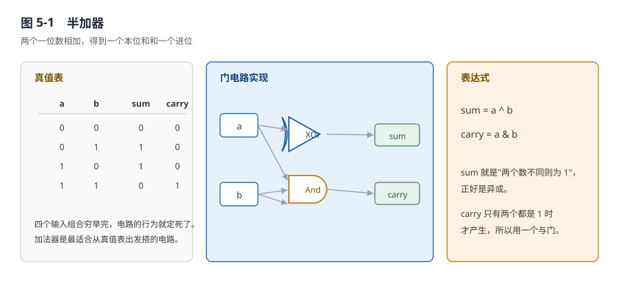
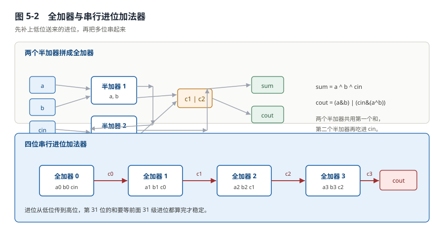
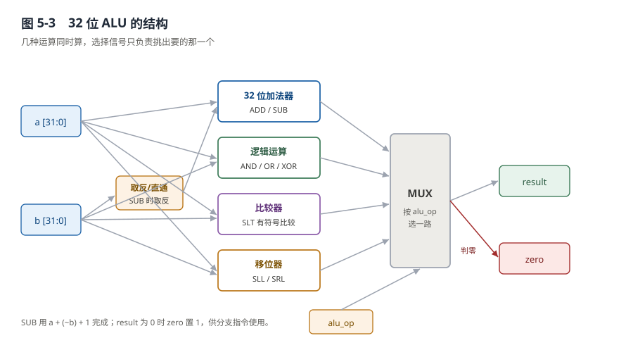
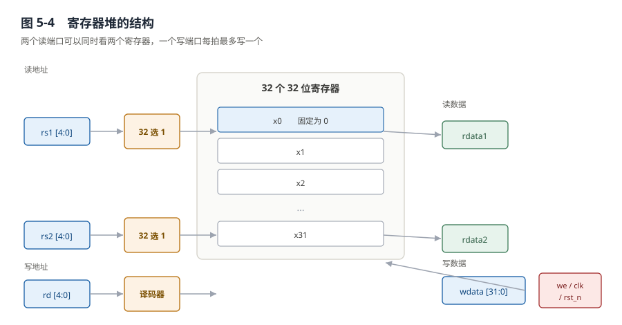
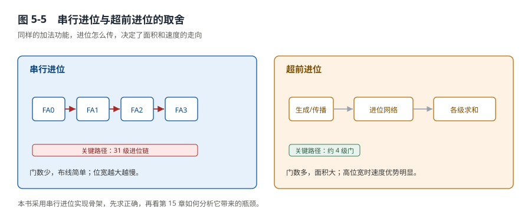

# 第 5 章　从真值表到运算电路

> **本章导读**
> 上一章我们学会了从真值表写出逻辑表达式。这一章把这条路走到底：从一位加法器搭到 32 位加法器，再加上逻辑运算、比较和移位，拼出处理器里真正干活的 ALU。最后搭一个 32 个寄存器的寄存器堆，让指令有地方存中间结果。
>
> 这一章第一次用到 Verilog 的层次化写法：一个小模块拼进大模块，大模块再被更大的模块调用。代码按同样的顺序长出来，先解决"加一位"，再解决"加一串"，最后才面对"选哪一种运算"。
>
> 实验文件在 `code/digital/` 和 `code/verilog/05_arith/`。
>
> 学完本章，你应该能够：
> 1. 从真值表写出半加器和全加器的表达式，并解释进位怎么传；
> 2. 说明补码减法为什么能用加法器完成；
> 3. 读懂 ALU 的代码，说清每个操作码对应哪一路结果；
> 4. 解释寄存器堆为什么有两个读端口和一个写端口，为什么 `x0` 写不进去。

---

## 5.1　从真值表到半加器

把两个一位二进制数相加，结果有两位：本位和 `sum`，进位 `carry`。输入只有四种组合，可以直接列出来。

| a | b | sum | carry |
| --- | --- | --- | --- |
| 0 | 0 | 0 | 0 |
| 0 | 1 | 1 | 0 |
| 1 | 0 | 1 | 0 |
| 1 | 1 | 0 | 1 |

`sum` 在 a 和 b 不同时为 1，这正是异或；`carry` 只在两者都为 1 时为 1，这是与。于是表达式和电路都定下来了：

```
sum   = a ^ b
carry = a & b
```

这就是**半加器**。它只处理两个加数，不管低位有没有送来的进位，所以叫"半"。



*图 5-1　半加器的真值表、门电路与表达式。*

在 Digital 里打开 `code/digital/05_half_adder.dig`，拨动 a 和 b，核对四个组合。用门电路看真值表，和第 4 章用门电路核对与门的真值表是同一件事，只是这次输出有两个。

### 补上低位送来的进位

多位加法里，第 i 位除了 a 和 b，还要接收第 i-1 位传来的进位 `cin`。输入变成三个，真值表有八行。可以用两个半加器搭出来：第一个先把 a 和 b 加起来，得到中间和 `s1` 与中间进位 `c1`；第二个把 `s1` 和 `cin` 加起来，得到真正的 `sum` 与另一个进位 `c2`。总的进位是 `c1 | c2`。

```
s1   = a ^ b
c1   = a & b
sum  = s1 ^ cin
c2   = s1 & cin
cout = c1 | c2
```

这个结构叫**全加器**。它没有新的数学，只是把两次半加串起来，把两个可能的进位合并。



*图 5-2　两个半加器拼成全加器，再把全加器串成多位加法器。*

## 5.2　32 位加法器

把 32 个全加器排成一列，低位算出的 `cout` 接高位的 `cin`，最低位的 `cin` 接外部输入，最高位的 `cout` 当作溢出进位输出。这叫**串行进位加法器**，也叫行波进位加法器。代码在 `code/verilog/05_arith/`，先看半加器和全加器。

```verilog
module half_adder (
    input  wire a,
    input  wire b,
    output wire sum,
    output wire carry
);

    assign sum   = a ^ b;
    assign carry = a & b;

endmodule
```

半加器两个输出都是组合逻辑，用 `assign` 直接写表达式。没有时钟，没有状态，输入一变输出就变。

全加器调用两次半加器。这里的写法需要注意：实例名不能省，端口用 `.名字(信号)` 的形式一一对应，顺序可以打乱。

```verilog
module full_adder (
    input  wire a,
    input  wire b,
    input  wire cin,
    output wire sum,
    output wire cout
);

    wire s1;
    wire c1;
    wire c2;

    half_adder u_h0 (
        .a     (a),
        .b     (b),
        .sum   (s1),
        .carry (c1)
    );

    half_adder u_h1 (
        .a     (s1),
        .b     (cin),
        .sum   (sum),
        .carry (c2)
    );

    assign cout = c1 | c2;

endmodule
```

`s1`、`c1`、`c2` 是内部连线，用 `wire` 声明。第一个半加器吃 a 和 b，第二个吃 `s1` 和 cin。最后那个或门把两条进位路径合起来。这段代码和上一节的推导逐句对应，读代码时可以直接在脑子里画出门电路。

### 把 32 个全加器串起来

如果手写 32 次实例化，代码冗长且容易写错下标。Verilog 提供 `generate` 加 `for` 循环，可以在电路展开阶段生成 32 份实例。注意这不是软件里的循环执行，硬件里真的有 32 个全加器同时存在。

```verilog
module adder_32 (
    input  wire [31:0] a,
    input  wire [31:0] b,
    input  wire        cin,
    output wire [31:0] sum,
    output wire        cout
);

    wire [31:0] carry;

    genvar i;
    generate
        for (i = 0; i < 32; i = i + 1) begin : g_bit
            if (i == 0) begin : g_first
                full_adder u_fa (
                    .a    (a[0]),
                    .b    (b[0]),
                    .cin  (cin),
                    .sum  (sum[0]),
                    .cout (carry[0])
                );
            end else begin : g_rest
                full_adder u_fa (
                    .a    (a[i]),
                    .b    (b[i]),
                    .cin  (carry[i-1]),
                    .sum  (sum[i]),
                    .cout (carry[i])
                );
            end
        end
    endgenerate

    assign cout = carry[31];

endmodule
```

最低位没有"第 -1 位的进位"，所以单独写一份，其余 31 位统一接 `carry[i-1]`。`carry` 是 32 位内部连线，第 i 位全加器的输出接第 i+1 位的输入。

为什么 `carry` 要声明成 `[31:0]` 而不是 `[30:0]`？因为最高位的进位输出也要有地方放，最后 `assign cout = carry[31];` 把它引出模块。少一位的话，仿真器会报出未连接的线。

## 5.3　用加法器做减法

补码的好处在这里体现出来。n 位补码里，`-b` 等于 `~b + 1`。于是

```
a - b = a + (~b) + 1
```

只要在做减法时把 b 取反，并把最低位的进位设为 1，原来的加法器就能算减法，不需要另做一套电路。这个 `~b` 加 `1` 的操作叫求补，前面的 `取反/直通` 小模块就是干这个的。

在 Verilog 里写成两行：

```verilog
assign b_operand = (alu_op == ALU_SUB) ? ~b : b;
assign carry_in  = (alu_op == ALU_SUB) ? 1'b1 : 1'b0;
```

加法器永远在那里算 `a + b_operand + carry_in`。做加法时 `b_operand=b`、`carry_in=0`，做减法时 `b_operand=~b`、`carry_in=1`。一个加法器兼顾两种运算，这是补码表示送的礼物。

溢出进位 `cout` 在加减法里另有含义：无符号加法时它表示结果超出 32 位，无符号减法时它是借位的反。本书的简化核不使用它，只在第 11 章讲异常时顺带提到。

## 5.4　ALU 的接口与实现

ALU 是处理器的运算中心。先把接口想清楚：两个 32 位操作数进来，一个操作码进来，一个 32 位结果出去。这是最初的版本。

```verilog
module alu (
    input  wire [31:0] a,
    input  wire [31:0] b,
    input  wire [3:0]  alu_op,
    output reg  [31:0] result
);
```

先只支持加法，把上一节做好的加法器接进来，组合逻辑里直接把结果送出去：

```verilog
    adder_32 u_adder (
        .a(a), .b(b), .cin(1'b0),
        .sum(result), .cout(add_cout)
    );
```

这样只能算加法。要支持减法，就得引入上一节的 `b_operand` 和 `carry_in`；要把 `result` 从连线变成可在 `case` 里赋值的寄存器，端口声明也要改成 `output reg`。接着把逻辑运算加进来，代码变成一组分支：

```verilog
    always @(*) begin
        case (alu_op)
            ALU_ADD: result = add_result;
            ALU_SUB: result = add_result;
            ALU_AND: result = a & b;
            ALU_OR:  result = a | b;
            ALU_XOR: result = a ^ b;
        endcase
    end
```

`always @(*)` 表示这是组合逻辑，敏感列表由工具自动推断。加法器的输出 `add_result` 一直在算，不管当前选的是不是加减法；`case` 只负责挑一路送出去。硬件里这对应图 5-3 那个大 MUX。

再补两种运算。有符号比较 `SLT` 不能直接拿 `a < b` 判断，因为 Verilog 里两个 32 位向量默认按无符号数比。正确做法是先比符号位：符号不同时负数更小，符号相同时才是数值比较。移位量取自 b 的低 5 位，因为 32 位数据最多移 31 位。

```verilog
    ALU_SLT: result = (a[31] != b[31]) ? {31'b0, a[31]} : {31'b0, (a < b)};
    ALU_SLL: result = a << b[4:0];
    ALU_SRL: result = a >> b[4:0];
```

分支指令 `beq` 和 `bne` 要判断两个操作数是否相等。与其在 ALU 外面另接比较器，不如让 ALU 算减法 `a-b`，结果为 0 就说明相等。于是接口再加一个输出 `zero`：

```verilog
    output wire        zero
```

```verilog
    assign zero = (result == 32'b0);
```

接口到这里定稿。下面是完整代码，与 `code/verilog/05_arith/alu.v` 逐字相同。

```verilog
module alu (
    input  wire [31:0] a,
    input  wire [31:0] b,
    input  wire [3:0]  alu_op,
    output reg  [31:0] result,
    output wire        zero
);

    localparam ALU_ADD = 4'd0;
    localparam ALU_SUB = 4'd1;
    localparam ALU_AND = 4'd2;
    localparam ALU_OR  = 4'd3;
    localparam ALU_XOR = 4'd4;
    localparam ALU_SLT = 4'd5;
    localparam ALU_SLL = 4'd6;
    localparam ALU_SRL = 4'd7;

    wire [31:0] b_operand;
    wire        carry_in;
    wire [31:0] add_result;
    wire        add_cout;

    assign b_operand = (alu_op == ALU_SUB) ? ~b : b;
    assign carry_in  = (alu_op == ALU_SUB) ? 1'b1 : 1'b0;

    adder_32 u_adder (
        .a    (a),
        .b    (b_operand),
        .cin  (carry_in),
        .sum  (add_result),
        .cout (add_cout)
    );

    always @(*) begin
        case (alu_op)
            ALU_ADD: result = add_result;
            ALU_SUB: result = add_result;
            ALU_AND: result = a & b;
            ALU_OR:  result = a | b;
            ALU_XOR: result = a ^ b;
            ALU_SLT: result = (a[31] != b[31]) ? {31'b0, a[31]} : {31'b0, (a < b)};
            ALU_SLL: result = a << b[4:0];
            ALU_SRL: result = a >> b[4:0];
            default: result = 32'b0;
        endcase
    end

    assign zero = (result == 32'b0);

endmodule
```

### 操作码

八种运算对应四位操作码，编码是本模块自己的约定，和指令里的 `funct3` 还隔着一层译码。第 8 章写一个译码模块，把指令字段翻译成这里的 `alu_op`。

| 编码 | 运算 | 说明 |
| --- | --- | --- |
| 0 | ADD | `a + b` |
| 1 | SUB | `a - b`，也用于相等比较 |
| 2 | AND | 按位与 |
| 3 | OR | 按位或 |
| 4 | XOR | 按位异或 |
| 5 | SLT | 有符号比较，`a < b` 时输出 1 |
| 6 | SLL | 逻辑左移，移位量取 `b[4:0]` |
| 7 | SRL | 逻辑右移，移位量取 `b[4:0]` |

完整的 RV32I 还需要 SLTU、SRA，M 扩展还要乘除法。这里先做八种，把数据通路搭通；缺的运算以后按同样的模式往 `case` 里加一行即可。



*图 5-3　各类运算并行计算，由操作码选出一路作为结果。*

测试台 `tb_alu.v` 覆盖八种运算和零标志，共 15 项检查。其中 `SUB 3-10 wraps around` 检查补码下的借位，SLT 用正负组合确认有符号比较没有走错成无符号比较。

## 5.5　寄存器堆

ALU 算完的结果要存起来，下一条指令才能接着用。RV32I 有 32 个通用寄存器，每个 32 位。硬件上就是一个小型存储阵列，加上读写端口。

先看需求。一条典型指令要读两个源寄存器，比如 `add x3, x1, x2` 同时读 x1 和 x2；结果只写一个目的寄存器。所以接口需要两个读地址 `rs1`、`rs2`，两个读数据 `rdata1`、`rdata2`，一个写地址 `rd`，一个写数据 `wdata`，再加写使能 `we`。

```verilog
    input  wire [4:0]  rs1,
    input  wire [4:0]  rs2,
    input  wire [4:0]  rd,
    input  wire        we,
    input  wire [31:0] wdata,
    output wire [31:0] rdata1,
    output wire [31:0] rdata2
```

5 位地址正好寻址 32 个寄存器。还有三个控制信号：时钟 `clk`、低有效复位 `rst_n`，以及写使能 `we`。为什么没有读使能？因为读是组合的：地址一给，输出就出来，不需要等时钟沿。写则是同步的：只有在时钟沿且 `we=1` 时才真正写进去。



*图 5-4　两个读地址各驱动一个 32 选 1 多路选择器，写地址经译码后产生写使能。*

完整代码在 `code/verilog/05_arith/regfile.v`。

```verilog
module regfile (
    input  wire        clk,
    input  wire        rst_n,
    input  wire [4:0]  rs1,
    input  wire [4:0]  rs2,
    input  wire [4:0]  rd,
    input  wire        we,
    input  wire [31:0] wdata,
    output wire [31:0] rdata1,
    output wire [31:0] rdata2
);

    reg [31:0] regs [0:31];
    integer i;

    always @(posedge clk) begin
        if (!rst_n) begin
            for (i = 0; i < 32; i = i + 1)
                regs[i] <= 32'b0;
        end else if (we && (rd != 5'd0)) begin
            regs[rd] <= wdata;
        end
    end

    assign rdata1 = (rs1 == 5'd0) ? 32'b0 : regs[rs1];
    assign rdata2 = (rs2 == 5'd0) ? 32'b0 : regs[rs2];

endmodule
```

有四处需要说明。

`reg [31:0] regs [0:31];` 声明了一个 32 行、每行 32 位的存储阵列。`regs[0]` 到 `regs[31]` 对应 x0 到 x31。

复位时用 `for` 循环把 32 个寄存器全部清 0。这个 `for` 写在一个 `always` 块里，会被展开成 32 个并行的赋值，不是按顺序一个一个清。这里用了非阻塞赋值 `<=`，保持时序逻辑的写法一致。

`rd != 5'd0` 这一句把 x0 固定成 0。规范规定 x0 永远读出 0，向它写入应当被忽略。与其专门留一个寄存器再想办法拦住写入，不如在写判断里直接排除，读的时候也直接返回 0。

读端口用 `assign` 连续取值，相当于两个 32 选 1 的多路选择器。两个读地址相同时，两个端口读出同样的值，互不干扰。

测试台 `tb_regfile.v` 有 7 项检查，覆盖复位清零、写后读、两个端口同时读同一寄存器、写 x0 被忽略、写使能无效时保持原值。这里有个值得记住的细节：改完 `rs1` 之后要等 1 ns 再检查 `rdata1`。组合逻辑的 `assign` 更新需要一个很小的时间，写在同一时刻检查会读到旧值。

## 5.6　重点与权衡

**从真值表出发是可靠的路子。** 一位加法器的真值表只有四行，八行的全加器也能手工列完。电路复杂到几十个输入时，才需要交给综合工具。

**层次化让复杂度可控。** 半加器拼全加器，全加器拼 32 位加法器，加法器再作为 ALU 的一个部件。每一层只关心输入输出，不必重新理解下面一层的门电路。

**串行进位省面积，超前进位省时间。** 图 5-5 对比了两种做法。本书用串行进位，代码短、容易看懂；但它让加法成为一条长关键路径，高频设计里通常要换成超前进位或更快的进位结构。



*图 5-5　串行进位逐级传递，超前进位提前算出各级进位。*

**补码让加减法共用一套硬件。** 减法只多了取反和末位加 1，代价是几个门，换来的是一个统一的加法通路。

**寄存器堆读写不对称。** 读是组合的，写是同步的；两个读端口对应一条指令的两个源操作数，一个写端口对应一个目的操作数。x0 用电路直接固定为 0。

## 5.7　实验

### 实验一　半加器

打开 `code/digital/05_half_adder.dig`，把 a、b 拨成四种组合，记录 `sum` 和 `carry`。然后对照 `half_adder.v`，确认 `assign sum = a ^ b;` 和 `assign carry = a & b;` 与门电路一致。

### 实验二　一位 ALU 切片

打开 `code/digital/05_alu_bit.dig`。op=0 时输出 `a^b`，op=1 时输出 `a&b`。拨几组 a、b，确认切换 op 时输出跟着换。这个电路就是图 5-3 那个大 MUX 的一位版本。

### 实验三　跑 Verilog 测试台

在 `code/verilog/05_arith/` 下分别执行：

```
iverilog -g2012 -o sim_alu.out half_adder.v full_adder.v adder_32.v alu.v tb_alu.v
vvp sim_alu.out
iverilog -g2012 -o sim_reg.out regfile.v tb_regfile.v
vvp sim_reg.out
```

ALU 应有 15 项通过，寄存器堆应有 7 项通过，最后都打印 `ALL TESTS PASSED`。

做完可以试两个小改动。把 `alu.v` 里 SLT 的有符号判断换成直接的 `a < b`，看看哪个检查会失败；把 `regfile.v` 里的 `rd != 5'd0` 去掉，看看写 x0 的检查会怎样。这两个改动都很小，却能验证你是否真的看懂了这两处用意。

## 5.8　本章小结

- 半加器由异或门和与门组成，输出本位和与进位。
- 两个半加器串起来得到全加器，它能处理低位送来的进位。
- 32 个全加器串成串行进位加法器，进位逐级传递，关键路径较长。
- 补码减法可以写成 `a + (~b) + 1`，和加法共用同一套电路。
- ALU 让多种运算并行计算，用操作码控制的多路选择器挑出结果；零标志供分支指令使用。
- 有符号比较要先看符号位，移位量取操作数低 5 位。
- 寄存器堆有两个组合读端口和一个同步写端口，x0 读出恒为 0，写入被忽略。

## 思考题

1. 用真值表验证全加器的 `cout = (a&b) | (cin&(a^b))`，确认八种输入组合都成立。
2. 串行进位加法器的 32 位版本，从最低位 `cin` 到最高位 `sum[31]` 大致经过多少级门？把这个数字和时钟周期联系起来，说明它为什么限制主频。
3. 在 4 位补码里计算 `3 - 5`，写出 `~b + 1` 的过程，确认结果表示 -2。
4. `alu.v` 里 `add_cout` 声明后没有使用。综合工具会怎么处理它？如果无符号加法需要检测溢出，应该接哪个信号？
5. 寄存器堆的两个读端口如果同时读 x0 和 x5，输出分别是什么？如果往 x0 写数据再立刻读，会发生什么？
6. 本章的 ALU 没有 SLTU（无符号比较）。参照 SLT 的写法，给出它在 `case` 里应该增加的表达式。
7. `tb_regfile.v` 里改完 `rs1` 后为什么要插入 `#1`？把这一行删掉再跑一次，看看结果是否变化，并解释原因。

---

*下一章：第 6 章　用 Python 写模拟器：取指与译码。先用软件搭出一个 RV32I 的内存、寄存器和 PC，把指令字段逐位拆开。*
