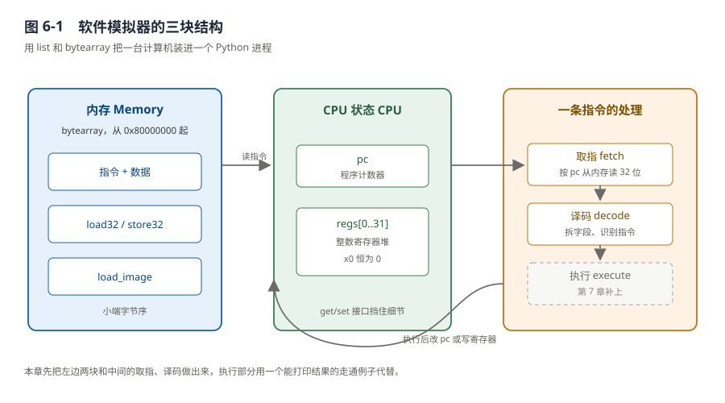
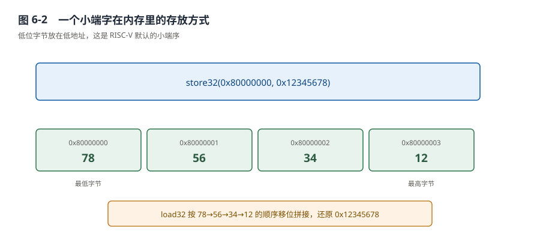
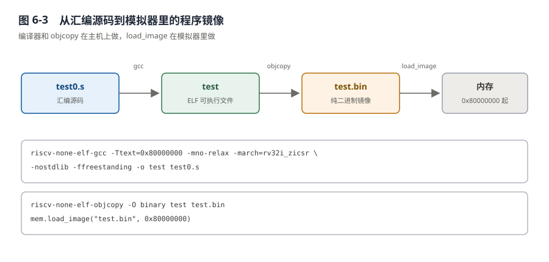
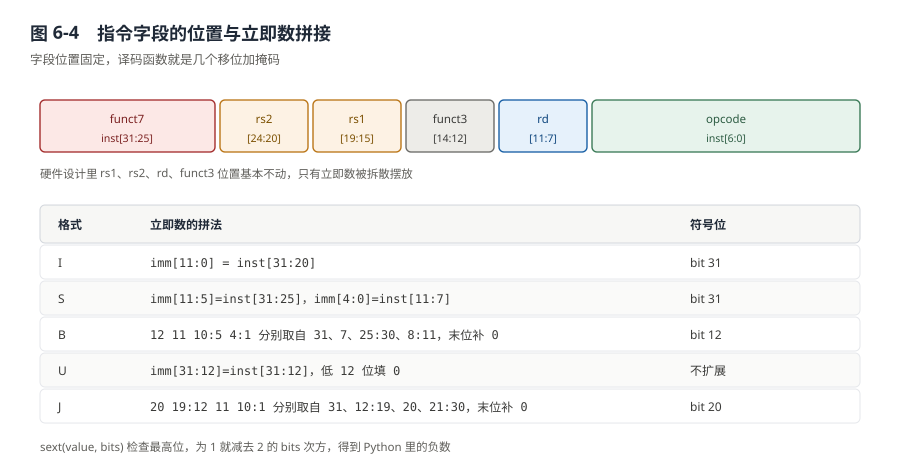

# 第 6 章　用 Python 写模拟器：取指与译码

> 本章导读
>
> 前五章分别在软件侧和硬件侧各走了一段：写汇编，搭门电路，拼 ALU。这两头之间还缺一个东西——一台能真正"跑指令"的模型。它既不是编译器，也不是电路，而是一段按顺序解释指令的 Python 程序。本章先把它搭到译码为止：内存怎么放程序，pc 怎么指向下一条指令，32 位指令字怎么拆成操作码、寄存器号和立即数。下一章再补执行和访存。

## 6.1　为什么要自己写一个模拟器

现成的 RISC-V 模拟器不少。QEMU 能跑完整操作系统，Spike 是官方参考模型，RARS 适合写汇编时单步调试。它们都很成熟，也都很不适合用来学处理器。

原因不在功能，在里面。打开这些工具的源码，会看到缓存、TLB、多线程、精确的中断时序。这些是对的，但它们挡住了最想看清的那件事：一条 `add x1, x2, x3` 从内存里取出来之后，究竟经过了哪些步骤才让 x1 里的数变了。

自己写一个功能级模拟器就没有这个问题。它不模拟时钟，不关心流水线，只做一件事：按 pc 取一条指令，弄明白它要干什么，然后改变处理器的状态。整个过程是透明的，每一步都能打印出来看。等第 8 章搭真正的硬件时，这个模拟器正好可以当参照——硬件算出来的结果，应该和它一样。

Python 在这里只是工具。核心代码只用到了 `list`、`bytearray` 和几个位运算，换成 C 或 Java 也写得出来。课件里用的 pyriscv 也是同样的思路。

## 6.2　模拟器分三块

先看整体。一台最小计算机可以拆成三个部分，如附图所示。



*图 6-1　软件模拟器的三块结构*

内存是一排带门牌号的格子，指令和数据都住在里面。CPU 本身只有一小组状态：一个 pc 和三十二个寄存器。第三条线是处理一条指令的动作：取指、译码、执行。

这三块在 Python 里正好对应三个类或三个模块。内存负责按地址读写字节，CPU 负责保管 pc 和寄存器，译码函数负责把一个 32 位整数拆开。它们之间只通过函数调用打交道，边界很干净。

本章只做到译码。执行部分在图里画成虚线框，下一章补上。

## 6.3　内存就是一排带门牌号的格子

先给内存定接口。它至少得回答两个问题：某个地址上放着什么字节，以及把一个字节写到某个地址。最小版本只有四个函数。

```python
def __init__(self, base=BASE, size=DEFAULT_SIZE):
    self.base = base
    self.mem = bytearray(size)

def load8(self, addr):
    self._check(addr, 1)
    return self.mem[addr - self.base]

def store8(self, addr, value):
    self._check(addr, 1)
    self.mem[addr - self.base] = value & 0xFF
```

地址是从 `base` 开始的，`self.mem` 的下标要用 `addr - self.base`。这样模拟的地址可以是 `0x80000000`，而 Python 的列表还是从 0 开始。`_check` 挡住越界访问，真写超了就报 `ValueError`，免得悄悄改到别的地方。

`bytearray` 的每个元素正好是一个字节，写入时再 `& 0xFF` 截一下。这些都很直白，不值得多说。

问题来了：取指一次要读 32 位，按字节一个一个读太笨。于是给内存加一组字访问。

```python
def load32(self, addr):
    self._check(addr, 4)
    off = addr - self.base
    return (self.mem[off]
            | (self.mem[off + 1] << 8)
            | (self.mem[off + 2] << 16)
            | (self.mem[off + 3] << 24))

def store32(self, addr, value):
    self._check(addr, 4)
    off = addr - self.base
    v = value & 0xFFFFFFFF
    self.mem[off] = v & 0xFF
    self.mem[off + 1] = (v >> 8) & 0xFF
    self.mem[off + 2] = (v >> 16) & 0xFF
    self.mem[off + 3] = (v >> 24) & 0xFF
```

这就是小端序：低字节放低地址，如附图。第 2 章讲访存指令时说过 RISC-V 默认采用小端，这里终于看到它落在代码里的样子。



*图 6-2　一个小端字在内存里的存放方式*

还差一个把程序装进内存的函数。镜像是一个 `.bin` 文件，里面就是一串字节，读出来整段塞进 `bytearray` 就行。

```python
def load_image(self, path, addr):
    with open(path, "rb") as f:
        data = f.read()
    self._check(addr, len(data))
    off = addr - self.base
    self.mem[off:off + len(data)] = data
    return len(data)
```

接口到齐了，列一张表固定下来。

| 函数 | 作用 |
| --- | --- |
| `__init__(base, size)` | 建立一段空内存 |
| `load8(addr) / store8(addr, value)` | 读写一个字节 |
| `load32(addr) / store32(addr, value)` | 读写一个 32 位字，小端 |
| `load_image(path, addr)` | 把二进制镜像从 `addr` 开始装入 |
| `_check(addr, length)` | 内部使用，检查地址范围 |

完整的 `memory.py` 如下，文件在 `code/python/06_simulator/`。

```python
"""RV32I 模拟器的内存模型：字节寻址、小端存放，从 0x80000000 开始。"""

BASE = 0x80000000
DEFAULT_SIZE = 64 * 1024


class Memory:
    """一段连续的字节地址空间。"""

    def __init__(self, base=BASE, size=DEFAULT_SIZE):
        self.base = base
        self.mem = bytearray(size)

    def _check(self, addr, length):
        if not (self.base <= addr and addr + length <= self.base + len(self.mem)):
            raise ValueError("address 0x%08x out of range" % addr)

    def load8(self, addr):
        self._check(addr, 1)
        return self.mem[addr - self.base]

    def store8(self, addr, value):
        self._check(addr, 1)
        self.mem[addr - self.base] = value & 0xFF

    def load32(self, addr):
        self._check(addr, 4)
        off = addr - self.base
        return (self.mem[off]
                | (self.mem[off + 1] << 8)
                | (self.mem[off + 2] << 16)
                | (self.mem[off + 3] << 24))

    def store32(self, addr, value):
        self._check(addr, 4)
        off = addr - self.base
        v = value & 0xFFFFFFFF
        self.mem[off] = v & 0xFF
        self.mem[off + 1] = (v >> 8) & 0xFF
        self.mem[off + 2] = (v >> 16) & 0xFF
        self.mem[off + 3] = (v >> 24) & 0xFF

    def load_image(self, path, addr):
        with open(path, "rb") as f:
            data = f.read()
        self._check(addr, len(data))
        off = addr - self.base
        self.mem[off:off + len(data)] = data
        return len(data)
```

## 6.4　程序镜像从哪来

`load_image` 需要一个 `.bin` 文件。它不能由 RARS 直接产出，得用 RISC-V 交叉编译器。课件里用的是 xPack GNU GCC，装好之后命令行里会多出 `riscv-none-elf-gcc` 这一组工具。

整个流程如附图。



*图 6-3　从汇编源码到模拟器里的程序镜像*

第一步，把汇编编译成 ELF 文件。

```
riscv-none-elf-gcc -Ttext=0x80000000 -mno-relax -march=rv32i_zicsr \
    -nostdlib -ffreestanding -o test test0.s
```

几个参数各管一件事。`-Ttext=0x80000000` 告诉链接器把代码段放在这个地址，正好是模拟器的内存起点。`-mno-relax` 关掉链接器对指令的松弛优化，不然它可能把 `jal` 换成别的形式，和讲义里的机器码对不上。`-march=rv32i_zicsr` 限定只产生基础整数指令和 CSR 指令，不偷偷用乘法。`-nostdlib -ffreestanding` 去掉标准库，因为我们现在还没有操作系统，也没有 `main` 函数要用的运行环境。

第二步，把 ELF 里的代码和数据抽成纯二进制。

```
riscv-none-elf-objcopy -O binary test test.bin
```

ELF 文件里有符号表、段信息这些给链接器和调试器看的东西，模拟器用不上。objcopy 只留下真正要装进内存的字节。

第三步，在 Python 里装载。

```
mem.load_image("test.bin", 0x80000000)
```

想确认编译器到底生成了什么，可以反汇编来看。

```
riscv-none-elf-objdump -D test
```

这一步在调试时很有用。模拟器打印出来的译码结果如果和反汇编对不上，问题多半出在自己的字段提取上。

## 6.5　CPU 状态只有一个 pc 和一组寄存器

接下来是 CPU。它的状态比内存简单得多：一个程序计数器，三十二个整数寄存器。先写构造函数和 pc 的访问接口。

```python
def __init__(self, mem, entry=BASE):
    self.mem = mem
    self.pc = entry
    self.regs = [0] * 32

def get_pc(self):
    return self.pc

def set_pc(self, addr):
    self.pc = addr & 0xFFFFFFFF

def pc_inc4(self):
    self.set_pc(self.pc + 4)
```

`self.mem` 是传进来的内存对象，CPU 自己不复制它。寄存器用 `[0] * 32` 建出来，下标就是寄存器号。`pc_inc4` 走 `set_pc`，这样 32 位回绕只在一处处理。

寄存器接口要专门处理 x0。RISC-V 规定 x0 永远读出 0，写进去的值要丢掉。让调用者记住这条规矩容易出错，不如封装在函数里。

```python
def get_reg(self, n):
    if n == 0:
        return 0
    return self.regs[n]

def set_reg(self, n, value):
    if n != 0:
        self.regs[n] = value & 0xFFFFFFFF
```

这一层看着多余，到了第 11 章处理异常返回时会省很多事：所有写寄存器的地方都走 `set_reg`，x0 不会被任何一条路径破坏。

最后加取指。它只是转调内存的 `load32`，但放在 CPU 里更顺手，因为取哪个地址由 pc 决定。

```python
def fetch(self):
    return self.mem.load32(self.pc)
```

接口定稿。

| 函数 | 作用 |
| --- | --- |
| `__init__(mem, entry)` | 持有内存，pc 指向入口地址 |
| `get_pc() / set_pc(addr) / pc_inc4()` | 读写程序计数器 |
| `get_reg(n) / set_reg(n, value)` | 读写寄存器，x0 特殊处理 |
| `fetch()` | 按当前 pc 取一个 32 位指令字 |

完整的 `cpu.py`。

```python
"""CPU 状态：程序计数器、32 个整数寄存器，以及取指操作。"""

from memory import BASE


class CPU:
    def __init__(self, mem, entry=BASE):
        self.mem = mem
        self.pc = entry
        self.regs = [0] * 32

    def get_pc(self):
        return self.pc

    def set_pc(self, addr):
        self.pc = addr & 0xFFFFFFFF

    def pc_inc4(self):
        self.set_pc(self.pc + 4)

    def get_reg(self, n):
        if n == 0:
            return 0
        return self.regs[n]

    def set_reg(self, n, value):
        if n != 0:
            self.regs[n] = value & 0xFFFFFFFF

    def fetch(self):
        return self.mem.load32(self.pc)
```

## 6.6　译码就是移位加掩码

现在到了这一章的核心。手里有一个 32 位整数，要说出它是哪条指令、操作数在哪里。第 2 章画过六种指令格式，字段的位置是固定的，如附图。



*图 6-4　指令字段的位置与立即数拼接*

先写最简单的六个提取函数。每个都是"右移若干位，再与一个掩码"。

```python
def get_opcode(inst):
    return inst & 0x7F


def get_rd(inst):
    return (inst >> 7) & 0x1F


def get_funct3(inst):
    return (inst >> 12) & 0x7


def get_rs1(inst):
    return (inst >> 15) & 0x1F


def get_rs2(inst):
    return (inst >> 20) & 0x1F


def get_funct7(inst):
    return (inst >> 25) & 0x7F
```

这里藏着一个容易吃亏的地方。写测试时我原以为 `addi x1, x0, 5` 的 `rs2` 字段应该是 0，结果读出来是 5。想了一下才明白：I 型指令根本没有 rs2，第 25 到 31 位放的是 `imm[11:5]`。那 5 位既是 `get_rs2` 读到的内容，也是立即数的一部分。硬件里也是这样，`get_rs2` 只是机械地按位置取值，用不用取决于指令类型。

立即数要麻烦一些，因为位被打散了。先写一个符号扩展工具。Python 的整数没有固定位宽，负数在内存里按补码存，但移位得到的是正数，得自己减掉 2 的幂。

```python
def sext(value, bits):
    sign = 1 << (bits - 1)
    return value - (1 << bits) if value & sign else value
```

比如 12 位的 `0xFFF` 传进去，最高位为 1，结果是 `0xFFF - 0x1000 = -1`。12 位的 `0x007` 最高位为 0，原样返回 7。

最简单的 I 型立即数就在高 12 位，取出来符号扩展即可。S 型把立即数拆成两段，要拼回去。

```python
def imm_i(inst):
    return sext((inst >> 20) & 0xFFF, 12)


def imm_s(inst):
    imm = (((inst >> 25) & 0x7F) << 5) | ((inst >> 7) & 0x1F)
    return sext(imm, 12)
```

B 型更绕。它的第 12 位在指令最高位，第 11 位在第 7 位，第 10 到 5 位在 `funct7` 的位置，第 4 到 1 位在 `funct3` 上面。第 0 位固定是 0，因为分支目标必须两字节对齐，指令字里干脆不存它。拼出来是 13 位数，所以按 13 位符号扩展。

```python
def imm_b(inst):
    imm = (((inst >> 31) & 1) << 12
           | ((inst >> 7) & 1) << 11
           | ((inst >> 25) & 0x3F) << 5
           | ((inst >> 8) & 0xF) << 1)
    return sext(imm, 13)
```

U 型最简单，高 20 位就是立即数的高 20 位，低 12 位补 0，不需要符号扩展。J 型类似 B 型，只是长度变成 21 位。

```python
def imm_u(inst):
    return inst & 0xFFFFF000


def imm_j(inst):
    imm = (((inst >> 31) & 1) << 20
           | ((inst >> 12) & 0xFF) << 12
           | ((inst >> 20) & 1) << 11
           | ((inst >> 21) & 0x3FF) << 1)
    return sext(imm, 21)
```

调用者不必记住哪种指令用哪种立即数。查表就能决定。

```python
IMM_FUNCS = {"I": imm_i, "S": imm_s, "B": imm_b, "U": imm_u, "J": imm_j, "R": None}
```

## 6.7　给译码结果一个名字

字段提取完了，还得知道这条指令叫什么。`opcode` 决定大的类别，`funct3` 和 `funct7` 再细分。

```python
OPCODE_KIND = {
    0x37: "lui", 0x17: "auipc", 0x6F: "jal", 0x67: "jalr",
    0x63: "branch", 0x03: "load", 0x23: "store",
    0x13: "op-imm", 0x33: "op", 0x0F: "fence", 0x73: "system",
}
```

这张表只覆盖 RV32I 的 11 个 opcode。查不到的就当非法指令，模拟器下一章遇到它会触发异常。

R 型指令靠 `funct7` 和 `funct3` 一起区分，`sub` 和 `add` 的 `funct3` 相同，只有 `funct7` 不同。I 型的移位指令也靠 `funct7` 区分 `srli` 和 `srai`。

```python
R_NAME = {
    (0x00, 0): "add", (0x20, 0): "sub",
    (0x00, 1): "sll", (0x00, 2): "slt", (0x00, 3): "sltu",
    (0x00, 4): "xor", (0x00, 5): "srl", (0x20, 5): "sra",
    (0x00, 6): "or", (0x00, 7): "and",
}
OP_IMM_NAME = {0: "addi", 2: "slti", 3: "sltiu", 4: "xori", 6: "ori", 7: "andi"}
LOAD_NAME = {0: "lb", 1: "lh", 2: "lw", 4: "lbu", 5: "lhu"}
STORE_NAME = {0: "sb", 1: "sh", 2: "sw"}
BRANCH_NAME = {0: "beq", 1: "bne", 4: "blt", 5: "bge", 6: "bltu", 7: "bgeu"}
```

把查名字的逻辑收进一个函数。system 类指令比较特殊，`ecall` 和 `ebreak` 靠 12 位立即数区分，分别是 0 和 1。

```python
def inst_name(kind, f3, f7, imm):
    if kind == "op":
        return R_NAME.get((f7, f3), "op?")
    if kind == "op-imm":
        if f3 == 5:
            return "srai" if f7 == 0x20 else "srli"
        return OP_IMM_NAME.get(f3, "op-imm?")
    if kind == "load":
        return LOAD_NAME.get(f3, "load?")
    if kind == "store":
        return STORE_NAME.get(f3, "store?")
    if kind == "branch":
        return BRANCH_NAME.get(f3, "branch?")
    if kind == "system":
        if imm == 0:
            return "ecall"
        if imm == 1:
            return "ebreak"
        return "csr"
    if kind == "illegal":
        return "illegal"
    return kind
```

现在可以把所有东西拼起来。`decode` 返回一个 `namedtuple`，字段固定，后面执行和打印都用它。

```python
Inst = namedtuple("Inst", "opcode rd funct3 rs1 rs2 funct7 imm kind name")
```

```python
def decode(inst):
    opcode = get_opcode(inst)
    kind = OPCODE_KIND.get(opcode, "illegal")
    rd = get_rd(inst)
    f3 = get_funct3(inst)
    rs1 = get_rs1(inst)
    rs2 = get_rs2(inst)
    f7 = get_funct7(inst)
    imm = 0
    if kind != "illegal":
        func = IMM_FUNCS[KIND_FORM[kind]]
        if func is not None:
            imm = func(inst)
    return Inst(opcode, rd, f3, rs1, rs2, f7, imm, kind,
                inst_name(kind, f3, f7, imm))
```

最后写一个反汇编风格的打印函数。它是调试用的，把 `Inst` 按汇编写法拼回字符串。移位量只取低 5 位，因为 RV32I 的移位位数是 5 位。这里踩过一个坑：一开始写的是 `& 0x3F`，打印出来的移位量会莫名其妙地多出一位。

```python
def disasm(inst):
    d = decode(inst)
    n = d.name
    if n in R_NAME.values():
        return "%s x%d, x%d, x%d" % (n, d.rd, d.rs1, d.rs2)
    if n in ("addi", "slti", "sltiu", "xori", "ori", "andi"):
        return "%s x%d, x%d, %d" % (n, d.rd, d.rs1, d.imm)
    if n in ("srli", "srai"):
        return "%s x%d, x%d, %d" % (n, d.rd, d.rs1, d.imm & 0x1F)
    if n in LOAD_NAME.values():
        return "%s x%d, %d(x%d)" % (n, d.rd, d.imm, d.rs1)
    if n in STORE_NAME.values():
        return "%s x%d, %d(x%d)" % (n, d.rs2, d.imm, d.rs1)
    if n in BRANCH_NAME.values():
        return "%s x%d, x%d, %+d" % (n, d.rs1, d.rs2, d.imm)
    if n == "lui":
        return "lui x%d, 0x%05x" % (d.rd, (d.imm >> 12) & 0xFFFFF)
    if n == "auipc":
        return "auipc x%d, 0x%05x" % (d.rd, (d.imm >> 12) & 0xFFFFF)
    if n == "jal":
        return "jal x%d, %+d" % (d.rd, d.imm)
    if n == "jalr":
        return "jalr x%d, %d(x%d)" % (d.rd, d.imm, d.rs1)
    return n
```

把它们按依赖顺序排好，就是完整的 `decode.py`。文件开头是模块说明，接着是 `namedtuple` 和几张查表，然后是提取函数、立即数函数、指令分类、译码与打印。

```python
"""指令字段提取与译码：把 32 位指令字拆成操作码、寄存器号和立即数。"""

from collections import namedtuple

Inst = namedtuple("Inst", "opcode rd funct3 rs1 rs2 funct7 imm kind name")

OPCODE_KIND = {
    0x37: "lui", 0x17: "auipc", 0x6F: "jal", 0x67: "jalr",
    0x63: "branch", 0x03: "load", 0x23: "store",
    0x13: "op-imm", 0x33: "op", 0x0F: "fence", 0x73: "system",
}

KIND_FORM = {
    "lui": "U", "auipc": "U", "jal": "J", "branch": "B", "store": "S",
    "jalr": "I", "load": "I", "op-imm": "I", "fence": "I", "system": "I",
    "op": "R",
}

R_NAME = {
    (0x00, 0): "add", (0x20, 0): "sub",
    (0x00, 1): "sll", (0x00, 2): "slt", (0x00, 3): "sltu",
    (0x00, 4): "xor", (0x00, 5): "srl", (0x20, 5): "sra",
    (0x00, 6): "or", (0x00, 7): "and",
}
OP_IMM_NAME = {0: "addi", 2: "slti", 3: "sltiu", 4: "xori", 6: "ori", 7: "andi"}
LOAD_NAME = {0: "lb", 1: "lh", 2: "lw", 4: "lbu", 5: "lhu"}
STORE_NAME = {0: "sb", 1: "sh", 2: "sw"}
BRANCH_NAME = {0: "beq", 1: "bne", 4: "blt", 5: "bge", 6: "bltu", 7: "bgeu"}


def get_opcode(inst):
    return inst & 0x7F


def get_rd(inst):
    return (inst >> 7) & 0x1F


def get_funct3(inst):
    return (inst >> 12) & 0x7


def get_rs1(inst):
    return (inst >> 15) & 0x1F


def get_rs2(inst):
    return (inst >> 20) & 0x1F


def get_funct7(inst):
    return (inst >> 25) & 0x7F


def sext(value, bits):
    sign = 1 << (bits - 1)
    return value - (1 << bits) if value & sign else value


def imm_i(inst):
    return sext((inst >> 20) & 0xFFF, 12)


def imm_s(inst):
    imm = (((inst >> 25) & 0x7F) << 5) | ((inst >> 7) & 0x1F)
    return sext(imm, 12)


def imm_b(inst):
    imm = (((inst >> 31) & 1) << 12
           | ((inst >> 7) & 1) << 11
           | ((inst >> 25) & 0x3F) << 5
           | ((inst >> 8) & 0xF) << 1)
    return sext(imm, 13)


def imm_u(inst):
    return inst & 0xFFFFF000


def imm_j(inst):
    imm = (((inst >> 31) & 1) << 20
           | ((inst >> 12) & 0xFF) << 12
           | ((inst >> 20) & 1) << 11
           | ((inst >> 21) & 0x3FF) << 1)
    return sext(imm, 21)


IMM_FUNCS = {"I": imm_i, "S": imm_s, "B": imm_b, "U": imm_u, "J": imm_j, "R": None}


def inst_name(kind, f3, f7, imm):
    if kind == "op":
        return R_NAME.get((f7, f3), "op?")
    if kind == "op-imm":
        if f3 == 5:
            return "srai" if f7 == 0x20 else "srli"
        return OP_IMM_NAME.get(f3, "op-imm?")
    if kind == "load":
        return LOAD_NAME.get(f3, "load?")
    if kind == "store":
        return STORE_NAME.get(f3, "store?")
    if kind == "branch":
        return BRANCH_NAME.get(f3, "branch?")
    if kind == "system":
        if imm == 0:
            return "ecall"
        if imm == 1:
            return "ebreak"
        return "csr"
    if kind == "illegal":
        return "illegal"
    return kind


def decode(inst):
    opcode = get_opcode(inst)
    kind = OPCODE_KIND.get(opcode, "illegal")
    rd = get_rd(inst)
    f3 = get_funct3(inst)
    rs1 = get_rs1(inst)
    rs2 = get_rs2(inst)
    f7 = get_funct7(inst)
    imm = 0
    if kind != "illegal":
        func = IMM_FUNCS[KIND_FORM[kind]]
        if func is not None:
            imm = func(inst)
    return Inst(opcode, rd, f3, rs1, rs2, f7, imm, kind,
                inst_name(kind, f3, f7, imm))


def disasm(inst):
    d = decode(inst)
    n = d.name
    if n in R_NAME.values():
        return "%s x%d, x%d, x%d" % (n, d.rd, d.rs1, d.rs2)
    if n in ("addi", "slti", "sltiu", "xori", "ori", "andi"):
        return "%s x%d, x%d, %d" % (n, d.rd, d.rs1, d.imm)
    if n in ("srli", "srai"):
        return "%s x%d, x%d, %d" % (n, d.rd, d.rs1, d.imm & 0x1F)
    if n in LOAD_NAME.values():
        return "%s x%d, %d(x%d)" % (n, d.rd, d.imm, d.rs1)
    if n in STORE_NAME.values():
        return "%s x%d, %d(x%d)" % (n, d.rs2, d.imm, d.rs1)
    if n in BRANCH_NAME.values():
        return "%s x%d, x%d, %+d" % (n, d.rs1, d.rs2, d.imm)
    if n == "lui":
        return "lui x%d, 0x%05x" % (d.rd, (d.imm >> 12) & 0xFFFFF)
    if n == "auipc":
        return "auipc x%d, 0x%05x" % (d.rd, (d.imm >> 12) & 0xFFFFF)
    if n == "jal":
        return "jal x%d, %+d" % (d.rd, d.imm)
    if n == "jalr":
        return "jalr x%d, %d(x%d)" % (d.rd, d.imm, d.rs1)
    return n
```

## 6.8　走通例子：六条指令挨个译码

代码齐了，拿几条真实机器码试试。`demo.py` 把六条指令写进内存，然后从入口地址开始，取一条译一条，打印出来。

```python
"""走通例子：把几条指令放进内存，逐条取指、译码、打印。"""

from cpu import CPU
from decode import decode, disasm
from memory import BASE, Memory

PROGRAM = [
    0x00500093,  # addi  x1, x0, 5
    0x00308133,  # add   x2, x1, x3
    0x0080A203,  # lw    x4, 8(x1)
    0x0050A023,  # sw    x5, 0(x1)
    0xFE028EE3,  # beq   x5, x0, -4
    0x00000073,  # ecall
]

mem = Memory()
for i, word in enumerate(PROGRAM):
    mem.store32(BASE + 4 * i, word)

cpu = CPU(mem)
for _ in range(len(PROGRAM)):
    pc = cpu.get_pc()
    word = cpu.fetch()
    d = decode(word)
    print("pc=0x%08x  word=0x%08x  kind=%-8s  %s"
          % (pc, word, d.kind, disasm(word)))
    cpu.pc_inc4()
```

运行结果如下。

```
pc=0x80000000  word=0x00500093  kind=op-imm    addi x1, x0, 5
pc=0x80000004  word=0x00308133  kind=op        add x2, x1, x3
pc=0x80000008  word=0x0080a203  kind=load      lw x4, 8(x1)
pc=0x8000000c  word=0x0050a023  kind=store     sw x5, 0(x1)
pc=0x80000010  word=0xfe028ee3  kind=branch    beq x5, x0, -4
pc=0x80000014  word=0x00000073  kind=system    ecall
```

值得说的是这几条机器码的来历。它们是手凑出来的，最初 `add` 的 rd 和 rs1 位置写反了，译出来成了 `add x1, x2, x3`；`beq` 的 funct3 也错写成 1，译出来是 `bne`。用编码器逐条核对后才改对。手写机器码时把寄存器号放错位是常事，更稳妥的做法是让编译器生成机器码，再用反汇编核对。下面测试里用的编码器也是这个道理。

## 6.9　实验：跑一遍字段提取测试

`test_decode.py` 里有 65 项检查，分成四组：内存的小端读写与越界检查、字段提取、五种立即数的拼接与符号扩展、指令译码与反汇编。

测试里用了一组编码函数，按字段把指令字拼出来。比如 R 型和 B 型。

```python
def enc_r(f7, rs2, rs1, f3, rd, op):
    return ((f7 << 25) | (rs2 << 20) | (rs1 << 15)
            | (f3 << 12) | (rd << 7) | op)


def enc_b(imm, rs2, rs1, f3, op):
    im = imm & 0x1FFF
    return ((((im >> 12) & 1) << 31) | (((im >> 5) & 0x3F) << 25)
            | (rs2 << 20) | (rs1 << 15) | (f3 << 12)
            | (((im >> 1) & 0xF) << 8) | (((im >> 11) & 1) << 7) | op)
```

有了它们，负数立即数、分支偏移这类用例就不用手算十六进制了。下面这段覆盖了六种常见指令，既查译码出的名字，也查立即数和反汇编文本。

```python
cases = [
    (enc_r(0x00, 3, 1, 0, 2, 0x33), "add", "add x2, x1, x3", 0),
    (enc_r(0x20, 3, 1, 0, 2, 0x33), "sub", "sub x2, x1, x3", 0),
    (enc_i(5, 0, 0, 1, 0x13), "addi", "addi x1, x0, 5", 5),
    (enc_i(-1, 1, 0, 2, 0x13), "addi", "addi x2, x1, -1", -1),
    (enc_i(0x400, 1, 5, 2, 0x13), "srai", "srai x2, x1, 0", 0x400),
    (enc_i(8, 1, 2, 4, 0x03), "lw", "lw x4, 8(x1)", 8),
    (enc_s(4, 5, 1, 2, 0x23), "sw", "sw x5, 4(x1)", 4),
    (enc_b(-8, 2, 1, 0, 0x63), "beq", "beq x1, x2, -8", -8),
    (enc_u(0x10000000, 1, 0x37), "lui", "lui x1, 0x10000", 0x10000000),
    (enc_u(0x80000000, 1, 0x17), "auipc", "auipc x1, 0x80000", 0x80000000),
    (enc_j(4, 1, 0x6F), "jal", "jal x1, +4", 4),
    (enc_i(0, 2, 0, 1, 0x67), "jalr", "jalr x1, 0(x2)", 0),
    (enc_i(0, 0, 0, 0, 0x73), "ecall", "ecall", 0),
]
for w, name, text, imm in cases:
    d = decode(w)
    check(d.name, name, "decode name " + name)
    check(d.imm, imm, "decode imm " + name)
    check(disasm(w), text, "disasm " + text)
```

运行方式。

```
cd code/python/06_simulator
python test_decode.py
python demo.py
```

测试通过时会打印 `passed 65, failed 0` 和 `ALL TESTS PASSED`。初版测试里有三处失败，正好对应正文提过的三个坑：I 型指令的第 25 到 31 位不是 rs2、srai 的 funct7 要放进立即数的高 7 位、移位量掩码只有 5 位。这三个坑都留在正文里了，下次再遇到就不会陌生。

## 6.10　功能级模拟器的边界

现在这个模型有个明显的局限：它没有时间。取指、译码、执行在硬件里可能分属不同流水级，会重叠、会停顿，而这里只是一个接一个的函数调用。

这正是它的价值所在。功能级模型只回答"指令做完之后状态对不对"，不回答"几个周期做完"。第 8 章写单周期处理器时，硬件每个周期做完一条指令，和功能模型逐步执行的结果应该一致。第 9 章引入流水线后，中间状态会变复杂，但每条指令最终留下的状态仍然要对得上。有这个模型在，硬件调试就有了参照。

另一个边界是外设。现在内存里只是一串字节，没有 UART，没有定时器。第 12 章会看到，RISC-V 把外设寄存器也放在地址空间里，读写方式和普通内存一样。到时候只要在 `load32` 和 `store32` 里加一段地址判断，就能把串口接进来，不用改 CPU 和译码的代码。这是内存映射 I/O 的好处。

## 6.11　本章小结

- 功能级模拟器只关心指令对状态的改变，不关心周期和时序，适合用来建立从指令集到硬件的参照。
- 模拟器分内存、CPU 状态、指令处理三块。内存用 `bytearray`，按小端读写多字节数据；CPU 状态只有 pc 和三十二个寄存器；指令处理分为取指、译码、执行三步。
- 内存接口从 `load8/store8` 起步，为取指加 `load32/store32`，为装程序加 `load_image`。CPU 接口从 pc 起步，加寄存器读写，再加 `fetch`。
- 译码是移位加掩码。`opcode` 定指令类别，`funct3` 和 `funct7` 再细分。立即数的位被打散摆放，I、S、B、U、J 五种各有拼法，拼完要按各自位宽做符号扩展。
- 程序镜像由交叉编译器产出。gcc 生成 ELF，objcopy 抽出 `.bin`，再由 `load_image` 装进内存。`-Ttext=0x80000000` 让代码段的地址和模拟器内存起点对齐。
- I 型指令没有 rs2，第 25 到 31 位是立即数的一部分。移位量是 5 位，不是 6 位。这两个细节在测试里都踩过。

## 思考题

1. `load32` 里四行移位拼接的顺序如果反过来，读出来的值会变成什么？在小端和大端机器上分别是什么结果？
2. `get_rs2` 在 I 型指令上读出的是立即数的一部分。为什么不设计一个"只有当指令确实是 R 型或 S 型时才读 rs2"的函数？
3. `sext` 目前按传入的 `bits` 判断符号位。如果把 B 型立即数误按 12 位符号扩展，哪些偏移会算错？举一个具体的偏移值说明。
4. `decode` 遇到不在 `OPCODE_KIND` 里的指令字会返回 `illegal`。按 RISC-V 规范，处理器此时应该做什么？这一动作留给第 11 章实现。
5. 把 `memory.py` 里的 `bytearray` 换成 `list`，功能会变吗？换成字典 `{addr: byte}` 呢？从访问速度和内存占用两方面想。

*下一章补上 ALU、访存和分支跳转，让这个模拟器真正跑完第 3 章写的汇编程序。*
