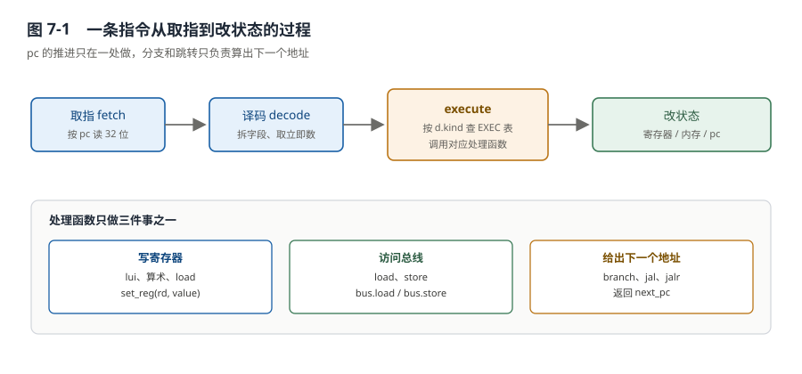
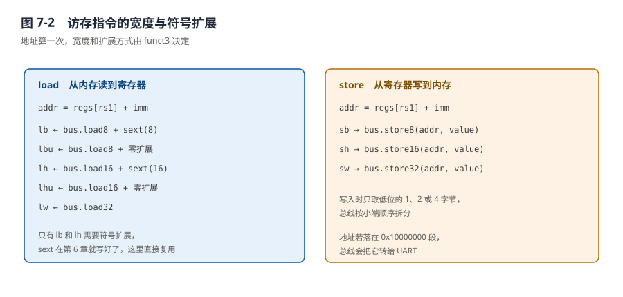
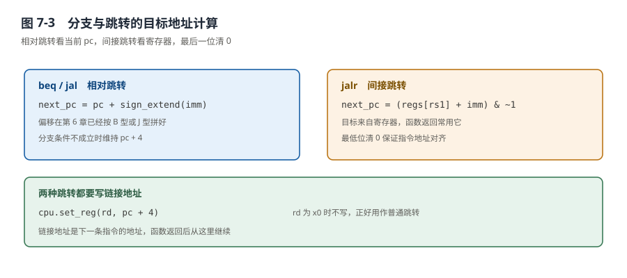
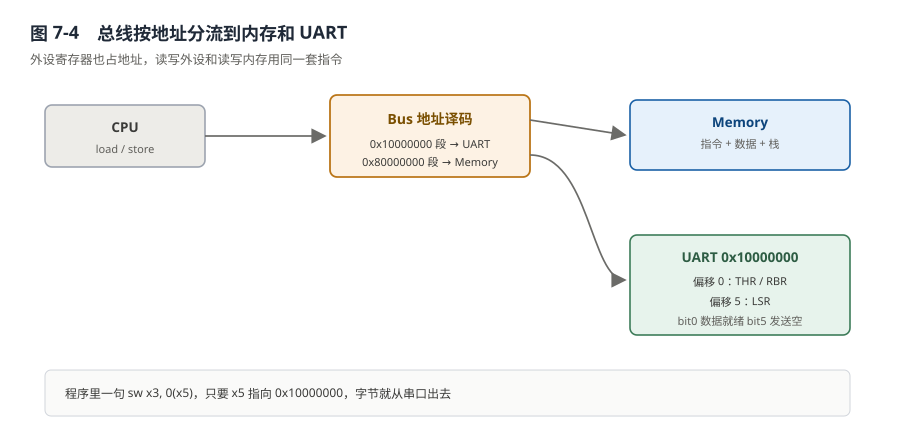

# 第 7 章　用 Python 写模拟器：执行与访存

> 本章导读
>
> 上一章的模拟器能取指、能译码，但只能把指令打印出来，寄存器始终没变过。这一章给它接上执行部分。算术运算改寄存器，访存指令走总线，分支跳转改 pc。等这些齐了，第 3 章写的汇编程序就能在模拟器里跑起来，每执行一条指令打印一次寄存器状态。最后再加一个简化的串口，让程序能输出字符。

## 7.1　执行一条指令要改什么

译码之后，手里有一个 `Inst`，里面装着操作码、寄存器号、立即数和指令类别。执行要做的事，说到底就是改三样东西：寄存器、内存、pc。

算术指令只改寄存器。load 和 store 要碰内存。分支跳转要改 pc，让下一条指令不在顺序的位置上。ecall 特殊，它让模拟器停下来。

这三件事的分布如附图。



*图 7-1　一条指令从取指到改状态的过程*

先定接口。执行函数拿到三个东西：CPU 状态（读写 pc 和寄存器）、译码结果、总线（访问内存和串口）。返回是否继续运行。

```python
def execute(cpu, d, bus):
    """执行一条已译码指令，返回 running；pc 的推进集中在这里。"""
    pc = cpu.get_pc()
    next_pc, running = EXEC[d.kind](cpu, d, bus, pc)
    cpu.set_pc(next_pc)
    return running
```

这里有两点值得说。第一，pc 的推进集中在 `execute` 里做。每个处理函数返回它算出的 `next_pc`，普通指令返回 `pc + 4`，分支指令返回跳转目标。这样不会漏掉 pc 更新，也不会出现两处都改 pc 的混乱。第二，用 `EXEC` 查表分发，而不是写一长串 `if`。表的键是上一章译出的 `kind`，值是对应的处理函数。

处理函数的统一签名是 `(cpu, d, bus, pc)`，返回 `(next_pc, running)`。参数多，但形状一致，查表才使得起来。

## 7.2　最简单的两条：lui 和 auipc

从最简单的开始。这两条指令只写一个寄存器，别的都不碰。

`lui` 把立即数直接放进 rd。上一章的 `imm_u` 已经把高 20 位摆好、低 12 位填了 0，这里直接写进去就行。

```python
def ex_lui(cpu, d, bus, pc):
    cpu.set_reg(d.rd, d.imm)
    return u32(pc + 4), True
```

`auipc` 多一步，要把当前 pc 加上去。这个名字就是 add upper immediate to pc 的缩写。

```python
def ex_auipc(cpu, d, bus, pc):
    cpu.set_reg(d.rd, u32(pc + d.imm))
    return u32(pc + 4), True
```

两处都调用了 `u32`。这是本章反复要用的工具。Python 的整数不限宽度，5 加 10 得 15 没问题，但 `0xFFFFFFFF + 1` 会得到 `0x100000000`，九位十六进制数，不是 32 位处理器的行为。得手动截断。

```python
MASK = 0xFFFFFFFF


def u32(value):
    return value & MASK


def s32(value):
    return sext(value, 32)
```

`s32` 反过来，把一个 32 位模式按补码解释成 Python 的负数。有符号比较和算术右移都要用它。`sext` 是上一章写的函数，直接拿来用。

## 7.3　ALU 运算：把第 5 章的电路搬进软件

第 5 章用门电路搭了 ALU，这里用 Python 函数实现同样的运算。R 型指令的两个操作数都来自寄存器，I 型指令的一个操作数来自立即数。

运算本身用字典装起来，每个名字对应一个 lambda。

```python
R_OPS = {
    "add": lambda a, b: u32(a + b),
    "sub": lambda a, b: u32(a - b),
    "sll": lambda a, b: u32(a << (b & 0x1F)),
    "slt": lambda a, b: 1 if s32(a) < s32(b) else 0,
    "sltu": lambda a, b: 1 if u32(a) < u32(b) else 0,
    "xor": lambda a, b: a ^ b,
    "srl": lambda a, b: u32(a) >> (b & 0x1F),
    "sra": lambda a, b: u32(s32(a) >> (b & 0x1F)),
    "or": lambda a, b: a | b,
    "and": lambda a, b: a & b,
}
```

几个细节要留意。移位量只取低 5 位，因为 RV32I 的寄存器移位位数是 5 位；取 `b & 0x1F` 正好模拟硬件里只接低 5 根线。`srl` 是逻辑右移，先按无符号看；`sra` 是算术右移，先按有符号看，移动完再截回 32 位。`slt` 和 `sltu` 的区别也在这里，一个走 `s32`，一个走 `u32`。

处理函数先取操作数，再查表算，最后写回。

```python
def ex_op(cpu, d, bus, pc):
    a = cpu.get_reg(d.rs1)
    b = cpu.get_reg(d.rs2)
    cpu.set_reg(d.rd, R_OPS[d.name](a, b))
    return u32(pc + 4), True
```

I 型这边稍有不同。移位指令的立即数字段里，低 5 位是移位量，高 7 位是 funct7；其他指令的立即数就是一个普通的 12 位数。上一章的 `imm_i` 已经把它符号扩展好了，加减和逻辑运算直接用，`slli`、`srli`、`srai` 单独取低 5 位。

```python
I_OPS = {
    "addi": lambda a, imm: u32(a + imm),
    "slti": lambda a, imm: 1 if s32(a) < imm else 0,
    "sltiu": lambda a, imm: 1 if u32(a) < u32(imm) else 0,
    "xori": lambda a, imm: a ^ u32(imm),
    "ori": lambda a, imm: a | u32(imm),
    "andi": lambda a, imm: a & u32(imm),
    "srli": lambda a, imm: u32(a) >> (imm & 0x1F),
    "srai": lambda a, imm: u32(s32(a) >> (imm & 0x1F)),
}
```

```python
def ex_op_imm(cpu, d, bus, pc):
    a = cpu.get_reg(d.rs1)
    if d.name in ("slli", "srli", "srai"):
        shamt = d.imm & 0x1F
        if d.name == "slli":
            result = u32(a << shamt)
        elif d.name == "srli":
            result = u32(a) >> shamt
        else:
            result = u32(s32(a) >> shamt)
    else:
        result = I_OPS[d.name](a, d.imm)
    cpu.set_reg(d.rd, result)
    return u32(pc + 4), True
```

写这一章时发现第 6 章的译码表漏了 `slli`。它的 funct3 是 001，上一章的 `OP_IMM_NAME` 没列这一项，译出来会是 `op-imm?`。现在补上即可。

```python
OP_IMM_NAME = {0: "addi", 1: "slli", 2: "slti", 3: "sltiu", 4: "xori", 6: "ori", 7: "andi"}
```

同时让 `disasm` 认识它。这是渐进开发里常见的事：写执行代码时才会发现译码漏了一种情况。

## 7.4　访存：地址算一次，宽度各不同

load 和 store 都要先算地址，再用上一章的 `bus` 读写。地址是 `regs[rs1] + imm`，算完也要 `u32` 截断。

```python
def ex_load(cpu, d, bus, pc):
    addr = u32(cpu.get_reg(d.rs1) + d.imm)
    if d.name == "lb":
        value = sext(bus.load8(addr), 8)
    elif d.name == "lbu":
        value = bus.load8(addr)
    elif d.name == "lh":
        value = sext(bus.load16(addr), 16)
    elif d.name == "lhu":
        value = bus.load16(addr)
    else:
        value = bus.load32(addr)
    cpu.set_reg(d.rd, value)
    return u32(pc + 4), True
```

宽度和符号扩展都由 `d.name` 决定，如附图。`lb` 和 `lh` 要符号扩展，`lbu` 和 `lhu` 只要零扩展，`lw` 读出来的就是 32 位，不必再处理。第 6 章的 `sext` 在这里派上用场，传 8 或 16 进去就行。



*图 7-2　访存指令的宽度与符号扩展*

store 更简单，没有符号扩展这回事，只需按宽度把值的低位写出去。

```python
def ex_store(cpu, d, bus, pc):
    addr = u32(cpu.get_reg(d.rs1) + d.imm)
    value = cpu.get_reg(d.rs2)
    if d.name == "sb":
        bus.store8(addr, value)
    elif d.name == "sh":
        bus.store16(addr, value)
    else:
        bus.store32(addr, value)
    return u32(pc + 4), True
```

## 7.5　分支与跳转：只负责算出下一个地址

分支指令比较两个数，条件成立才跳。六种比较写在一起，最后统一返回目标或 `pc + 4`。

```python
def ex_branch(cpu, d, bus, pc):
    a = cpu.get_reg(d.rs1)
    b = cpu.get_reg(d.rs2)
    name = d.name
    if name == "beq":
        taken = a == b
    elif name == "bne":
        taken = a != b
    elif name == "blt":
        taken = s32(a) < s32(b)
    elif name == "bge":
        taken = s32(a) >= s32(b)
    elif name == "bltu":
        taken = u32(a) < u32(b)
    else:
        taken = u32(a) >= u32(b)
    return (u32(pc + d.imm) if taken else u32(pc + 4)), True
```

有符号和无符号的比较各走各的转换，和 ALU 里的 `slt`、`sltu` 是同一套道理。

`jal` 是相对跳转，顺手把返回地址写进 rd。`jalr` 是间接跳转，目标来自寄存器加立即数，最低位要清 0。



*图 7-3　分支与跳转的目标地址计算*

```python
def ex_jal(cpu, d, bus, pc):
    cpu.set_reg(d.rd, u32(pc + 4))
    return u32(pc + d.imm), True


def ex_jalr(cpu, d, bus, pc):
    target = u32((cpu.get_reg(d.rs1) + d.imm) & ~1)
    cpu.set_reg(d.rd, u32(pc + 4))
    return target, True
```

图里把两种跳转画在一起，是因为它们都要写链接地址。`rd` 为 x0 时不写，于是同一条指令也能当普通跳转用，这正是第 3 章里 `j` 伪指令的实现方式。

## 7.6　收尾：ecall 停机与分发表

剩下的三条很短。`fence` 在单核功能模型里没有实际动作，直接往下走。`system` 类的 `ecall` 和 `ebreak` 让模拟器停下来，返回 `running = False`。非法的指令字抛异常，别让它悄悄混过去。

```python
def ex_fence(cpu, d, bus, pc):
    return u32(pc + 4), True


def ex_system(cpu, d, bus, pc):
    return u32(pc + 4), False


def ex_illegal(cpu, d, bus, pc):
    raise ValueError("illegal instruction at pc=0x%08x" % pc)
```

把处理函数登记到表里，`execute` 就能按类别找到它们。

```python
EXEC = {
    "lui": ex_lui, "auipc": ex_auipc,
    "op": ex_op, "op-imm": ex_op_imm,
    "load": ex_load, "store": ex_store,
    "branch": ex_branch, "jal": ex_jal, "jalr": ex_jalr,
    "fence": ex_fence, "system": ex_system, "illegal": ex_illegal,
}
```

完整的 `execute.py` 就是把上面这些函数按依赖顺序排好：先是 `u32`、`s32`，再是各个处理函数，然后是 `EXEC` 表和 `execute`。放在 `code/python/07_simulator/` 下。

## 7.7　运行器：让程序真正跑起来

有了执行函数，还差一个循环：装载程序，取指，译码，执行，重复到停机。`run.py` 做这件事，并在每步之后打印发生变化的寄存器。

```python
def run(words, data_chunks=(), max_steps=1000, trace=True):
    bus = Bus()
    load_program(bus, words, data_chunks)
    cpu = CPU(bus)
    steps = 0
    running = True
    while running and steps < max_steps:
        pc = cpu.get_pc()
        word = cpu.fetch()
        d = decode(word)
        before = list(cpu.regs)
        running = execute(cpu, d, bus)
        after = list(cpu.regs)
        steps += 1
        if trace:
            changed = ["x%d=0x%08x" % (i, after[i])
                       for i in range(1, 32) if before[i] != after[i]]
            print("pc=0x%08x  %-24s  %s"
                  % (pc, disasm(word), "  ".join(changed)))
    if steps >= max_steps:
        raise RuntimeError("step limit reached")
    return cpu, bus, steps
```

`before` 和 `after` 两份寄存器快照相减，只打印变了的那些。一路打印全部 32 个寄存器会很吵，看 traces 时反而找不到重点。`max_steps` 是死循环的保险，跑过一千条还没停机就报错。

装载程序也有讲究。`words` 是机器码列表，从 `0x80000000` 开始一条条放。`data_chunks` 放数据，可以是整数列表（按字放），也可以是字节串（按字节放）。

```python
def load_program(bus, words, data_chunks=()):
    for i, word in enumerate(words):
        bus.store32(BASE + 4 * i, word)
    for addr, blob in data_chunks:
        if isinstance(blob, int):
            bus.store32(addr, blob)
        elif isinstance(blob, (list, tuple)):
            for j, word in enumerate(blob):
                bus.store32(addr + 4 * j, word)
        else:
            for j, byte in enumerate(blob):
                bus.store8(addr + j, byte)
```

这里踩过一个坑。数组求和的数据是整数列表，初版把它当字节串处理，只写了五个字节，读出来的数组自然不对。现在按类型分支，整数列表按字写，字节串按字节写。

## 7.8　走通例子：数组求和

拿第 3 章的数组求和做个完整演示。程序用 `encode.py` 里的辅助函数拼出机器码，注释写着对应的汇编。

```
0  lui   x1, 0x80000       # x1 指向数组
1  addi  x1, x1, 256
2  addi  x2, x0, 5         # 剩余 5 个数
3  addi  x3, x0, 0         # 累加和清零
4  lw    x4, 0(x1)         # loop
5  add   x3, x3, x4
6  addi  x1, x1, 4
7  addi  x2, x2, -1
8  bne   x2, x0, -16       # 回 loop
9  lui   x5, 0x10000       # x5 指向串口
10 sw    x3, 0(x5)
11 ecall
```

运行结果的前几步和后几步如下。

```
pc=0x80000000  lui x1, 0x80000           x1=0x80000000
pc=0x80000004  addi x1, x1, 256          x1=0x80000100
pc=0x80000008  addi x2, x0, 5            x2=0x00000005
pc=0x8000000c  addi x3, x0, 0
pc=0x80000010  lw x4, 0(x1)              x4=0x0000000a
pc=0x80000014  add x3, x3, x4            x3=0x0000000a
...
pc=0x80000010  lw x4, 0(x1)              x4=0x00000032
pc=0x80000014  add x3, x3, x4            x3=0x00000096
...
pc=0x80000028  sw x3, 0(x5)
pc=0x8000002c  ecall
```

数组是 `[10, 20, 30, 40, 50]`，累加和 `0x96` 就是十进制 150。第 8 条 `bne` 的偏移是 -16，从 pc `0x80000020` 回到 `0x80000010`，正好是循环开头。整段跑 32 步。

这份 traces 就是调试工具。哪条指令没按预期改寄存器，一眼就能看到。第 8 章搭硬件时，会用测试台打印同样的信息，和这里对照。

## 7.9　给模拟器接一个串口

现在加外设。RISC-V 采用内存映射 I/O，外设寄存器也占一段地址，读写外设和读写内存用同一套指令。第 12 章会详细讲，这里先接一个简化的 16550 UART 让程序能输出字符。

先做 UART 本身。真实的 16550 有一堆寄存器，这里只留两个：偏移 0 是数据寄存器，写进去就是发送，读出来就是接收；偏移 5 是线路状态寄存器，bit 0 表示有数据可读，bit 5 表示发送保持寄存器为空。

```python
class UART:
    def __init__(self):
        self.rx_fifo = []
        self.tx_log = []

    def feed(self, data):
        if isinstance(data, str):
            data = data.encode("ascii")
        self.rx_fifo.extend(data)

    def read(self, offset):
        if offset == RBR:
            return self.rx_fifo.pop(0) if self.rx_fifo else 0
        if offset == LSR:
            status = LSR_THRE
            if self.rx_fifo:
                status |= LSR_DR
            return status
        return 0

    def write(self, offset, value):
        if offset == THR:
            self.tx_log.append(value & 0xFF)

    def output(self):
        return bytes(self.tx_log).decode("ascii", errors="replace")
```

`feed` 是宿主机往模拟器里送字符，`tx_log` 记录模拟器发出去的字符。状态位里 THRE 恒为 1，因为我们的串口没有真正的发送延迟，写进去就算发完了。

再写总线。它按地址分流：落在 UART 地址段的转给 UART，其余的转给内存。对 CPU 来说，接口和原来的 Memory 一样，所以把 `Bus` 实例传给 `CPU` 即可，不必改 CPU 的代码。



*图 7-4　总线按地址分流到内存和 UART*

```python
class Bus:
    def __init__(self, mem=None, uart=None):
        self.mem = mem if mem is not None else Memory()
        self.uart = uart if uart is not None else UART()

    def _is_uart(self, addr):
        return UART_BASE <= addr < UART_BASE + UART_SIZE

    def load8(self, addr):
        if self._is_uart(addr):
            return self.uart.read(addr - UART_BASE)
        return self.mem.load8(addr)

    def store8(self, addr, value):
        if self._is_uart(addr):
            self.uart.write(addr - UART_BASE, value)
            return
        self.mem.store8(addr, value)
```

字节访问分流后，半字和字访问就用字节拼。这样 UART 只需实现 `read` 和 `write`，不必管 16 位和 32 位。

```python
    def load16(self, addr):
        return self.load8(addr) | (self.load8(addr + 1) << 8)

    def store16(self, addr, value):
        self.store8(addr, value)
        self.store8(addr + 1, value >> 8)

    def load32(self, addr):
        return (self.load8(addr)
                | (self.load8(addr + 1) << 8)
                | (self.load8(addr + 2) << 16)
                | (self.load8(addr + 3) << 24))

    def store32(self, addr, value):
        self.store8(addr, value)
        self.store8(addr + 1, value >> 8)
        self.store8(addr + 2, value >> 16)
        self.store8(addr + 3, value >> 24)
```

程序那边只要让 x5 指向 `0x10000000`，一句 `sw x3, 0(x5)` 就把字节送到了串口。数组求和程序末尾那句 `sw` 就是这个用意，它把结果 150 写进了 `tx_log`。

另一个示例程序逐字节读字符串，遇到结尾 0 停下，运行后 `uart.output()` 得到 `Hi, RV32I!`。这就是第 12 章访问外设的雏形：没有专门的 I/O 指令，全靠地址和读写。

## 7.10　实验

本章代码在 `code/python/07_simulator/`，目录里带了第 6 章的三个基础模块，可以独立运行。

```
cd code/python/07_simulator
python test_execute.py
```

`test_execute.py` 有 58 项检查，覆盖 32 位回绕、R 型和 I 型运算、五种 load 与三种 store、六种分支、jal 与 jalr、总线分流、UART 读写，以及两个完整程序。全部通过会打印 `ALL TESTS PASSED`。

想看执行轨迹，用 `run.py` 里的小例子，或者直接：

```
python -c "from programs import *; from run import run; run(SUM_PROGRAM, [(SUM_DATA_ADDR, SUM_DATA)])"
```

调试时最有用的就是这份轨迹。初版测试和示例程序里有几处错误，都是靠轨迹和逐项核对找出来的：R 型用例把两个操作数写反、`auipc` 的期望值少加了一个 pc、`jalr` 前忘设源寄存器、数组求和的 `add` 指令把 x3 当成了两个源。这些问题藏在机器码里，光看十六进制很难发现，跑一遍轨迹就清楚了。

## 7.11　功能级模型的意义

到这一章为止，模拟器已经能跑完整的 RV32I 程序。它没有时钟，也没有流水线，一条指令接着一条执行。这恰恰是它的用处：把指令的语义单独拎出来，不受微结构细节干扰。

第 8 章搭单周期处理器时，硬件每个周期做完一条指令，结果应该和这里逐步执行一致。第 9、10 章引入流水线和转发，中间状态会复杂得多，但每条指令最终留下的状态仍然要对得上。有这个模型在，硬件仿真结果就有了一个可靠的参照。

现在还有两块没做。一是 CSR 和特权指令，`ecall` 只是停机，没有真正的异常号和陷阱处理；二是中断，定时器到点时 CPU 该响应什么。这些留到第 11 章。二是外设只做了串口，GPIO 和定时器留到第 12 章。

## 7.12　本章小结

- 执行函数按译码出的 `kind` 查表分发到处理函数，处理函数返回下一个 pc 和是否继续运行，pc 的推进集中在 `execute` 一处。
- Python 整数不限宽度，所有运算结果都要用 `u32` 截成 32 位；有符号比较和算术右移先用 `s32` 转成负数。
- R 型运算用 `funct7` 和 `funct3` 共同区分，I 型移位指令的移位量取立即数低 5 位。第 6 章漏掉的 `slli` 在本章补上。
- load 按 funct3 决定读字节、半字还是字，`lb` 和 `lh` 要做符号扩展；store 按宽度写低位字节。
- 分支目标是 `pc + imm`，jal 也是相对跳转并写链接地址，jalr 目标是 `(rs1 + imm) & ~1`。
- 总线按地址把访问分流给内存和 UART，CPU 看到的是同一套 load/store 接口。这样第 6 章的 CPU 代码不必改。
- 运行器打印每条指令后发生变化的寄存器，形成一份能用来调试程序状态的执行轨迹。

## 思考题

1. 如果把 `execute` 里的 `cpu.set_pc(next_pc)` 移到每个处理函数里各自实现，会有什么风险？举一个容易漏掉的路径。
2. `sra` 的实现是 `u32(s32(a) >> (b & 0x1F))`。如果去掉外层的 `u32`，Python 会返回什么？对后续 `get_reg` 和分支比较有什么影响？
3. `jalr` 为什么要把目标地址的最低位清 0？如果不清，在 RV32I 上会发生什么？
4. 总线的 `load32` 用四次 `load8` 拼成。如果访问 UART 地址段，这四次读分别读到什么？这样的设计对真实的 16550 合理吗？
5. 运行器只打印变化的寄存器。如果想观察某个寄存器"被写了同样的值"，该怎么改？这样做在调试什么问题时有用？

*下一章进入硬件实现，用 Verilog 搭一个单周期处理器，把这一章的软件模型变成真实的电路。*
