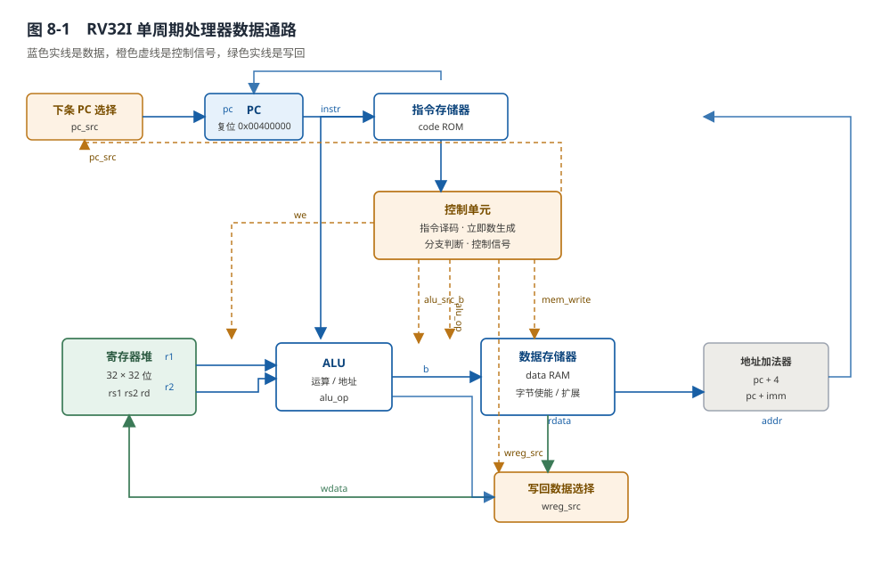
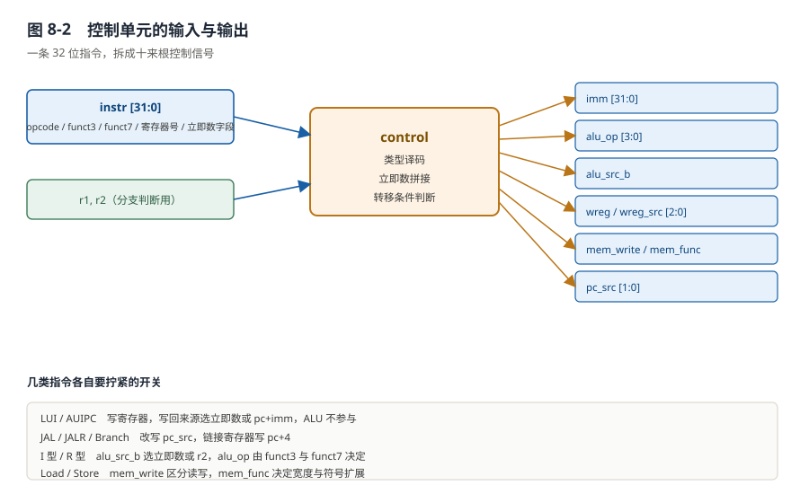
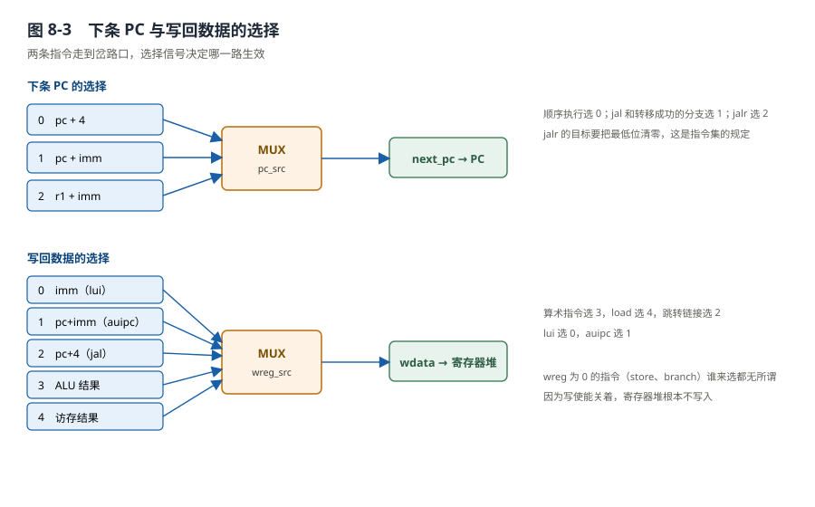
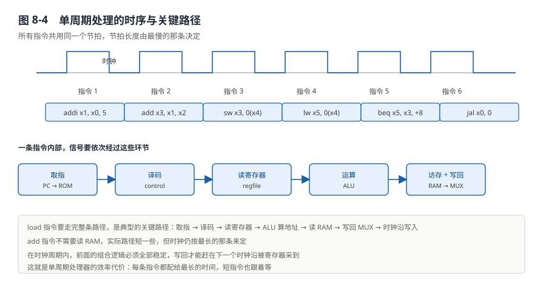

# 第 8 章　单周期处理器

## 本章导读

前面两章用 Python 写了一个能跑程序的模拟器。它把每条指令的动作写成函数，按顺序调用，改的是内存里的几个变量。这一章要做同样的事，但换一种实现方式：把每条指令的动作做成电路，让信号在导线里流动，用一个时钟把结果存下来。

听起来跨度很大，其实两边讲的是同一件事。模拟器里的 `cpu.pc` 对应硬件里的 PC 寄存器，`cpu.regs[1]` 对应寄存器堆的第 1 项，`execute()` 函数里那一串 `if` 对应硬件里的控制逻辑。软件是一条一条执行，硬件是所有部件同时连着，靠控制信号决定这一拍谁起作用。

这一章搭的是一个单周期处理器：每条指令占用一个完整的时钟周期，从取指到写回在这一拍里走完。它不快，但结构最清楚，是理解后面流水线的基础。

## 8.1　把软件模型换成电路，变的是什么

先看第 7 章模拟器执行一条 `add` 指令的过程。伪代码大致是这样：

```python
inst = cpu.fetch()         # 从内存取一条指令
d = decode(inst)           # 拆出字段
r1 = cpu.get_reg(d.rs1)    # 读寄存器
r2 = cpu.get_reg(d.rs2)
result = r1 + r2           # 运算
cpu.set_reg(d.rd, result)  # 写回
cpu.set_pc(cpu.pc + 4)     # 指向下一条
```

这几行在软件里是先后执行的，每一步都改一次 CPU 对象的状态。硬件不能这么写。硬件里没有"先执行这一行再执行下一行"的说法，所有门电路从通电那一刻起就一直在算。

硬件的做法是把上面每一步变成一个部件：PC 寄存器保存当前地址，指令存储器按地址给出指令，译码器拆字段，寄存器堆读出两个操作数，ALU 做运算，最后在时钟沿把结果写回寄存器堆。这些部件从一开始就连在一起，同一时刻都在工作。控制信号的作用是让这一拍里只有该起作用的那条路通。

这里有个重要区别。软件里改变量是立即生效的，硬件里寄存器只在时钟沿才更新。所以 `cpu.set_reg(d.rd, result)` 在硬件里对应的是：组合逻辑算出 `result`，连到寄存器堆的写数据口，等时钟沿到来才真正写进去。时钟沿之前，寄存器堆里还是旧值。

理解了这一点，剩下的就是连线题。

## 8.2　先定几个基本部件

搭处理器之前，先把装状态的几个箱子准备好。第 5 章课件里把它们叫基本部件：程序计数器、寄存器堆、指令存储器、数据存储器。它们共同保存了处理器的全部状态，一条指令的执行就是按控制信号修改这些状态。

### 8.2.1　程序计数器 PC

PC 要做的事很简单：时钟来了，把 `next_pc` 存进去。先看接口。时钟和要存的数据是必须的，于是有 `clk` 和 `next_pc`，输出是当前的 `cur_pc`。但复位之后 PC 必须落在一个确定的地址，否则第一条指令会从未知地址去取，所以还要一个 `rst_n`。接口攒齐了。

```verilog
module pc (
    input  wire        clk,
    input  wire        rst_n,
    input  wire [31:0] next_pc,
    output reg  [31:0] cur_pc
);
```

复位地址取多少？代码段从 `0x00400000` 开始，这是课件里定的内存布局，也是后面测试程序链接的地址。所以复位时把 PC 指到这里。寄存器用同步复位，和寄存器堆保持一致。

```verilog
    localparam [31:0] RESET_PC = 32'h00400000;

    always @(posedge clk) begin
        if (!rst_n)
            cur_pc <= RESET_PC;
        else
            cur_pc <= next_pc;
    end
```

这个模块只有十几行，但它定义了处理器的一条时间轴：每个时钟沿，PC 前进一步。

### 8.2.2　寄存器堆直接拿来用

第 5 章已经搭好了 32 个 32 位寄存器组成的寄存器堆，带两个读端口、一个写端口，`x0` 固定读出 0。单周期处理器需要的正是这个东西，直接把 `regfile.v` 复制过来即可，不必重写。

它的接口是 `rs1`、`rs2` 两个读编号，`rd` 写编号，`we` 写使能，`wdata` 写数据，加上时钟和复位。读端口是组合的，给编号就出数据；写端口是时序的，时钟沿才写入。这个组合和时序的搭配，在单周期里刚好合适：同一拍里先读出旧值去运算，时钟沿再把新值写回去。

### 8.2.3　指令存储器

指令存储器装的是程序机器码。课堂上它由 RARS 导出成 `code.hex`，每行一个 32 位十六进制数。Verilog 用 `$readmemh` 把这个文件读进数组。接口上只要一个地址输入 `addr` 和一个指令输出 `instr`，因为它只读不写。

```verilog
module imem (
    input  wire [31:0] addr,
    output reg  [31:0] instr
);

    localparam [31:0] BASE   = 32'h00400000;
    localparam        IDX_W  = 10;
    localparam        DEPTH  = 1 << IDX_W;

    reg [31:0] mem [0:DEPTH-1];

    initial begin
        $readmemh("code.hex", mem);
    end
```

`BASE` 是代码段起始地址，`DEPTH` 是容量，这里取 1024 个字。地址减去基址得到字节偏移，再右移两位换成字地址，就是数组下标。

```verilog
    wire [31:0] offset = addr - BASE;
    wire [IDX_W-1:0] idx = offset[IDX_W+1:2];

    always @(*) begin
        if (addr >= BASE && offset < DEPTH * 4)
            instr = mem[idx];
        else
            instr = 32'h00000013;
    end

endmodule
```

最后那个 `0x00000013` 是 `addi x0, x0, 0`，一条什么都不做的空指令。程序跑出代码段时给它这个，不会执行出乱子。

有个细节值得留意：`idx` 用的是 `offset[IDX_W+1:2]`，忽略了低两位。因为指令是 4 字节对齐的，低两位本来就是 0。PC 每次加 4，正好落在字的边界上。

### 8.2.4　数据存储器

数据存储器比指令存储器麻烦一点，因为 load 和 store 有字节、半字、字三种宽度，还要区分有符号和无符号。接口上除了地址 `addr`、写使能 `we`、写数据 `wdata`、读数据 `rdata`，还得有一个 `funct3` 告诉它这次访问是什么宽度。

```verilog
module dmem (
    input  wire        clk,
    input  wire [31:0] addr,
    input  wire        we,
    input  wire [2:0]  funct3,
    input  wire [31:0] wdata,
    output reg  [31:0] rdata
);
```

数据区从 `0x10000000` 开始。这里按字节存，一个字节一个格子，容量 4096 字节。教学上够用，真实的内存当然大得多。

```verilog
    localparam [31:0] BASE  = 32'h10000000;
    localparam        IDX_W = 12;
    localparam        BYTES = 1 << IDX_W;

    reg [7:0] mem [0:BYTES-1];

    wire [31:0] offset     = addr - BASE;
    wire [IDX_W-1:0] byte_addr = offset[IDX_W-1:0];
```

写的时候要按宽度决定改几个字节。`sb` 只写最低字节，`sh` 写两个，`sw` 写四个。`be` 是四位的字节使能，哪一位为 1 就写哪个字节。

```verilog
    reg [3:0] be;
    always @(*) begin
        case (funct3)
            3'b000: be = 4'b0001;
            3'b001: be = 4'b0011;
            3'b010: be = 4'b1111;
            default: be = 4'b0000;
        endcase
    end
```

写操作发生在时钟沿，用 `for` 循环逐字节判断使能位。`wdata[i*8 +: 8]` 是 Verilog 的部分选择语法，取第 `i` 个字节。

```verilog
    integer i;
    always @(posedge clk) begin
        if (we) begin
            for (i = 0; i < 4; i = i + 1)
                if (be[i])
                    mem[byte_addr + i] <= wdata[i*8 +: 8];
        end
    end
```

读是组合的，取出字节后按 `funct3` 拼接和扩展。`lb` 要把第 8 位复制到高 24 位，`lbu` 直接补零；`lh` 和 `lhu` 同理；`lw` 四个字节原样排好。

```verilog
    wire [7:0] b0 = (addr >= BASE) ? mem[byte_addr]     : 8'b0;
    wire [7:0] b1 = (addr >= BASE) ? mem[byte_addr + 1] : 8'b0;
    wire [7:0] b2 = (addr >= BASE) ? mem[byte_addr + 2] : 8'b0;
    wire [7:0] b3 = (addr >= BASE) ? mem[byte_addr + 3] : 8'b0;

    always @(*) begin
        case (funct3)
            3'b000: rdata = {{24{b0[7]}}, b0};
            3'b001: rdata = {{16{b1[7]}}, b1, b0};
            3'b010: rdata = {b3, b2, b1, b0};
            3'b100: rdata = {24'b0, b0};
            3'b101: rdata = {16'b0, b1, b0};
            default: rdata = 32'b0;
        endcase
    end

endmodule
```

这里复用了第 7 章讲过的小端规则：低地址放低字节。store 写的时候用 `wdata[i*8 +: 8]` 先写低位字节，load 读的时候把 `b0` 放在最低位，两边对得上。



*图 8-1　RV32I 单周期处理器数据通路*

## 8.3　把部件连成一条通路

部件齐了，接下来连线。图 8-1 是完整的数据通路，看着线多，其实顺着一条指令走一遍就清楚了。

取指：PC 的输出接到指令存储器的地址口，指令存储器给出 `instr`。

译码：`instr` 一方面送进控制单元，另一方面把寄存器号字段直接接到寄存器堆的 `rs1`、`rs2`、`rd`。这三个字段在指令格式里的位置是固定的（第 2 章讲过），所以不用等译码结果就能接。

执行：寄存器堆读出的 `r1`、`r2` 接到 ALU 的两个输入。第二个输入前面放一个选择开关 `alu_src_b`，I 型指令选立即数，R 型指令选 `r2`。

访存：ALU 的结果接到数据存储器的地址口。store 指令要写的数据是 `r2`，直接接到数据存储器的 `wdata`。写使能和访问宽度来自控制单元。

写回：数据存储器读出的 `rdata` 和 ALU 结果都接到写回开关 `wreg_src`，选中的一路接回寄存器堆的 `wdata`。时钟沿到来时，写使能若为 1，数据落进目标寄存器。

还要算下一条指令的地址。pc+4、pc+imm、jalr 目标三路结果送进 pc_src 开关，选中的一路回到 PC 的输入。这就闭上了环。

这里可以看出控制单元的位置：它自己不碰数据，只发出各种开关的选择信号和写使能。数据流和控制流分开，是处理器设计里常用的画法，后面讲流水线时这个习惯会帮上忙。

## 8.4　控制单元怎么想问题

控制单元是这一章最费脑子的部件。它的工作是把一条 32 位指令翻译成十来根控制信号。为此它先看 `opcode` 认出指令类型，再用 `funct3`、`funct7` 细分，最后按类型把每根信号摆到正确位置。图 8-2 画出了它的输入输出。



*图 8-2　控制单元的输入与输出*

### 8.4.1　先认出是哪一类指令

指令类型由 `opcode` 唯一决定。把 7 位 opcode 和常量比一比就知道是不是这一类。

```verilog
    wire [6:0] opcode = instr[6:0];
    wire [2:0] funct3 = instr[14:12];
    wire [6:0] funct7 = instr[31:25];

    wire is_lui    = (opcode == 7'b0110111);
    wire is_auipc  = (opcode == 7'b0010111);
    wire is_jal    = (opcode == 7'b1101111);
    wire is_jalr   = (opcode == 7'b1100111);
    wire is_branch = (opcode == 7'b1100011);
    wire is_load   = (opcode == 7'b0000011);
    wire is_store  = (opcode == 7'b0100011);
    wire is_itype  = (opcode == 7'b0010011);
    wire is_rtype  = (opcode == 7'b0110011);
```

这九根线搭起了一个骨架。后面每生成一个控制信号，基本上都是拿这些 `is_xxx` 做条件拼出来的。

### 8.4.2　立即数的五种拼法

第 2 章讲过六种指令格式里立即数的摆位。RV32I 有五种立即数：I、S、B、U、J。它们散落在指令的不同位置，控制单元要把各自的位捡出来，符号扩展到 32 位。

```verilog
    wire [31:0] imm_i = {{20{instr[31]}}, instr[31:20]};
    wire [31:0] imm_s = {{20{instr[31]}}, instr[31:25], instr[11:7]};
    wire [31:0] imm_b = {{19{instr[31]}}, instr[31], instr[7], instr[30:25], instr[11:8], 1'b0};
    wire [31:0] imm_u = {instr[31:12], 12'b0};
    wire [31:0] imm_j = {{11{instr[31]}}, instr[31], instr[19:12], instr[20], instr[30:21], 1'b0};
```

B 型和 J 型最绕，因为它们的位被打散了。这么摆是为了让译码电路简单：同一个位置的位在不同格式里含义尽量一致。B 型最低位固定为 0，J 型也是，所以分支和跳转的目标总是偶数地址。

五种都算好之后，按当前指令类型选一个输出。分支用 B 型，store 用 S 型，LUI 和 AUIPC 用 U 型，JAL 用 J 型，其余用 I 型。

```verilog
    reg [31:0] imm_r;
    always @(*) begin
        case (opcode)
            7'b0110111, 7'b0010111: imm_r = imm_u;
            7'b1101111:              imm_r = imm_j;
            7'b1100111, 7'b0010011, 7'b0000011: imm_r = imm_i;
            7'b0100011:              imm_r = imm_s;
            7'b1100011:              imm_r = imm_b;
            default:                 imm_r = 32'b0;
        endcase
    end
    assign imm = imm_r;
```

### 8.4.3　分支条件怎么判

六条分支指令的条件各不一样。`beq` 判相等，`bne` 判不等，`blt` 和 `bge` 判有符号大小，`bltu` 和 `bgeu` 判无符号大小。先把三个基础比较算出来。

```verilog
    wire eq  = (r1 == r2);
    wire lt  = ($signed(r1) < $signed(r2));
    wire ltu = (r1 < r2);
```

Verilog 里默认的比较是无符号的，所以有符号比较必须写 `$signed(r1)` 和 `$signed(r2)`。漏掉这个，`-1 < 1` 会判成假，因为无符号的 `0xFFFFFFFF` 比 1 大得多。这是新手常踩的坑，第 5 章做 ALU 里的 `slt` 时也遇到过。

有了三个基础比较，按 `funct3` 选条件。

```verilog
    reg branch_taken_r;
    always @(*) begin
        case (funct3)
            3'b000: branch_taken_r = eq;
            3'b001: branch_taken_r = !eq;
            3'b100: branch_taken_r = lt;
            3'b101: branch_taken_r = !lt;
            3'b110: branch_taken_r = ltu;
            3'b111: branch_taken_r = !ltu;
            default: branch_taken_r = 1'b0;
        endcase
    end
    assign branch_taken = branch_taken_r;
```

课堂实验里可以用 Digital 单步看这个判据。逐位异或再取反就能判断两个二进制数是否相等，`code/digital/08_branch_equal.dig` 搭的是一位的版本，拨动开关就能看到 XOr 输出和最终相等信号的关系。把它扩展到 32 位，就是 `beq` 的判据。

### 8.4.4　其余控制信号

写寄存器这件事，除了 store、branch 和系统指令，其他类型都要写。用一根 `wreg` 表示。

```verilog
    assign wreg = is_lui || is_auipc || is_jal || is_jalr || is_load || is_itype || is_rtype;
```

写什么进去？这由 `wreg_src` 决定。下条 PC 从哪来？由 `pc_src` 决定。这两处都是多路选择，先给每种来源编个号。

```verilog
    localparam [2:0] WR_IMM   = 3'd0;
    localparam [2:0] WR_PCIMM = 3'd1;
    localparam [2:0] WR_PC4   = 3'd2;
    localparam [2:0] WR_ALU   = 3'd3;
    localparam [2:0] WR_MEM   = 3'd4;

    localparam [1:0] PC_PC4  = 2'd0;
    localparam [1:0] PC_IMM  = 2'd1;
    localparam [1:0] PC_JALR = 2'd2;
```

LUI 写立即数，AUIPC 写 pc+imm，JAL 和 JALR 写 pc+4 作为链接地址，load 写访存结果，算术指令写 ALU 结果。按当前指令类型把编号摆到正确的位置。

```verilog
    reg [2:0] wreg_src_r;
    always @(*) begin
        if (is_lui)                    wreg_src_r = WR_IMM;
        else if (is_auipc)             wreg_src_r = WR_PCIMM;
        else if (is_jal || is_jalr)    wreg_src_r = WR_PC4;
        else if (is_load)              wreg_src_r = WR_MEM;
        else                           wreg_src_r = WR_ALU;
    end
    assign wreg_src = wreg_src_r;
```

下条 PC 的逻辑类似。顺序执行是 pc+4，JAL 和转移成功的分支是 pc+imm，JALR 是 r1+imm。

```verilog
    reg [1:0] pc_src_r;
    always @(*) begin
        if (is_jal || (is_branch && branch_taken_r)) pc_src_r = PC_IMM;
        else if (is_jalr)                            pc_src_r = PC_JALR;
        else                                         pc_src_r = PC_PC4;
    end
    assign pc_src = pc_src_r;
```

ALU 的第二个操作数，I 型指令和访存指令用立即数，R 型和分支用 `r2`。分支比较用的是 `r1` 和 `r2`，而地址计算才用立即数，这两个用途由控制单元里的不同通路分别处理。

```verilog
    assign alu_src_b = is_itype || is_load || is_store;
```

至此控制信号的来历都交代了。完整模块在 `code/verilog/08_single_cycle/control.v`，把上面这些片段按顺序拼起来就是它，另外还有 `alu_op`、`mem_write`、`mem_func` 三根信号的生成，它们同属这套编码约定。

## 8.5　ALU 的小改动

单周期处理器要执行全部 RV32I 整数指令，第 5 章那个 ALU 不够用了。它实现了加、减、与、或、异或、有符号小于、左移、逻辑右移八种运算，缺了无符号比较 `sltu` 和算术右移 `sra`。这两条在 RV32I 里都要用，补进运算表即可。

```verilog
    localparam ALU_ADD  = 4'd0;
    localparam ALU_SUB  = 4'd1;
    localparam ALU_AND  = 4'd2;
    localparam ALU_OR   = 4'd3;
    localparam ALU_XOR  = 4'd4;
    localparam ALU_SLT  = 4'd5;
    localparam ALU_SLTU = 4'd6;
    localparam ALU_SLL  = 4'd7;
    localparam ALU_SRL  = 4'd8;
    localparam ALU_SRA  = 4'd9;
```

运算体直接用 Verilog 的运算符写，不再逐层例化第 5 章的加法器。这是行为级描述，综合工具会把它变成对应的门电路，仿真结果一致。

```verilog
    always @(*) begin
        case (alu_op)
            ALU_ADD:  result = a + b;
            ALU_SUB:  result = a - b;
            ALU_AND:  result = a & b;
            ALU_OR:   result = a | b;
            ALU_XOR:  result = a ^ b;
            ALU_SLT:  result = ($signed(a) < $signed(b)) ? 32'd1 : 32'd0;
            ALU_SLTU: result = (a < b) ? 32'd1 : 32'd0;
            ALU_SLL:  result = a << b[4:0];
            ALU_SRL:  result = a >> b[4:0];
            ALU_SRA:  result = $signed(a) >>> b[4:0];
            default:  result = 32'b0;
        endcase
    end
```

`>>>` 是算术右移，配合 `$signed(a)` 会在右移时补符号位。`alu_sltu` 用无符号比较，`alu_slt` 用 `$signed` 包一下。第 5 章讲过的道理在这里原样重现。

控制单元要给 ALU 发正确的 `alu_op`。I 型看 `funct3`，移位指令还要看 `funct7` 的高位；R 型同时看 `funct3` 和 `funct7`。这是第 2 章指令格式表的直接翻译。

```verilog
        if (is_itype) begin
            case (funct3)
                3'b000: alu_op_r = ALU_ADD;
                3'b010: alu_op_r = ALU_SLT;
                3'b011: alu_op_r = ALU_SLTU;
                3'b100: alu_op_r = ALU_XOR;
                3'b110: alu_op_r = ALU_OR;
                3'b111: alu_op_r = ALU_AND;
                3'b001: alu_op_r = ALU_SLL;
                3'b101: alu_op_r = funct7[5] ? ALU_SRA : ALU_SRL;
                default: alu_op_r = ALU_ADD;
            endcase
        end else if (is_rtype) begin
            case (funct3)
                3'b000: alu_op_r = funct7[5] ? ALU_SUB : ALU_ADD;
                3'b001: alu_op_r = ALU_SLL;
                3'b010: alu_op_r = ALU_SLT;
                3'b011: alu_op_r = ALU_SLTU;
                3'b100: alu_op_r = ALU_XOR;
                3'b101: alu_op_r = funct7[5] ? ALU_SRA : ALU_SRL;
                3'b110: alu_op_r = ALU_OR;
                3'b111: alu_op_r = ALU_AND;
                default: alu_op_r = ALU_ADD;
            endcase
        end else begin
            alu_op_r = ALU_ADD;
        end
```

最后那个 `else` 给 LUI、AUIPC、JAL 这类指令一个默认的加法。它们要么不用 ALU，要么地址计算本来就是加法，给个 `ALU_ADD` 不会出错。

有个约定要记牢：ALU 模块里 `ALU_ADD=0`、`ALU_SUB=1` 这些编号，和控制单元里同名的 `localparam` 必须一致。两边各自定义了一份，改的时候要一起改。这是手写 Verilog 常见的小麻烦，第 9 章把控制逻辑并进流水线后，这个问题会自然消失。

## 8.6　顶层连接

部件和接口都齐了，剩下的工作是在顶层把它们接起来。图 8-3 把两个关键的选择点单独画出来：下条 PC 的来源，和写回数据的来源。



*图 8-3　下条 PC 与写回数据的选择*

顶层先声明一串连线，把各部件的输入输出接在一起。这里没有新的逻辑，全是连线。

```verilog
    pc u_pc (
        .clk     (clk),
        .rst_n   (rst_n),
        .next_pc (next_pc),
        .cur_pc  (pc)
    );

    imem u_imem (
        .addr  (pc),
        .instr (instr)
    );

    control u_control (
        .instr        (instr),
        .r1           (r1),
        .r2           (r2),
        .imm          (imm),
        .wreg         (wreg),
        .wreg_src     (wreg_src),
        .pc_src       (pc_src),
        .branch_taken (branch_taken),
        .alu_src_b    (alu_src_b),
        .alu_op       (alu_op),
        .mem_write    (mem_write),
        .mem_func     (mem_func)
    );
```

寄存器堆、ALU、数据存储器依次接上。注意 ALU 的 b 输入前面那个选择开关：`alu_src_b ? imm : r2`，一行条件表达式就是数据通路里的一个 MUX。

```verilog
    regfile u_regfile (
        .clk    (clk),
        .rst_n  (rst_n),
        .rs1    (instr[19:15]),
        .rs2    (instr[24:20]),
        .rd     (instr[11:7]),
        .we     (wreg),
        .wdata  (wdata),
        .rdata1 (r1),
        .rdata2 (r2)
    );

    alu u_alu (
        .a      (r1),
        .b      (alu_src_b ? imm : r2),
        .alu_op (alu_op),
        .result (alu_result)
    );

    dmem u_dmem (
        .clk     (clk),
        .addr    (alu_result),
        .we      (mem_write),
        .funct3  (mem_func),
        .wdata   (r2),
        .rdata   (rdata)
    );
```

三个地址加法器都是组合逻辑。`jalr_target` 最后与上一个 `~32'd1`，把最低位清零，这是指令集的规定，第 7 章做模拟器时也这么处理。

```verilog
    assign pc_plus_4   = pc + 32'd4;
    assign pc_plus_imm = pc + imm;
    assign jalr_target = (r1 + imm) & ~32'd1;
```

两个选择开关用条件表达式实现。pc_src 三选一，wreg_src 五选一，和前面控制单元里的编码一一对应。

```verilog
    assign next_pc = (pc_src == 2'b00) ? pc_plus_4 :
                     (pc_src == 2'b01) ? pc_plus_imm :
                     (pc_src == 2'b10) ? jalr_target : pc_plus_4;

    assign wdata = (wreg_src == 3'd0) ? imm :
                   (wreg_src == 3'd1) ? pc_plus_imm :
                   (wreg_src == 3'd2) ? pc_plus_4 :
                   (wreg_src == 3'd3) ? alu_result :
                   (wreg_src == 3'd4) ? rdata : 32'b0;
```

顶层代码不长，但它把前面所有部件串成了一台机器。PC 推动取指，指令驱动控制，控制拧动开关，数据在时钟沿落回寄存器，下一个周期重新开始。

## 8.7　实验：跑通十条指令

写代码不难，难的是确认它真的对。实验用的程序放在 `code/verilog/08_single_cycle/code.hex`，由 `tools/gen_code_hex.py` 生成，一共十条指令。

| 地址 | 指令 | 作用 |
|------|------|------|
| 0x00400000 | `addi x1, x0, 5` | x1 = 5 |
| 0x00400004 | `addi x2, x0, 3` | x2 = 3 |
| 0x00400008 | `add x3, x1, x2` | x3 = 8 |
| 0x0040000c | `lui x4, 0x10000` | x4 = 0x10000000 |
| 0x00400010 | `sw x3, 0(x4)` | 把 8 写进数据区 |
| 0x00400014 | `lw x5, 0(x4)` | x5 = 8 |
| 0x00400018 | `beq x5, x3, +8` | 相等，跳过下一条 |
| 0x0040001c | `addi x6, x0, 99` | 被跳过，不该执行 |
| 0x00400020 | `addi x7, x0, 42` | x7 = 42 |
| 0x00400024 | `jal x0, 0` | 停在这里循环 |

这段程序把几种典型指令都走了一遍：算术运算、装大常数、访存、条件分支、跳转。特别是中间那条分支，如果判错，x6 会被写成 99，测试立刻能发现。

测试台在 `code/verilog/08_single_cycle/tb_core.v`。它在每个时钟周期后检查寄存器和 PC 的值。层次化引用可以直接看到处理器内部的寄存器和数据存储器，比如 `uut.u_regfile.regs[1]` 就是 x1 的内容。

编译运行的命令是：

```bash
cd code/verilog/08_single_cycle
iverilog -g2012 -o sim.out alu.v pc.v control.v regfile.v imem.v dmem.v core.v tb_core.v
vvp sim.out
```

十二项检查全部通过，包括复位地址、每一步的寄存器值、访存结果、分支是否跳过、最终是否停在自循环。测试台最后打印 `ALL TESTS PASSED`。

如果仿真出来 x5 是 x 而不是 8，先查数据区的地址有没有对上，再看 `sw` 那一拍 `mem_write` 是否为 1。如果分支没跳过，用 `$display` 把 `r1`、`r2`、`branch_taken` 打出来，通常是 `$signed` 漏写或者立即数拼接错位。这两个地方最容易出问题。

## 8.8　单周期的代价

单周期处理器的好处是简单。每条指令一拍走完，不用考虑指令之间的相互影响，时序关系一目了然。图 8-4 画出了它的节拍。



*图 8-4　单周期处理的时序与关键路径*

代价也明显。时钟周期必须足够长，让最慢的那条指令也能走完全程。上面这段程序里，`lw` 要经过取指、译码、读寄存器、ALU 算地址、读数据存储器、写回选择，最后在时钟沿写进寄存器堆，这是最长的一条路。其他指令用不了这么久，但时钟不会为它们加快。

算一笔账。假设取指 2 ns、译码 1 ns、读寄存器 1 ns、ALU 2 ns、读内存 3 ns、写回选择 1 ns，加起来 10 ns，时钟只能跑到 100 MHz。一条 `addi` 其实只用前四步，7 ns 就能做完，却也要等满 10 ns。处理器里大部分时间都浪费在等待上。

这就是下一章要解决的问题。如果把一条指令的执行拆成几段，每段之间加寄存器，时钟就可以按最慢的那一段来定，而不是按最慢的整条指令。多条指令还能重叠执行，像流水线一样前一条没走完下一条就进来。第 9 章就把这一章的单周期版本切开，插成五级流水线。

## 8.9　本章小结

- 单周期处理器把软件模型里的每个动作变成一个部件，用时钟把结果存进寄存器。软件按顺序改变量，硬件所有部件同时工作，靠控制信号决定哪条路通。
- 基本部件包括 PC、寄存器堆、指令存储器、数据存储器。PC 和寄存器堆是时序的，指令存储器只读，数据存储器的写按字节使能在时钟沿进行。
- 控制单元按 opcode 认出指令类型，用 funct3 和 funct7 细分，生成立即数、写使能、运算选择、访存宽度、下条 PC 来源等信号。
- 立即数有五种拼法，B 型和 J 型的位被打散摆放；有符号比较必须显式使用 `$signed`，否则会按无符号处理。
- 数据通路里有两个关键选择点：下条 PC 三选一，写回数据五选一。条件表达式就能描述这些多路选择器。
- 单周期结构简单，但时钟周期由最慢的指令决定，短指令也要等待。这是引入流水线的直接动机。

## 思考题

1. 为什么寄存器堆的读端口用组合逻辑，写端口用时序逻辑？如果读端口也改成时钟沿触发，数据通路要怎么调整？
2. 控制单元里 `alu_src_b` 对 store 指令为 1，让 ALU 用立即数算地址。但 store 还要把 `r2` 写进数据存储器，这根数据线为什么不受 `alu_src_b` 影响？
3. `jalr_target` 为什么要与 `~32'd1`？如果忘掉这一步，程序可能出现什么现象？
4. 单周期里 `lw` 读到的内存数据，和同一拍 `sw` 写入的数据，会不会冲突？结合 `dmem.v` 里读是组合、写是时序这一点分析。
5. 如果往代码段之外取指，`imem` 会返回 `addi x0, x0, 0`。这个"空指令"会让处理器停不下来，还是一直往前跑？想要一个真正的停机办法，可以怎么做？

*下一章把这一章的单周期数据通路切成五级，让多条指令重叠执行，看看吞吐率能提高多少。*
