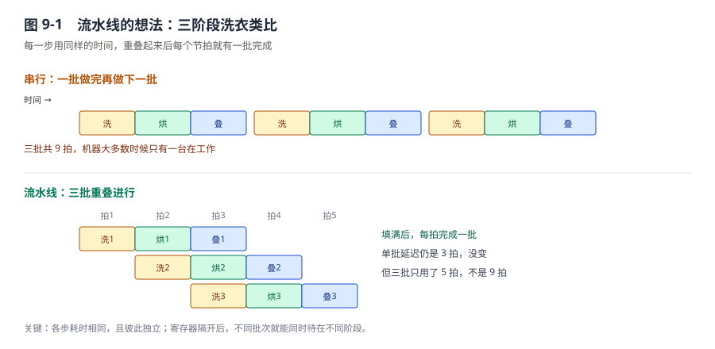
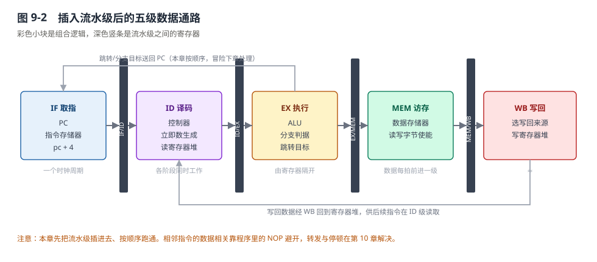
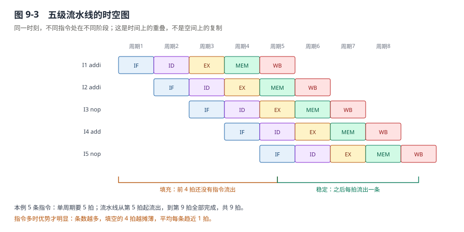
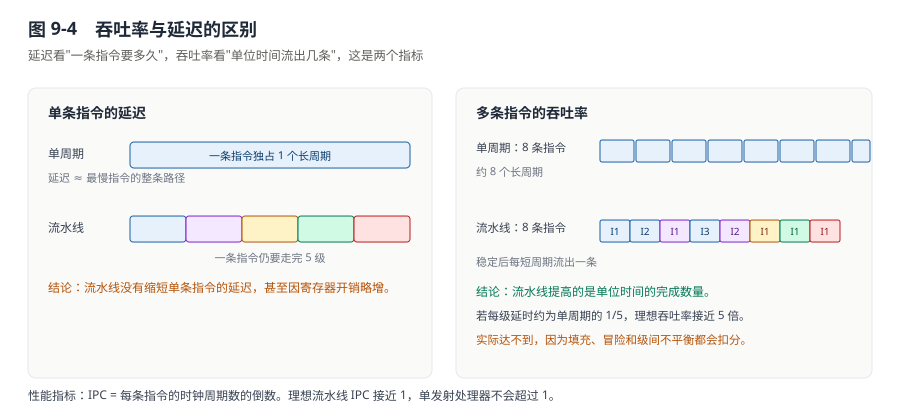
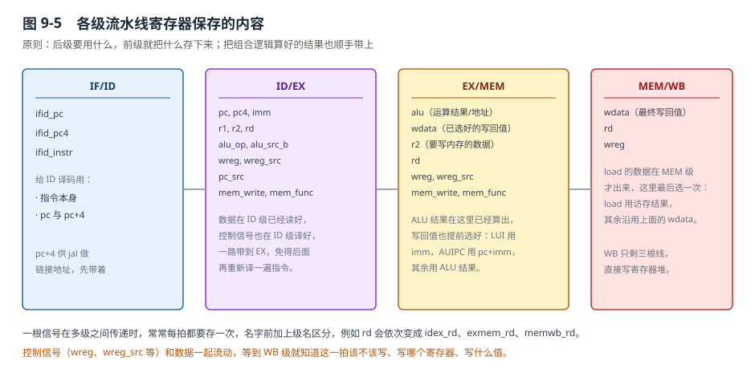

# 第 9 章　五级流水线

## 本章导读

第 8 章的单周期处理器能跑通 RV32I 程序，但它的时钟周期由最慢的那条指令决定。取指、译码、读寄存器、运算、访存、写回全部挤在一个周期里，周期长度只能按最坏情况定。结果就是简单的 `addi` 也要等和最慢指令一样长的时间。

这一章换一个思路。既然一条指令要走好几步，而每一步用的硬件各不相同，能不能让不同指令同时待在不同步骤里？这一章先把这件事讲清楚，再把第 8 章的数据通路切开，插入流水级寄存器，让单周期处理器变成五级流水线。

先说明本章的边界。这一章只做一件事：把流水级插进去，让程序按顺序跑通。相邻指令之间的数据相关怎么办？本章的程序用空指令（NOP）把它们隔开。转发的连线、加载-use 停顿、分支预测这些真正解决冒险的办法，留到第 10 章。这样分开，是为了先把流水线本身的骨架看清楚，不被冒险处理的细节淹没。

学完这一章，你应该能回答：流水线到底缩短了什么；五级怎么划分；每级之间的寄存器要存哪些东西；为什么单条指令 latency 没变，程序却变快了。

## 9.1　单周期的木桶效应

先看处理器执行一条指令要花多久。CPU 时间可以用一个简单公式拆开：

```
CPU 时间 = 指令数 × 每条指令的时钟周期数 × 时钟周期长度
```

三项对应三种优化方向。指令数由算法和编译器决定；时钟周期长度由电路决定；每条指令的时钟周期数，也就是 CPI，由处理器的微结构决定。流水线动的是后两项。

单周期处理器里，每条指令都用一个时钟周期完成。周期长度必须够长，长到最慢的那条指令也能走完全部步骤。看一条 `lw`：取指、译码、读寄存器、算地址、读数据存储器、写回，一整条路径串下来。这个路径有多长，周期就有多长。

问题在于，其它指令用不了这么长的周期。`addi` 只是读两个寄存器、加一个数、写回去，它根本不需要访存那一段。可它也得老老实实等一个长周期，因为大家共用一个节拍。这就像几个人排队过一个关卡，关卡的放行时间按走得最慢的那个人定，走得快的人也只能等着。

一个直接的改进是把周期做短，让慢指令跨多个周期。这就是多周期处理器的思路，但代价是控制复杂，而且同一时刻仍然只有一条指令在推进。流水线走的是另一条路：不改变每条指令要做的全部工作，而是让多条指令重叠起来。

## 9.2　流水线的想法

用一个洗衣房的例子最容易说明。假设洗一批衣服要三步：洗、烘、叠，每步各花一小时。

串行做法是：第一批洗完、烘完、叠完，再开始第二批。三批衣服要九个小时，而且大部分时候只有一台机器在转。

流水线的做法是：第一批进洗衣机后，一小时后它进烘干机，此时第二批正好进洗衣机；再过一小时，第一批进叠衣台，第二批进烘干机，第三批进洗衣机。三台机器同时工作。从第一批开始洗到它叠好，还是要三个小时，一点没少；但从第四小时起，每小时就有一批衣服叠好。三批衣服五个小时就全部完成，不是九个小时。



*图 9-1　流水线的想法：三阶段洗衣类比*

这个类比点出了两个关键。

第一，每一步耗时要差不多。如果烘干要五小时，洗和叠各一小时，那么烘干就成了瓶颈，其它两步大部分时间在等。流水线设计同样要尽量让各级均衡。

第二，各步之间要能独立工作。洗衣机把衣服交给烘干机后，就可以开始洗下一批。在电路里，这个"交接"靠的就是级间寄存器：每一步的结果在时钟沿被打入寄存器，下一步从寄存器取，于是前一步可以马上去做下一条指令。

可以用一个 Digital 电路亲手感受一下这件事。`code/digital/09_pipe_stage.dig` 里有两个 D 触发器串联，共用同一个时钟。拨动输入 `d`，点两下时钟，会看到 `d` 的值像波浪一样一级一级往下传。这就是流水线里数据每拍前进一级的样子。

## 9.3　五级怎么划分

把第 8 章单周期数据通路里的一条指令执行过程按时间切开，自然得到五段。分界点选在各主要部件之间：

- **IF（Instruction Fetch，取指）**：用 PC 去指令存储器取指令，同时算出 pc+4。
- **ID（Instruction Decode，译码）**：解析指令，生成各种控制信号和立即数，从寄存器堆读出源操作数。
- **EX（Execute，执行）**：ALU 做运算，或者算出访存地址；分支指令在这里判断条件、算出跳转目标。
- **MEM（Memory，访存）**：读写数据存储器，load 从这里拿到数据。
- **WB（Write Back，写回）**：从几个候选里选出该写回的值，写进寄存器堆。



*图 9-2　插入流水级后的五级数据通路*

这五级和单周期里的五个部件是一一对应的。换句话说，硬件资源没有变多，只是把它们用寄存器隔开了，让它们能同时为不同指令服务。单周期时，取指部件取完一条就闲置；流水线里，它下一拍就给下一条指令取指。

分界线要放在组合逻辑之间，不能放在组合逻辑中间。每一级内部是组合逻辑，时钟沿到来时，这一级算好的东西被打入边界寄存器。寄存器是流水线的节拍器，全片共用同一个时钟。

为什么是五级，不是三级或十级？这是经典五级 RISC 流水线的划分，各级工作量比较均衡，教学上也好记。级数更多可以进一步缩短每级延时、提高主频，但级间寄存器本身有开销，级数一多，冒险也变复杂。这些取舍留到第 15 章那本书里再展开。

## 9.4　时空图、吞吐率与延迟

五级流水线跑起来的样子，用时空图看得最清楚。横轴是时钟周期，纵轴是一条条指令，格子里的字母表示这条指令这个周期处在哪一级。



*图 9-3　五级流水线的时空图*

沿着对角线看，第一条指令从周期 1 的 IF 一路走到周期 5 的 WB；第二条晚一拍，从周期 2 的 IF 走到周期 6 的 WB。任意一条指令都走五拍，这一点和单周期没有本质区别（单周期是一条指令占一个长周期）。

真正的变化在竖着看。周期 5 这一列，五条指令分别处在 WB、MEM、EX、ID、IF 五个不同的阶段，五个部件全都在干活。这就是重叠。

这里要分清两个常被混为一谈的指标：

**延迟**是一条指令从开始到完成要多久。流水线里它仍然是五拍，甚至因为级间寄存器的建立保持时间，比单周期的一条指令还略长一点。流水线不缩短延迟。

**吞吐率**是单位时间内完成多少条指令。单周期每拍完成一条，但那个"拍"很长；流水线填充满之后，每个短周期流出一条。如果每级的延时大约是原来长周期的五分之一，理想情况下吞吐率接近五倍。



*图 9-4　吞吐率与延迟的区别*

还有一个现象叫**填充**。开头四个周期，还没有任何指令流出，因为流水线没满。这段时间像洗衣机还没出第一批干净衣服。指令条数少时，填充开销占比大，流水线优势不明显；程序一长，这四拍就被摊薄，平均每条指令接近一拍。

衡量流水线的常用指标是 IPC（每周期指令数）。单发射流水线理想 IPC 是 1，也就是每拍一条。填充、冒险和级间不平衡都会让它低于 1。第 15 章那本书讨论多发射时，IPC 可以超过 1。

## 9.5　流水线寄存器要存什么

动手写代码前，先定下每级之间要保存哪些信号。这一步是接口设计，比写实现更重要：存少了，后级要用的数据拿不到；存多了，白白增加寄存器面积。

判断原则只有一句：**后级要用什么，前级就把什么存下来**。有些信号在当前级已经算好，也要顺手存进去，免得后级再算一遍。



*图 9-5　各级流水线寄存器保存的内容*

四组寄存器的内容如下。

**IF/ID**。ID 级要译码，所以需要指令本身；jal 这类指令要写 pc+4 作为链接地址，pc 和 pc+4 也一起带上。三个信号：`ifid_pc`、`ifid_pc4`、`ifid_instr`。

**ID/EX**。EX 级要算 ALU，需要两个操作数（`r1`、`r2`）、立即数 `imm`、运算选择 `alu_op` 和 b 来源选择 `alu_src_b`。后面几级还需要目的寄存器号 `rd`、写使能 `wreg`、写回来源 `wreg_src`、下条 PC 来源 `pc_src`，以及访存的 `mem_write` 和 `mem_func`。这些数据在 ID 级都已经准备好，一次性存进 ID/EX，后面逐级传递。

**EX/MEM**。ALU 结果 `alu` 在这里算好了，访存地址就是它。store 要写内存的数据是 `r2`。写回用的值在这一级也提前选好（LUI 用 imm，AUIPC 用 pc+imm，jal 用 pc+4，其余用 ALU 结果），存成 `wdata`。加上 `rd`、`wreg`、`wreg_src`，以及访存的 `mem_write`、`mem_func`。

**MEM/WB**。load 的数据到 MEM 级才出来，这里最后选一次：load 用访存结果，其余沿用传下来的 `wdata`。WB 级只需要三根线：最终的 `wdata`、`rd`、`wreg`。

注意同一个信号在多级里的名字。目的寄存器号从 ID 级的 `rd_id` 出发，进 ID/EX 变成 `idex_rd`，再进 EX/MEM 变成 `exmem_rd`，最后进 MEM/WB 变成 `memwb_rd`。名字前缀标明它属于哪一级，读代码时不会搞混。

## 9.6　给单周期插入流水级

现在动手改代码。第 8 章的六个基础模块（PC、指令存储器、寄存器堆、控制器、ALU、数据存储器）都不用改，要改的只是顶层 `core.v`：把原来一拍做完的事拆成五段，段与段之间插入上一节定的寄存器。

代码依旧渐进展开。每加一段，先说这一拍要解决什么问题。

### 先看顶层接口

好消息是，顶层接口和单周期完全一样：时钟、复位、输出 PC。内部多了流水级，对外看不出来。

```verilog
module core (
    input  wire        clk,
    input  wire        rst_n,
    output wire [31:0] pc_out
);

    localparam [2:0] WR_IMM   = 3'd0;
    localparam [2:0] WR_PCIMM = 3'd1;
    localparam [2:0] WR_PC4   = 3'd2;
    localparam [2:0] WR_ALU   = 3'd3;
    localparam [2:0] WR_MEM   = 3'd4;

    // WB 级产生，回送到 ID 级写寄存器堆
    wire [31:0] wb_wdata;
    wire [4:0]  wb_rd;
    wire        wb_wreg;
```

那五个 `localparam` 是写回来源的编号，与第 8 章控制器里的定义一致。`wb_wdata`、`wb_rd`、`wb_wreg` 是 WB 级通往寄存器堆的三根回送线。现在它们还只是声明，最后一节才接上。

### 第一级：取指

取指这一级和单周期几乎一样：PC 模块给出当前地址，指令存储器按地址送出指令，同时算出 pc+4。唯一的不同是，这些结果这一拍要送进 IF/ID 寄存器，而不是直接被后级组合逻辑用掉。

```verilog
    // ---------- IF：取指 ----------
    wire [31:0] pc;
    wire [31:0] pc_plus_4 = pc + 32'd4;
    wire [31:0] instr_if;
    wire [31:0] next_pc;

    pc u_pc (
        .clk     (clk),
        .rst_n   (rst_n),
        .next_pc (next_pc),
        .cur_pc  (pc)
    );

    imem u_imem (
        .addr  (pc),
        .instr (instr_if)
    );
```

`next_pc` 此刻还没赋值，别急，它要等 EX 级算出跳转目标后才定得下来。Verilog 允许先声明后赋值。

### 第一道闸门：IF/ID

时钟沿到来时，把取到的指令和它对应的两个 PC 值锁存。复位时全部清零。这几行就是洗衣房里"洗衣机把衣服交给烘干机"的那个交接动作。

```verilog
    // ---------- IF/ID 流水线寄存器 ----------
    reg [31:0] ifid_pc;
    reg [31:0] ifid_pc4;
    reg [31:0] ifid_instr;

    always @(posedge clk) begin
        if (!rst_n) begin
            ifid_pc    <= 32'b0;
            ifid_pc4   <= 32'b0;
            ifid_instr <= 32'b0;
        end else begin
            ifid_pc    <= pc;
            ifid_pc4   <= pc_plus_4;
            ifid_instr <= instr_if;
        end
    end
```

复位清零不是可选项。若放任 `ifid_instr` 停在不确定的 x 态，控制器译出来的信号也是 x，一路传播下去，仿真满屏红色。清零之后，一开始流进流水线的是全 0 指令，它被译成一条什么也不做的空操作，安全。

### 第二级：译码与读寄存器

ID 级的输入不再是取指级直接送来的线，而是 IF/ID 寄存器里的值。从 `ifid_instr` 里拆出三个寄存器号，交给控制器和寄存器堆。

```verilog
    // ---------- ID：译码与读寄存器堆 ----------
    wire [4:0] rs1_id = ifid_instr[19:15];
    wire [4:0] rs2_id = ifid_instr[24:20];
    wire [4:0] rd_id  = ifid_instr[11:7];

    wire [31:0] r1_id;
    wire [31:0] r2_id;
    wire [31:0] imm_id;
    wire        wreg_id;
    wire [2:0]  wreg_src_id;
    wire [1:0]  pc_src_id;
    wire        branch_taken_id;
    wire        alu_src_b_id;
    wire [3:0]  alu_op_id;
    wire        mem_write_id;
    wire [2:0]  mem_func_id;

    control u_ctrl (
        .instr        (ifid_instr),
        .r1           (r1_id),
        .r2           (r2_id),
        .imm          (imm_id),
        .wreg         (wreg_id),
        .wreg_src     (wreg_src_id),
        .pc_src       (pc_src_id),
        .branch_taken (branch_taken_id),
        .alu_src_b    (alu_src_b_id),
        .alu_op       (alu_op_id),
        .mem_write    (mem_write_id),
        .mem_func     (mem_func_id)
    );

    regfile u_regfile (
        .clk     (clk),
        .rst_n   (rst_n),
        .rs1     (rs1_id),
        .rs2     (rs2_id),
        .rd      (wb_rd),
        .we      (wb_wreg),
        .wdata   (wb_wdata),
        .rdata1  (r1_id),
        .rdata2  (r2_id)
    );
```

控制器和单周期里用的是同一个 `control.v`，一字未改。它输入指令和两个源操作数，输出立即数、控制信号和分支判断。寄存器堆也复用第 8 章的模块，写端口接的正是末尾要接好的 `wb_*` 三根线。

这里藏着第 10 章要解决的麻烦：ID 级读寄存器的时刻，前面那条写这个寄存器的指令可能还没到 WB 级。本章用 NOP 把相关指令隔开，暂时绕开。

### 第二道闸门：ID/EX

这一组寄存器最宽，因为 ID 级准备好的数据和控制信号都要往下传。声明一堆 reg，时钟沿到来时逐个把 ID 级的组合信号打进去。

```verilog
    // ---------- ID/EX 流水线寄存器 ----------
    reg [31:0] idex_pc;
    reg [31:0] idex_pc4;
    reg [31:0] idex_imm;
    reg [31:0] idex_r1;
    reg [31:0] idex_r2;
    reg [4:0]  idex_rd;
    reg        idex_wreg;
    reg [2:0]  idex_wreg_src;
    reg [1:0]  idex_pc_src;
    reg        idex_alu_src_b;
    reg [3:0]  idex_alu_op;
    reg        idex_mem_write;
    reg [2:0]  idex_mem_func;

    always @(posedge clk) begin
        if (!rst_n) begin
            idex_pc        <= 32'b0;
            idex_pc4       <= 32'b0;
            idex_imm       <= 32'b0;
            idex_r1        <= 32'b0;
            idex_r2        <= 32'b0;
            idex_rd        <= 5'b0;
            idex_wreg      <= 1'b0;
            idex_wreg_src  <= 3'b0;
            idex_pc_src    <= 2'b0;
            idex_alu_src_b <= 1'b0;
            idex_alu_op    <= 4'b0;
            idex_mem_write <= 1'b0;
            idex_mem_func  <= 3'b0;
        end else begin
            idex_pc        <= ifid_pc;
            idex_pc4       <= ifid_pc4;
            idex_imm       <= imm_id;
            idex_r1        <= r1_id;
            idex_r2        <= r2_id;
            idex_rd        <= rd_id;
            idex_wreg      <= wreg_id;
            idex_wreg_src  <= wreg_src_id;
            idex_pc_src    <= pc_src_id;
            idex_alu_src_b <= alu_src_b_id;
            idex_alu_op    <= alu_op_id;
            idex_mem_write <= mem_write_id;
            idex_mem_func  <= mem_func_id;
        end
    end
```

这么多行看着唬人，其实只有两件事：复位清零，其余每拍把 ID 级信号原样搬进来。写的时候按"数据在前、控制在后"的顺序排，检查时不容易漏。

### 第三级：执行

EX 级的输入全部来自 ID/EX 寄存器。ALU 的两个操作数按 `alu_src_b` 选，运算交给复用的 ALU 模块。

这一级还做了两件单周期里由控制器包办的事：算出跳转目标，以及提前选好写回值。跳转目标有两类，jal 用 pc+imm，jalr 用 r1+imm 并把最低位清零；`next_pc` 按 `pc_src` 三选一。写回值 `ex_wdata` 按 `wreg_src` 选，LUI、AUIPC、jal 各有来源，其余用 ALU 结果。

```verilog
    // ---------- EX：执行 ----------
    wire [31:0] alu_a = idex_r1;
    wire [31:0] alu_b = idex_alu_src_b ? idex_imm : idex_r2;
    wire [31:0] alu_result_ex;

    alu u_alu (
        .a      (alu_a),
        .b      (alu_b),
        .alu_op (idex_alu_op),
        .result (alu_result_ex)
    );

    wire [31:0] jalr_target = (idex_r1 + idex_imm) & ~32'h1;

    assign next_pc =
        (idex_pc_src == 2'd1) ? (idex_pc + idex_imm) :
        (idex_pc_src == 2'd2) ? jalr_target :
        pc_plus_4;

    wire [31:0] ex_wdata =
        (idex_wreg_src == WR_IMM)   ? idex_imm :
        (idex_wreg_src == WR_PCIMM) ? (idex_pc + idex_imm) :
        (idex_wreg_src == WR_PC4)   ? idex_pc4 :
        alu_result_ex;
```

有个细节值得说：`next_pc` 用的是 `idex_pc`，也就是 EX 级那条指令的 PC，而不是当前 IF 级的 `pc`。因为 `pc_src` 和 `imm` 都是相对 EX 级指令译出来的，目标地址必须以那条指令为基准。单周期里这两者是同一个值，流水线里差了好几拍，不改就跳错地方。

jalr 目标清最低位那一步也不能省。RISC-V 规定 jalr 的目标地址最低位为 0，`& ~32'h1` 就是干这个的。

### 第三道闸门：EX/MEM

ALU 结果、提前选好的写回值、store 的数据，连同目的寄存器号和控制信号，一起打进 EX/MEM。

```verilog
    // ---------- EX/MEM 流水线寄存器 ----------
    reg [31:0] exmem_alu;
    reg [31:0] exmem_wdata;
    reg [31:0] exmem_r2;
    reg [4:0]  exmem_rd;
    reg        exmem_wreg;
    reg [2:0]  exmem_wreg_src;
    reg        exmem_mem_write;
    reg [2:0]  exmem_mem_func;

    always @(posedge clk) begin
        if (!rst_n) begin
            exmem_alu        <= 32'b0;
            exmem_wdata      <= 32'b0;
            exmem_r2         <= 32'b0;
            exmem_rd         <= 5'b0;
            exmem_wreg       <= 1'b0;
            exmem_wreg_src   <= 3'b0;
            exmem_mem_write  <= 1'b0;
            exmem_mem_func   <= 3'b0;
        end else begin
            exmem_alu        <= alu_result_ex;
            exmem_wdata      <= ex_wdata;
            exmem_r2         <= idex_r2;
            exmem_rd         <= idex_rd;
            exmem_wreg       <= idex_wreg;
            exmem_wreg_src   <= idex_wreg_src;
            exmem_mem_write  <= idex_mem_write;
            exmem_mem_func   <= idex_mem_func;
        end
    end
```

`exmem_alu` 有两种身份：对算术指令它是结果，对访存指令它是地址。存储器不关心这个区别，它只按 `mem_write` 决定读还是写。

### 第四级：访存

数据存储器直接复用第 8 章模块，地址、写使能、字节选择、写数据都来自 EX/MEM 寄存器。load 的数据 `rdata_mem` 这一拍才出现。

最后再选一次写回值：如果是 load，用刚读出的 `rdata_mem`；否则沿用 EX 级选好的 `exmem_wdata`。这一步放在 MEM 级，是因为只有到这里 load 的数据才齐。

```verilog
    // ---------- MEM：访存 ----------
    wire [31:0] rdata_mem;

    dmem u_dmem (
        .clk    (clk),
        .addr   (exmem_alu),
        .we     (exmem_mem_write),
        .funct3 (exmem_mem_func),
        .wdata  (exmem_r2),
        .rdata  (rdata_mem)
    );

    wire [31:0] mem_wdata =
        (exmem_wreg_src == WR_MEM) ? rdata_mem : exmem_wdata;
```

为什么写回值选两次？在 EX 级先选一次，把除 load 以外的情况都定下来；到 MEM 级再补上 load。这样两级各自只处理自己能看到的数据，不用把 load 结果再往前传一级去选。

### 第四道闸门与第五级：写回

MEM/WB 只剩三根线。之后再无组合逻辑，直接接到寄存器堆的写端口，`wb_*` 三根回送线到这里终于接上了。

```verilog
    // ---------- MEM/WB 流水线寄存器 ----------
    reg [31:0] memwb_wdata;
    reg [4:0]  memwb_rd;
    reg        memwb_wreg;

    always @(posedge clk) begin
        if (!rst_n) begin
            memwb_wdata <= 32'b0;
            memwb_rd    <= 5'b0;
            memwb_wreg  <= 1'b0;
        end else begin
            memwb_wdata <= mem_wdata;
            memwb_rd    <= exmem_rd;
            memwb_wreg  <= exmem_wreg;
        end
    end

    // ---------- WB：写回 ----------
    assign wb_wdata = memwb_wdata;
    assign wb_rd    = memwb_rd;
    assign wb_wreg  = memwb_wreg;

    assign pc_out = pc;
```

走到这里，`wb_wdata`、`wb_rd`、`wb_wreg` 和开头 ID 级寄存器堆的三个端口连成一个环。一条指令在 WB 级写入的寄存器，若干拍后可以被另一条指令在 ID 级读到——只要中间隔着足够多的拍。

### 完整代码

把上面各段按顺序列出来，就是完整的 `core.v`。它保存在 `code/verilog/09_pipeline/core.v`。六个基础模块一字未改，全都从第 8 章目录复制过来。这种"只改顶层"的做法有个好处：基础模块已经在单周期里验证过，出错只可能出在新加的流水级连接上，排查范围小很多。

## 9.7　走通例子：让程序在流水线上跑对

测试程序放在 `code/verilog/09_pipeline/code.hex`，由 `tools/gen_code_hex09.py` 生成。它和第 8 章的程序语义相同，只是在有数据相关的指令之间插了 NOP：

```
0x00400000  addi x1, x0, 5
0x00400004  addi x2, x0, 3
0x00400008  nop
0x0040000c  nop
0x00400010  nop
0x00400014  add  x3, x1, x2
0x00400018  lui  x4, 0x10000
0x0040001c  nop
0x00400020  nop
0x00400024  nop
0x00400028  sw   x3, 0(x4)
0x0040002c  lw   x5, 0(x4)
0x00400030  nop
0x00400034  nop
0x00400038  nop
0x0040003c  addi x6, x5, 1
0x00400040  jal  x0, 0
```

为什么 `add x3, x1, x2` 前面要三个 NOP？看时空图就明白了：写 `x1` 的 `addi` 在周期 5 的 WB 级才写回，而 `add` 要到周期 6 的 ID 级才读寄存器。中间必须隔开，否则 `add` 读到的是 `x1` 的旧值 0。第 10 章引入转发后，ALU 结果不必等到 WB 级就能送到下一条指令的 EX 级，这些 NOP 大部分可以删掉；只有 load 紧跟使用的情况还得停一拍。

测试台 `tb_core.v` 的每个检查点都按流水线延迟往后挪了 4 拍。单周期里第一条 `addi` 一拍就写回，这里要等五级走完。仿真结果：

```
PASS 65000:  x1 after addi (5-stage latency)  = 0x00000005
PASS 75000:  x2 after addi  = 0x00000003
PASS 115000: x3 after add (NOP-separated)  = 0x00000008
PASS 125000: x4 after lui  = 0x10000000
PASS 155000: dmem word after sw  = 0x00000008
PASS 175000: x5 after lw  = 0x00000008
PASS 215000: x6 after addi from loaded value  = 0x00000009
PASS 235000: pc parked at self loop  = 0x00400040
ALL TESTS PASSED
```

九个检查全部通过，说明五级切分没有改变程序语义，只是把结果推迟了几拍。

这里补一个调试经验。第一次写测试台时，很容易照搬单周期的检查时刻，结果第一条指令就报"期望 5、实际 0"。这不是硬件错了，是检查得太早——流水线还没走完。遇到这种情况，先把波形或流水级信号打出来，看清每条指令第几拍写回，再定检查时刻。

## 9.8　重点与权衡

把这一章的取舍集中说一下。

**流水线缩短的是吞吐率，不是延迟。** 单条指令仍要走完五级，占用五拍。变快的是整体上单位时间完成的指令数。程序越长，填充开销越小，收益越明显。

**级间均衡很重要。** 每级延时要尽量接近，否则最慢的那级决定了时钟周期。这就是流水线的木桶效应，只是木桶从"一条指令的所有步骤"变成了"一级里的所有逻辑"。

**寄存器有开销。** 级间寄存器本身有建立时间和时钟到输出的延时，级数不是越多越好。五级是一个均衡点。

**冒险被暂时绕开了。** 本章用 NOP 隔开相关指令，这是软件层面的回避，不是硬件解决。程序里凭空多出的 NOP 占空间、耗时间。第 10 章从硬件入手，用转发和停顿把它们消掉。

**分支目标要按 EX 级的 PC 算。** 这是流水线里特有的坑。跳转信号在 EX 级才确定，对应的指令已经是几拍前取的了，基准 PC 必须用 `idex_pc`。分支本身还有控制冒险：跳走时已经取进来的几条指令怎么办，第 10 章解决。

## 9.9　实验

**实验一　观察流水线逐拍推进。** 用 Icarus Verilog 编译仿真：

```
cd code/verilog/09_pipeline
iverilog -g2012 -o sim.out alu.v pc.v control.v regfile.v imem.v dmem.v core.v tb_core.v
vvp sim.out
```

在测试台里加一段 `$display`，每拍打印五个流水级的关键信号，比如 `ifid_instr`、`idex_rd`、`exmem_alu`、`memwb_wdata`。对着图 9-3 的时空图，看看同一拍里五条指令是不是真的各处一级。

**实验二　观察延迟。** 把测试台第一条 `addi` 的检查时刻改到复位后第 2 拍，会看到 `x1` 还是 0；逐拍后移，直到第 5 拍之后才变成 5。把这个过程记录下来，就能直观看出"五级"的代价。

**实验三　去掉一个 NOP。** 删掉 `add` 前面三个 NOP 中的一个，重新生成 `code.hex` 并仿真，`x3` 的结果会变成错误值。想清楚为什么错，就能理解第 10 章转发要解决的问题。

**实验四　在 Digital 里看寄存器搬移。** 打开 `code/digital/09_pipe_stage.dig`，拨动 `d` 并点动时钟，观察 `q1`、`q2` 依次变化。把这个两级结构和 `core.v` 里的四组流水线寄存器对照起来看。

## 9.10　香山一瞥（选读）

香山的后端是乱序流水线，级数和本章的五级相去甚远，但基本动作一致：取指、译码、重命名、分发、发射、执行、写回，每一级之间都有队列或寄存器隔开，不同指令重叠推进。

差别在于，香山的流水线不是固定顺序往下滑的。指令在发射队列里等待操作数就绪，谁先准备好谁先执行，这就是乱序。流水线寄存器在香山里也变得更复杂，往往是一整个队列，而不只是几个触发器。

本章的四组寄存器可以看成这套机制的最简版本。它们传递的数据和控制信号，和乱序处理器里流水线队列传递的东西在概念上是同一类：这一级算好了什么，下一级要用什么。

## 9.11　本章小结

1. 单周期处理器的时钟周期由最慢指令决定，简单指令白白等待，这是流水线的出发点。
2. 流水线让多条指令重叠执行，各级同时为不同指令服务，硬件资源没有增加。
3. 五级划分是 IF、ID、EX、MEM、WB，分界点放在组合逻辑之间，靠寄存器交接。
4. 流水线缩短的是吞吐率，不是单条指令的延迟；填充开销在程序短时影响明显。
5. 每级之间存什么，取决于后级要用什么；同一个信号在各级有不同前缀。
6. 分支目标要按 EX 级指令的 PC 计算；本章的程序用 NOP 避开数据相关，冒险的硬件解法留在第 10 章。

## 思考题

1. 一条指令在五级流水线里要走几拍？如果时钟周期是 1 ns，连续执行 100 条指令（不考虑填充），大约需要多少时间？
2. 为什么说流水线没有缩短单条指令的延迟？在什么情况下流水线反而不如单周期划算？
3. IF/ID 寄存器里为什么要存 pc+4？如果去掉它，哪条指令会出错？
4. ID/EX 寄存器里的信号可以分为数据和控制两类，各举三个例子，并说明它们在后级做什么用。
5. 写回值为什么在 EX 级选一次、MEM 级又选一次？合并成一次行不行？
6. 本章的 `next_pc` 用 `idex_pc` 作基准。如果误用当前 IF 级的 `pc`，`jal` 会跳到哪里？
7. 删掉测试中 `add` 前的一个 NOP 后 `x3` 出错。请画出这种情况下的时空图，指出 `add` 在 ID 级读到的 `x1` 是哪条指令写的值。

*下一章处理流水线冒险：用转发把本章插入的 NOP 消掉，用停顿应对加载-use，用冲刷应对分支。*
