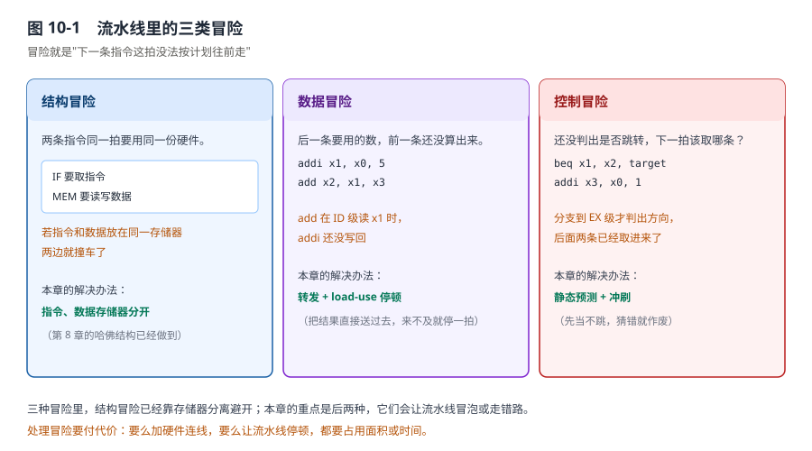
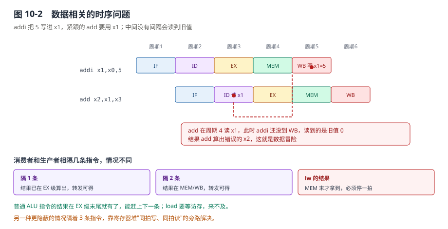
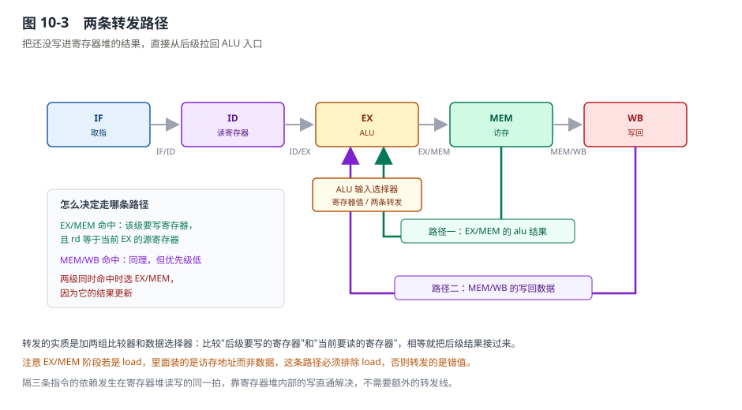
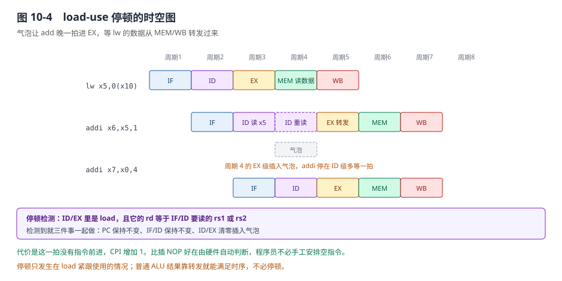
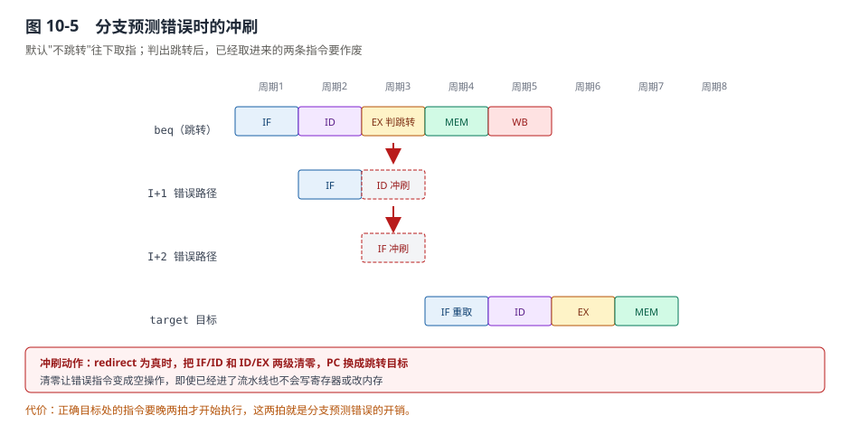

# 第 10 章　流水线冒险

## 本章导读

第 9 章把单周期处理器切成五级，让多条指令重叠起来。可是同一章的程序里塞了不少 NOP。那些 NOP 不是程序本来就要做的运算，而是为了掩盖一个问题：流水线上相邻的指令会互相"抢时间"。前一条还没算出结果，后一条就要用；前一条还没判出往哪跳，后一条已经取错方向了。

这一章就是来处理这些"抢时间"的情况，术语叫**冒险**（hazard）。我们一件件来：先看有哪几类冒险，再用转发把大部分数据相关消掉，接着用停顿处理 load 这种来不及的情况，最后用冲刷解决分支取错路的问题。做完这些，第 9 章里那些 NOP 就可以删掉了。

学完这一章，你应该能回答：为什么相邻指令会读到旧值；转发线接在哪里、凭什么判断该不该转；load 为什么必须停一拍；分支猜错了怎么把已经取进来的指令作废。

## 10.1　冒险是什么

冒险指流水线里"下一条指令这拍没法按计划往前走"的情况。常见的一类三种。



*图 10-1　流水线里的三类冒险*

**结构冒险**是硬件资源不够用。比如指令和数据放在同一块存储器里，IF 级要取指令、MEM 级要读写数据，同一拍就撞上了。第 8 章把指令存储器和数据存储器做成了两个独立模块，等于直接把这个问题消掉了，本章不用再管。

**数据冒险**是后一条指令要用的数，前一条还没准备好。`addi x1, x0, 5` 后面紧跟 `add x2, x1, x3`，add 在译码级读 x1 的时候，addi 还没写回，读到的是旧值。

**控制冒险**是不知道下一条该取哪条。分支指令要到执行级才判出跳不跳，可执行级后面的两条指令这时已经取进流水线了。如果真的跳了，这两条就取错了。

三类里，结构冒险靠加硬件解决（存储器分离），数据冒险和控制冒险才是本章的主角。它们没法靠"加一份硬件"一劳永逸，得动态地判断、动态地救场。

## 10.2　数据相关是怎么发生的

把两条相关的指令画到时空图上，问题就一目了然。



*图 10-2　数据相关的时序问题*

addi 在周期 5 的 WB 级才把 5 写进 x1，而 add 在周期 4 的 ID 级就要读 x1。读在写前面，自然是旧值。这不是哪条指令写错了，是流水线的重叠把"先写后读"的顺序打乱了。

解决思路有两条。一条是等：让 add 在译码级多待几拍，等 addi 写回再读。这可行，但每条相关的指令都要等，流水线就堵了。第 9 章插 NOP 走的就是这条路，只不过是由程序员手工插的。

另一条是绕：addi 的结果其实在周期 3 的 EX 级末尾就算出来了，只是要等到周期 5 才写进寄存器堆。既然结果早就有了，何必非要绕寄存器堆一圈？直接从算出的地方拉一根线，接到 add 的 ALU 入口就行。这就是**转发**（forwarding，也叫旁路 bypassing）。

打个比方。寄存器堆像公司的成品仓库，ALU 像车间。生产出的零件按规矩要先入库，再凭单领用。转发就是车间之间直接递一手："这个零件刚做好，你拿去用，入库手续回头补。"省掉了往返仓库的时间。

## 10.3　两条转发路径

需要转发时，结果可能处在两级之一。



*图 10-3　两条转发路径*

- 生产者是上一条指令，它的结果已经打到 EX/MEM 寄存器里。这是路径一，`exmem_wdata`。
- 生产者是上上条指令，它的结果已经到了 MEM/WB 寄存器。这是路径二，`memwb_wdata`。
- 再往前（隔开三条）的指令，结果那拍已经写进寄存器堆了，正常读就能读到，不用转发。

两级都可能命中当前 EX 级的同一个源寄存器，所以要先判优先级：选 EX/MEM，因为它的结果更新。这和"仓库里新旧两批货同名，先拿刚生产的那批"是一个道理。

还有一个坑。EX/MEM 里如果是 load，那里装的是**访存地址**，不是访存数据，转发它就把地址当数据用了。所以路径一必须排除 load。这条排除条件漏掉的话，症状很隐蔽：程序里 addi 之后的转发全对，一碰到 lw 紧跟使用就出错。

判断命中要比较寄存器号。当前 EX 级要读哪个寄存器，生产者要写哪个寄存器，两者相等且生产者确实要写，才算命中。这就要求级间寄存器除了存数据，还得把寄存器号也带上。第 9 章的 ID/EX 已经存了目的号 `idex_rd`，这一章还得补上两个源号。

## 10.4　从接口开始改

顶层接口一个信号都不用变：还是时钟、复位、输出 PC。这一章要动的是内部的级间信号，它们相当于模块之间的接口。按老规矩，接口一点点加，需要哪个才引出哪个。

先看开头。多出来的两个 `localparam` 是下一级要用的 PC 来源编号，第 8 章的控制器里有同样的一组。第 9 章把它们藏在了控制器的 pc_src 输出里，现在要在 EX 级直接判断跳转，就在顶层也放一份。

```verilog
module core (
    input  wire        clk,
    input  wire        rst_n,
    output wire [31:0] pc_out
);

    localparam [2:0] WR_IMM   = 3'd0;
    localparam [2:0] WR_PCIMM = 3'd1;
    localparam [2:0] WR_PC4   = 3'd2;
    localparam [2:0] WR_ALU   = 3'd3;
    localparam [2:0] WR_MEM   = 3'd4;

    localparam [1:0] PC_PC4  = 2'd0;
    localparam [1:0] PC_IMM  = 2'd1;
    localparam [1:0] PC_JALR = 2'd2;
```

取指级和上一章一样，照抄即可。PC、指令存储器、算出 pc+4，三件事。

## 10.5　取指级要学会停下和重来

IF/ID 寄存器的写入条件变了，多了两个例外。

```verilog
    // ---------- IF/ID 流水线寄存器 ----------
    reg [31:0] ifid_pc;
    reg [31:0] ifid_pc4;
    reg [31:0] ifid_instr;

    always @(posedge clk) begin
        if (!rst_n || redirect) begin
            ifid_pc    <= 32'b0;
            ifid_pc4   <= 32'b0;
            ifid_instr <= 32'b0;
        end else if (!lw_stall) begin
            ifid_pc    <= pc;
            ifid_pc4   <= pc_plus_4;
            ifid_instr <= instr_if;
        end
    end
```

两个新信号现在只是先引用，稍后定义。

`redirect` 为真表示跳转发生，这一拍要把 IF/ID 清零，把刚取进来的错误指令抹掉。`lw_stall` 为真表示要停顿，IF/ID 保持原值不动，让译码级的指令原地等一拍。注意两者分工不同：冲刷是清零，停顿是保持。把这两件事混成一件事，是初学时常犯的错。

## 10.6　译码级多认几种转移

ID 级仍用第 8 章的控制器和寄存器堆，但要额外认出 jal、jalr 和分支三类指令，因为跳转要由执行级自己判断。

```verilog
    // ---------- ID：译码与读寄存器堆 ----------
    wire [4:0] rs1_id = ifid_instr[19:15];
    wire [4:0] rs2_id = ifid_instr[24:20];
    wire [4:0] rd_id  = ifid_instr[11:7];
    wire [6:0] op_id  = ifid_instr[6:0];
    wire [2:0] f3_id  = ifid_instr[14:12];

    wire is_jal_id    = (op_id == 7'b1101111);
    wire is_jalr_id   = (op_id == 7'b1100111);
    wire is_branch_id = (op_id == 7'b1100011);
```

`op_id` 是操作码，`f3_id` 是功能码，分支条件要靠它区分 beq、bne、blt 等。三个 `is_*` 信号只是从操作码里认一认，并不复杂。

控制器的例化有个变化值得说明。

```verilog
    wire [31:0] r1_id;
    wire [31:0] r2_id;
    wire [31:0] imm_id;
    wire        wreg_id;
    wire [2:0]  wreg_src_id;
    wire        alu_src_b_id;
    wire [3:0]  alu_op_id;
    wire        mem_write_id;
    wire [2:0]  mem_func_id;

    control u_ctrl (
        .instr        (ifid_instr),
        .r1           (r1_id),
        .r2           (r2_id),
        .imm          (imm_id),
        .wreg         (wreg_id),
        .wreg_src     (wreg_src_id),
        .pc_src       (),
        .branch_taken (),
        .alu_src_b    (alu_src_b_id),
        .alu_op       (alu_op_id),
        .mem_write    (mem_write_id),
        .mem_func     (mem_func_id)
    );
```

`pc_src` 和 `branch_taken` 两个输出空着没接。第 9 章里是它们决定下条 PC 的，但那是拿译码级读出的旧值判的分支。这一章要在执行级用转发后的新值重判，控制器里那两路结果就不再作数了。控制器模块本身一个字没改，只是不用它的这两个输出。

寄存器堆照旧接在末尾回送的 `wb_*` 三根线上，这里不再重复。

## 10.7　把停顿判据写出来

load-use 的判据放在译码级，因为停顿要拦在这里。

```verilog
    // ---------- 冒险检测（组合逻辑） ----------
    // load-use：ID/EX 里是 load，且它的目标正好是 IF/ID 要读的源寄存器
    wire lw_stall =
        (idex_wreg_src == WR_MEM) && (idex_rd != 5'd0) &&
        ((idex_rd == rs1_id) || (idex_rd == rs2_id));
```

读一遍：`idex_wreg_src == WR_MEM` 说明执行级那条是 load，`idex_rd` 是它的目标；`rs1_id`、`rs2_id` 是译码级这条要读的源。目标等于任一源，就命中。中间判断 `idex_rd != 5'd0` 不能省，x0 永远写不进值，把它排除掉，免得一条写 x0 的假 load 让流水线白白停顿。

## 10.8　ID/EX 寄存器多带几个字段

转发要比较寄存器号，冲刷要认出转移指令，这些都得从译码级带到执行级。于是 ID/EX 这一组寄存器要扩容。

```verilog
    // ---------- ID/EX 流水线寄存器 ----------
    reg [31:0] idex_pc;
    reg [31:0] idex_pc4;
    reg [31:0] idex_imm;
    reg [31:0] idex_r1;
    reg [31:0] idex_r2;
    reg [4:0]  idex_rs1;
    reg [4:0]  idex_rs2;
    reg [4:0]  idex_rd;
    reg [2:0]  idex_f3;
    reg        idex_is_jal;
    reg        idex_is_jalr;
    reg        idex_is_branch;
    reg        idex_wreg;
    reg [2:0]  idex_wreg_src;
    reg        idex_alu_src_b;
    reg [3:0]  idex_alu_op;
    reg        idex_mem_write;
    reg [2:0]  idex_mem_func;
```

新增的四类字段各有来路：`idex_rs1`、`idex_rs2` 供转发比较用；`idex_f3` 供执行级重判分支条件；三个 `is_*` 标志供冲刷用。第 9 章的 ID/EX 里，`idex_rd` 已经有了，这里正好和源号配成一对。

写入逻辑也多了两个清空条件。

```verilog
    always @(posedge clk) begin
        if (!rst_n || redirect || lw_stall) begin
            idex_pc         <= 32'b0;
            idex_pc4        <= 32'b0;
            idex_imm        <= 32'b0;
            idex_r1         <= 32'b0;
            idex_r2         <= 32'b0;
            idex_rs1        <= 5'b0;
            idex_rs2        <= 5'b0;
            idex_rd         <= 5'b0;
            idex_f3         <= 3'b0;
            idex_is_jal     <= 1'b0;
            idex_is_jalr    <= 1'b0;
            idex_is_branch  <= 1'b0;
            idex_wreg       <= 1'b0;
            idex_wreg_src   <= 3'b0;
            idex_alu_src_b  <= 1'b0;
            idex_alu_op     <= 4'b0;
            idex_mem_write  <= 1'b0;
            idex_mem_func   <= 3'b0;
        end else begin
            idex_pc         <= ifid_pc;
            idex_pc4        <= ifid_pc4;
            idex_imm        <= imm_id;
            idex_r1         <= r1_id;
            idex_r2         <= r2_id;
            idex_rs1        <= rs1_id;
            idex_rs2        <= rs2_id;
            idex_rd         <= rd_id;
            idex_f3         <= f3_id;
            idex_is_jal     <= is_jal_id;
            idex_is_jalr    <= is_jalr_id;
            idex_is_branch  <= is_branch_id;
            idex_wreg       <= wreg_id;
            idex_wreg_src   <= wreg_src_id;
            idex_alu_src_b  <= alu_src_b_id;
            idex_alu_op     <= alu_op_id;
            idex_mem_write  <= mem_write_id;
            idex_mem_func   <= mem_func_id;
        end
    end
```

`redirect` 或 `lw_stall` 为真时，ID/EX 清零。清零就是往执行级塞一个全 0 的空操作。停顿那一拍，译码级的指令本来就走不过来，执行级自然得是气泡；冲刷那一拍，错误指令也不能往下走。两种情况下一级都被清成 0，写法上正好合并。

这里有个容易忽略的地方：停顿那一拍 IF/ID 是**保持**的（上一节的代码），而 ID/EX 是**清零**的。于是在下一个沿，译码级的指令会重新被打进执行级，相当于让它重来一次，这一次读到的寄存器已经写回，值就对了。

## 10.9　两条转发路径的代码

执行级先把操作数选出来，再送给 ALU。

```verilog
    // ---------- EX：转发与执行 ----------
    // EX/MEM 结果优先于 MEM/WB；load 在 EX/MEM 阶段还没有数据，排除掉
    wire exmem_hit_a = exmem_wreg && (exmem_rd != 5'd0) &&
                       (exmem_wreg_src != WR_MEM) && (exmem_rd == idex_rs1);
    wire exmem_hit_b = exmem_wreg && (exmem_rd != 5'd0) &&
                       (exmem_wreg_src != WR_MEM) && (exmem_rd == idex_rs2);
    wire memwb_hit_a = memwb_wreg && (memwb_rd != 5'd0) && (memwb_rd == idex_rs1);
    wire memwb_hit_b = memwb_wreg && (memwb_rd != 5'd0) && (memwb_rd == idex_rs2);

    wire [31:0] r1_ex = exmem_hit_a ? exmem_wdata :
                        memwb_hit_a ? memwb_wdata : idex_r1;
    wire [31:0] r2_ex = exmem_hit_b ? exmem_wdata :
                        memwb_hit_b ? memwb_wdata : idex_r2;

    wire [31:0] alu_a = r1_ex;
    wire [31:0] alu_b = idex_alu_src_b ? idex_imm : r2_ex;
    wire [31:0] alu_result_ex;

    alu u_alu (
        .a      (alu_a),
        .b      (alu_b),
        .alu_op (idex_alu_op),
        .result (alu_result_ex)
    );
```

四个 `hit` 信号是四个命中判据，两组各两个。`exmem_hit_a` 管第一个源操作数从 EX/MEM 转发的情形，`exmem_hit_b` 管第二个，下面 `memwb_hit_*` 同理。每个判据都查三件事：后级确实要写寄存器、写的不是 x0、写的号正好等于当前要读的源号。路径一额外查了 `exmem_wreg_src != WR_MEM`，就是为了把 load 排除掉。

四个判据写好后，两个源操作数各自做一次三选一：先问 EX/MEM 命中没有，再问 MEM/WB 命中没有，都没命中才用译码级从寄存器堆读来的值。这个先后顺序就是优先级，`exmem_wdata` 写在前面，自然胜过 `memwb_wdata`。

Digital 里的 `code/digital/10_forward_mux.dig` 把这个二选一单独画了出来。用开关拨动 hit，看旧值和新值怎么被选中，真值表可以直接跑。命中判据那里用开关代替了，因为这一节要先看清"选择"这个动作本身。

## 10.10　load-use 停顿的时机

转发能救回大多数数据相关，唯独救不了 load。



*图 10-4　load-use 停顿的时空图*

load 的数据要到 MEM 级末尾才从存储器读出来，而紧跟的 add 在下一拍的 EX 级就要用它。时间差了一拍，数据还没到手，转发线也无能为力。唯一的办法是让 add 在译码级多等一拍。

停顿的逻辑在 10.7 节的 `lw_stall` 和 10.5、10.8 两节的寄存器写入条件里已经写全了，这里把三件事连起来看：

1. 译码级发现执行级是 load，且自己的源寄存器正是 load 的目标，`lw_stall` 拉高。
2. PC 保持不变（下一节的 `next_pc` 里有这一项），IF/ID 保持不变，ID/EX 清零插气泡。
3. 下一拍 load 走到 MEM/WB，数据已经读出；add 重新进到执行级，从 `memwb_wdata` 转发拿到数据。

代价是这一拍没有任何指令往前推进，相当于流水线里多了个气泡。但这是硬件自动判断、自动插入的，程序员不必像第 9 章那样手工数着指令插 NOP。

## 10.11　寄存器堆的同拍写直通

还有一种更隐蔽的相关，隔开三条指令。程序里 `lui x10` 之后隔着两条指令才用 x10，就属于这种。

按理说隔了三条，前一条早该写回寄存器堆了。仔细看时序会发现：生产者到 WB 级写回的那一拍，消费者正好在 ID 级读寄存器。寄存器堆是时钟沿写、组合逻辑读，读端口在这一拍看到的还是写之前的值。于是消费者读到旧值，而生者已经"写完"了，转发线又够不着——生产者已经离开流水线了。

解决办法是让寄存器堆自己带一点转发。同一拍如果有写操作，且写的寄存器正好是某个读端口要读的，就直接把写入值送到读端口。

```verilog
    // 同一拍写回的寄存器直接把写入值送到读端口，不必等下一拍
    assign rdata1 = (rs1 == 5'd0) ? 32'b0 :
                    (we && (rd == rs1)) ? wdata : regs[rs1];
    assign rdata2 = (rs2 == 5'd0) ? 32'b0 :
                    (we && (rd == rs2)) ? wdata : regs[rs2];
```

这两行改在 `regfile.v` 里，是全章唯一改动的基础模块。加完之后，隔三条的相关自动解决，不必再加停顿。这算寄存器堆给流水线提供的"就近服务"：东西正在入库，你要取，直接递给你，不用等入库手续办完。

## 10.12　控制冒险与冲刷

分支的问题和数据冒险不一样。



*图 10-5　分支预测错误时的冲刷*

执行级判出"要跳"的时候，后面两条指令已经取进流水线了：一条在译码级，一条刚进取指级。这两条是按"不跳"的顺序取来的，属于错误路径。它们绝不能留下痕迹——不能写寄存器，不能写内存。

本处理器用最简单的办法：默认不跳（静态预测），一直往下取；等执行级判出真的要跳，就把那两级清零。清零之后，那些指令变成全 0 的空操作，翻译过来就是"什么也不做"，自然不会改状态。同时把 PC 换成跳转目标，下一拍从正确的地方重新取指。

分支条件要用转发后的操作数重新判断，否则 `beq x7, x7` 这种紧跟在 `addi x7` 后面的指令会拿旧值比较，判错方向。

```verilog
    // 分支条件在 EX 级用转发后的操作数重新判断
    wire eq_ex  = (r1_ex == r2_ex);
    wire lt_ex  = ($signed(r1_ex) < $signed(r2_ex));
    wire ltu_ex = (r1_ex < r2_ex);

    reg branch_taken_ex;
    always @(*) begin
        case (idex_f3)
            3'b000: branch_taken_ex = eq_ex;
            3'b001: branch_taken_ex = !eq_ex;
            3'b100: branch_taken_ex = lt_ex;
            3'b101: branch_taken_ex = !lt_ex;
            3'b110: branch_taken_ex = ltu_ex;
            3'b111: branch_taken_ex = !ltu_ex;
            default: branch_taken_ex = 1'b0;
        endcase
    end

    wire [1:0] pc_src_ex =
        idex_is_jal                          ? PC_IMM  :
        idex_is_jalr                         ? PC_JALR :
        (idex_is_branch && branch_taken_ex)  ? PC_IMM  : PC_PC4;

    wire redirect = (pc_src_ex != PC_PC4);

    wire [31:0] jalr_target = (r1_ex + idex_imm) & ~32'h1;

    assign next_pc =
        lw_stall                      ? pc :
        (pc_src_ex == PC_IMM)         ? (idex_pc + idex_imm) :
        (pc_src_ex == PC_JALR)        ? jalr_target :
        pc_plus_4;
```

这一段把几个线索收在一起。比较用 `r1_ex`、`r2_ex`，正是上一节转发选出来的新值。`idex_f3` 决定用哪种比较，六种分支条件一一对应。`pc_src_ex` 汇总三种跳转：jal 用立即数目标，jalr 用寄存器加立即数（最低位清零是 RISC-V 的规定），分支跳不跳看刚判出的结果。

`redirect` 就是"pc_src_ex 不是顺序执行"。它为真时，前面 10.5 和 10.8 两节里 IF/ID、ID/EX 的清零条件触发，错误指令被抹掉。jalr 的目标用 `r1_ex` 算，也吃了转发的红利——紧跟在 `jal` 后面取链接寄存器的情况，正好靠它。

最后看 `next_pc` 的第一项。`lw_stall` 为真时 PC 保持原值，配合 IF/ID 的保持，让译码级那条指令原地不动。停顿和跳转不会同时发生：停顿的前提是执行级为 load，跳转的前提是执行级为转移指令，两者互斥。所以第一项放在最前面不会有歧义。

写回值的选择和上一章一样，除 load 以外的指令在执行级就把 `ex_wdata` 定下来。

```verilog
    wire [31:0] ex_wdata =
        (idex_wreg_src == WR_IMM)   ? idex_imm :
        (idex_wreg_src == WR_PCIMM) ? (idex_pc + idex_imm) :
        (idex_wreg_src == WR_PC4)   ? idex_pc4 :
        alu_result_ex;
```

## 10.13　后级照旧传递

EX/MEM 和 MEM/WB 两组的写法和第 9 章完全相同，只有一处细节：store 要写内存的数据改用 `r2_ex`，也就是转发后的值。否则 `addi x4, x0, 9` 紧跟 `sw x4, 0(x10)` 时，存进去的会是 x4 的旧值。

```verilog
    // ---------- EX/MEM 流水线寄存器 ----------
    reg [31:0] exmem_alu;
    reg [31:0] exmem_wdata;
    reg [31:0] exmem_r2;
    reg [4:0]  exmem_rd;
    reg        exmem_wreg;
    reg [2:0]  exmem_wreg_src;
    reg        exmem_mem_write;
    reg [2:0]  exmem_mem_func;

    always @(posedge clk) begin
        if (!rst_n) begin
            exmem_alu        <= 32'b0;
            exmem_wdata      <= 32'b0;
            exmem_r2         <= 32'b0;
            exmem_rd         <= 5'b0;
            exmem_wreg       <= 1'b0;
            exmem_wreg_src   <= 3'b0;
            exmem_mem_write  <= 1'b0;
            exmem_mem_func   <= 3'b0;
        end else begin
            exmem_alu        <= alu_result_ex;
            exmem_wdata      <= ex_wdata;
            exmem_r2         <= r2_ex;
            exmem_rd         <= idex_rd;
            exmem_wreg       <= idex_wreg;
            exmem_wreg_src   <= idex_wreg_src;
            exmem_mem_write  <= idex_mem_write;
            exmem_mem_func   <= idex_mem_func;
        end
    end
```

访存、写回两级无需改动，照搬即可。

```verilog
    // ---------- MEM：访存 ----------
    wire [31:0] rdata_mem;

    dmem u_dmem (
        .clk    (clk),
        .addr   (exmem_alu),
        .we     (exmem_mem_write),
        .funct3 (exmem_mem_func),
        .wdata  (exmem_r2),
        .rdata  (rdata_mem)
    );

    wire [31:0] mem_wdata =
        (exmem_wreg_src == WR_MEM) ? rdata_mem : exmem_wdata;

    // ---------- MEM/WB 流水线寄存器 ----------
    reg [31:0] memwb_wdata;
    reg [4:0]  memwb_rd;
    reg        memwb_wreg;

    always @(posedge clk) begin
        if (!rst_n) begin
            memwb_wdata <= 32'b0;
            memwb_rd    <= 5'b0;
            memwb_wreg  <= 1'b0;
        end else begin
            memwb_wdata <= mem_wdata;
            memwb_rd    <= exmem_rd;
            memwb_wreg  <= exmem_wreg;
        end
    end

    // ---------- WB：写回 ----------
    assign wb_wdata = memwb_wdata;
    assign wb_rd    = memwb_rd;
    assign wb_wreg  = memwb_wreg;

    assign pc_out = pc;

endmodule
```

到这里，`wb_*` 三根线绕回 ID 级的寄存器堆，闭环接好。把上面各段按顺序拼起来，就是 `code/verilog/10_hazard/core.v` 的完整内容。六个基础模块里只改了寄存器堆的两行读端口逻辑，其余一字未动。

## 10.14　走通例子

测试程序放在 `code/verilog/10_hazard/code.hex`，由 `tools/gen_code_hex10.py` 生成。和第 9 章最大的区别是 NOP 全删了，相关指令紧贴着放。

```
0x00400000  addi  x1, x0, 5
0x00400004  addi  x2, x1, 3       # EX/MEM 转发
0x00400008  addi  x1, x0, 7
0x0040000c  add   x3, x1, x2     # 两个源都转发
0x00400010  lui   x10, 0x10000
0x00400014  addi  x4, x0, 9
0x00400018  sw    x4, 0(x10)     # store 数据转发
0x0040001c  lw    x5, 0(x10)
0x00400020  addi  x6, x5, 1       # load-use 停顿
0x00400024  addi  x7, x0, 4
0x00400028  beq   x7, x7, 12     # 跳转，冲刷两条
0x0040002c  addi  x8, x0, 111    # 被冲刷
0x00400030  addi  x9, x0, 222    # 被冲刷
0x00400034  addi  x8, x0, 42
0x00400038  beq   x7, x0, 8      # 不跳
0x0040003c  addi  x9, x0, 55
0x00400040  jal   x11, 16
0x00400044  addi  x12, x0, 666   # 被冲刷
0x00400048  addi  x13, x0, 777   # 被冲刷
0x0040004c  nop                  # 被跳过
0x00400050  jal   x11, 4
0x00400054  jalr  x14, x11, 0   # 跳回自身，形成自环
```

这段程序把本章的机制挨个试了一遍。第 2 条验证 EX/MEM 转发；第 4 条两个源都要转发，还顺便检验"连写两次 x1 时取最新值"；第 7 条验证 store 的数据转发；第 9 条是 load-use 停顿；`beq` 那些验证冲刷，被跳过的指令往 x8、x9、x12、x13 里写明显的值，只要这些寄存器保持 0，就说明冲刷干净了；最后两条跳转验证链接地址。

测试台 `tb_core.v` 用了一个等待任务 `wait_reg`，它等到某个寄存器变成期望值再继续，而不是写死检查时刻。这么做有个好处：加了停顿以后，后面指令写回的时刻整体后移，写死时刻就得逐个数周期，容易算错；等寄存器到位就不需要关心它具体第几拍到。

仿真结果：

```
PASS x1 last write wins  = 0x00000007
PASS x2 from EX/MEM forwarding  = 0x00000008
PASS x3 both operands forwarded  = 0x0000000f
PASS dmem word after sw with forwarding  = 0x00000009
PASS x5 after lw  = 0x00000009
PASS x6 after load-use stall  = 0x0000000a
PASS x8 from taken branch target  = 0x0000002a
PASS x9 from not-taken path  = 0x00000037
PASS x11 link from jal at 0x50  = 0x00400054
PASS x14 link from jalr  = 0x00400058
PASS x12 from flushed instruction stays 0  = 0x00000000
PASS x13 from flushed instruction stays 0  = 0x00000000
ALL TESTS PASSED
```

x2 拿到 8、x3 拿到 15，说明转发在起作用；x6 拿到 10，说明 load-use 停顿那一拍确实插进去了；x8、x9 是 42 和 55，x12、x13 保持 0，说明跳转和冲刷都对。

最后说一个仿真时容易踩的坑。程序末尾 jalr 跳回自身形成自环，但五级流水线里从取指到执行要隔几拍，跳转生效前 PC 已经往前走了两条，所以稳定后 PC 会在 0x54 到 0x5c 之间来回，不会老老实实停在 0x54。这不是 bug，是流水线的正常现象。测试台检查的是"PC 落在跳转目标那一段"，而不是"PC 精确等于某一条"。

## 10.15　重点与权衡

把这一章的取舍集中说一下。

**转发不是万能的。** 它能救结果已经算出来的情况，救不了还没算出来的 load。load 紧跟使用必须停顿，这是硬约束，再多的转发线也绕不过去。

**优先级不能颠倒。** 两级同时命中同一个寄存器时选更新的一级。写反了，程序会拿到旧值，而且只在特定的指令序列下出错，很难查。

**排除 load 那条判据不能漏。** EX/MEM 里装的地址和数据是同一个字段，漏掉 `exmem_wreg_src != WR_MEM`，转发就会把地址当数据送出去。

**冲刷要清两级。** 执行级判出跳转时，译码级和取指级各有一条错误指令。只清一级，另一条会溜过去执行。

**每种解法都有代价。** 转发要加比较器和连线，停顿和冲刷要浪费周期。处理冒险本质上是在面积和速度之间做取舍。程序里相关的概率越高，这些代价越明显。

**编译器的配合。** 有些相关可以靠编译器调整指令顺序避开，这叫指令调度。硬件做了转发和停顿以后，编译器轻松很多，但两者配合得好，流水线才能跑满。

## 10.16　实验

**实验一　跑通冒险处理。** 用 Icarus Verilog 编译仿真：

```
cd code/verilog/10_hazard
iverilog -g2012 -o sim.out alu.v pc.v control.v regfile.v imem.v dmem.v core.v tb_core.v
vvp sim.out
```

确认全部检查通过，再看一遍每条 PASSED 对应程序里的哪条指令。

**实验二　制造一次转发失败。** 把 `core.v` 里 `exmem_hit_a` 的 `exmem_wreg_src != WR_MEM` 这一项删掉，重新仿真。程序里 lw 紧跟使用的部分应该还正确（因为停顿把它挡住了），但观察波形会看到 EX/MEM 为 load 时那条转发线也在动。想清楚为什么这个程序没被它坑到，再设计一条会被坑到的指令序列。

**实验三　观察停顿那几拍。** 在测试台里加 `$display`，每拍打印 `lw_stall`、`redirect`、`pc`、`ifid_instr`、`idex_rd`。找到 `lw_stall` 拉高的那一拍，对照图 10-4，看 PC 是不是停住了、ID/EX 是不是清零了、译码级那条指令是不是下一拍重来了一次。

**实验四　在 Digital 里看转发选择。** 打开 `code/digital/10_forward_mux.dig`，拨动 `hit`，看输出 `src` 在旧值和新值之间切换；再点运行真值表，确认四行都对。把这个二选一和 `core.v` 里的 `r1_ex` 三选一对照起来看。

**实验五　数一数气泡。** 程序里有一次 load-use 停顿和三次跳转冲刷。算一算这段程序理论上要多少拍，再数一数仿真的总周期数，看看差在哪里。这能直观看出冒险处理付出的代价。

## 10.17　香山一瞥（选读）

香山是乱序处理器，指令不必按顺序执行，本章这套"检测相关、转发、停顿"的思路在那里换了形态。

转发还在，只是连线多得多：执行单元的结果要广播给所有可能等待它的地方。停顿的思路则被绕过——后一条指令如果缺操作数，就先在发射队列里等着，谁的操作数齐了谁先执行，不必整条流水线一起停。第 9 章提到的"重新排序"，正是从这里开始的。

分支预测也复杂得多。本章"一律当不跳"是静态预测，猜错了要冲刷两条。香山会用动态预测器记录每条分支过去的方向，猜对的多了，冲刷的次数就少。预测错了同样要回滚，只是要回滚的指令更多、状态更复杂。

本章这套简单的转发和冲刷，可以看成那些复杂机制的最小版本。基本问题是一样的：数据什么时候可用，指令该不该执行；变的只是回答这个问题的手段。

## 10.18　本章小结

1. 冒险分三类：结构冒险靠存储器分离避开，数据冒险和控制冒险需要动态处理。
2. 数据相关的根源是"读在写前面"；结果若已算出，可以用转发直接送到 ALU 入口。
3. 两条转发路径分别从 EX/MEM 和 MEM/WB 取数，同时命中时选 EX/MEM，且 EX/MEM 为 load 时必须排除。
4. load 的数据到 MEM 级末才有效，紧跟使用的指令必须停顿一拍，由硬件自动插入气泡。
5. 隔开三条指令的相关靠寄存器堆的写直通解决，不必停顿。
6. 分支默认不跳，判出跳转时冲刷译码级和取指级两条错误指令；分支条件用转发后的值重判。
7. 每种解法都有代价，处理冒险是在面积和速度之间取舍。

## 思考题

1. 转发为什么能解决相邻 ALU 指令的相关，却解决不了 load 紧跟使用？画出后者的时序图说明。
2. 本节程序里 `addi x1, x0, 7` 紧跟 `add x3, x1, x2` 之前还隔了一条指令。如果把它直接挪到 add 前面一条，转发还成立吗？
3. EX/MEM 的转发判据里，为什么要检查 `exmem_rd != 5'd0`？不检查会怎样？
4. 两级同时命中同一个源寄存器时如果错选了 MEM/WB，程序会出现什么现象？举一个具体的指令序列。
5. 停顿那一拍，IF/ID 保持而 ID/EX 清零。假如反过来，IF/ID 清零而 ID/EX 保持，会发生什么？
6. 分支冲刷只清译码级一条够不够？为什么必须连取指级一起清？
7. 本章的静态预测总是猜"不跳"。如果把一段几乎总是跳转的程序跑上去，CPI 会怎样？结合图 10-5 说一说。
8. 寄存器堆的写直通解决了隔开三条的相关。如果流水线改成六级，这个办法还够用吗？

*下一章进入系统侧面：异常和中断。处理器怎么保存现场、跳转到处理程序、再返回原程序，将在那里展开。*
