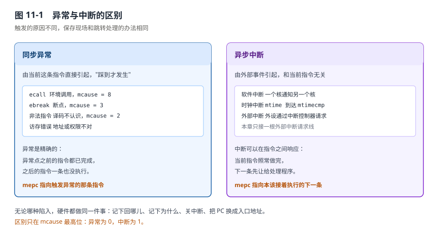
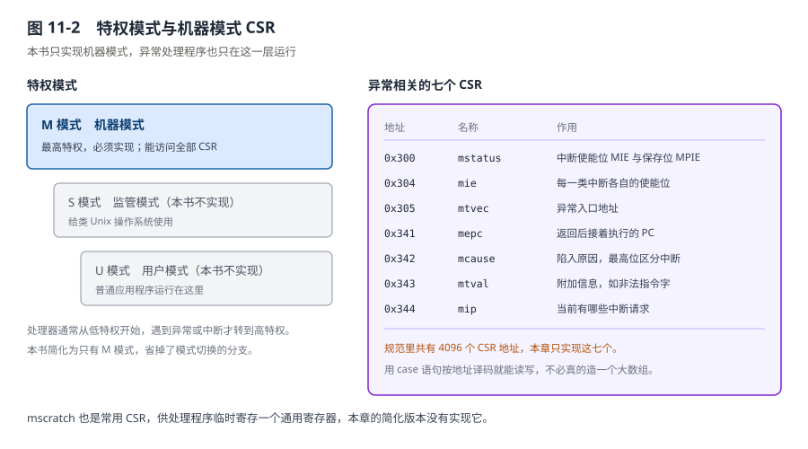
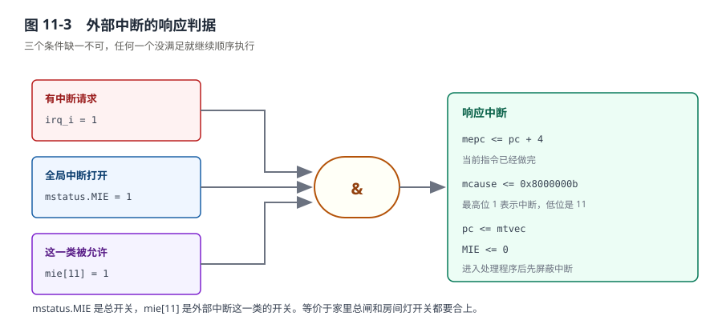
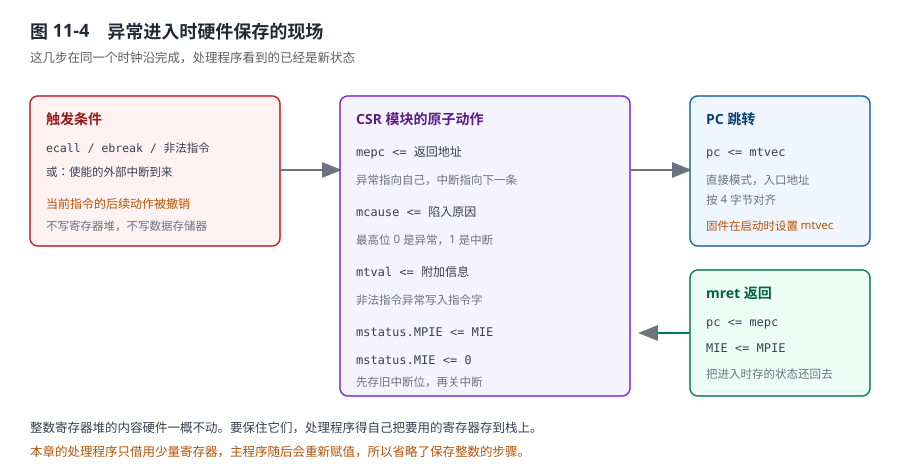
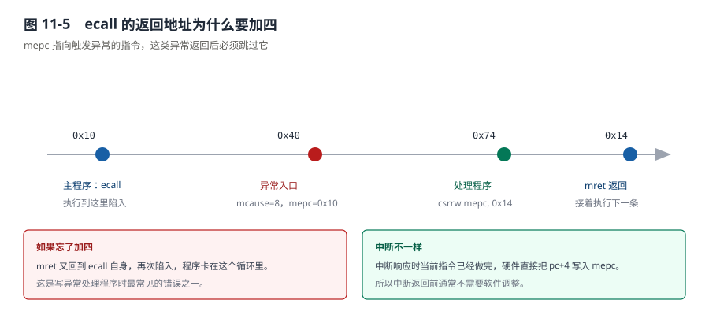
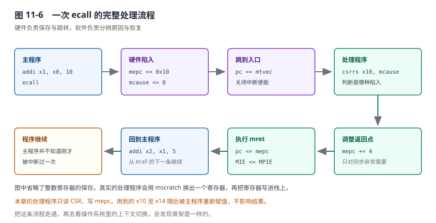

# 第 11 章　异常与中断

## 本章导读

前面的程序都顺着一条直线走，只有 branch、jal 这种指令才改写 PC，而且改写是程序自己安排的。这一章要处理另一类转向：不是程序想去，而是不得不去。执行了一条不认识的指令，或者用户程序请求操作系统服务，或者外部的定时器到点了，处理器都得暂时放下手头的工作，跳到一个固定的入口，处理完再回来。

这类事件统称**陷入**（trap），分成同步的异常和异步的中断。它们看起来差别很大，硬件处理却是同一套路子：记下从哪儿回来、记下为什么、关掉中断、跳到入口。等处理程序做完，一条返回指令把现场恢复，程序好像什么都没发生过。

这一章给第 8 章的单周期处理器加上这套机制。先认识特权模式和 CSR，再让处理器认出 ecall、ebreak、mret 和几种 CSR 读写指令，最后接一根外部中断请求线。测试程序会连续触发四次陷入，把每一次的原因和返回地址都检查一遍。章末用 QEMU 跑一段同样的程序，看看真实虚拟机里的异常行为。

学完这一章，你应该能回答：异常和中断的区别在哪里；处理器陷入时保存了什么、没保存什么；为什么 ecall 返回前要把 mepc 加四；中断要满足哪些条件才会被响应。

## 11.1　程序为什么会中途转向

写 C 程序时调用 `printf`，函数内部最后会执行一条 ecall。这条指令本身不做输入输出，它只是请求执行环境帮个忙。再比如在用户模式下访问一段没有权限的内存，处理器不能假装没事，必须找个人来处理。外设也差不多，键盘来了一个字符，处理器不可能一直盯着它看，最好由外设喊一声。



*图 11-1　异常与中断的区别*

**异常**由当前这条指令引起。译码时发现操作码不认识，执行 ecall 时请求系统服务，执行 ebreak 时通知调试器，这些都在指令流里，什么时候发生完全确定。所以异常也叫同步异常。RISC-V 要求异常是精确的：异常点之前的指令全部执行完毕，之后的指令一条都没开始。单周期处理器天然满足这一点，因为一条指令走完才轮到下一条。第 10 章的流水线就不一样了，异常发生时后面几条已经在流水线里，必须像冲刷分支那样把它们清掉。

**中断**来自指令流之外。定时器到点、外设请求服务、另一个硬件线程发来消息，这些事跟当前执行的指令没有关系，什么时候来不确定。处理器在指令之间检查有没有中断，有 interrupts 就先去处理。响应中断时当前这条指令已经做完了，所以返回地址是下一条指令。

两者走的是同一条路。硬件不管原因是什么，都做下面四件事：把返回地址写进 mepc，把原因写进 mcause，把中断使能关掉，把 PC 换成 mtvec 里存的入口地址。唯一的区别刻在 mcause 的最高位上，0 表示异常，1 表示中断。

## 11.2　特权模式与 CSR

普通程序只能看见整数寄存器和内存。异常发生后要保存现场、跳到入口，这些动作涉及一批普通指令碰不到的寄存器，叫**控制状态寄存器**（Control and Status Register，CSR）。它们有自己的地址空间，12 位地址，用专门的指令读写，和内存地址完全是两回事。



*图 11-2　特权模式与机器模式 CSR*

RISC-V 定义了几种特权模式。用户模式（U）跑应用程序，监管模式（S）跑类 Unix 操作系统，机器模式（M）权限最高，负责启动和配置系统。M 模式是唯一所有 RISC-V 处理器都必须实现的模式，简单的微控制器可以只有 M 模式。本书走的就是这条路：只有 M 模式，也就不需要处理模式切换。

异常处理要用到七个 CSR，列在图 11-2 的右半边。地址是规范定死的，软件按地址读写，硬件按地址译码。

- `mtvec` 存异常入口地址。本书只用最简单的直接模式，异常来了就跳到这个地址。
- `mepc` 存返回地址。名字里的 epc 就是 exception PC。
- `mcause` 存陷入原因，编码如表 11-1。
- `mtval` 存附加信息，非法指令异常会把那条指令的机器码写进来。
- `mstatus` 存处理器状态，这里只关心 MIE（bit 3）和 MPIE（bit 7）两位。
- `mie` 和 `mip` 分别存中断的使能位和请求位。本书只接外部中断，用第 11 位。

表 11-1　本章用到的 mcause 编码

| mcause | 含义 | 类别 |
| --- | --- | --- |
| 2 | 非法指令 | 异常 |
| 3 | 断点 | 异常 |
| 8 | 环境调用（ecall） | 异常 |
| 0x8000000b | 机器外部中断 | 中断 |

规范里总共留了 4096 个 CSR 地址，咱们只实现七个。用一组寄存器加上 case 语句就能做完，没必要造一个 4096 项的数组。这是教学实现，够用就好；真实处理器会把 CSR 做成单独的寄存器文件，加上权限检查和调试支持。

## 11.3　先看顶层接口

老规矩，先动接口。第 8 章的 core 只有时钟、复位和 PC 输出。现在外部设备要能喊一声，所以加一根中断请求线。只有这一根线变了，其余信号保持原样。

```verilog
module core (
    input  wire        clk,
    input  wire        rst_n,
    input  wire        irq_i,
    output wire [31:0] pc_out
);
```

`irq_i` 是电平信号，拉高表示有请求。真实平台上的外部中断会先经过中断控制器，多个设备共用一根线到处理器；本章把这一段省掉，直接把这一根线接到 CSR 模块，当成已经仲裁好的结果。Digital 里也能看到同样的结构，三个条件接进与门，见 `code/digital/11_interrupt_enable.dig`。

## 11.4　CSR 模块从读写端口开始

先造一个最简单的 CSR 模块，只做一件事：按地址读写。接口包含时钟复位、写使能、写地址、写数据，以及读地址和读数据。读端口单独给出来，是因为组合逻辑要用 CSR 的当前值去算写数据，比如 csrrs 要把旧值和 rs1 或起来。

寄存器和地址常量一起写。地址用 12 位常量表示，读代码时一眼就能看出是哪一个 CSR。

```verilog
    localparam [11:0] CSR_MSTATUS = 12'h300;
    localparam [11:0] CSR_MIE     = 12'h304;
    localparam [11:0] CSR_MTVEC   = 12'h305;
    localparam [11:0] CSR_MEPC    = 12'h341;
    localparam [11:0] CSR_MCAUSE  = 12'h342;
    localparam [11:0] CSR_MTVAL   = 12'h343;
    localparam [11:0] CSR_MIP     = 12'h344;
```

读端口是一个纯组合的多路选择器，按地址挑一个寄存器送出去。mip 没有对应的寄存器，它由外部中断线直接给出，第 11 位接 irq_i，其余位是零。

```verilog
    reg [31:0] rdata_r;
    always @(*) begin
        case (csr_addr_i)
            CSR_MSTATUS: rdata_r = mstatus;
            CSR_MIE:     rdata_r = mie;
            CSR_MTVEC:   rdata_r = mtvec;
            CSR_MEPC:    rdata_r = mepc;
            CSR_MCAUSE:  rdata_r = mcause;
            CSR_MTVAL:   rdata_r = mtval;
            CSR_MIP:     rdata_r = mip;
            default:     rdata_r = 32'b0;
        endcase
    end
    assign csr_rdata_o = rdata_r;
```

写端口暂时只支持 CSR 指令的写入，一条时钟语句里用 case 分配。mtvec 和 mepc 写入时把低两位清零，符合地址对齐的要求。

### 异常进入也要写 CSR

普通 CSR 指令一次只写一个寄存器，异常进入不一样，硬件要在同一个时钟沿更新四个 CSR。如果在 core 里分四次写，就得把异常过程摊到四个周期，软件看到的中间状态不可靠。干脆把这件事交给 CSR 模块，给它一组专门的入口信号。

```verilog
            if (trap_i) begin
                mepc    <= trap_epc_i;
                mcause  <= trap_cause_i;
                mtval   <= trap_val_i;
                mstatus <= mstatus_trap_i;
            end
            if (mret_i) begin
                mstatus <= mstatus_mret_i;
            end
```

`trap_i` 为真，四个寄存器一起更新；`mret_i` 为真，只恢复 mstatus 的中断位。这两条路径不和普通的 CSR 写入冲突，因为发生异常的那条指令本来就不该写 CSR，而 mret 也不是 CSR 指令。core 那边会保证三者不会同时有效。

CSR 模块还要把几个寄存器的值引出来给 core 看：mstatus 和 mie 用于判断中断能不能响应，mtvec 和 mepc 用于算下一条 PC。mcause 和 mtval 引出来主要是方便测试台观察。完整端口列表和模块代码放在 11.9 节。

## 11.5　让控制器认出系统指令

SYSTEM 类指令的操作码是 `7'b1110011`。ecall、ebreak、mret、wfi 和所有 CSR 指令都用这个操作码，靠指令里的 imm 字段和 funct3 区分。ecall 和 ebreak 的 imm 分别是 0 和 1，mret 是 0x302，wfi 是 0x105。CSR 指令的 funct3 不为零，这是最省事的判据。

```verilog
    assign is_ecall  = (instr == 32'h00000073);
    assign is_ebreak = (instr == 32'h00100073);
    assign is_mret   = (instr == 32'h30200073);
    wire   is_wfi    = (instr == 32'h10500073);

    wire is_csr = is_system && (funct3 != 3'b000);
    wire known_opcode = is_lui || is_auipc || is_jal || is_jalr ||
                        is_branch || is_load || is_store ||
                        is_itype || is_rtype || is_system;
    wire system_ok = is_ecall || is_ebreak || is_mret || is_wfi || is_csr;
    assign illegal = !known_opcode || (is_system && !system_ok);
```

`illegal` 是非法指令判据。操作码不在白名单里当然是非法，操作码是 SYSTEM 但 imm 字段既不是那四条特权指令、funct3 又是零，也属于非法。这里没检查 R 型和 I 型指令的 funct3、funct7 组合，真实处理器会查；本章的测试只用到了 `0xffffffff` 这种明显非法的机器码，简化判据够用。wfi 被当成空指令，因为本书不用低功耗状态。

### CSR 指令写什么进去

csrrw 写 rs1 的值，csrrs 把旧值和 rs1 或起来，csrrc 把旧值里 rs1 为 1 的位清掉。三种立即数版本把 rs1 字段当 5 位无符号数用，零扩展之后再做同样的操作。写进目的寄存器的永远是 CSR 的**旧值**，这一点容易忘，忘了以后读 mcause 就会读到刚写进去的东西。

```verilog
    wire [31:0] csr_uimm = {27'b0, instr[19:15]};

    reg [31:0] csr_wdata_r;
    always @(*) begin
        case (funct3)
            3'b001: csr_wdata_r = r1;
            3'b010: csr_wdata_r = csr_rdata | r1;
            3'b011: csr_wdata_r = csr_rdata & ~r1;
            3'b101: csr_wdata_r = csr_uimm;
            3'b110: csr_wdata_r = csr_rdata | csr_uimm;
            3'b111: csr_wdata_r = csr_rdata & ~csr_uimm;
            default: csr_wdata_r = 32'b0;
        endcase
    end
    assign csr_wdata = csr_wdata_r;
    assign csr_we = is_csr;
```

控制器还要给写回选择器加一路 `WR_CSR`，让 CSR 指令把旧值写进 rd。其余控制信号照旧，第 8 章那张表一行都不用改。

## 11.6　异常进入的硬件动作

core 里把触发条件整理成三个信号。`sync_trap` 表示同步异常，包含非法指令、ecall 和 ebreak。`irq_pending` 表示外部中断满足响应条件。`trap_enter` 是两者的或，为真时这一拍就是陷入。

```verilog
    wire        sync_trap;
    wire        irq_pending;
    wire        trap_enter;
    wire [31:0] trap_cause;
    wire [31:0] trap_epc;
    wire [31:0] trap_val;
    wire [31:0] mstatus_trap;
    wire [31:0] mstatus_mret;

    assign sync_trap = illegal || is_ecall || is_ebreak;
    assign irq_pending = irq_i && mstatus[3] && mie[11];
    assign trap_enter = sync_trap || irq_pending;
```

中断的三个条件在图 11-3 里画成了与门。总开关 mstatus.MIE、这一类中断的开关 mie[11]、外部请求 irq_i，缺一个都不响应。打个比方，总闸、房间灯开关、有人按门铃，三件事凑齐了灯才亮。



*图 11-3　外部中断的响应判据*

接着算要写进 CSR 的三个值。原因按表 11-1 编码，中断的 mcause 最高位设为 1。返回地址分两种：同步异常的 mepc 指向出错指令自己，中断的 mepc 指向 pc+4，因为中断响应时当前指令已经做完。mtval 只在非法指令时填指令字，其他情况写零。

```verilog
    assign trap_cause = illegal  ? 32'd2   :
                        is_ebreak ? 32'd3   :
                        is_ecall  ? 32'd8   : 32'h8000000b;
    assign trap_epc = sync_trap ? pc : pc_plus_4;
    assign trap_val = illegal ? instr : 32'b0;
```



*图 11-4　异常进入时硬件保存的现场*

mstatus 的两位搬运写成两行位运算。进入时把 MIE（bit 3）搬到 MPIE（bit 7），再把 MIE 清零，相当于"把原来的开关状态收好，然后把总闸拉下来"。返回时反过来，从 MPIE 搬回 MIE。

```verilog
    assign mstatus_trap = (mstatus & ~32'h00000008) | ((mstatus & 32'h00000008) << 4);
    assign mstatus_mret = (mstatus & ~32'h00000008) | ((mstatus >> 4) & 32'h00000008);
```

这两行看着绕，其实只是移动一个比特。写成 `<< 4` 是因为 bit 3 左移四位就是 bit 7，右移四位则相反。用移位而不是单独判断一位，代码短，也不会漏掉"先把目标位清掉"这一步。

## 11.7　PC 该去哪儿

下一拍的 PC 现在有四个来源，按优先级排列：陷入最优先，mret 次之，然后是分支跳转，最后才是 pc+4。

```verilog
    assign next_pc = trap_enter   ? {mtvec[31:2], 2'b00} :
                     is_mret      ? mepc                 :
                     (pc_src == 2'b01)  ? pc_plus_imm :
                     (pc_src == 2'b10)  ? jalr_target : pc_plus_4;
```

mtvec 的低两位清零，保证入口地址四字节对齐。如果同步异常发生时当前指令还照常写回，程序就会出现"一边跳到处理程序、一边把出错指令的结果写进寄存器"这种怪事。所以在寄存器堆和数据存储器的写使能上都要加一道闸。

```verilog
        .we     (wreg && !sync_trap),
```

```verilog
        .we      (mem_write && !sync_trap),
```

中断不在这道闸的范围内。中断是当前指令做完之后才响应的，那条指令的结果必须保留。这也是同步异常和中断在硬件上唯一需要区别对待的地方。

## 11.8　返回地址与 mret

mret 把 pc 换回 mepc，同时恢复 MIE。它本身不碰 mepc，所以 mepc 里是什么，就返回到哪里。规范规定同步异常的 mepc 指向触发异常的指令，这对缺页这类异常很合适：操作系统修好页表，返回后重新执行那条访存指令就行。

可是 ecall 不成。它的任务已经由处理程序完成了，返回后再执行一遍 ecall 就又陷入一次，程序卡死在原地。所以 ecall、ebreak 这类异常在返回前必须把 mepc 加四，让 mret 落到下一条指令。



*图 11-5　ecall 的返回地址为什么要加四*

这一步由软件做，处理程序里通常长这样：

```asm
    csrr    t0, mcause
    csrr    t1, mepc
    addi    t1, t1, 4
    csrw    mepc, t1
    mret
```

把"加法"留给软件是有道理的。不同异常对返回地址的看法不同，硬件不该替软件做决定。缺页要原地重来，ecall 要跳过，交给处理程序按 mcause 分支最灵活。代价是写处理程序时得记着这件事，忘了就要调试半天。

完整的一次处理流程画在图 11-6。硬件负责前半段，软件负责后半段，中间的交接点是那七个 CSR。



*图 11-6　一次 ecall 的完整处理流程*

还有一件事要说清楚：硬件进入异常时只保存 PC 和几个 CSR，**整数寄存器一个都不动**。真实的处理程序要先用 mscratch 换出一个寄存器，再把用到的通用寄存器存进栈，返回前逐一恢复。本章的处理程序只读 mcause、改 mepc，借用的 x10 至 x14 在主程序里都会重新赋值，所以省掉了保护现场这一步。这是简化，不是标准做法。

## 11.9　完整代码

把前面几节拼起来，就是两个模块。先看 CSR 模块，端口分成三组：上面是普通读写，中间是异常进入和返回，下面是给 core 观察的状态输出。

```verilog
module csr (
    input  wire        clk,
    input  wire        rst_n,

    input  wire [11:0] csr_addr_i,
    input  wire [31:0] csr_wdata_i,
    input  wire        csr_we_i,
    output wire [31:0] csr_rdata_o,

    input  wire        trap_i,
    input  wire [31:0] trap_cause_i,
    input  wire [31:0] trap_epc_i,
    input  wire [31:0] trap_val_i,
    input  wire [31:0] mstatus_trap_i,

    input  wire        mret_i,
    input  wire [31:0] mstatus_mret_i,

    input  wire        irq_i,

    output wire [31:0] mstatus_o,
    output wire [31:0] mie_o,
    output wire [31:0] mtvec_o,
    output wire [31:0] mepc_o,
    output wire [31:0] mcause_o,
    output wire [31:0] mtval_o
);
```

下面是完整实现。三个写来源放在同一个 always 块里，顺序上普通写入在前，异常和返回在后；core 保证它们不会同时有效，所以谁先谁后并不影响结果。

```verilog
module csr (
    input  wire        clk,
    input  wire        rst_n,

    input  wire [11:0] csr_addr_i,
    input  wire [31:0] csr_wdata_i,
    input  wire        csr_we_i,
    output wire [31:0] csr_rdata_o,

    input  wire        trap_i,
    input  wire [31:0] trap_cause_i,
    input  wire [31:0] trap_epc_i,
    input  wire [31:0] trap_val_i,
    input  wire [31:0] mstatus_trap_i,

    input  wire        mret_i,
    input  wire [31:0] mstatus_mret_i,

    input  wire        irq_i,

    output wire [31:0] mstatus_o,
    output wire [31:0] mie_o,
    output wire [31:0] mtvec_o,
    output wire [31:0] mepc_o,
    output wire [31:0] mcause_o,
    output wire [31:0] mtval_o
);

    localparam [11:0] CSR_MSTATUS = 12'h300;
    localparam [11:0] CSR_MIE     = 12'h304;
    localparam [11:0] CSR_MTVEC   = 12'h305;
    localparam [11:0] CSR_MEPC    = 12'h341;
    localparam [11:0] CSR_MCAUSE  = 12'h342;
    localparam [11:0] CSR_MTVAL   = 12'h343;
    localparam [11:0] CSR_MIP     = 12'h344;

    reg [31:0] mstatus;
    reg [31:0] mie;
    reg [31:0] mtvec;
    reg [31:0] mepc;
    reg [31:0] mcause;
    reg [31:0] mtval;

    wire [31:0] mip = {20'b0, irq_i, 11'b0};

    assign mstatus_o = mstatus;
    assign mie_o     = mie;
    assign mtvec_o   = mtvec;
    assign mepc_o    = mepc;
    assign mcause_o  = mcause;
    assign mtval_o   = mtval;

    reg [31:0] rdata_r;
    always @(*) begin
        case (csr_addr_i)
            CSR_MSTATUS: rdata_r = mstatus;
            CSR_MIE:     rdata_r = mie;
            CSR_MTVEC:   rdata_r = mtvec;
            CSR_MEPC:    rdata_r = mepc;
            CSR_MCAUSE:  rdata_r = mcause;
            CSR_MTVAL:   rdata_r = mtval;
            CSR_MIP:     rdata_r = mip;
            default:     rdata_r = 32'b0;
        endcase
    end
    assign csr_rdata_o = rdata_r;

    always @(posedge clk) begin
        if (!rst_n) begin
            mstatus <= 32'b0;
            mie     <= 32'b0;
            mtvec   <= 32'b0;
            mepc    <= 32'b0;
            mcause  <= 32'b0;
            mtval   <= 32'b0;
        end else begin
            if (csr_we_i) begin
                case (csr_addr_i)
                    CSR_MSTATUS: mstatus <= csr_wdata_i;
                    CSR_MIE:     mie     <= csr_wdata_i;
                    CSR_MTVEC:   mtvec   <= {csr_wdata_i[31:2], 2'b00};
                    CSR_MEPC:    mepc    <= {csr_wdata_i[31:2], 2'b00};
                    CSR_MCAUSE:  mcause  <= csr_wdata_i;
                    CSR_MTVAL:   mtval   <= csr_wdata_i;
                    default:     ;
                endcase
            end
            if (trap_i) begin
                mepc    <= trap_epc_i;
                mcause  <= trap_cause_i;
                mtval   <= trap_val_i;
                mstatus <= mstatus_trap_i;
            end
            if (mret_i) begin
                mstatus <= mstatus_mret_i;
            end
        end
    end

endmodule
```

核心模块的代码如下。跟第 8 章相比，多出来的只是 CSR 实例、几个陷入信号和 next_pc 的前两项。取指、译码、ALU、访存还是原来那几块。

```verilog
module core (
    input  wire        clk,
    input  wire        rst_n,
    input  wire        irq_i,
    output wire [31:0] pc_out
);

    wire [31:0] pc;
    wire [31:0] next_pc;
    wire [31:0] instr;
    wire [31:0] imm;
    wire [31:0] r1;
    wire [31:0] r2;
    wire [31:0] alu_result;
    wire [31:0] wdata;
    wire [31:0] rdata;
    wire [31:0] pc_plus_4;
    wire [31:0] pc_plus_imm;
    wire [31:0] jalr_target;

    wire        wreg;
    wire [2:0]  wreg_src;
    wire [1:0]  pc_src;
    wire        branch_taken;
    wire        alu_src_b;
    wire [3:0]  alu_op;
    wire        mem_write;
    wire [2:0]  mem_func;

    wire        is_ecall;
    wire        is_ebreak;
    wire        is_mret;
    wire        illegal;
    wire        csr_we;
    wire [31:0] csr_wdata;

    wire [31:0] csr_rdata;
    wire [31:0] mstatus;
    wire [31:0] mie;
    wire [31:0] mtvec;
    wire [31:0] mepc;
    wire [31:0] mcause;
    wire [31:0] mtval;

    pc u_pc (
        .clk     (clk),
        .rst_n   (rst_n),
        .next_pc (next_pc),
        .cur_pc  (pc)
    );

    imem u_imem (
        .addr  (pc),
        .instr (instr)
    );

    csr u_csr (
        .clk             (clk),
        .rst_n           (rst_n),
        .csr_addr_i      (instr[31:20]),
        .csr_wdata_i     (csr_wdata),
        .csr_we_i        (csr_we),
        .csr_rdata_o     (csr_rdata),
        .trap_i          (trap_enter),
        .trap_cause_i    (trap_cause),
        .trap_epc_i      (trap_epc),
        .trap_val_i      (trap_val),
        .mstatus_trap_i  (mstatus_trap),
        .mret_i          (is_mret),
        .mstatus_mret_i  (mstatus_mret),
        .irq_i           (irq_i),
        .mstatus_o       (mstatus),
        .mie_o           (mie),
        .mtvec_o         (mtvec),
        .mepc_o          (mepc),
        .mcause_o        (mcause),
        .mtval_o         (mtval)
    );

    control u_control (
        .instr        (instr),
        .r1           (r1),
        .r2           (r2),
        .csr_rdata    (csr_rdata),
        .imm          (imm),
        .wreg         (wreg),
        .wreg_src     (wreg_src),
        .pc_src       (pc_src),
        .branch_taken (branch_taken),
        .alu_src_b    (alu_src_b),
        .alu_op       (alu_op),
        .mem_write    (mem_write),
        .mem_func     (mem_func),
        .is_ecall     (is_ecall),
        .is_ebreak    (is_ebreak),
        .is_mret      (is_mret),
        .illegal      (illegal),
        .csr_we       (csr_we),
        .csr_wdata    (csr_wdata)
    );

    regfile u_regfile (
        .clk    (clk),
        .rst_n  (rst_n),
        .rs1    (instr[19:15]),
        .rs2    (instr[24:20]),
        .rd     (instr[11:7]),
        .we     (wreg && !sync_trap),
        .wdata  (wdata),
        .rdata1 (r1),
        .rdata2 (r2)
    );

    alu u_alu (
        .a      (r1),
        .b      (alu_src_b ? imm : r2),
        .alu_op (alu_op),
        .result (alu_result)
    );

    dmem u_dmem (
        .clk     (clk),
        .addr    (alu_result),
        .we      (mem_write && !sync_trap),
        .funct3  (mem_func),
        .wdata   (r2),
        .rdata   (rdata)
    );

    assign pc_plus_4   = pc + 32'd4;
    assign pc_plus_imm = pc + imm;
    assign jalr_target = (r1 + imm) & ~32'd1;

    wire        sync_trap;
    wire        irq_pending;
    wire        trap_enter;
    wire [31:0] trap_cause;
    wire [31:0] trap_epc;
    wire [31:0] trap_val;
    wire [31:0] mstatus_trap;
    wire [31:0] mstatus_mret;

    assign sync_trap = illegal || is_ecall || is_ebreak;
    assign irq_pending = irq_i && mstatus[3] && mie[11];
    assign trap_enter = sync_trap || irq_pending;

    assign trap_cause = illegal  ? 32'd2   :
                        is_ebreak ? 32'd3   :
                        is_ecall  ? 32'd8   : 32'h8000000b;
    assign trap_epc = sync_trap ? pc : pc_plus_4;
    assign trap_val = illegal ? instr : 32'b0;

    assign mstatus_trap = (mstatus & ~32'h00000008) | ((mstatus & 32'h00000008) << 4);
    assign mstatus_mret = (mstatus & ~32'h00000008) | ((mstatus >> 4) & 32'h00000008);

    assign next_pc = trap_enter   ? {mtvec[31:2], 2'b00} :
                     is_mret      ? mepc                 :
                     (pc_src == 2'b01)  ? pc_plus_imm :
                     (pc_src == 2'b10)  ? jalr_target : pc_plus_4;

    assign wdata = (wreg_src == 3'd0) ? imm :
                   (wreg_src == 3'd1) ? pc_plus_imm :
                   (wreg_src == 3'd2) ? pc_plus_4 :
                   (wreg_src == 3'd3) ? alu_result :
                   (wreg_src == 3'd4) ? rdata :
                   (wreg_src == 3'd5) ? csr_rdata : 32'b0;

    assign pc_out = pc;

endmodule
```

写代码时踩过一个坑，值得记下来。trap_cause、trap_epc 这些信号一开始忘了声明 wire，Icarus 会把它们当成 1 位线，高 31 位悄悄丢掉。仿真表现是 PC 跳到了 0 地址，CSR 里的原因只剩最低位，查起来很费劲。Verilog 不要求显式声明网线，但依赖这个"方便"迟早要还债。所有中间信号都写清楚位宽，是省时间的习惯。

## 11.10　走通例子

测试程序放在 `code/verilog/11_trap/code.hex`，由 `tools/gen_code_hex11.py` 生成。程序开头先用 lui 和 addi 算出异常入口 0x00400040，再用 csrrw 写进 mtvec。注意生成机器码时有两个容易错的地方：CSR 地址在指令的 bit[31:20]，mtvec 是 0x305 而不是 mepc 的 0x341；LUI 用 20 位立即数，不能套用 I 型指令的 12 位立即数编码。

主程序依次触发 ecall、非法指令、ebreak，然后用 csrrs 设置 mie[11]，用 csrrsi 置起 mstatus.MIE，最后打开外部中断。异常处理入口按 mcause 分支，对三种同步异常把 mepc 加四，对中断则直接返回。

表 11-2 是四次陷入的关键数据。前三次的 mepc 指向出错指令自己，第四次是中断，mepc 指向下一条指令。

表 11-2　四次陷入的观察结果

| 次序 | 触发原因 | mcause | mepc | 返回后执行 |
| --- | --- | --- | --- | --- |
| 1 | ecall | 8 | 0x00400010 | 0x00400014 的 addi |
| 2 | 非法指令 | 2 | 0x00400018 | 0x0040001c 的 addi |
| 3 | ebreak | 3 | 0x00400020 | 0x00400024 的 lui |
| 4 | 外部中断 | 0x8000000b | 0x00400038 | 0x00400038 的 addi |

测试台在检测到 PC 首次进入异常入口时记下 mcause、mepc 和 mtval，最后统一检查。这样四次陷入共用一个处理程序，也不会因为寄存器被后一次覆盖而漏检。中断请求由测试台在 PC 到达 0x00400030 那一拍拉高，进入处理程序后立刻拉低，避免返回后又响应一次。

运行方法：

```bash
cd code/verilog/11_trap
iverilog -g2012 -o sim.out alu.v pc.v control.v regfile.v imem.v dmem.v csr.v core.v tb_core.v
vvp sim.out
```

21 项检查全部通过，包括四次陷入的原因和返回地址、非法指令字是否进入 mtval、每条指令返回后是否继续执行、mret 是否恢复了全局中断使能。

## 11.11　重点与权衡

**精确异常是有代价的。** 单周期处理器一条指令走完再处理下一条，天然精确。第 10 章的流水线就不行了，异常在第几级发现，后面几级都可能是无辜的，得冲刷。越深的流水线，异常处理和分支预测纠缠得越紧，这是乱序处理器里最费心思的部分之一。本书停在这里，不再往前走。

**哪些现场由硬件保存，哪些交给软件。** 硬件只保存返回地址、原因和状态位，整数寄存器让软件自己存。这样硬件简单，软件灵活：处理程序可以只保存真正会用到的寄存器。代价是每次陷入都要执行一段保存和恢复的指令，中断频繁时开销不小。

**要不要支持向量模式。** mtvec 除了直接模式，还支持向量模式，不同的异常直接跳到不同的入口，省掉软件按 mcause 分支那几步。本书只有一个入口，直接模式够用。中断源多起来之后，向量模式的好处才明显。

**权限检查省掉了。** 真实处理器在处理 CSR 指令前会检查当前特权模式，用户模式碰机器模式的 CSR 要触发非法指令异常。本书只有 M 模式，不存在这个问题。等读到操作系统相关的书，这一课要补上。

## 11.12　实验

**实验一　观察四次陷入。** 运行 11.10 节的仿真命令，对照表 11-2 检查测试台输出。然后把测试台里拉高 irq 的时刻往后挪一条指令，再跑一次，看看 mepc 和返回点怎么变。

**实验二　漏掉加四会怎样。** 把测试程序里 handler 的 `addi x14, x11, 4` 改成加零，重新生成 code.hex 并仿真。测试台会在等待第四次陷入时卡住，因为程序回到 ecall 后又陷进去了。用观测台打印 PC，能看到它在 0x10 和 0x40 之间来回跳。

**实验三　关掉全局中断。** 把 `csrrsi x0, mstatus, 8` 改成写零，再仿真。前三次异常不受影响，第四次中断不会发生，测试台会一直等下去。这验证了中断的第二个条件。

**实验四　数字电路。** 用 Digital 打开 `code/digital/11_interrupt_enable.dig`，拨三个开关，验证只有三个输入全为 1 时输出才为 1。再把这段文字里描述的真值表逐行对一遍。

## 11.13　QEMU 里的同一段程序

前面跑的是自己搭的处理器。真实软件不必等硬件做完才能验证，QEMU 就能在一台普通电脑上模拟 RISC-V 机器。`code/qemu/` 下放了一段机器模式的汇编程序，做的事和本章的测试程序一样：设置 mtvec，执行两次 ecall，处理程序读 mcause、把 mepc 加四、从串口输出一个字符，再 mret 返回。

程序最后是一条自环指令，让处理器停在那里。退出 QEMU 要按 Ctrl+A，松开后再按 X。

```bash
cd code/qemu
make
make run
```

串口上应该依次出现 A 和 B。两个字符说明两次 ecall 都正确返回了主程序：如果忘了给 mepc 加四，只会看到第一个 A，然后程序卡在第二次 ecall 上。

`link.ld` 把程序入口放在 0x80000000，这是 QEMU virt 机器的内存起点；`trap.S` 里的串口地址 0x10000000 是 virt 平台的 16550 UART。第 12 章讲外设时会把这两个地址展开。这两组参数是平台相关的，换一块开发板就要换。

这组实验需要预先安装 RISC-V GCC 交叉编译器和 qemu-system-riscv32，编写的机器是 32 位 virt：`-M virt -bios none`。本书的核心实验不依赖 QEMU，硬件仿真部分用 Icarus Verilog 就能全部跑完。QEMU 的作用是提供一个对照：同一段机器码，在虚拟机里看到的 mcause 和 mepc，跟自己搭的处理器算出来的是一致的。

## 11.14　香山一瞥（选读）

香山支持完整的特权架构，异常和中断的处理比本章复杂得多。它实现了 M 模式和 S 模式，异常可以按 medeleg、mideleg 的配置委托给操作系统直接处理；中断先经过 PLIC 汇总，再送到核内；后端发现异常时，issue queue、重定序队列和分支预测器里的相关项都要按序号作废，保证异常是精确的。

值得留意的是入口地址的计算。本章直接跳到 mtvec 给出的地址，香山还要区分中断和异常、是否向量模式、是否被委托，选择哪一套 CSR 来保存现场。这套逻辑不深，但分支多，写的时候极易漏掉某一种组合。第 10 章讲的冲刷在这里派上用场：异常发生那一刻，处理器要让流水线里比它年轻的指令全部消失，就像分支预测失败一样。

本节只作对照，不展开实现细节。把本章的单周期版本吃透，再去看那些名字繁多的 CSR，会发现骨架还是同一套。

## 11.15　本章小结

异常由指令同步触发，中断来自指令流之外，两者共用一套陷入机制。硬件在陷入时把返回地址写入 mepc、原因写入 mcause、附加信息写入 mtval，保存中断使能位后关中断，再把 PC 换成 mtvec 中的入口。mret 做相反的恢复动作。

同步异常的 mepc 指向触发它的指令，返回前通常要由软件加四；中断的 mepc 指向下一条指令，直接返回即可。整数寄存器不由硬件保存，处理程序要自己保护要用到的那些。中断响应要同时满足三个条件：有请求、全局使能打开、该类中断使能打开。

本章的实现只支持机器模式、七个 CSR 和一根外部中断线。特权模式、委托机制、向量模式和中断控制器都没有涉及，这些是系统软件课程的起点，不是本书的目标。

## 思考题

1. 异常和中断都叫陷入，为什么 mepc 的填法不一样？
2. mcause 的最高位有什么用？如果只看低 31 位，会不会把中断和异常搞混？
3. ecall 的处理程序忘记把 mepc 加四，程序会表现出什么现象？
4. mstatus 的 MIE 和 MPIE 为什么要分两位？只用一位行不行？
5. 硬件进入异常时没有保存整数寄存器，为什么不会破坏主程序的现场？本章的简化做法在什么条件下才安全？
6. 中断响应的三个条件里，去掉全局使能这一项会怎样？
7. 第 10 章的五级流水线如果加入异常处理，需要在哪一级检测非法指令？检测之后应该冲刷哪些级？
8. QEMU 里的 trap.S 用串口输出字符验证返回是否正确。如果只输出了一个 A，可能有哪几种原因？
