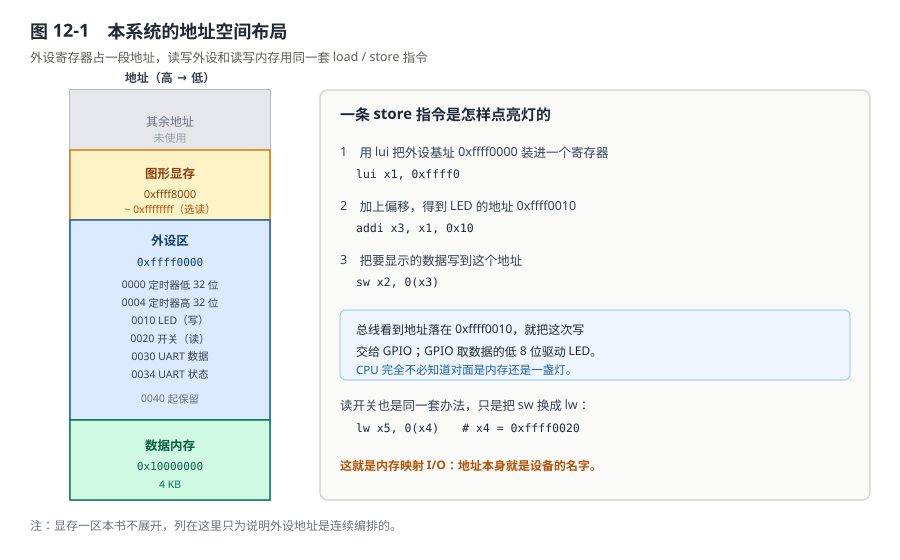
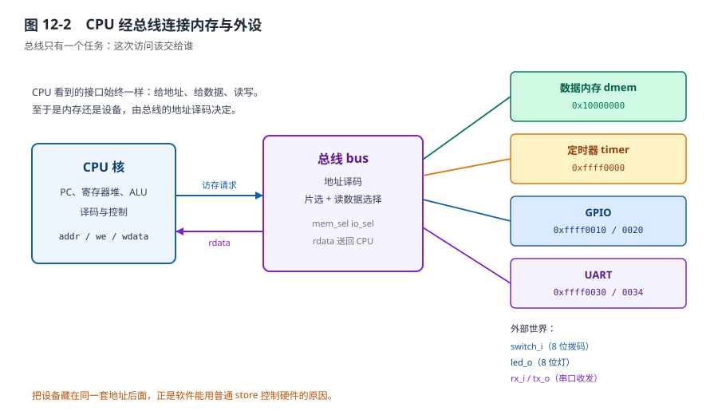
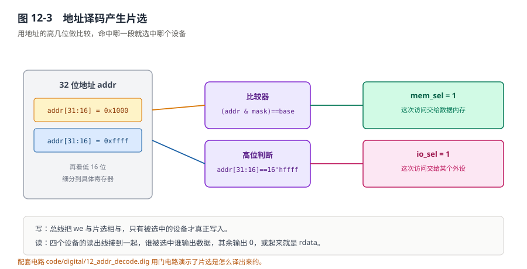
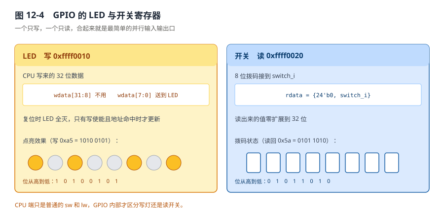
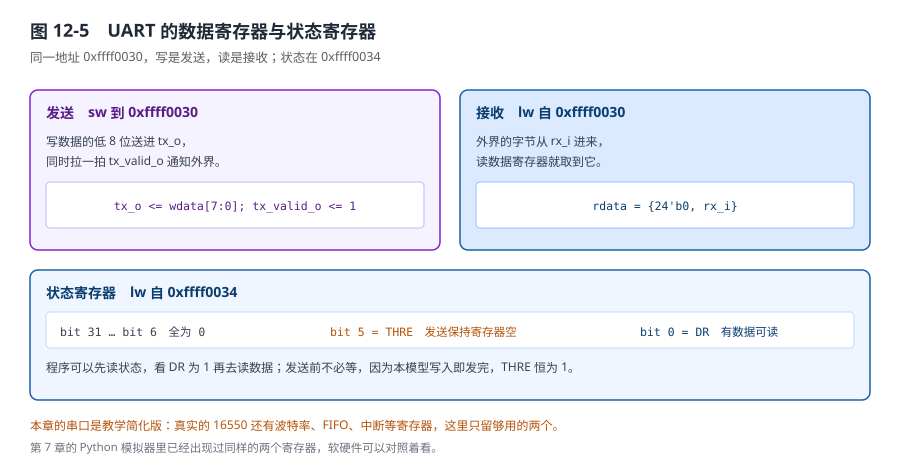
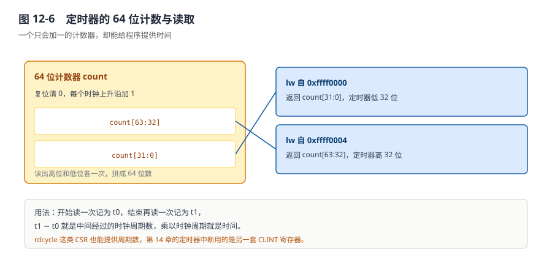

# 第 12 章　外设

## 本章导读

前面十章里，处理器不是跟内存打交道，就是跟寄存器打交道。程序算出的结果存回内存，下一条指令再从内存取回来，整个过程自给自足。可是真正的计算机得跟外面的世界说话：点亮一盏灯，读一下拨码开关，在终端上打印一个字符，看看时间过了多久。这些部件不是内存，叫**外设**。

外设种类很多，接法却可以统一。RISC-V 采用内存映射 I/O，把外设的控制寄存器安排进地址空间，让软件用普通的 `lw` 和 `sw` 就能访问。处理器不需要专门的输入输出指令，只要地址译码时认得这些地址，把读写转给对应的设备就行。这样一来，第 8 章那套访存逻辑几乎不用改。

这一章先给第 7 章的 Python 模拟器接上 GPIO、UART 和定时器，用熟悉的软件把地址映射这件事看清楚；再给硬件加一段总线，把单周期核和三个外设连起来。测试程序会依次点灯、读开关、发两个字符、读串口状态和定时器，把每一结果都检查一遍。配套的门电路 `code/digital/12_addr_decode.dig` 用一个两位译码器演示片选是怎么产生的。

学完这一章，你应该能回答：什么是内存映射 I/O；CPU 怎么知道一次访问是给内存还是给设备；为什么串口的数据寄存器既能写又能读；定时器为什么分两次读高低 32 位。

## 12.1　把设备当成地址来看

设想一个最简单的需求：让程序点亮一盏灯。最直接的想法是加一条专门的指令，比如 `out x1`，把寄存器的值送到某个端口。这条路能走通，但每加一种设备就要加一条指令，指令集会越来越臃肿。

RISC-V 走了另一条路。它不给 I/O 留专门的指令，而是把设备的寄存器安排到地址空间里的某一段。要点亮灯，就往那个地址写一个数；要读开关，就从另一个地址读一个数。软件看到的仍然是 `lw` 和 `sw`，只是这些地址背后不再是内存芯片，而是一盏灯或一组拨码开关。这就是**内存映射 I/O**。

本书的地址布局画在图 12-1。代码段放在 `0x00400000`，数据内存放在 `0x10000000`，两者分开；外设寄存器集中在 `0xffff0000` 开始的一小段，各占四个字节或一个地址。



*图 12-1　本系统的地址空间布局*

具体安排是这样的：

| 地址 | 设备 | 方向 | 说明 |
| --- | --- | --- | --- |
| `0xffff0000` | 定时器 | 读 | 64 位计数的低 32 位 |
| `0xffff0004` | 定时器 | 读 | 64 位计数的高 32 位 |
| `0xffff0010` | LED | 写 | 低 8 位驱动八盏灯 |
| `0xffff0020` | 开关 | 读 | 低 8 位是拨码状态 |
| `0xffff0030` | UART 数据 | 读写 | 写是发送，读是接收 |
| `0xffff0034` | UART 状态 | 读 | bit 0 有数据，bit 5 可发送 |

这张表不难记，因为它的规律就是"高 16 位是 `ffff`，低 16 位决定具体设备"。第 4 章讲译码器时说过，地址线上的每一位都能用来做选择，这里正是那个思想的应用。

也有不采用内存映射的架构，最典型的是 x86 的 `in` 和 `out` 指令，它们访问一个独立于内存的 I/O 地址空间。两种做法各有取舍，内存映射的好处是软件模型统一，坏处是外设占掉了本来可以放内存的地址。RISC-V 选了前一种，本书照此办理。

## 12.2　先在软件里把地址访问走一遍

直接上 Verilog 容易迷路。先用第 7 章熟悉的 Python 把同一套地址映射写一遍，等概念清楚了，再看硬件就顺了。代码放在 `code/python/12_peripheral/peripherals.py`。

先把地址常量集中起来，避免满屏魔数。

```python
# ---- 地址常量 ----
MEM_BASE = 0x10000000
MEM_SIZE = 0x1000

MTIME_LO = 0xFFFF0000
MTIME_HI = 0xFFFF0004
LED_ADDR = 0xFFFF0010
SW_ADDR = 0xFFFF0020
UART_DATA = 0xFFFF0030
UART_STAT = 0xFFFF0034

LSR_DR = 0x01    # 接收数据就绪
LSR_THRE = 0x20  # 发送保持寄存器空
```

这些常量稍后会被总线和设备类共用。写地址时只要写 `LED_ADDR`，不必每次都数 `0xffff0010` 里有几个零。

### GPIO 是最容易理解的起点

GPIO 只有两个寄存器，一个管灯，一个管开关。灯的寄存器只写：把值的低 8 位记下来。开关的寄存器只读：把外界的 8 位拨码返回出来。

```python
class GPIO:
    """两个寄存器：写 LED，读开关。"""

    def __init__(self):
        self.led = 0

    def matches(self, addr):
        return addr in (LED_ADDR, SW_ADDR)

    def read(self, addr, switches):
        if addr == SW_ADDR:
            return switches & 0xFF
        return 0

    def write(self, addr, value):
        if addr == LED_ADDR:
            self.led = value & 0xFF
```

`matches` 回答一个关键问题：这个地址是不是我的。总线上挂着好几个设备，每个都先做这个判断，只有命中的那个才动手。这个"先看是不是叫我"的习惯，硬件里也一样，只不过判断从 Python 的 `in` 变成了比较器。

### UART 的同一地址两种用途

串口稍微绕一点。数据寄存器 `UART_DATA` 写入时是发送，读出时是接收，一个地址两种用途，靠读还是写来区分。状态寄存器 `UART_STAT` 只读，用两个位告诉程序现在能不能收发。

```python
class UART:
    """一个数据寄存器，一个状态寄存器，行为对齐 Verilog 版。"""

    def __init__(self):
        self.rx_queue = []
        self.tx_log = []

    def matches(self, addr):
        return addr in (UART_DATA, UART_STAT)

    def feed(self, data):
        if isinstance(data, str):
            data = data.encode("ascii")
        self.rx_queue.extend(data)

    def read(self, addr):
        if addr == UART_DATA:
            return self.rx_queue.pop(0) if self.rx_queue else 0
        if addr == UART_STAT:
            status = LSR_THRE
            if self.rx_queue:
                status |= LSR_DR
            return status
        return 0

    def write(self, addr, value):
        if addr == UART_DATA:
            self.tx_log.append(value & 0xFF)

    def output(self):
        return bytes(self.tx_log).decode("ascii", errors="replace")
```

`feed` 是宿主机往模拟器里送字符，`tx_log` 记录程序发出去的字符。状态位里 THRE 恒为 1，因为这里没有真正的发送延迟，写进去就算发完了。真实的 16550 会在字节还没发完时把这个位清掉，程序得等它重新变 1 才能写下一个。第 7 章已经见过这套简化，这里保持一致。

### 定时器只是个加法器

定时器的全部本事就是每个时钟加一。它有两个读出地址，分别给低 32 位和高 32 位。

```python
class Timer:
    """64 位自由运行计数器，读低 32 位或高 32 位。"""

    def __init__(self):
        self.count = 0

    def matches(self, addr):
        return (MTIME_LO <= addr < MTIME_LO + 4) or \
               (MTIME_HI <= addr < MTIME_HI + 4)

    def tick(self):
        self.count = (self.count + 1) & 0xFFFFFFFFFFFFFFFF

    def read(self, addr):
        if MTIME_LO <= addr < MTIME_LO + 4:
            return (self.count >> (8 * (addr - MTIME_LO))) & 0xFF
        if MTIME_HI <= addr < MTIME_HI + 4:
            return (self.count >> (32 + 8 * (addr - MTIME_HI))) & 0xFF
        return 0
```

注意 `matches` 判的是一个四字节的范围，不是单个地址。原因在总线那一段讲：一次 `lw` 会拆成四个字节访问，定时器的四个字节都得认领，否则拼出来的 32 位数只剩最低一个字节。这个坑在硬件版里不存在，因为硬件一次就给出 32 位，Python 版按字节模拟才需要这样处理。

### 总线负责分发

最后写总线。它持有内存和三个设备，按地址决定把一次字节访问转给谁。

```python
class Bus:
    """按地址把字节访问分发给内存或外设。"""

    def __init__(self, switches=0):
        self.mem = bytearray(MEM_SIZE)
        self.switches = switches & 0xFF
        self.gpio = GPIO()
        self.uart = UART()
        self.timer = Timer()

    @staticmethod
    def _in_mem(addr):
        return MEM_BASE <= addr < MEM_BASE + MEM_SIZE

    def load8(self, addr):
        addr = u32(addr)
        if self._in_mem(addr):
            return self.mem[addr - MEM_BASE]
        if self.gpio.matches(addr):
            return self.gpio.read(addr, self.switches) & 0xFF
        if self.uart.matches(addr):
            return self.uart.read(addr) & 0xFF
        if self.timer.matches(addr):
            return self.timer.read(addr) & 0xFF
        return 0

    def store8(self, addr, value):
        addr = u32(addr)
        value &= 0xFF
        if self._in_mem(addr):
            self.mem[addr - MEM_BASE] = value
        elif addr == LED_ADDR:
            self.gpio.write(addr, value)
        elif addr == UART_DATA:
            self.uart.write(addr, value)
```

`load8` 里那串 `if` 就是软件版的地址译码。四段地址互不重叠，顺序无所谓，命中哪段就返回哪段的数据，都没命中就返回 0。`store8` 只处理真正可写的两个地址，定时器根本没有写入口，往它的地址写东西会被静默忽略。

半字和字访问仍然靠字节拼，这一层完全不用改。

```python
    def load32(self, addr):
        return (self.load8(addr)
                | (self.load8(addr + 1) << 8)
                | (self.load8(addr + 2) << 16)
                | (self.load8(addr + 3) << 24))

    def store32(self, addr, value):
        for i in range(4):
            self.store8(addr + i, (value >> (8 * i)) & 0xFF)
```

运行 `code/python/12_peripheral/demo.py`，能看到 LED 写成 `0xa5`、开关读回 `0x5a`、串口输出 `Hi`，以及定时器节节增长。`test_peripherals.py` 有 13 项检查，全部通过会打印 `ALL TESTS PASSED`。软件这条线走通了，接下来把它搬到硬件。

## 12.3　总线的接口先从一次访存说起

现在看硬件。第 8 章的单周期核里，ALU 算出的地址直接送进 `dmem`，读出的数据直接送回寄存器堆。要把外设插进来，最省事的做法是在中间加一层总线：核这边还是给地址、给写使能、给数据，总线那边负责转交。

先看核与总线之间需要哪些信号。接口不是一次想全的，按需求一个个加：

- ALU 算完的地址要给出去，于是有 `addr`。
- 是读还是写要说明，于是有 `we`。
- 写的时候数据要给出去，于是有 `wdata`；读的位宽由访存指令决定，于是有 `funct3`。
- 读出来的数据要送回核，于是有 `rdata`。

到这里，总线对核的接口和原来的 `dmem` 一模一样。核根本不用知道自己接的是内存还是总线。

再看总线对外设那一边。LED 和开关是真实世界的东西，得引到芯片外面，于是有 `switch_i` 和 `led_o`。串口要有收发两根数据线，简化成并行的 `rx_i`、`rx_valid_i`、`tx_o` 和 `tx_valid_o`。时钟复位照旧。攒齐之后，接口定稿如下。

```verilog
module bus (
    input  wire        clk,
    input  wire        rst_n,
    input  wire [31:0] addr,
    input  wire        we,
    input  wire [2:0]  funct3,
    input  wire [31:0] wdata,
    input  wire [7:0]  switch_i,
    input  wire [7:0]  rx_i,
    input  wire        rx_valid_i,
    output wire [7:0]  led_o,
    output wire [7:0]  tx_o,
    output wire        tx_valid_o,
    output wire [31:0] rdata
);
```

图 12-2 画出了这条连接。核把访存请求交给总线，总线按地址分发给四个设备，再把选中的读出数据汇总送回核。



*图 12-2　CPU 经总线连接内存与外设*

这个结构有个好处：以后要加新设备，比如实时时钟或者模数转换器，只要再写个模块挂到总线上，分配一段地址，核的代码一个字都不用改。可扩展性就是从这一层译码里来的。

## 12.4　地址译码产生片选

总线的第一件事是判断这次访问落在哪一段。内存区用掩码比较，外设区直接看高 16 位。

```verilog
    localparam [31:0] MEM_BASE   = 32'h10000000;
    localparam [31:0] MEM_MASK   = 32'hfffff000;

    wire mem_sel = ((addr & MEM_MASK) == MEM_BASE);
    wire io_sel  = (addr[31:16] == 16'hffff);
```

`MEM_MASK` 是 `0xfffff000`，把地址的低 12 位抹掉。内存有 4 KB，正好由低 12 位寻址，所以只要高 20 位等于 `0x10000`，就落在内存区。外设区更简单，高 16 位是 `ffff` 就算数，具体是哪个设备留给设备自己判断。



*图 12-3　地址译码产生片选*

片选出来后，要跟写使能相与。不这么做的话，写 LED 的那次写操作会同时写进内存，因为在总线眼里 io_sel 和 mem_sel 的判断是并行的。

```verilog
    wire dmem_we = we & mem_sel;
    wire gpio_we = we & io_sel;
    wire uart_we = we & io_sel;
```

这里 `gpio_we` 和 `uart_we` 都等于 `we & io_sel`，看起来两个设备会同时被写。其实不会：GPIO 和 UART 各自还会检查低 16 位，只有地址真的是 `0xffff0010` 或 `0xffff0030` 才动手。片选分两级，先粗后细，这是地址译码常见的写法。

配套电路 `code/digital/12_addr_decode.dig` 用两个反相器和四个与门搭了一个两位译码器，输入地址的最高两位，输出四个片选，真值表列在文件里。打开 Digital 拨动开关，就能看到"地址一变，片选跟着变"。

## 12.5　GPIO 从写灯开始

现在写第一个外设。先解决点灯：需要一个寄存器记住当前该亮哪些灯，复位时清零，写使能且地址命中时更新。

```verilog
module gpio (
    input  wire        clk,
    input  wire        rst_n,
    input  wire [31:0] addr,
    input  wire        we,
    input  wire [31:0] wdata,
    input  wire [7:0]  switch_i,
    output reg  [7:0]  led_o,
    output reg  [31:0] rdata
);

    localparam [31:0] LED_ADDR    = 32'hffff0010;
    localparam [31:0] SWITCH_ADDR = 32'hffff0020;

    wire led_sel    = (addr == LED_ADDR);
    wire switch_sel = (addr == SWITCH_ADDR);
```

接口里 `switch_i` 和 `led_o` 是接到芯片外面的信号，`rdata` 送回总线。两个地址常量和对应的片选信号紧挨着写，一眼能对上。

点灯的逻辑只有几行。

```verilog
    always @(posedge clk or negedge rst_n) begin
        if (!rst_n)
            led_o <= 8'b0;
        else if (we && led_sel)
            led_o <= wdata[7:0];
    end
```

复位时灯全灭。否则只有 `we` 为 1、地址又是 LED 寄存器时才更新，取写回数据的低 8 位。八盏灯对应低八位，写 `0xa5` 就是 `1010 0101` 的图案，图 12-4 左边画了这个效果。



*图 12-4　GPIO 的 LED 与开关寄存器*

读开关是纯组合逻辑，不需要时钟。

```verilog
    always @(*) begin
        rdata = switch_sel ? {24'b0, switch_i} : 32'b0;
    end

endmodule
```

地址是开关寄存器就把 8 位拨码零扩展成 32 位，其余情况给 0。给 0 而不是高阻，是因为总线那边用"或"来汇总数据，高阻会污染结果。

## 12.6　UART 的数据与状态寄存器

串口要处理两件事：程序写数据寄存器时发送一个字节，程序读数据寄存器时取回收到的字节。先看地址和状态位的编码。

```verilog
    localparam [31:0] DATA_ADDR  = 32'hffff0030;
    localparam [31:0] STAT_ADDR  = 32'hffff0034;

    localparam [31:0] LSR_DR    = 32'h00000001;  // 接收数据就绪
    localparam [31:0] LSR_THRE  = 32'h00000020;  // 发送保持寄存器空

    wire data_sel = (addr == DATA_ADDR);
    wire stat_sel = (addr == STAT_ADDR);
```

DR 是 Data Ready 的缩写，收到一个字节就置 1。THRE 是 Transmit Holding Register Empty，发送保持寄存器空，表示可以再写一个字节。这两个名字来自真实的 16550，第 7 章介绍过。

发送用时序逻辑，因为要产生一拍有效的脉冲。

```verilog
    always @(posedge clk or negedge rst_n) begin
        if (!rst_n) begin
            tx_o        <= 8'b0;
            tx_valid_o  <= 1'b0;
        end else begin
            tx_valid_o <= 1'b0;
            if (we && data_sel) begin
                tx_o       <= wdata[7:0];
                tx_valid_o <= 1'b1;
            end
        end
    end
```

每个时钟先把 `tx_valid_o` 清成 0，只有这一拍真的写了数据寄存器才重新拉高。这是产生单拍脉冲的标准写法：先默认清零，再按条件置位。`tx_valid_o` 拉高的那一拍，`tx_o` 上就是刚写进去的字节，外界的发送器可以据此把它变成串行波形。

读操作是组合的，按地址选数据或状态。

```verilog
    always @(*) begin
        if (stat_sel)
            rdata = LSR_THRE | (rx_valid_i ? LSR_DR : 32'b0);
        else if (data_sel)
            rdata = {24'b0, rx_i};
        else
            rdata = 32'b0;
    end

endmodule
```

写数据寄存器和读数据寄存器是同一个地址 `0xffff0030`，但方向不同，一个走时序逻辑的 `we && data_sel`，一个走组合逻辑的 `data_sel` 读分支，互不干扰。图 12-5 把这两个寄存器和状态位画在一起。



*图 12-5　UART 的数据寄存器与状态寄存器*

这里的串口是教学简化版。真实的 UART 按波特率一位一位发送，还带起始位、停止位、校验位和 FIFO。本书只保留"写一个字节、读一个字节、看两个状态位"这个最小的软件接口，够写驱动就行。

## 12.7　定时器分两次读

定时器只有一个 64 位计数器，每个时钟加一。

```verilog
    localparam [31:0] MTIME_LO = 32'hffff0000;
    localparam [31:0] MTIME_HI = 32'hffff0004;

    reg [63:0] count;

    always @(posedge clk or negedge rst_n) begin
        if (!rst_n)
            count <= 64'b0;
        else
            count <= count + 64'd1;
    end
```

32 位的 CPU 一条指令读不了 64 位，所以拆成两个地址，各给 32 位。

```verilog
    always @(*) begin
        if (addr == MTIME_LO)
            rdata = count[31:0];
        else if (addr == MTIME_HI)
            rdata = count[63:32];
        else
            rdata = 32'b0;
    end

endmodule
```

图 12-6 画了这个读法。程序在开始时读一次记为 t0，结束时读一次记为 t1，两者之差就是经过的时钟周期数。周期数乘以时钟周期就是时间。



*图 12-6　定时器的 64 位计数与读取*

分两次读藏着一个细节：两次读之间计数器还在走。如果第一次读到低 32 位是 `0xffffffff`，第二次读高位时刚好进位，拼出来的数就错了。稳妥的做法是先读高位，再读低位，再读一次高位，两次高位相同才认为低位的读数有效。测试程序只验证计数在增长，没有跨 32 位边界，所以没处理这个情况；真实驱动得考虑。

## 12.8　把设备接到总线上

四个设备各自的读数据线先声明出来，再把片选后的写使能接进去。

```verilog
    wire [31:0] dmem_rdata;
    wire [31:0] gpio_rdata;
    wire [31:0] uart_rdata;
    wire [31:0] timer_rdata;

    dmem u_dmem (
        .clk    (clk),
        .addr   (addr),
        .we     (dmem_we),
        .funct3 (funct3),
        .wdata  (wdata),
        .rdata  (dmem_rdata)
    );
```

GPIO 和 UART 的实例化把对外的引脚接上去，定时器不需要写使能，只读。

```verilog
    gpio u_gpio (
        .clk       (clk),
        .rst_n     (rst_n),
        .addr      (addr),
        .we        (gpio_we),
        .wdata     (wdata),
        .switch_i  (switch_i),
        .led_o     (led_o),
        .rdata     (gpio_rdata)
    );

    uart u_uart (
        .clk         (clk),
        .rst_n       (rst_n),
        .addr        (addr),
        .we          (uart_we),
        .wdata       (wdata),
        .rx_i        (rx_i),
        .rx_valid_i  (rx_valid_i),
        .tx_o        (tx_o),
        .tx_valid_o  (tx_valid_o),
        .rdata       (uart_rdata)
    );

    timer u_timer (
        .clk   (clk),
        .rst_n (rst_n),
        .addr  (addr),
        .rdata (timer_rdata)
    );
```

最后是读数据的汇总。这是整条总线最要紧的一行。

```verilog
    assign rdata = mem_sel ? dmem_rdata :
                   io_sel  ? (gpio_rdata | uart_rdata | timer_rdata) : 32'b0;

endmodule
```

内存命中时直接取 `dmem_rdata`。外设命中时把三个设备的读数或起来。为什么可以或？因为每个设备在自己没被选中时输出全 0，全 0 跟任何数相或都不改变那个数。三个设备里最多只有一个会给出非零值，或起来正好就是它的读数。这种接法省掉了一级多路选择器，代价是所有设备都得保证未选中时输出 0——GPIO 和 UART 的 `else rdata = 32'b0` 就是为这件事准备的。

## 12.9　顶层核只需改一处

核的顶层端口要加上外设引脚。原来只有时钟、复位和 PC 输出，现在多出开关输入、串口收发和 LED 输出。

```verilog
module core (
    input  wire        clk,
    input  wire        rst_n,
    input  wire [7:0]  switch_i,
    input  wire [7:0]  rx_i,
    input  wire        rx_valid_i,
    output wire [7:0]  led_o,
    output wire [7:0]  tx_o,
    output wire        tx_valid_o,
    output wire [31:0] pc_out
);
```

数据通路里，原来实例化 `dmem` 的地方换成 `bus`，连接几乎照抄，只是多了几个外设引脚。

```verilog
    bus u_bus (
        .clk         (clk),
        .rst_n       (rst_n),
        .addr        (alu_result),
        .we          (mem_write),
        .funct3      (mem_func),
        .wdata       (r2),
        .switch_i    (switch_i),
        .rx_i        (rx_i),
        .rx_valid_i  (rx_valid_i),
        .led_o       (led_o),
        .tx_o        (tx_o),
        .tx_valid_o  (tx_valid_o),
        .rdata       (rdata)
    );
```

其余部分，取指、译码、寄存器堆、ALU、分支判断、写回选择，跟第 8 章完全一样。访存地址还是 ALU 的结果，写回数据还是从 `wdata` 那几路里选。这一章真正新增的东西都关在总线和四个设备里，核只是换了个邻居。

## 12.10　走通一个程序

测试程序在 `tools/gen_code_hex12.py` 里生成。它从 `0x00400000` 开始，逐条做下面这些事。

头两条把外设基址和点灯图案准备好。`lui x1, 0xffff0` 把 `0xffff0000` 装进 x1，`addi x2, x0, 0xa5` 是要点亮的图案。

接着点灯、读开关。

```
0x08: addi x3, x1, 0x10     # LED 地址
0x0c: sw   x2, 0(x3)        # 写 LED
0x10: addi x4, x1, 0x20     # 开关地址
0x14: lw   x5, 0(x4)        # 读开关到 x5
```

测试台把 `switch_i` 接成 `0x5a`。程序读完 x5 应该是 `0x5a`，LED 输出应该是 `0xa5`。

然后是两次串口发送。`addi x7, x1, 0x30` 得到数据寄存器地址，接着两次 `sw`，分别写 `0x48` 和 `0x69`，也就是字符 `H` 和 `i`。测试台记录 `tx_valid_o` 为 1 那一拍的 `tx_o`，拼出发出的字符串。

读状态、读定时器、读接收数据各占一条指令。

```
0x2c: addi x9, x1, 0x34     # UART 状态地址
0x30: lw   x10, 0(x9)       # 状态 -> x10
0x34: lw   x11, 0(x1)       # 定时器低 32 位 -> x11
0x38: lw   x12, 0(x7)       # 串口收到的数据 -> x12
0x3c: j    0x3c             # 停机
```

测试台把 `rx_i` 接成 `0x7a` 且 `rx_valid_i` 恒为 1，所以状态读回来是 `0x21`（THRE 和 DR 都为 1），接收数据是 `0x7a`。定时器读回来是个两位数，说明它一直在走。最后一条指令跳到自己，程序停在原地。

在 `code/verilog/12_peripheral/` 下运行仿真：

```
iverilog -g2012 -o sim.out \
  alu.v pc.v control.v regfile.v imem.v dmem.v \
  gpio.v uart.v timer.v bus.v core.v tb_core.v
vvp sim.out
```

九项检查全部打印 PASS，最后出现 `ALL TESTS PASSED`。

## 12.11　重点与权衡

这一章的内容可以归纳成三句话。

**地址就是设备的名字。** 内存映射 I/O 不需要新指令，读写外设和读写内存走同一条数据通路。代价是外设要占一段地址空间，地址译码也要多花一点逻辑。

**片选先粗后细。** 总线先分内存区还是外设区，设备再按低位地址判断是不是自己。两级译码让每个模块各管各的，加设备时不用动总线。

**未选中时输出零。** 用"或"汇总读数据时，这条约定是正确性的前提。忘了写 `else rdata = 32'b0`，读出的数据就会被别人的高阻或未知态带坏。

再说说简化。真实的外设比这里复杂得多：UART 有波特率发生器和 FIFO，GPIO 有方向和上下拉配置，定时器往往带比较寄存器和中断。本书只留软件能看到的最小寄存器集合，目的是把"地址映射到设备"这件事讲透，而不是造一个能接真实串口的控制器。等读者要写实际驱动时，对着芯片手册补寄存器就是了，方法是一样的。

还有一处软硬件差异值得留意。Python 版的定时器按字节读，因为 `load32` 拆成四次 `load8`；Verilog 版的定时器一次给出 32 位，因为硬件的 `lw` 就是一拍一次读 32 位。两种实现都对，只是模拟粒度不同。读代码时看到 `matches` 判断一个范围，要明白它对应的是软件里的四次字节访问。

## 12.12　实验

**实验一　改点灯图案。** 把测试程序里 `addi x2, x0, 0xa5` 的立即数换成别的 8 位数，重新生成 `code.hex` 并仿真，观察 LED 输出怎么变。再换成超过 8 位的值，看看高位是不是被丢掉了。

**实验二　让串口多打几个字符。** 在程序里再加两次 `sw` 到 `0xffff0030`，发送 `RV` 两个字符，同时改测试台去检查 `tx_log[2]` 和 `tx_log[3]`。注意每次发送之间不必插入空操作，因为写数据寄存器是一拍一次。

**实验三　用开关控制灯。** 在程序末尾加一条 `lw` 读开关、一条 `sw` 写 LED，把拨码状态直接显示到灯上。改测试台的 `switch_i`，看 LED 是否跟着变。这就是第 4 章"访问外设"课件里的按键控制 LED 示例。

**实验四　测一段代码跑了多久。** 在程序开头和结尾各读一次定时器，把两次读数相减存进一个寄存器。改变中间插入的空指令条数，看差值怎么变。

**实验五　软件对照。** 运行 `code/python/12_peripheral/demo.py` 和 `test_peripherals.py`，把输出跟硬件仿真比一比。两个版本的地址布局完全一致，结果应该对得上。

## 12.13　香山一瞥（选读）

真实的处理器不会把 LED 直接挂在核的总线上。香山把外设访问交给总线桥，经片上总线送到不同的控制器，串口、定时器、中断控制器各有自己的地址段。软件看到的仍然是内存映射的寄存器，和本章没有本质区别，只是中间的互连复杂得多。

香山用的是 RISC-V 平台级的中断控制器和外设：定时器通过 CLINT 提供 mtime 和 mtimecmp，外部中断经 PLIC 汇总后送到核的中断线。第 11 章接的那根中断请求线，在真实系统里就是 PLIC 的输出。第 14 章会看到定时器中断的完整用法。

对外设驱动作者来说，本章的方法可以直接迁移：查手册找到寄存器地址，用 `volatile` 指针读写，按状态位决定下一步。第 13 章写 C 驱动时会用到这一点。

## 12.14　小结与思考题

这一章给单周期核接上了外面的世界。内存映射 I/O 让外设寄存器占一段地址，软件用普通访存指令就能控制硬件。总线按地址译码产生片选，把读写转给内存、GPIO、UART 或定时器，再把选中设备的读数送回核。Python 版和 Verilog 版用同一套地址布局，可以互相印证。

几个要点：地址高位区分设备区、低位区分具体寄存器；写使能必须和片选相与；多个设备的读数据线用"或"汇总时，未选中设备要输出零；串口的同一数据寄存器写是发送、读是接收；定时器分高低两次读，跨 32 位边界时要防读数不一致。

思考题：

1. 内存映射 I/O 和独立 I/O 地址空间各有什么好处？为什么 RISC-V 选了前者？
2. 总线里 `gpio_we` 和 `uart_we` 都等于 `we & io_sel`，为什么两个设备不会同时被写？
3. 如果忘了在 GPIO 的 `else` 分支给 `rdata` 赋零，会发生什么？结合总线的"或"逻辑说明。
4. UART 数据寄存器为什么一个地址既能写又能读？硬件里靠什么区分？
5. 定时器为什么要分两次读？什么情况下两次读拼出来的数会出错，怎么避免？
6. 如果要在系统里加一个 8 位模数转换器，地址定为 `0xffff0040`，需要改哪些模块？核的代码要改吗？
7. Python 版定时器的 `matches` 判断的是一个地址范围，Verilog 版只判断单个地址，为什么会有这个差别？
8. 本章的串口 THRE 位恒为 1。如果换成真实串口，程序在发送前该做什么？
