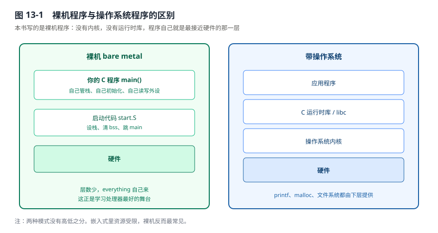
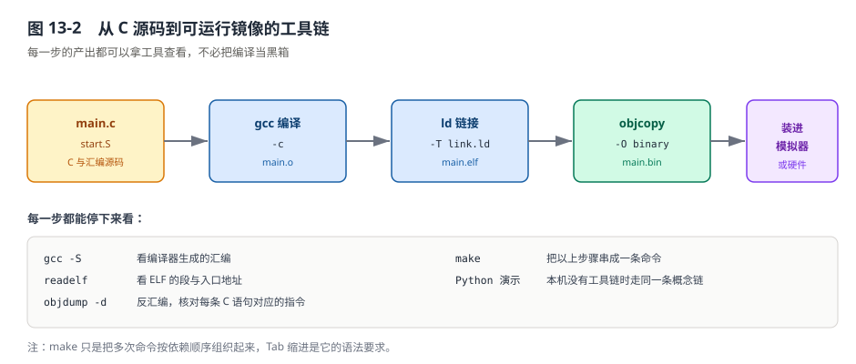
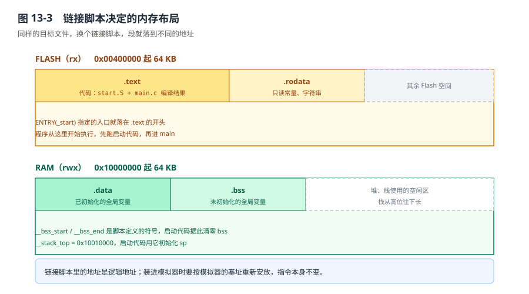
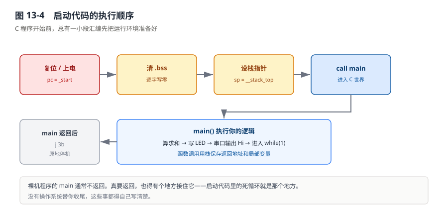
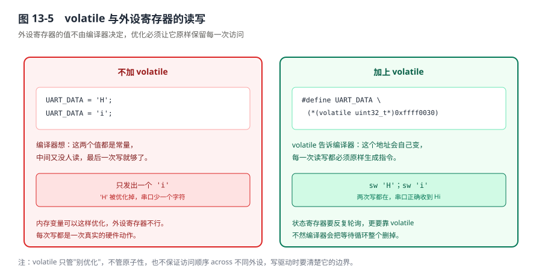
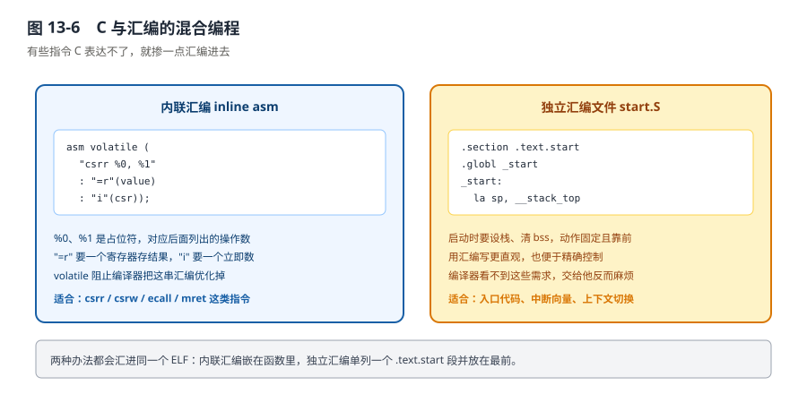

# 第 13 章　基于 C 的嵌入式系统编程

## 本章导读

前面十二章，软件侧写到 Python 模拟器，硬件侧搭到带异常和外设的单周期核。现在把这些线头收到一起：用 C 写一个真正的裸机程序，让它点亮一盏灯、从串口吐出两个字符。这是全书从"看懂处理器"走向"给处理器写程序"的最后一步。

写 C 程序不难，难的是弄明白从一行 C 到硬件动作之间发生了什么。编译器把 C 变成汇编，链接器把汇编变成带地址的 ELF，链接脚本决定每段代码放在哪里，启动代码把运行环境准备好，最后程序才跑起来。这一章就把这条链上的每一环拆开看一遍。

本书写作时用的机器没有安装 RISC-V GCC 和 QEMU，所以这一章给出两套东西。一套是完整的裸机 C 工程和 QEMU 示例，在装好工具链的机器上照着 Makefile 就能编译运行；另一套是本机的 Python 工具链演示，把编译、链接、生成镜像、运行的每一步都用看得见的代码重演一遍。两件事讲的是同一套道理，后者保证你在任何机器上都能把概念走通。

学完这一章，你应该能回答：裸机程序和操作系统程序有什么不一样；交叉编译器为什么叫"交叉"；链接脚本怎样决定代码和数据的地址；启动代码在 main 之前做了什么；volatile 为什么在外设驱动里少不了；C 里怎么嵌入几条汇编指令。

## 13.1　没有操作系统的程序

平时在电脑上写 C，程序能调用 `printf` 打印、用 `malloc` 申请内存、读写文件。这些能力不是 C 语言自带的，是操作系统和运行时库提供的。程序一启动，操作系统已经把内存、文件、屏幕都安排好了，main 只管做自己的事。

裸机程序没有这些靠山。处理器上电后从某个固定地址开始取指，此时内存是空的，栈指针没有值，全局变量还没准备好，更没有谁替你处理打印和内存分配。程序自己是运行在硬件上的第一层软件，环境要靠自己搭起来。图 13-1 把两种情形放在一起比较。



*图 13-1　裸机程序与操作系统程序的区别*

这不是说裸机更低级。嵌入式设备往往只有几十 KB 内存，跑不起操作系统，裸机反而最常见，也最直接。对我们来说更是如此：想看清一条 C 语句到底变成什么，就得把它放在没有遮挡的环境里。少一层抽象，就少一层猜测。

裸机程序要自己操心三件事。一是栈指针，函数调用要用栈保存返回地址和局部变量。二是未初始化的全局变量，也就是 `.bss` 段，要在 main 之前清零。三是入口，得告诉链接器程序从哪里开始执行。这三件事都由一小段汇编写成，叫**启动代码**。

## 13.2　从 C 到镜像的完整链条

先看清全局，再逐个击破。图 13-2 画的是一条典型的工具链。



*图 13-2　从 C 源码到可运行镜像的工具链*

`main.c` 和 `start.S` 交给交叉编译器，编译成目标文件 `main.o`。链接器读链接脚本 `link.ld`，把目标文件里的各个段安放到指定地址，产出 ELF 文件 `main.elf`。`objcopy` 从 ELF 里抽出纯机器码，得到 `main.bin`，这个镜像才能装进模拟器或烧进硬件。

链条上的每一步都能停下来查看，这正是学习的好机会。`gcc -S` 让你看编译器生成的汇编，`readelf` 让你看 ELF 的段和入口，`objdump -d` 把机器码反汇编回来。把这三样对着 C 源码看，编译就不再是黑箱。

`make` 只是把这些命令按依赖关系串起来。它看文件的时间戳：源码改了才重新编译，没改就跳过。Makefile 里命令必须用 Tab 缩进，这是它最容易被新手踩到的规矩。

## 13.3　交叉编译器

在一台 x86 电脑上，生成能在 RISC-V 处理器上运行的机器码，这件事叫**交叉编译**。生成代码的编译器叫交叉编译器，名字里的"交叉"就是指主机和目标机不是同一种架构。

本书用 `riscv32-unknown-elf-` 这一套工具。名字可以拆成三段：`riscv32` 是目标架构，`unknown` 是厂商字段，`elf` 表示输出 ELF 格式。Makefile 开头把工具前缀集中定义。

```makefile
CROSS   = riscv32-unknown-elf-
CC      = $(CROSS)gcc
OBJDUMP = $(CROSS)objdump
OBJCOPY = $(CROSS)objcopy
```

把前缀抽成一个变量，换工具链时只改一行。比如机器上装的是 `riscv64-unknown-elf-`，改 `CROSS` 就够了，下面的规则一个字不用动。

编译选项写在 `CFLAGS` 里，每一个都有讲究。

```makefile
CFLAGS = -march=rv32i -mabi=ilp32 -nostdlib -O1 -g -Wall -T link.ld
```

`-march=rv32i` 限定只生成基本整数指令。我们搭的硬件只会这些指令，编译器要是自作主张生成一条乘法或压缩指令，硬件就译不了。`-mabi=ilp32` 约定整数和指针都是 32 位。`-nostdlib` 告诉链接器不要链接标准库——裸机上没有 libc，也没有启动文件，一切都得自己来。`-O1` 开轻度优化，`-g` 保留调试信息，`-Wall` 打开常用警告。最后的 `-T link.ld` 指定链接脚本。

这里有个容易困惑的地方：既然 `-nostdlib`，为什么 C 里还能用 `uint32_t` 这样的类型？因为 `stdint.h` 只是头文件，里的类型定义是编译器自带的，不需要链接任何库。缺的是 `printf`、`malloc` 这些函数的实现。

## 13.4　链接脚本决定地址

编译得到的每个目标文件里，代码和数据是分段的：`.text` 放指令，`.rodata` 放只读常量，`.data` 放已初始化的全局变量，`.bss` 放未初始化的全局变量。这些段在目标文件里还没有确定的地址，链接器的工作就是给它们安排地址。安排的规则写在链接脚本里。

先声明两块内存。

```ld
MEMORY
{
    FLASH (rx)  : ORIGIN = 0x00400000, LENGTH = 64K
    RAM   (rwx) : ORIGIN = 0x10000000, LENGTH = 64K
}
```

`FLASH` 只读可执行，起点 `0x00400000`，正好是第 8 章单周期核的复位入口。`RAM` 可读写可执行，起点 `0x10000000`，和本书的数据内存一致。括号里的 `rx`、`rwx` 是属性标记，链接器据此检查有没有把代码塞进只读区之类的问题。

接着把段分配进去。

```ld
    .text :
    {
        *(.text.start)
        *(.text*)
    } > FLASH
```

`*(.text.start)` 先放启动代码的段，`*(.text*)` 再放其余代码。顺序要紧：启动代码必须排在最前面，因为处理器复位后从 `.text` 的开头取指。`> FLASH` 表示这个段放进 FLASH 区。

`.bss` 段的写法稍微特别。

```ld
    .bss (NOLOAD) :
    {
        __bss_start = .;
        *(.bss*)
        __bss_end = .;
    } > RAM
```

`(NOLOAD)` 告诉链接器，这个段在镜像文件里不占空间——未初始化的变量本来就不用保存初值。`.` 是当前地址计数器，`__bss_start` 和 `__bss_end` 是两个由脚本定义的符号，分别记录 bss 的起止地址。启动代码会用到它们。

最后定义栈顶。

```ld
    __stack_top = ORIGIN(RAM) + LENGTH(RAM);
```

栈从内存顶端往下长，所以栈顶设在 RAM 的末尾。这是个只存在于链接阶段的符号，不占任何存储空间，启动代码用 `la` 就能把它的值装进栈指针。

完整的布局画在图 13-3。



*图 13-3　链接脚本决定的内存布局*

链接脚本里的地址是逻辑地址。第 7 章的 Python 模拟器从 `0x80000000` 开始放程序，和这里的 `0x00400000` 不同。装进模拟器时要把镜像搬到模拟器的基址，指令本身不用改——这正是相对跳转的好处，代码不依赖自己被放在哪里。

## 13.5　启动代码在 main 之前做什么

入口点由链接脚本指定。

```ld
ENTRY(_start)
```

`_start` 是启动代码的标签。处理器复位后跳到这里，此时还没进 C 世界。启动代码写在 `start.S` 里，第一件事是清 bss。

```asm
    .section .text.start
    .globl  _start
_start:
    /* 清 .bss：从 __bss_start 到 __bss_end 逐字写零 */
    la      t0, __bss_start
    la      t1, __bss_end
1:
    bge     t0, t1, 2f
    sw      zero, 0(t0)
    addi    t0, t0, 4
    j       1b
2:
```

这段是个循环。`la` 把链接脚本定义的两个符号地址装进 `t0` 和 `t1`。只要 `t0` 还没到 `t1`，就往 `t0` 指向的地方写一个零，再把 `t0` 加四。数字标签 `1:`、`2:` 是汇编的局部标号，`1b` 表示向后找最近的 `1`，`2f` 表示向前找最近的 `2`。同一个源文件里可以有很多个 `1:`，靠方向区分，写小段循环很方便。

为什么必须清零？C 语言规定未初始化的全局变量初值为零。这个规定不是编译器在运行时保证的，硬件上电后那片内存里是随机的。不清零，一个没赋初值的计数器可能从 314159 开始数。

第二件事是设栈，然后调用 main。

```asm
    /* 设栈指针，然后调用 C 的 main */
    la      sp, __stack_top
    call    main
3:
    /* main 若返回，停在这里 */
    j       3b
```

`la sp, __stack_top` 把栈顶地址装进栈指针。这一步必须在调用 main 之前，因为函数调用一进来就要用栈保存返回地址。`call` 是伪指令，汇编器会把它展开成 `auipc` 加 `jalr`，能够跳到任意 32 位地址。

main 通常不该返回。但 C 编译器不知道这一点，它照样会生成返回指令。万一 main 真返回了，控制流落到 `3:` 的死循环，处理器停在那里，不会跑到未知的内存里去乱执行。整个过程见图 13-4。



*图 13-4　启动代码的执行顺序*

启动代码通常用汇编写，不用 C。原因很实在：设栈指针、清零 bss 这些动作，C 编译器看不到需求，也没法保证生成的第一条指令是什么。交给汇编写，顺序和指令都控制在自己手里。

## 13.6　用 C 访问外设

现在写 C 程序。目标是用第 12 章的外设：把求和结果写到 LED，从串口输出 `Hi`。

先解决地址怎么表示。外设是内存映射的，一个寄存器就是一个地址，用指针访问最自然。头文件里集中定义这些指针。

```c
/*
 * 本书第 12 章定义的外设地址。每个寄存器都用一个指针常量表示，
 * volatile 告诉编译器"这个地址的内容会自己变化，别优化掉读写"。
 */
#define MTIME_LO   (*(volatile uint32_t *)0xffff0000u)
#define LED        (*(volatile uint32_t *)0xffff0010u)
#define SWITCH     (*(volatile uint32_t *)0xffff0020u)
#define UART_DATA  (*(volatile uint32_t *)0xffff0030u)
#define UART_STAT  (*(volatile uint32_t *)0xffff0034u)
```

`(*(volatile uint32_t *)0xffff0010u)` 这句可以拆开读：`0xffff0010u` 是个地址，转成指向 `uint32_t` 的指针，再解引用，就得到这个地址上的一个 32 位对象。给它赋值相当于写这个寄存器，读它就相当于读寄存器。`volatile` 是关键，稍后细说。

串口发送要先看状态。16550 风格的状态寄存器里，bit 5 是 THRE，表示发送保持寄存器空，只有它置位才能写下一个字节。

```c
#define UART_DR    0x01u   /* 接收数据就绪 */
#define UART_THRE  0x20u   /* 发送保持寄存器空 */
```

这两个位是第 7 章 UART 模型里用过的，第 12 章的硬件也照此实现。

发送一个字符的函数就这么写。

```c
/* 轮询状态位，直到发送保持寄存器变空 */
void uart_putc(char c)
{
    while ((UART_STAT & UART_THRE) == 0) {
        /* 等待 */
    }
    UART_DATA = (unsigned char)c;
}
```

循环里什么也不做，只是反复读状态寄存器。处理器比串口快得多，这个等待是必要的。没有它，两个字符会被接连写进发送寄存器，前一个还没发出去就被覆盖。

主程序调用它，再加点计算。

```c
int main(void)
{
    int s = sum_to(10);       /* 1+2+...+10 = 55 */
    LED = (uint32_t)s;        /* 低 8 位点亮，0x37 */
    uart_putc('H');
    uart_putc('i');
    while (1) {
        /* 停机 */
    }
    return 0;
}
```

求和函数本身很普通。

```c
/* 一个会被编译器翻译成循环和加法的小函数 */
int sum_to(int n)
{
    int s = 0;
    for (int i = 1; i <= n; ++i) {
        s += i;
    }
    return s;
}
```

值得留意的是它的参数传递。按 RISC-V 调用约定，第一个整数参数放 `a0`，返回值也放 `a0`。编译器会照这个约定生成代码，稍后在反汇编里能验证。

### volatile 为什么不能省

假设把 `UART_DATA` 定义成普通的 `uint32_t *`。编译器看到连续两次赋值，中间没有读，就会想:既然都是写同一个地址，前一个值又没人用，那就只保留最后一次写。于是 `'H'` 被优化掉，串口只收到 `'i'`。对普通内存变量，这个优化完全正确；对外设寄存器，它改变了硬件行为。

状态寄存器的轮询更危险。编译器如果发现循环体里没有改变状态地址的写，可能判定条件永远不变，把整个等待循环优化掉。图 13-5 对比了加与不加 `volatile` 的差别。



*图 13-5　volatile 与外设寄存器的读写*

`volatile` 的含义是"这个对象可能被程序之外的因素改变，每次访问都要真的执行"。它保证每次读写都生成对应的访存指令，编译器不会合并、不会删掉、不会缓存到寄存器里。写驱动时，所有外设寄存器都该加它。

要说清楚它的边界。`volatile` 只管"别优化"，不管原子性，也不负责不同外设之间的访问顺序。真要做多核同步或内存映射设备的严格排序，还得用别的手段。本书的单核简化模型里，`volatile` 够用了。

## 13.7　C 与汇编混合

有两件事 C 语言做不了：读 CSR，执行 `ecall`。这些是特权指令，C 里没有对应的语法。办法是用内联汇编，直接在 C 函数里嵌几条汇编。

先看现成的写法。

```c
/*
 * CSR 读写和 ecall 没有对应的 C 语句，只能用内联汇编。
 * "i"(csr) 要求把 CSR 编号当汇编立即数，"=r" 要求分配一个寄存器接结果。
 */
#define read_csr(csr)                                                       \
    ({ uint32_t value;                                                      \
       __asm__ __volatile__("csrr %0, %1" : "=r"(value) : "i"(csr));        \
       value; })
```

`__asm__ __volatile__` 里那串字符串是汇编模板，`%0`、`%1` 是占位符。冒号后面分三段：输出操作数、输入操作数、会被破坏的寄存器列表。这里 `"=r"(value)` 是输出，等号表示要写，字母 `r` 表示随便分配一个通用寄存器；`"i"(csr)` 是输入，字母 `i` 表示它是个汇编立即数。编译器把 `%0` 换成它给 `value` 分配的寄存器，把 `%1` 换成 CSR 编号。

`__volatile__` 的作用和 C 里的 `volatile` 类似，阻止编译器把这串汇编当成可以重排或删除的东西。`ecall` 的封装更简单，没有操作数。

```c
static inline void ecall(void)
{
    __asm__ __volatile__("ecall");
}
```

写 CSR 用另一个宏。

```c
#define write_csr(csr, val)                                                 \
    __asm__ __volatile__("csrw %0, %1" :: "i"(csr), "r"(val))
```

两个冒号挨在一起，中间的输出段空着，表示这条汇编没有输出。输入段有两个：`csr` 当立即数，`val` 当寄存器里的值。

什么时候用内联汇编，什么时候用独立的 `.S` 文件？经验是这样：一条或几条指令嵌在函数中间，用内联汇编；整段逻辑相对独立、要求精确控制位置和顺序，比如启动代码和中断向量，用独立汇编文件。图 13-6 把两种办法放在一起。



*图 13-6　C 与汇编的混合编程*

内联汇编有个陷阱常被忽略：编译器不知道你写的汇编改了哪些寄存器，除非你在破坏列表里声明。本书只在启动和 CSR 访问这类简单场合用它，没有复杂的寄存器依赖，暂且绕开了这个问题。真正写底层驱动时，这一课迟早要补。

## 13.8　本机就能走通的工具链演示

真机上的流程清楚了。没有工具链的机器上，怎么把这条链走一遍？答案是用 Python 把每一步演出来。代码在 `code/python/13_toolchain/`，它复用第 7 章的模拟器，把编译器输出的汇编当作输入。

### 先把汇编变成机器码

第一章写过按字段拼指令的小函数，这里直接复用 `encode.py`。汇编器 `assemble.py` 做两遍扫描。第一遍收集标签和常量，算出每条指令的地址。

```python
def assemble(source):
    """两遍汇编，返回 (words, labels)。labels 的值是相对偏移（字节）。"""
    lines = clean(source)
    labels, constants = {}, {}
    pc = 0

    # 第一遍：收集标签与常量，算出每条指令的地址
    for _, line in lines:
        while ":" in line:
            name, line = line.split(":", 1)
            labels[name.strip()] = pc
            line = line.strip()
            if not line:
                break
        if not line:
            continue
        op = line.split()[0].lower()
        if op == ".equ":
            parts = line.replace(",", " ").split()
            constants[parts[1]] = number(parts[2])
            continue
        if op == ".word":
            pc += 4
            continue
        pc += 4 * len(expand(line))
```

为什么必须两遍？因为跳转指令要用到标签的地址，而标签可能写在后面。第一遍把标签都记下来，第二遍遇到 `jal ra, sum_to` 时才能算出该跳多远。这是汇编器的基本套路。

第二遍逐条生成机器码。

```python
    # 第二遍：生成机器码
    words = []
    pc = 0
    for lineno, line in lines:
        while ":" in line:
            _, line = line.split(":", 1)
            line = line.strip()
            if not line:
                break
        if not line:
            continue
        op = line.split()[0].lower()
        if op == ".equ":
            continue
        if op == ".word":
            words.append(number(line.split()[1]) & 0xFFFFFFFF)
            pc += 4
            continue
        for real_op, args in expand(line):
            words.append(encode_one(real_op, args, pc, labels, constants)
                         & 0xFFFFFFFF)
            pc += 4
    return words, labels
```

`expand` 处理伪指令。`li`、`nop`、`j`、`call`、`ret` 这些写法并非机器指令，汇编器要把它们展开成真实的 RV32I 指令。

```python
def expand(line):
    """把伪指令展开成一条或两条真实指令，返回助记符列表。"""
    parts = line.replace(",", " ").split()
    op = parts[0].lower()
    args = parts[1:]

    if op == "nop":
        return [("addi", ["zero", "zero", "0"])]
    if op == "mv":
        return [("addi", [args[0], args[1], "0"])]
    if op == "li":
        imm = number(args[1])
        if -2048 <= imm <= 2047:
            return [("addi", [args[0], "zero", str(imm)])]
        return [("lui", [args[0], str((imm + 0x800) >> 12)]),
                ("addi", [args[0], args[0], str(imm & 0xFFF)])]
    if op == "j":
        return [("jal", ["zero", args[0]])]
    if op == "call":
        return [("jal", ["ra", args[0]])]
    if op == "ret":
        return [("jalr", ["zero", "ra", "0"])]
    if op == "ble":
        return [("bge", [args[1], args[0], args[2]])]
    if op == "bgt":
        return [("blt", [args[1], args[0], args[2]])]
    return [(op, args)]
```

`li` 是个好例子。立即数装得进 12 位，一条 `addi` 就够；装不进，就拆成 `lui` 加 `addi` 两条。第 11 章踩过 `addi` 装不下 2048 的坑，这里正好看见汇编器是怎么替我们处理的。

### 编译器输出长什么样

`program.s` 是 `main.c` 的等价物。真机上它由 GCC 生成，这里手写出来，方便对照。先看主程序部分。

```asm
        lui     sp, 0x8000f             # 栈指针 = 0x8000f000，指向主存顶部
        addi    a0, zero, 10            # 调用 sum_to(10)
        jal     ra, sum_to
        add     s0, a0, zero            # s = 返回值 55

        lui     a1, 0xffff0             # a1 = 0xffff0000，外设基址
        sw      s0, 0x10(a1)            # LED = 55
        addi    t2, zero, 72            # 'H' = 0x48
        sw      t2, 0x30(a1)            # UART_DATA = 'H'
        addi    t2, zero, 105           # 'i' = 0x69
        sw      t2, 0x30(a1)            # UART_DATA = 'i'

stop:   jal     zero, stop              # 停机自环
```

对照 C 源码看：`sum_to(10)` 变成把 10 放进 `a0` 再 `jal`；`LED = s` 变成一条 `sw`；两个 `uart_putc` 因为状态寄存器恒为可发送，被简化成两次写数据寄存器。参数在 `a0`、返回值在 `a0`，和调用约定完全对上。

求和函数用栈保存现场，这是函数调用的标准动作。

```asm
# int sum_to(int n)  入口参数在 a0，返回值放 a0
sum_to:
        addi    sp, sp, -8              # 让出一个栈槽
        sw      ra, 4(sp)               # 保存返回地址
        sw      s0, 0(sp)               # 保存 s0
        addi    s0, zero, 0             # s = 0
        addi    t0, zero, 1             # i = 1
        addi    t1, zero, 10            # 上界 10
loop:   blt     t1, t0, done            # 若 i > 10 则退出
        add     s0, s0, t0              # s += i
        addi    t0, t0, 1               # i++
        jal     zero, loop
done:   add     a0, s0, zero            # 返回值 = s
        lw      s0, 0(sp)               # 恢复现场
        lw      ra, 4(sp)
        addi    sp, sp, 8
        jalr    zero, ra, 0             # 返回 main
```

`s0` 是被调用者保存寄存器，函数用了它就得先存后恢复，否则调用者手里的值会被破坏。`ra` 是返回地址，也必须保存，因为函数里还有 `jal` 跳转，会覆盖 `ra`。这两条规矩合起来，就是 RISC-V 调用约定的核心。

### 生成镜像并运行

`build_image.py` 把上面几步串起来。它先汇编，报告段布局。

```python
def report_sections(words, labels):
    text_size = 4 * len(words)
    print("ELF 段布局（逻辑地址，来自 link.ld）")
    print("  段        起始地址      大小     属性")
    print("  .text     0x%08x  %5d B   rx" % (FLASH_ORIGIN, text_size))
    print("  .rodata   0x%08x  %5d B   r" % (FLASH_ORIGIN + text_size, 0))
    print("  .data     0x%08x  %5d B   rwx" % (RAM_ORIGIN, 0))
    print("  .bss      0x%08x  %5d B   rwx" % (RAM_ORIGIN, 0))
    print("  栈底      0x%08x" % STACK_TOP)
    print("入口 _start（本演示的 main）: 0x%08x" % FLASH_ORIGIN)
    print("符号表: " + ", ".join("%s=0x%x" % (k, v)
                              for k, v in sorted(labels.items())))
    print()
```

这段对应真机上 `readelf` 做的事：告诉你每个段放在哪里、多大。逻辑地址来自链接脚本，符号表来自汇编器收集到的标签。

装进模拟器时要重定位。

```python
def load_image(bus, words):
    """把逻辑地址 0x00400000 的镜像搬到模拟器基址 BASE。"""
    for i, word in enumerate(words):
        bus.store32(BASE + 4 * i, word)
```

真机上镜像烧进 `0x00400000`，模拟器里搬到 `0x80000000`。指令里的跳转都是相对偏移，搬一下照样能跑。

运行部分就是第 7 章的老套路：取指、译码、执行、打印变化的寄存器。

```python
def run_image(words, trace=True, max_steps=500):
    bus = DemoBus()
    load_image(bus, words)
    cpu = CPU(bus, entry=BASE)
    steps = 0
    while steps < max_steps:
        pc = cpu.get_pc()
        word = cpu.fetch()
        before = list(cpu.regs)
        running = execute(cpu, decode(word), bus)
        steps += 1
        if trace:
            changed = ["x%d=0x%08x" % (i, cpu.regs[i])
                       for i in range(1, 32) if before[i] != cpu.regs[i]]
            print("pc=0x%08x  %-22s %s"
                  % (pc, disasm(word), " ".join(changed)))
        if not running:
            break
    return cpu, bus, steps
```

`DemoBus` 把第 12 章的外设地址接进模拟器，往 `0xffff0030` 写字节会记进 `uart_tx`，往 `0xffff0010` 写会更新 `led`。于是程序跑完后，我们能像看硬件寄存器一样检查这两个值。

### 跑一遍看结果

在本机执行：

```
cd code/python/13_toolchain
python build_image.py
python test_toolchain.py
```

第一段输出先报告段布局，再逐条打印反汇编和寄存器变化，最后给出三样检查结果。

```
执行 500 步后:
  sum_to(10) -> x10(a0) = 55
  LED        = 0x37
  UART 输出  = 'Hi'
结果: PASS
```

求和得到 55，LED 是 `0x37`（正是 55），串口收到 `Hi`。程序末尾是停机自环，所以会一直跑到步数上限，这是预期行为。自检脚本把这条也查了一遍：PC 应当停在 `stop` 那条指令上。

自检脚本 `test_toolchain.py` 还查了别的东西：编码函数算得对不对，伪指令展开对不对，标签地址对不对，以及整条链跑下来的结果对不对。12 项检查全部通过。

```
PASS 求和结果 55
PASS LED = 0x37
PASS 串口输出 Hi
PASS PC 停在停机自环

ALL TOOLCHAIN TESTS PASSED
```

这套演示没有用真正的 GCC，`program.s` 是手写的。它演示的是工具链每一步的作用和数据流：汇编怎么变成机器码，链接怎么决定地址，镜像怎么装进内存，程序怎么跑起来。理解了这些，再看真机上的 `gcc`、`ld`、`objdump`，就知道它们各自在替你做哪件事。

## 13.9　在 QEMU 里跑

QEMU 能在一台电脑上模拟 RISC-V 机器。本书用它做软件侧的系统演示，不拿它替代我们自己搭的处理器。

QEMU 的 `virt` 机器串口在 `0x10000000`，和本书的 `0xffff0030` 不同。所以另做了一个最小示例 `code/qemu/hello/`，只做一件事：打印一行字。

```c
#include <stdint.h>

/* QEMU virt 机器的 16550 UART 数据寄存器 */
#define UART0 ((volatile uint32_t *)0x10000000u)

void main(void)
{
    const char *s = "Hello from RISC-V\n";
    while (*s) {
        *UART0 = (uint32_t)(unsigned char)*s;
        s++;
    }
    for (;;) {
    }
}
```

链接脚本把程序放在 `0x80000000`，这是 QEMU virt 机器的内存起点。

```ld
SECTIONS
{
    . = 0x80000000;
    .text :
    {
        *(.text*)
    }
```

编译运行就两条命令。

```
make
make run
```

终端应当打印 `Hello from RISC-V`。程序最后进死循环，QEMU 不会自己退出，按 `Ctrl+A` 再按 `X` 退出。

本机没有装 QEMU 和交叉编译器，这组脚本未在机器上实跑。正文给出的是标准用法和预期现象，在装好工具的机器上照做即可。核心实验用 Python 演示或第 12 章的 Verilog 仿真就能在本机完成，不依赖这些工具。

## 13.10　重点与权衡

这一章的东西头绪多，理一理哪些是要害。

**工具链是一串确定的变换。** C 变汇编，汇编变目标文件，链接变 ELF，抽镜像，装内存。每一步的产出都能用工具查看。把黑箱拆开，概念就落地了。

**地址是链接器安排的。** 同一个目标文件，换个链接脚本就落到不同地址。入口点、段顺序、栈顶都由脚本决定。理解这一点，才明白为什么裸机程序要操心根本不存在于PC程序里的地址问题。

**启动代码补上 C 不管的事。** 栈指针、bss 清零、入口，这些必须在 main 之前准备好。C 编译器帮不上忙，只能用汇编写。

**volatile 划出编译优化的边界。** 外设寄存器会被硬件改变，每次访问都得真实执行。省掉它，程序在仿真里可能还"看起来对"，到真机上就出错。

**内联汇编点到为止。** C 表达不了的特权指令用它补。操作数约束和破坏列表是它的难点，本书用到的场合都很简单，复杂的驱动开发需要另做功课。

也要说清取舍。手写汇编的演示可读性强，但不等于真实的编译器输出；真实的 GCC 会做大量优化，生成的指令序列比这里的示范复杂得多。QEMU 示例用虚拟串口，避开了本书自己的外设地址，换来的是一套能在普通电脑上跑的对照环境。两条路各有各的用途，不要混淆。

## 13.11　实验

**实验一　走通本机工具链**
进入 `code/python/13_toolchain/`，先跑 `python test_toolchain.py` 看 12 项检查，再跑 `python build_image.py` 看完整的段布局和逐条反汇编。把反汇编的每一行和 `program.s` 对上，确认自己看得懂。

**实验二　改程序重跑**
把 `program.s` 里的求和上界从 10 改成 100，把 `sum_to` 上界的 `addi t1, zero, 10` 改成 100。重跑，看求和结果和 LED 值变了没有。注意 LED 只显示低 8 位。

**实验三　观察调用约定**
在 `program.s` 的 `sum_to` 里再加用一个被保存寄存器（如 `s1`），练习保存和恢复。忘了会怎样？改完把 `s1` 加进保存列表前后各跑一次，对比 `main` 里 `s1` 的值。

**实验四　看懂 volatile**
在 `code/c/13_baremetal/main.c` 里，试着把 `rv32i.h` 中 `UART_DATA` 的 `volatile` 去掉。有工具链的话，对比 `-O0` 和 `-O2` 下的反汇编，看两次写串口有没有被合并成一次。

**实验五　改链接脚本**
把 `code/c/13_baremetal/link.ld` 里的 FLASH 起点改成另一个地址，重新编译，用 `readelf -S` 看段的地址怎么跟着变。体会"地址是链接器安排的"这句话。

**实验六　QEMU 对照**
在装好工具的机器上跑 `code/qemu/hello/`，确认输出。把字符串改长、改短，看串口输出的变化。这是全书唯一一次真正借外部工具运行程序。

## 香山一瞥（选读）

香山这样的高性能处理器，软件启动过程比本书的裸机程序长得多。上电后先由 ROM 里的固件（如 OpenSBI）跑起来，初始化时钟、内存控制器和串口，再把控制权交给上级软件。操作系统内核还要建立页表、设置中断向量、初始化调度器，才轮到第一个用户程序。

中间的软件栈越厚，一行 C 到硬件动作之间的距离就越远。但每一步的本质没变：还是编译、链接、装载，还是有人在最底层设好栈和入口。本书把这条链压缩到最短，正是为了让你看清那些在复杂系统里被层层遮住的基本动作。有兴趣的读者可以顺着 OpenSBI 的启动代码往下读，会发现它做的许多事，和本章的 `start.S` 是同一类，只是规模大得多。

## 小结

这一章从 C 源码出发，走过工具链的每一环，最后落到硬件上。

裸机程序没有操作系统撑腰，环境自己搭。交叉编译器在 x86 上生成 RISC-V 代码，选项 `-march`、`-mabi`、`-nostdlib` 各自约束着生成结果。链接脚本把代码和数据安排到指定地址，`.text` 进 Flash，`.bss` 进 RAM，栈顶在内存末端。启动代码在 main 之前设栈、清 bss、跳入口。外设寄存器用 `volatile` 指针访问，每次读写都不能被优化掉。C 里表达不了的特权指令，用内联汇编补上。

本机演示把这条链走了一遍：汇编成机器码，报告段布局，装进模拟器运行，检查 LED 和串口输出。求和得 55，LED 是 `0x37`，串口收到 `Hi`，12 项自检全部通过。QEMU 示例给出了在装好工具的机器上复现的办法。

从指令到汇编，从模拟器到硬件，从裸机到 C 程序，这条主线到这里就完整了。最后一章是综合实验，把这些环节串成一次完整的系统运行，并用定时器中断驱动一个最小的多任务切换。

## 思考题

1. 裸机程序为什么必须在 main 之前设栈指针？如果跳过这一步，最先出问题的会是什么？
2. 交叉编译的"交叉"体现在哪里？`-march=rv32i` 和 `-mabi=ilp32` 各约束了什么？
3. 链接脚本里 `.bss` 段为什么要加 `(NOLOAD)`？`__bss_start` 和 `__bss_end` 这两个符号是谁定义的，谁使用的？
4. 汇编器为什么要用两遍扫描？如果只用一遍，哪类指令会出问题？
5. `li` 伪指令在立即数装不下 12 位时为什么要拆成 `lui` 加 `addi` 两条？直接截断会怎样？
6. 函数 `sum_to` 为什么要保存 `s0` 和 `ra`？只保存其中一个够不够？
7. 如果把 `UART_DATA` 的 `volatile` 去掉，编译器可能对串口输出做什么优化？为什么这种优化对普通内存变量没问题？
8. 内联汇编里 `%0`、`%1` 是怎么和 C 变量对应起来的？`"=r"` 和 `"i"` 两种约束有什么区别？
