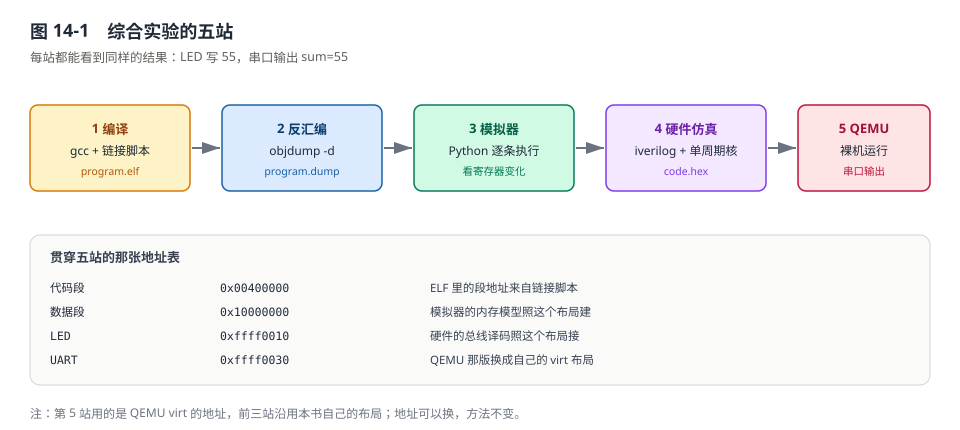
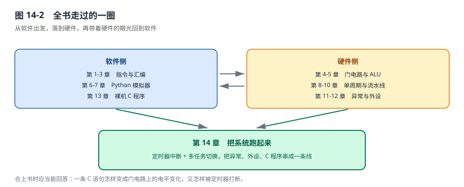
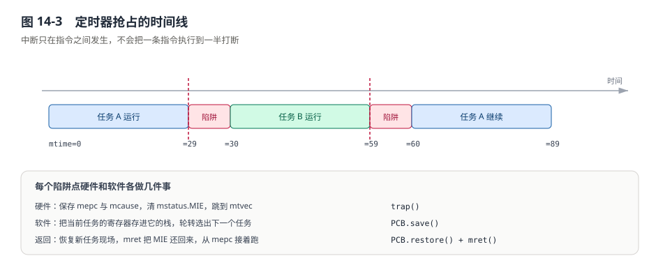
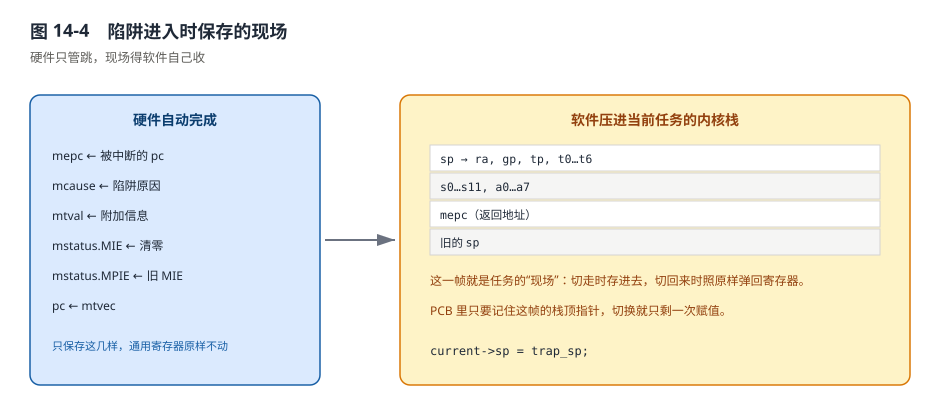
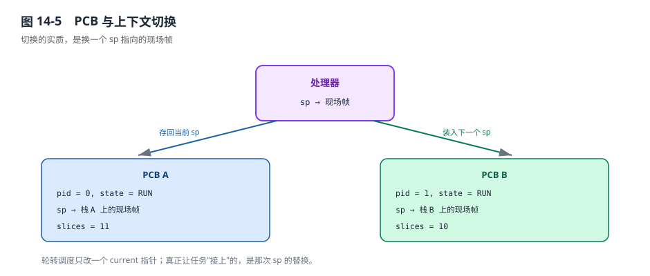
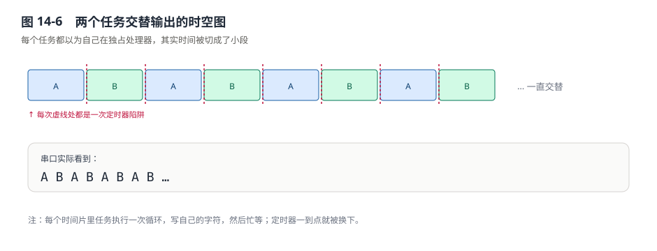

# 第 14 章　把系统跑起来

## 本章导读

这是全书最后一章，做两件事。

第一件是把前面十几章的东西接成一条完整的流水线。从第 3 章的一段汇编、第 13 章的一段 C 程序出发，经过编译、反汇编、镜像制作，交给第 8 章的单周期核执行，再放到 QEMU 里跑一遍。走完这一趟，你会看清工具链每一步的产物，知道屏幕上那串字符是从哪条指令来的。

第二件是用定时器中断驱动一个最小的多任务系统。两个任务各自循环输出字符，定时器到点把处理器抢走，调度器保存现场、换上另一个任务。异常、CSR、外设、C 程序在这里第一次一起工作。这也是全书最后一幅图景：处理器不再是一条直线跑到底的程序，而是在多个任务之间来回切换的小系统。

本章的代码分两套。一套在本机的 Python 模拟器里，能逐拍看到陷阱和切换的全过程，27 项自检全部通过；另一套是面向 QEMU 的真实裸机 C 工程，需要交叉编译器和 QEMU 才能运行。本机没有装这两样工具，C 工程的代码经过仔细推敲但没有实机跑过，正文会如实说明。先用 Python 版建立直觉，再看 C 版是怎样把同一套机制落到真实硬件上的。

## 一段 C 程序的最后一公里

第 13 章已经能把 C 编译成 ELF，也能用 Python 工具链把汇编变成镜像。但那是分开讲解的。现在把它们接起来，回答一个朴素的问题：

一段求和并点灯的 C 程序，从 `program.c` 到处理器里那盏亮起来的灯，中间到底经过了什么？



*图 14-1　综合实验的五站*

五站分别是编译、反汇编、模拟器验证、硬件仿真、QEMU 运行。它们用的是同一张地址表：代码从 `0x00400000` 开始，数据在 `0x10000000`，LED 在 `0xffff0010`，串口在 `0xffff0030`。这张表第 8 章的核、第 12 章的总线、第 13 章的链接脚本都见过，这里只是把它们放进同一个 `Makefile`。

程序本身很简短。`code/c/14_integration/program.c` 求 1 到 10 的和，把结果 55 写进 LED，再从串口打出 `sum=55`。

```c
void main(void)
{
    uint32_t s = sum_to(10);   /* 55 */
    *LED = s;

    const char *msg = "sum=55\n";
    while (*msg) {
        *UART = (uint32_t)(unsigned char)*msg++;
    }
    for (;;) {
    }
}
```

链接脚本管两件事：代码段放在哪，入口在哪。`program.ld` 里有一行值得留意。

```
    .text : {
        *(.text.start)
        *(.text*)
        *(.rodata*)             /* 字符串常量跟着指令一起进镜像 */
    }
```

`"sum=55\n"` 这样的字符串常量属于 `.rodata` 段。如果只抽 `.text`，这些字符会被漏掉，串口什么都打不出来。把它并进 `.text`，`objcopy` 才能连带取走。这类问题不读反汇编是很难想到的，而反汇编正是下一站。

`Makefile` 把整条链串起来。

```makefile
program.bin: program.elf
	$(OBJCOPY) -O binary -j .text program.elf $@

# 把二进制镜像转成 Icarus Verilog 能读的 code.hex（每行一个 32 位字）
code.hex: program.bin
	$(PYTHON) ../../../tools/bin_to_hex.py program.bin code.hex
```

`bin_to_hex.py` 做的事很直白：每四个字节按小端合成一个 32 位数，写成一行十六进制。第 8 章的 `imem.v` 用 `$readmemh` 读它，第一行就是 `0x00400000` 处的那条指令。

```python
    words = []
    for i in range(0, len(data), 4):
        word = (data[i] | (data[i + 1] << 8)
                | (data[i + 2] << 16) | (data[i + 3] << 24))
        words.append("%08x" % word)
```

本机没有 RISC-V GCC，这一站的 `make` 留在装好工具链的机器上跑。不过从汇编到镜像再到运行的部分，第 13 章的 Python 工具链已经逐条验证过，那里能看到每一步的产出。方法是一样的，只是这次换成真的编译器。

## 从一条直线到来回切换

上面那段程序有个特点：从第一条指令到最后一条自环，处理器只干一件事。现实里的处理器很少这样。你一边听音乐一边浏览网页，看起来是几件事同时发生，其实是处理器在它们之间飞快地来回切换，快到人察觉不到。

多任务系统就是把这个"来回切换"做成一套机制。它的核心只有三个词：

- **任务**：一段独立的执行流程，有自己的寄存器和栈。
- **现场**：任务被切走那一刻，处理器的全部状态。存下它，才能原样恢复。
- **调度**：决定下一个该轮到谁。

最难的地方在于，任务自己并不知道被切走过。它跑着跑着，感觉上应该连续执行；实际上中间可能被打断很多次。要让这个"假装没被打断"成立，现场必须存得一丝不差。

这一章用一个最小的例子把机制讲清楚。两个任务，一个输出 `A`，一个输出 `B`，中间忙等一会儿。定时器每 30 个周期打断一次，调度器让它们轮流上场。串口上会出现 `ABABAB` 这样的交替字符。



*图 14-2　全书走过的一圈*

这幅图回望了整本书。软件侧从指令、汇编、Python 模拟器走到裸机 C 程序；硬件侧从门电路、ALU 走到单周期、流水线和异常外设。第 14 章让两条线在中间交汇。

## 定时器怎样按响闹钟

要让操作系统重新拿回处理器的控制权，得有一个不受任务控制的事件源。定时器最合适。它按固定的节奏滴答，到点就提出中断，任务再怎么忙也躲不过。

本书第 12 章的外设里已经有定时器：一个 64 位计数器 `mtime` 每个时钟加一，另一个寄存器 `mtimecmp` 存放比较值，两者相等时提出中断。Python 版把它简化成低 32 位，逻辑原样保留。

```python
    def tick(self):
        """每执行一条指令前进一个周期，返回是否产生了新的定时器中断。"""
        self.mtime = (self.mtime + 1) & 0xFFFFFFFF
        return self.mtime == self.mtimecmp

    def timer_pending(self):
        return self.mtime >= self.mtimecmp
```

`clear_timer()` 把比较值推到未来，相当于给闹钟重新定时。中断处理完必须重设，否则比较值一直成立，会不停地进陷阱。



*图 14-3　定时器抢占的时间线*

图里要注意一件事：中断只在指令之间发生。`mtime` 走到 30 那一刻，处理器刚执行完一条指令，下一条还没开始，这时候才响应陷阱。一条指令不会被执行到一半打断。这是精确中断的基本要求，第 11 章讲异常时已经出现过。

响应中断要看三个条件。定时器到点还不够，还得中断使能打开、全局中断打开。Digital 电路 `code/digital/14_timer_interrupt.dig` 把这个判据画成两个与门，真值表只有最后一行输出 1。

## 陷阱进出时硬件和软件各管什么

处理器响应中断时，硬件自动做几件事：把当前 pc 存进 `mepc`，把原因写进 `mcause`，清掉 `mstatus.MIE` 关中断，然后把 pc 设成 `mtvec`。第 11 章的 Verilog 核就是这么做的。Python 版用一段方法模拟这些动作。

```python
    def trap(self, cause, epc):
        """进入陷阱：记下返回地址和原因，关中断，跳到 mtvec。"""
        self.csrs[MEPC] = epc & 0xFFFFFFFF
        self.csrs[MCAUSE] = cause & 0xFFFFFFFF
        status = self.csrs[MSTATUS]
        previous_ie = (status & MSTATUS_MIE) >> 3
        status = status & ~(MSTATUS_MIE | MSTATUS_MPIE | MSTATUS_MPP)
        status |= (previous_ie << 7) | (3 << 11)   # MPP=3 表示来自 M 模式
        self.csrs[MSTATUS] = status
        self.set_pc(self.csrs[MTVEC])
```

注意 `previous_ie` 那两行。进陷阱前先把当前的 `MIE` 存进 `MPIE`，再把 `MIE` 清零。这是为了返回时能恢复原来的中断状态：如果进来之前中断是开的，出去之后还得开。

对应的返回动作是 `mret`。

```python
    def mret(self):
        """从陷阱返回：恢复中断使能，回到 mepc。"""
        status = self.csrs[MSTATUS]
        previous_ie = (status & MSTATUS_MPIE) >> 7
        status = (status & ~(MSTATUS_MIE | MSTATUS_MPIE)) | (previous_ie << 3)
        status |= MSTATUS_MPIE
        self.csrs[MSTATUS] = status
        self.set_pc(self.csrs[MEPC])
```

硬件只保存 pc 和原因，通用寄存器原样不动。可任务切换需要保存全部寄存器，这一步只能由软件做。陷阱处理程序把当前任务的寄存器压进它自己的栈，形成一个完整的现场帧。



*图 14-4　陷阱进入时保存的现场*

现场帧里除了通用寄存器，还要放 `mepc` 和旧的 `sp`。前者是任务被切走的位置，后者让任务恢复后能找回自己的栈。至于 `mcause` 这类 CSR，属于全局状态，不入单个任务的现场帧。

## PCB 与上下文切换

每个任务配一张进程控制块，也就是 PCB。它要记的东西不多：一个编号、一个状态、一个指向现场帧的栈顶指针，再加一个被调度的次数，方便演示时观察。

```python
class PCB:
    """进程控制块：保住一个任务被切走那一刻的全部寄存器和返回地址。"""

    def __init__(self, name, entry, stack_top):
        self.name = name
        self.regs = [0] * 32
        self.regs[2] = stack_top       # sp
        self.pc = entry                # 下次从哪里接着跑
        self.state = 1                 # 1=可运行
        self.slices = 0                # 被调度了多少次

    def save(self, cpu, mepc):
        self.regs = cpu.regs[:]
        self.pc = mepc                 # 恢复到那条被中断的指令

    def restore(self, cpu):
        cpu.regs = self.regs[:]
        cpu.set_pc(self.pc)
        self.slices += 1
```

`save()` 把处理器的寄存器整体复制进 PCB，`restore()` 反向复制。真实硬件里这一步是几十条 `sw` 和 `lw` 指令，Python 里一次切片赋值就完成了。机制完全一样，只是省去了逐条写寄存器。



*图 14-5　PCB 与上下文切换*

调度器的核心是 `Machine` 类。它相当于中断服务程序加上一个轮转算法。定时器陷阱到来时，先保存当前任务，再用轮转法挑下一个，装进处理器。

```python
    def on_timer(self):
        """定时器陷阱：保存现场、切换任务、把比较值推到下一次。"""
        cpu = self.cpu
        mepc = cpu.read_csr(MEPC)
        self.procs[self.current].save(cpu, mepc)
        self.current = self.schedule_next()
        nxt = self.procs[self.current]
        nxt.restore(cpu)
        cpu.write_csr(MEPC, nxt.pc)
        # ISR 结尾必须 mret：它把 MPIE 恢复到 MIE，否则中断再也进不来
        cpu.mret()
        self.bus.mtimecmp = (self.bus.mtime + self.timer_period) & 0xFFFFFFFF
        self.trap_count += 1
        self.switch_log.append((self.trap_count, nxt.name, nxt.pc))
```

这里藏着本章最容易踩的坑，也是写这章时真实遇到的一次失败。代码里那句 `cpu.mret()` 一开始是没有的。结果仿真只陷阱了一次：第一次进陷阱时硬件把 `MIE` 清零，调度器只换了任务、改了 pc，却没把 `MIE` 恢复回来。从此以后所有中断都被屏蔽，两个任务里有一个从此再也没机会上场。

原因就在于 `mstatus.MIE` 是硬件维护的状态，进陷阱时它替你清了，出陷阱时就得靠 `mret` 还回来。只改 pc 不等于返回陷阱。补上这一句，陷阱次数从 1 次变成 20 次，两个任务才开始真正轮转。C 版的 `start.S` 在恢复现场后也有一条 `mret`，作用完全相同。

主循环在每条指令之后检查中断条件。

```python
        fired = self.bus.tick()
        mie = cpu.read_csr(MIE)
        status = cpu.read_csr(MSTATUS)
        pending = self.bus.timer_pending()
        if fired and pending and (mie & MTIE) and (status & MSTATUS_MIE):
            cpu.trap(CAUSE_TIMER, cpu.get_pc())
            self.on_timer()
```

四个条件缺一不可：定时器刚好到点、比较值仍然成立、定时器中断使能、全局中断使能。`tick()` 返回的本拍到点信号，加上 `timer_pending()` 的持续状态，一起构成完整的判据。

## 把两个任务跑起来

两个任务写在 `tasks.s` 里，各自的循环几乎一模一样，只是输出的字符不同。

```
task_a:
    li t0, UART
    li t1, 65
loop_a:
    sw t1, 0(t0)
    call delay_a
    j loop_a

delay_a:
    li t2, DELAY
wait_a:
    addi t2, t2, -1
    bnez t2, wait_a
    ret
```

`65` 是字符 `A` 的 ASCII 码。任务先往串口写一个字符，再调用一段忙等延时。延时里没有别的动作，纯粹消耗时间，给定时器制造切换机会。

跑 `python run.py`，能看到这样的结果：

```
任务 A 入口 0x80000000，任务 B 入口 0x80000028
执行指令数：600
串口输出（前 60 字符）：AABBABAABBABABAABBABAABBABAABB
定时器陷阱次数：20
任务切换轨迹（前 12 次）：
  # 1 -> 任务 B, 从 0x80000028 继续
  # 2 -> 任务 A, 从 0x80000020 继续
  # 3 -> 任务 B, 从 0x80000048 继续
任务 A 被调度 11 次，任务 B 被调度 10 次
```

切换轨迹里的 pc 不是 tasks.s 里的相对地址，而是加上装载基址 `0x80000000` 后的实际地址，而且落在各自循环的内部。这正说明任务是从"上次被打断的地方"接着跑，不是每次从头开始。



*图 14-6　两个任务交替输出的时空图*

`test_multitask.py` 的 27 项自检覆盖了陷阱进出口、CSR 读写、定时器判据和多任务输出。其中两条专门查中断使能：`trap` 之后 `MIE` 必须为 0，`mret` 之后必须恢复。这正是前面那个坑的回归测试。

## QEMU 里的同一套机制

Python 版帮你看清机制，QEMU 版则把同样的机制放到真实指令上。`code/qemu/multitask/` 是一个 M 模式的裸机程序，同样两个任务、同样定时器抢占、同样完整现场切换。

`start.S` 里的陷阱处理程序先把 31 个通用寄存器压栈，加上 `mepc` 和 `sp` 一共 132 字节。

```asm
trap_handler:
    /* 本工程全程在 M 模式，任务直接用内核栈，无需 sscratch 交换 */
    addi    sp, sp, -132
    sw      ra,   0(sp)
    sw      gp,   4(sp)
    sw      tp,   8(sp)
    sw      t0,  12(sp)
```

后面的 `sw` 依次把其余寄存器按固定偏移存进去，最后两行单独存 `mepc` 和 `sp`。

```asm
    csrr    t0, mepc
    sw      t0,120(sp)          /* 120: 被中断的 pc */
    sw      sp,124(sp)          /* 124: 保存的栈指针 */

    mv      a0, sp              /* 把现场指针交给 C 处理函数 */
    call    handle_trap
```

`handle_trap` 完成轮转，返回时 `a0` 里是下一个任务的栈指针。恢复现场是压栈的逆过程，最后用 `mret` 返回。

```asm
    /* handle_trap 返回后，a0 是下一个任务的内核栈（含它保存的现场） */
    mv      sp, a0
    lw      t0,120(sp)
    csrw    mepc, t0
    lw      ra,   0(sp)
    lw      gp,   4(sp)
    lw      tp,   8(sp)
    lw      t0,  12(sp)
```

同样地，后面的 `lw` 把其余寄存器依次弹回，最后两行撤销压栈并返回。

```asm
    lw      t6, 116(sp)
    addi    sp, sp, 132         /* 撤销入口处的压栈，回到任务原先的栈顶 */
    mret
```

最后那条 `mret` 和 Python 版的 `cpu.mret()` 是同一个动作。C 侧的 `handle_trap()` 做轮转，`current` 指针在两个 PCB 之间来回挪。

```c
    /* 轮转：把当前任务的保存栈记下来，换到另一个任务 */
    current->sp = (uint32_t *)(trap_sp[124 / 4]);
    current = (current == &procs[0]) ? &procs[1] : &procs[0];
    return current->sp;
```

Makefile 提供三个目标：`make` 编译，`make disasm` 生成反汇编，`make run` 在 QEMU 里运行。

```makefile
run: multitask.elf
	qemu-system-riscv32 -machine virt -nographic -monitor none -serial stdio \
		-bios none -kernel multitask.elf
```

预期串口输出 A 和 B 交替出现。本机没有装 RISC-V GCC 和 QEMU，这组命令没有实机跑过。代码按 QEMU `virt` 机器的地址布局写就，CLINT 定时器在 `0x02000000`，UART 在 `0x10000000`。README 里列了它和 Python 版一一对表的概念，可以对着看。

## 几种切换方式的选择

多任务系统里，"什么时候换人"有两种做法。

协作式切换由任务自己提出。任务干完一段活，主动调用一个让出函数，调度器趁机换人。好处是简单，切换点完全可控，不用保存全部寄存器——只需要保存被调用方负责的那几个。QEMU 工程里的 `switch_context` 就是这种轻量切换，只存 `ra` 和 `s0` 到 `s11`。坏处是任务必须自觉，一个死循环就能把整个系统卡住。

抢占式切换由定时器说了算。任务不用配合，时间一到就被换下。这就是本章 Python 版和 QEMU 陷阱路径用的方式，可靠得多，代价是现场必须存全，切进切出的开销更大。现代操作系统两者都用：平时靠抢占保证公平，任务主动等待时走协作路径省开销。

还有一层选择是保存什么。轻量切换只存被调用方保存寄存器，依赖 C 语言的调用约定，编译器会帮你在调用前把别的寄存器 spilled 到栈上。完整陷阱切换不能挑食，任何寄存器都可能正被用到，只能全部存下来。这也是为什么中断服务程序通常写成汇编，或者用编译器提供的中断属性——C 函数本身没法保证不破坏某个寄存器。

## 实验

1. 运行 `python code/python/14_multitask/run.py`，观察陷阱次数和任务切换轨迹。把 `timer_period` 从 30 改成 10 和 100，看串口字符的交替节奏怎么变。
2. 在 `machine.py` 里暂时删掉 `on_timer()` 中的 `cpu.mret()`，重跑，确认陷阱只发生一次。再补回去。这是本章最值得亲手做一遍的实验。
3. 给 `tasks.s` 加第三个任务，输出字符 `C`，在 `run.py` 里把它加进 `Machine`，观察三个任务是否公平轮转。
4. 读 `test_multitask.py`，找出哪两条测试专门防止"忘了 mret"这个回归。
5. 在装好工具的机器上编译并运行 `code/qemu/multitask/`，把串口输出和 Python 版对照。再用 `make disasm` 打开反汇编，找到 `trap_handler` 里第一条 `addi sp, sp, -132`。
6. 在 `code/c/14_integration/` 跑通完整的 `make sim`，把生成的 `code.hex` 前几行和第 8 章的 `imem.v` 对起来，确认第一行确实是 `_start` 的机器码。

## 香山一瞥（选读）

本章的小系统只有一个核、两个任务、一次一拍的切换。真实的处理器要复杂得多。香山用乱序执行和多发射，一条指令在被确认之前可能已经在流水线里跑了一段路。当定时器中断到来时，它不能像本章这样在某个干净的指令边界直接保存现场——得先把在飞的错误路径指令清空，把已经执行但还没退休的结果按精确异常的要求处理好，才能跳到处理程序。第 10 章讲流水线冒险时见过冲刷，第一本书讲重排序缓冲时见过精确异常，这两样在这里一起派上用场。

中断本身也分了好几类。香山通过 CLINT 处理定时器和软件中断，通过 PLIC 处理外部中断，还要处理特权级之间的委托：哪些中断直接交给监管模式的操作系统，哪些先落到机器模式。本章只用了机器模式下的定时器中断，把 delegation、PLIC 仲裁、中断优先级这些留给以后。原理是一样的，只是层数多了。

值得留意的是，无论硬件多复杂，本章讲的那条主线不会变：保存现场、跳到入口、处理、恢复现场、返回。多任务切换和异常处理用的是同一套机制，这也是为什么学会本章这点东西，就能看懂操作系统最核心的一小段。

## 结语

从第一章的 RV32I 指令格式，到这一章的定时器抢占，这本书走了一整圈。

一开始，指令只是一串 0 和 1，我们学会把它拆成操作码、寄存器号和立即数。后来用 Python 让它跑起来，用 Verilog 让它在门电路上跑起来。再后来给它加上流水线、异常、外设，最后用 C 写程序驱动它，让它在多个任务之间切换。回头看第 1 章那张"软件、指令集、硬件"三层图，现在每一层你都亲手碰过。

这本书故意没有往深里走。乱序执行、缓存一致性、虚拟内存、多核，这些都留在外面。把一条路走通，比把每条路都看一眼更有用。等你真的需要那些东西时，已经有一套完整的坐标系可以往上挂新东西了。

处理器并不神秘。它就是一堆按钟点干活的门电路，加上几个约定，加上一点把复杂事情藏起来的耐心。现在你至少知道那口钟是怎么敲响的。

## 小结

- 综合实验把编译、反汇编、模拟器、硬件仿真和 QEMU 接成一条链，各站共用同一张地址表。
- 链接脚本要把 `.rodata` 并进 `.text`，否则制作镜像时会丢掉字符串常量。
- 定时器按节奏提出中断，处理器只在指令边界响应，一条指令不会被打断。
- 响应中断看三个条件：定时器到点、该类中断使能、全局中断使能。
- 硬件进陷阱时自动保存 pc 和原因并清 `MIE`，通用寄存器由软件存进现场帧。
- 返回必须用 `mret` 恢复 `MIE`，只改 pc 会让后续中断全部失效。
- PCB 保存任务的寄存器和返回地址，切换的实质是换一个现场帧。
- 抢占式切换可靠但开销大，协作式切换省开销但依赖任务自觉。

## 思考题

1. 定时器中断为什么只在指令边界响应？如果允许在一条指令执行到一半时打断，会出什么问题？
2. `mstatus.MIE` 和 `mie` 寄存器里的 `MTIE` 各管什么？为什么两个都要打开才能响应定时器中断？
3. 进入陷阱时硬件已经把 pc 存进了 `mepc`，为什么还要在现场帧里再存一次？
4. 本章那个"陷阱只发生一次"的 bug，根子在哪里？如果 C 版的 `start.S` 漏掉 `mret`，症状会有什么不同？
5. `PCB.save()` 里把 `self.pc` 设成 `mepc` 而不是处理器的当前 pc，为什么？这两个值在这个时刻是什么关系？
6. 协作式的 `switch_context` 只保存 `ra` 和 `s0` 到 `s11`，凭什么认为别的寄存器不用存？这依赖哪一条约定？
7. 如果两个任务的 `timer_period` 设得非常短，短到任务一次循环都没跑完就被切走，串口输出会变成什么样？
8. 从 `program.c` 到 LED 亮起，列出中间每一步产物的文件名，并说明每一步如果出错会在哪里暴露出来。
